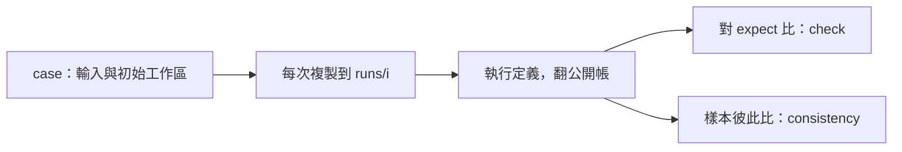

# cases — measure 共用的考題格式與比對器契約。

← [proto8](../README.md)｜量測工具 [measure](../lib/aos/measure/README.md)｜現成考題 [smoke](smoke/README.md)



同一份考題可以換不同的定義根跑；門與自洽分開報。`smoke/` 是兩題只用 `lib/base/math` 的套題。

<details>
<summary>單題格式與比對器契約</summary>

```text
case/
  run.json      {"exec": "lib/base/math", "stdin": "stdin.json"}
                或 {"agent": "templates/agent-fsm", "say": "say.txt"}
  stdin.json    函數的原始 stdin；agent 改用 say.txt
  ws/           初始工作區，可省；每次執行都複製到新的 ws/
  expect/       期望產出，路徑相對執行後的 ws/
  check.json    {"min_score": 1.0, "compare": "lib/aos/my_compare"}
```

`run.json` 的 `exec`／`agent` 相對 measure 的 `defs`；`stdin`／`say` 相對 case。`compare` 可省，省略時逐 byte 比對 expect 的檔案：分數＝相同檔數／期望檔數。沒給 `expect/` 就用第一次產出作參考；函數 stdout 原始 bytes 另存到該次工作區的 `stdout.json`，可在 `expect/stdout.json` 放固定答案。

**比對器契約**：普通 aos 函數，stdin 為 `{"expect": "<資料夾絕對路徑>", "got": "<資料夾絕對路徑>", "input": "<case 夾絕對路徑>"}`，stdout 為 `{"score": 0.94, "diff": ["stdout.json"], "why": "optional explanation"}`。比對器也經 `observed.call()` 執行；其成本只進 `check.cost`。

執行目標與比對器的訊息、輸出都用英文。固定答案是原始輸出 bytes，不額外加檔頭註解。

</details>

<details>
<summary>兩題以上與三種粒度</summary>

沒有 `run.json` 的套題夾，放一層各自有 `run.json` 的子題；measure 按名稱排序執行。每題保留完整結果，套題的 `check.pass` 要所有題、所有次數都過，`diff` 帶題名。套題每一輪的成本相加，再取各輪中位數；`samples` 數量仍是 `repeat`。

腳本步放錄好的上游產出，期望自洽 100%；LLM 步用逐條比對器，按 endpoint 分看；整體題比工作區檔案的相同比例。三種粒度各自跑 case、各看自己的 `consistency`，不合成一個確定性分數。`repeat < 2` 不輸出 `consistency`。

`size_bytes` 只計 stdin／say 加初始 `ws/`；`expect/`、設定與執行後的產物不算輸入大小。工具只在自己的 stack 留 `runs/`，量測結果只印 stdout。

</details>
