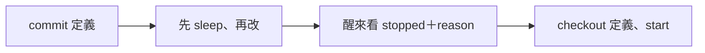
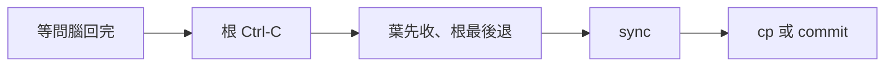
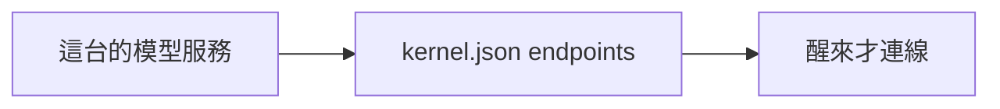
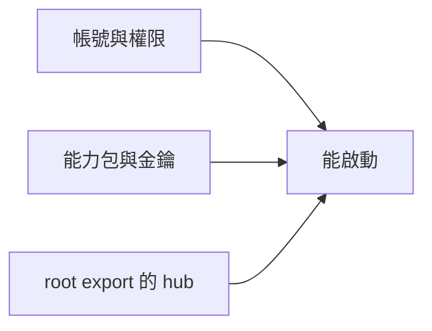

# 搬家的六段食譜：回復定義、凍住 image 與重建根 daemon

← [搬家入口](../04-搬家.md)｜下一份：[image 保存與邊界](02-image保存與邊界.md)

## ① 改定義前先留一份能回去的



跑著改定義先 sleep；醒不來時看這隻的上一層表，回復定義後 start。以下用三層食譜的 `foreman`、`ann` 名稱。

<details><summary>明確指令與回復邊界</summary>

在 image 根執行；`agent_def` 是 ann 的定義資料夾，第一次改之前先 commit：

```sh
git add -- agent_def
git commit -m 'Save working agent definition' -- agent_def
aos-daemon-ctl -d "$PWD/foreman_image" sleep ann
# 確認表上 ann 是 sleeping，才編輯 agent_def。
aos-daemon-ctl -d "$PWD/foreman_image" ls --json
# 編輯完：
aos-daemon-ctl -d "$PWD/foreman_image" wake ann
# 若 ann 留 stopped，讀 reason：
aos-daemon-ctl -d "$PWD/foreman_image" ls --json
# 捨棄剛才的定義修改，回到 commit：
git checkout -- agent_def
aos-daemon-ctl -d "$PWD/foreman_image" start ann
```

`git checkout --` 會捨棄該定義未 commit 的修改，先確認要回復的範圍。定義沒搬齊、入口起不來，loop／常駐列會留 `stopped`＋`reason`；一次性 exec 的錯可能只在它的 `stderr.txt`。改 daemon 定義則先從上一層 sleep 那列；根沒有上一層，在根的視窗 Ctrl-C、等退出後再改。回復的是定義，並不回復 stack 已發生的變動。

</details>

## ② 存 image：全 sleep、daemon 退出、sync 才複製



凍之前先等問腦收完（`aos-agent ctl state --target ann` 看 pending，並確認問腦流程已結束）。根 Ctrl-C 後等它退出，子層自己收工；只睡單隻、只 pause 或 SIGSTOP 都不算可搬 image。

<details><summary>保存指令與外接限制</summary>

在根的前景視窗 Ctrl-C，等命令返回殼；另檢查各層 `procs_state.json` 的常駐／loop 列已為 `sleeping`（原本 `stopped` 的維持停用）。再於 image 的上一層：

```sh
sync
cp -a image image_copy
```

`image_copy` 必須是尚不存在的目的地；image 包含定義、ws、所有 stack，彼此相對位置保持不變。使用 git 就改走 [git image 食譜](02-image保存與邊界.md#git-image專門-repo只留最新一份11-06-使用者裁定)；push 仍須另有使用者授權。

跨樹問腦是外接：**搬後重設 `AOS_LLM_KERNEL`；在飛請求作廢重寄；凍之前先等問腦收完**。只搬 agent 樹不能假設舊 kernel 還能送回信。凍時執行中的外部 CLI／HTTP 可能被砍，恢復流程可能重跑，但外部服務可能已生效；eca 已交給 CLI 的信不會自動重答，要人重寄。

要凍住／搬家期間時鐘期限不逾時，**根** daemon 帶鐘列＋根定義資料夾 `.env` 一行 `AOS_CLOCK=${AOS_STACK}/clock`，鐘檔就在根的 stack（image）裡、搬家接著數（寫法見 [aos-daemon docs/02](../../../../impls/aos-daemon/docs/02-看寫法決定怎麼起.md#時鐘普通一列)）。kernel 範本（總機、判官）不帶鐘，底下各層預設聽根的鐘（使用者 11-09「預設聽外層……大家也通常只在root daemon才開」，[thinking clock-decouple](../../../../thinking/2026-11/09/clock-decouple/README.md)），所以樹裡只有一個鐘：凍住整棵樹＝根 sleep，或只停時間＝`pause` 根的 `_clock`。沒時鐘就走牆鐘，醒來可能已過期；外部服務自己的牆鐘期限仍會過。不要人工 export 指向樹外的 `AOS_CLOCK`。

</details>

## ③ 搬完先改能力包的 url、model



能力包屬於這台。起總機之前，改它定義 `kernel.json` 的 `endpoints[*].url`／`model`，對上這台的服務與模型。

<details><summary>檢查與金鑰</summary>

```sh
python3 -m json.tool llm_def/kernel.json
${EDITOR:-vi} llm_def/kernel.json
rg -- 'key-env' llm_def/endpoints
```

`url`、`model` 留在 kernel.json；金鑰由端點小 proc 自己讀，照 `_entry` 的 `--key-env` 名稱在起總機的殼 export。LM Studio 位址、API endpoint、模型是否已載入也要在這台確認。只搬 agent 樹時，檢查外接 kernel 的 `budget.senders` 是否仍指向正確的相對位置。

</details>

## ④ 「這台的」逐項重設



帳號、ctl 信箱擁有者、cgroup 委派、能力包端點，以及人 export 的 `AOS_LLM_KERNEL`／`AOS_KERNEL`／`AOS_DAEMON` 都屬這台，不能沿用舊絕對值。

<details><summary>起來前後各檢查什麼</summary>

先確認 `limits.user` 指的帳號存在，且該帳號可寫自己的 stack／ctl 信箱；不存在會 `LimitBad user …: no such user`。帳號有了仍須確認切換權限，daemon 不替人改擁有者。工具 bin 也不在 image，這台須安裝 aos 並放進 PATH。

通常不要手設 `AOS_DAEMON`，交給 daemon 每跳給子項；人殼操作特定 daemon 可用 `-d`。若曾 export，搬後重設或 unset。`AOS_KERNEL` 只在要走判官的那個 root 殼設；起 llm daemon 的殼不要誤帶 agent 樹的判官。

醒來後在各 agent 的 ws／stack 上下文跑 `aos-tools ls`，檢查定義的 `tools.json` 與 stack 覆蓋層登記檔。登記檔照 add 時的寫法存（11-10 起：給絕對存絕對、給相對存相對，也可以手寫 `{"$env": …}`，[兩台輪流](04-兩台輪流.md)），而且贏過外層 export；存成這台絕對路徑的，必要時用這台的值重新 `aos-tools add --override`。只 export 新值不會覆蓋舊登記。

</details>

⑤、⑥ 接在 [重建 root 與 `.env`](03-重建root與環境.md)。
