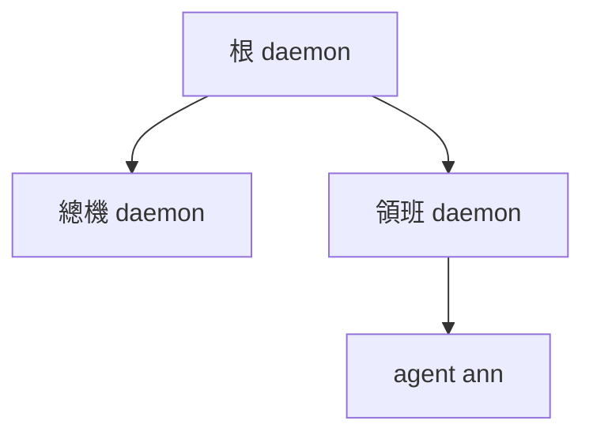
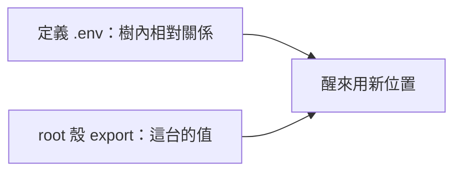

# 重建 root、三層佈局與 `.env` 邊界

← [搬家入口](../04-搬家.md)｜前四段：[六段食譜](01-六段食譜.md)

## ⑤ 重建 root 四步，起根後逐層接回



四步是建帳號（可略）→包 root（可略）→export→`aos-exec --stack <image> <定義>`。根是普通 daemon；沒有上層替它重起，正常運行由使用者顧。

<details><summary>三層佈局與啟動指令</summary>

以下是 image 根內的佈局；`root_image` 是根 stack，`llm_image` 與 `foreman_image` 是子 stack，`ws` 是工作成果。定義的 `_entry` 均為 `["aos-daemon", "daemon.json"]`。此例把 repo 的 `kernel/llm-kernel` 複製成 `llm_def`、`templates/agent-fsm` 複製成 `agent_def`，並帶同層的 `lib/`、`py/`。搬平一層後，先把 kernel.json 的 `exec`／fake 端點路徑改為 `../lib/base/llm_http`／`../lib/base/llm_fake`，agent 的 wall_clock 工具 path 改為 `../lib/base/wall_clock`；其他有用到的工具也照實際相對位置改。外部複本須安裝 repo 的 Python 共用模組，或在起根殼設 `PYTHONPATH="$PWD/py:$PWD/lib${PYTHONPATH:+:$PYTHONPATH}"`。agent 的啟動目標照其定義（例如 `fsm.json`），不要把會自掛的入口再掛一次。

```text
image/
  root_def/       root_image/
  llm_def/        llm_image/
  foreman_def/    foreman_image/
  agent_def/      agent_image/
  ws/            lib/  py/
```

`root_def/daemon.json`：

```json
{"procs_requests":"procs_requests","procs":{
  "_clock":{"exec":{"argv":["aos-clock",{"$env":"AOS_DAEMON","$path":"clock"}]},"interval_ms":1000,"auto_restart":true,"stuck_after_ms":10000},
  "_sweeper":{"exec":{"argv":["aos-sweeper","--retention-days","7","--report",{"$env":"AOS_STACK","$path":"sweeper_report.json"}]},"interval_ms":600000,"auto_restart":true,"stuck_after_ms":600000},
  "switchboard":{"exec":"../llm_def","stack":"../llm_image","auto_restart":true},
  "foreman":{"exec":"../foreman_def","stack":"../foreman_image","ws":"../ws","auto_restart":true}
}}
```

`root_def/.env`：

```sh
AOS_CLOCK=${AOS_STACK}/clock
```

`llm_def/daemon.json` 沿用 kernel daemon 定義，另加 `"procs_requests":"procs_requests"` 才能用下方 ping 確認總機；其 `exec` 身體繼續跑 aos-llm-kernel。

`foreman_def/daemon.json`：

```json
{"procs_requests":"procs_requests","procs":{
  "ann":{"exec":"../agent_def/fsm.json","interval_ms":0,"stack":"../agent_image","ws":"../ws","def":"../agent_def"}
}}
```

清道夫列 `_sweeper`（11-10）是每台 daemon 各帶一列、只管自己（領班、總機的 daemon.json 也寫同一列）；它寫的封存、報告、鎖都不進 image，換機後新機器從空的開始。只有根帶鐘（鐘列＋`.env`），鐘檔在 `root_image/clock`；領班、總機不帶，照繼承聽根的鐘（使用者 11-09「預設聽外層……大家也通常只在root daemon才開」，[thinking clock-decouple](../../../../thinking/2026-11/09/clock-decouple/README.md)）。凍住整棵樹＝根 sleep；只停時間＝`pause` 根的 `_clock`。定義中的相對 exec／stack／ws 從各 daemon 的 cwd（此例是其定義資料夾）算。父只把 switchboard／foreman 當普通 exec，`auto_restart: true` 才有常駐 sleep／wake 與退了重起。

1. 建帳號可略；若用了 `limits.user`，先由人把帳號、stack／信箱寫入權限配好。
2. 包 root 可略；家機有 systemd 委派時可用下方 scope。
3. 在 image 根 export 這台的外接位置：

```sh
export AOS_LLM_KERNEL="$PWD/llm_image"
unset AOS_KERNEL AOS_DAEMON AOS_CLOCK   # 殼裡留著 AOS_CLOCK 的話，根的 .env 不會蓋它
# 有判官才另 export AOS_KERNEL；端點需要的金鑰在此殼 export。
```

4. 前景起根：

```sh
aos-exec --stack "$PWD/root_image" "$PWD/root_def"
```

若要包根的整樹總額，在根 stack 中執行以下食譜（`<根定義>` 換成實際絕對路徑）：

```sh
systemd-run --user --scope -p MemoryMax=4G -p CPUQuota=200% aos-exec --stack . <根定義>
```

WSL 沒 systemd 時標作「家機才有」，直接起根；判準是 user slice 對應的 `cgroup.controllers` 有 `memory`、`cpu` 且已委派給這個使用者。scope 是整樹總額，與每行程 rlimit 不同。

另一個殼在 image 根檢查，不用 `sleep N` 猜啟動完成：

```sh
aos-daemon-ctl -d "$PWD/root_image" ping --timeout-s 30
aos-daemon-ctl -d "$PWD/llm_image" ping --timeout-s 30
aos-daemon-ctl -d "$PWD/foreman_image" ping --timeout-s 30
aos-daemon-ctl -d "$PWD/foreman_image" ls --json
```

各 ping 收到 applied 回信，領班表 ann 為 running，agent 的 loop 起時若給了 `--enable-counters`，可讀 `agent_image/counter_runs.txt` >= 1 作觀察（11-09 起 state.json 沒有 `counter_runs`，預設也不寫這個檔）；它在每次開跑時寫，>= 1 只代表第一次已開跑；它不是心跳，也不跨重啟累加，長跑身體未返回時不會增加。是否叫得動以 ping／實際問答確認，不等待計數持續增加。根重開會 adopt 接回仍活的子項；換機／重開機 `boot_id` 不同，全當死，照表起與醒。`pid` 等舊值不用人修。

</details>

## ⑥ `.env` 不寫這台的值



`.env` 跟定義一起搬；樹內可用 `${AOS_CD}/..` 或指示詞表達關係，跨樹 hub、外部端點的金鑰與本機絕對路徑由 root 殼 export。搬前檢查 `.env` 與工具登記檔有沒有凍住舊家目錄；不要把 export 展開的這台值寫回定義。
