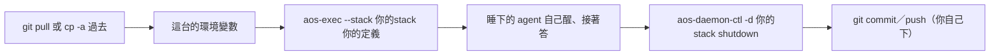

# 兩台輪流跑同一批 agent（11-10）

← [搬家入口](../04-搬家.md)｜上一份：[重建 root 與環境](03-重建root與環境.md)



**最簡單的做法**：整個專案用 git（或 `cp -a`）搬過去，設好這台的環境變數，起根。不用跑任何「換台」指令：睡下的列自己醒、留在信箱的信照答、eca 自己認出「對話不在這台」開新對話。下面的 `defs`、`stacks/root`、`ann` 只是例子，名字與位置都隨你。

```sh
cd something && git pull
export AOS_HOME=<這台 proto8 的位置>          # 範本的 {"$env": "AOS_HOME", …} 寫法靠它（或寫進根 .env）
export AOS_LLM_KERNEL=<llm kernel 的 stack>
unset AOS_CLOCK AOS_DAEMON AOS_STACK
aos-exec --stack stacks/root defs
# 下班
aos-daemon-ctl -d stacks/root shutdown
git add -A && git commit -m "..." && git push
```

每台另要先跑過一次 `proto8/install.sh`（PATH 與 `aos-proto8.pth`）；aos repo 有改到 C++ 就先重建。第一次建立、kernel 沒開時會怎樣、坑的完整清單：[thinking two-machines 11](../../../../thinking/2026-11/10/two-machines/11-給使用者的一頁.md)。

## 指到外面的路徑：三種寫法都收

| 寫法 | 例 | 兩台要一樣的是 |
|---|---|---|
| 相對 | `"../another/tools/greet"` | 相對位置 |
| 絕對 | `"/home/me/code/another/tools/greet"` | 絕對位置 |
| 環境變數 | `{"$env": "AOS_ANOTHER", "$path": "/tools/greet"}` | 只要每台設好那個變數 |

- **收的地方**：工具登記檔（定義的 `tools.json` 與 stack 覆蓋層）的 `path`／`env`、`daemon.json`、`_memory.json` 的 `base`、`cli.json` 的 `tools`、`kernel.json`；都是用到時才解，兩台各設各的。
- **指到 proto8**：範本一律寫 `{"$env": "AOS_HOME", …}`、用 `cp -r` 抄出（11-10 templates-cp）；`AOS_HOME` 每台 export 一次，或在根 `.env` 寫絕對路徑（兩台同位置）、`${AOS_WS}/…`（兩台同樣相對擺法）。哪種給法換台都不用跑額外指令。
- **命令列給的值當下就定了**：`ctl add -w／-s／XXX`、`--envs K=V`、`aos-tools add --envs` 照字面存。

<details><summary>專案外的 stack 或定義（兩台相對位置不同：用 `--*-json` 的環境變數寫法）</summary>

11-10 B01：`aos-agent ctl add`／`aos-daemon-ctl add` 收 `--ws-json`、`--stack-json`、`--path-json`（代替 XXX），給的 JSON 指示詞原樣進表（`as_written`），每次起照當下環境再解；例 `--ws-json '{"$env": "PROJ"}' --path-json '{"$env": "PROJ", "$path": "/defs/ann"}'`，兩台各設自己的 `PROJ`。下面是一般寫法（`add xxx` 會換算）時的補法。

daemon 表把每列的 `ws`、`def`、`exec` 存成相對根 stack 的路徑。stack 與定義都在同一個專案裡時，整包搬到哪都對；有一邊放在專案外、兩台的相對位置又不同，那列會起不來（`WsMissing`／`EntryMissing`，重起 3 次後 `stopped`，信不掉）。那台這樣補（stack 留著、history 接著）：

```sh
aos-daemon-ctl -d stacks/root rm ann
aos-agent -d stacks/root ctl add --auto-restart -w . <ann 的定義在這台的位置>
```

`aos-agent ctl rm` 也行（11-10 晚起預設留 stack），只是別加 `--purge`——那會連 stack 一起刪。

</details>

## 其他要知道的

- **gitignore**：要把 stack 放進 git，照 [gitignore 指南](../05-gitignore指南.md) 把 `stack.gitignore` 放到 stack 根或只裝 stack 的資料夾；aos 不自動寫、不擋啟動。
- **放哪**：Linux 檔案系統與 `/mnt/c` 都可以（11-10 起）。`/mnt/c` 每輪慢約 2～5 倍；畫面的 socket 不在 stack 裡。用 WSL 的 git，不要用 Windows 版 git checkout（見 [保存與邊界](02-image保存與邊界.md)）。
- **eca**：換台＝新對話＋aos 記的紀錄整理成開場白。`shutdown` 打斷正在答的那輪＝那封不重答（下一封照常答），要那封有答就先等它答完再 shutdown。
- **llm kernel 沒開**：agent 原地等、不會停（有沒有 `--auto-restart` 都一樣）；kernel 起來後接著答。kernel 收件匣排隊的信照帶，換台前讓 kernel 處理完最好，否則接受重寄、回信可能沒人收（[gitignore 指南](../05-gitignore指南.md)）。
- **金鑰**：只放 llm kernel 那個專案、不進 git 的檔；agent 的 history 與 ws 都會進 git。
