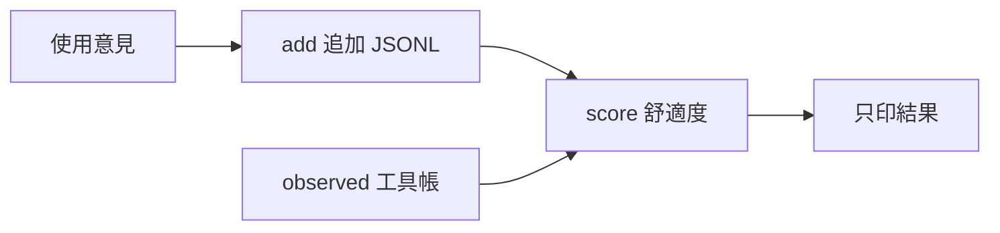

# aos-feedback — 收集指令與函數的使用意見，從評分與觀測帳計算 AI 舒適度。

← [cmd](../README.md)｜資料：[feedback](../../feedback/README.md)｜腦的入口：[feedback 工具](../../lib/aos/feedback/README.md)

最常用：`aos-feedback add aos-agent "ctl add usage unclear" "show an example" --kind help --by codex-sol`。意見進 `$AOS_FEEDBACK/<key>.jsonl`；沒設環境變數時用本 repo 的 `proto8/feedback/`。`score` 只讀意見與帳，不回寫目標的 `_metainfo.json`。

送意見、看意見與 JSON 輸出

`add COMMAND PAIN [SUGGEST]` 的旗標可放在位置參數前後；任意文字若以 `-` 開頭，用 `--` 結束旗標解析。文字原樣保存，`key` 取 command 第一詞的 basename、小寫、非 `[a-z0-9_-]` 換 `_`。`aos-agent ctl add` 歸 `aos-agent.jsonl`；`lib/base/read` 歸 `read.jsonl`。同 key 可收不同 command，不做裁決或自動修改。

| 旗標 | 內容 |
|---|---|
| `--kind` | `usage`、`help`、`errors`、`args`、`other`；預設 `other` |
| `--score` | 選填有限數 0～1；1 表示很順手 |
| `--by` | 預設 `$AOS_CD` 的 basename；沒設為 `unknown` |
| `--model` | 模型名；沒給為 `unknown` |
| `--family`、`--tier` | 自由字串；各自覆寫模型規則推得的家族、階位 |

模型名對 `<dir>/raters.json` 的 `rules` 做不分大小寫子字串比對，第一條命中即停；沒有規則檔或沒命中時為 `unknown`。預設規則有 opus、sonnet、sol、terra、12b；更換 `AOS_FEEDBACK` 時，規則也從該目錄讀，不自動複製或改寫。

成功印 `aos-feedback: recorded <file>`。`add --json` 改印新紀錄物件。紀錄有 UTC 毫秒 `at`、原樣 `command`／`pain`、選填 `suggest`／`score`、`kind`、`by`、`rater`、`cwd`（家目錄前綴寫成 `~`，意見檔進 git、不帶帳號名）；檔案只追加，同檔寫者用檔案鎖避免交錯。

`ls` 每 key 一行 `KEY  COUNT  LATEST`，按筆數降序、同筆數按 key 升序；`--json` 印 `[{"key", "feedback", "latest"}, ...]`。`show KEY` 逐行印完整意見，換行文字以 JSON 字串表示；`--json` 印原始紀錄陣列。不存在的 key 視為空意見，不產生檔案。

每個子命令皆有英文 `--help`；`-j`＝`--json`、`-h`＝`--help`。也可在子命令前給 `--json`。壞參數用 `aos_flags` 印單行錯誤及最後的 usage，退 1；Ctrl-C 退 130，stdout 被關退 141。資料壞了報 `FileBad`，指定的帳不存在報 `FileMissing`，均不吐 traceback。

舒適度與重試的計算

`score KEY [--observed FILE]...` 印 JSON；有無 `--json` 相同。每份帳依順序讀 `kind=tool` 行，只計 `name` 或 `def` 的 basename 等於 key 的列；`calls` 是呼叫次數，`errors` 是非 0 次數。緊接同一工具的前次呼叫非 0，算一次 `retries`；工具以完整 `def` 辨別，無 `def` 才用 `name`。其他工具會切斷相鄰，`think` 等非工具行不切斷；不同帳檔各自起算，不跨檔接成重試。

`comfort.ai` 的 `usage`／`help`／`errors`／`args` 分別取該 kind 帶 score 意見的平均；沒有 score 仍計入 `feedback` 筆數，`other` 不形成子項。`ai_by.family` 與 `ai_by.tier` 各組有同樣四子項與 `val`；不知道模型的意見歸 `unknown`。分組匯總沿用同一份帳的行為因子。

行為因子為 `calls / (calls + errors + retries)`。`val` 是非 null 子項的平均乘行為因子；沒匹配到呼叫時不乘。全無子項時只用行為因子；連帳也沒有則為 null。`user` 現在固定 null，不需使用者評分。

例如 10 次呼叫、2 次非 0、1 次重試，加兩筆 help 評分 0.4、0.6，得到 `ai.help=0.5`、其他三項 null，`val=0.38461538461538464`。只從帳計分也可以，key 不必已有意見檔。

設計者自稱的 `comfort` 可選填在 `_metainfo.json`，可用同形物件或只有匯總的數字；本指令不強迫、不改寫，也不替 `metainfo_check` 增加比較行為。

驗收

`python3 -m unittest discover -s proto8/cmd/aos-feedback/tests -v`

測試全部用 `AOS_FEEDBACK` 指向暫存夾，並將起始模型規則複製到那裡；包含實際 `aos-exec` 呼叫薄工具，需先有 `proto8/impls/aos-exec/bin/aos-exec`。

