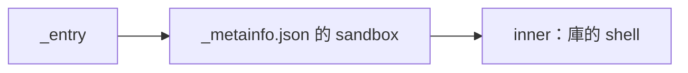

# shell-boxed — 把 shell 工具（bash）關在工作區與工具小格內，斷網並逐支開放執行檔。

宣告與強制共用 `_metainfo.json#/sandbox`。執行檔白名單只改這份設定的 `ro`。

執行與限制

`aos-exec proto8/cmd/aos-sandbox/examples/shell-boxed` 從 stdin 收 `{"command":"rg --version"}`；需要 `AOS_WS`、工具自己的 `AOS_STACK`、bubblewrap 與 s6-softlimit。

`inner` 與 `_tooldef.json` 指向庫的 shell 工具；唯讀逐支掛入它實際 import 的 `tool_io.py`、`shell_observed.py`、`observed.py`。`commands` 只列 aos-exec，避免把整個 `/usr/bin` 掛進去。Python 是執行期必備，因此指令白名單只是盡量限制；寫入位置與網路仍受沙箱控制。daemon stack 必須放在工作區外。

實際關箱驗證見 [box-probe](../../../../cases/box-probe/README.md)；主機禁止建立網路命名空間時，bwrap 會直接失敗，不能當作通過。

