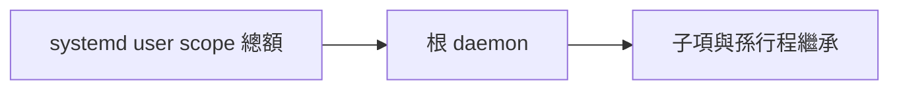

← [回入口 README.md](../README.md)｜段落：份額 limits（feat-proto 件 5）｜上一份：[08-當機復原與已知限制](08-當機復原與已知限制.md)｜下一份：—

## 份額 limits

使用者 11-05 午：「啊，還有，會想要限制特定aos proc所占用的資源。以及daemon/kernel自己本身被限制占用資源，並且會分配份額給proc」；方向：「讓daemon偷偷給底下的proc包s6」。規劃與代定：[feat-proto 05](../../../thinking/2026-11/05/feat-proto/05-資源份額.md)（E1～E3）。

```json
{"limits": {"files": 256},
 "procs": {"bob": {"exec": "../agents/bob/fsm.json", "interval_ms": 0, "limits": {"mem_mb": 1024, "cpu_s": 3600}},
           "job": "../job"}}
```

- **寫在 daemon 的表上，proc 自己不知道**（「偷偷」，C-52）：proc 物件選填 **`limits`**；daemon.json 頂層選填 **`limits`**＝沒寫 `limits` 的列用的預設（沒寫＝不限）。列寫 `{}` 或 `null`＝當沒寫（用預設）。字串／陣列寫法沒地方放，要份額就寫成 `{"exec": 它, "limits": …}`（仍是 exec 型）。指示詞照解。`limits` 不寫進 proc 的 stack 的 `loop.json`。
- **key**（同 [aos-sandbox](../../../py/aos/apps/sandbox/README.md) 那套）：`mem_mb`→`RLIMIT_AS`＋`RLIMIT_DATA`（不碰 `RLIMIT_STACK`）、`cpu_s`→`RLIMIT_CPU`、`procs`→`RLIMIT_NPROC`、`file_mb`→`RLIMIT_FSIZE`、`files`→`RLIMIT_NOFILE`，都是正整數，soft＝寫的值、hard 同值，只有 `cpu_s` 的 hard 多 1 秒（先收到 SIGXCPU）；若 daemon 自己的 cpu hard 恰等於所寫的值，hard 退回同值，照起但不保證 SIGXCPU；`user`＝帳號名（字串），換成那個帳號（附加群組、主群組、uid）；或 `"sub:N"`＝免 root 換成這個帳號名下的 subuid（見下面「換成 subuid」）。
- **數字鍵整份取代，不逐鍵合併**（使用者 11-14 裁選 a）：列寫非空 `limits`，預設裡沒重寫的數字鍵就被取消；在列上寫 `limits` 時，要的鍵都要寫全。不想被列取消的預設鍵，必須放進 `limits_max`。唯一例外是預設 `user`：列沒寫 `user` 就補上，列自己寫了則照寫的（身分政策歸 kernel）。
- **`limits_max` 天花板**：daemon.json 選填數字份額物件（同七個正整數鍵、不收 `user`）；超過或漏掉被封頂的鍵（視為不限）＝那一支 `LimitBad … exceeds limits_max …` 起不來，留 `stopped`＋reason，其他列照跑，daemon 不夾值。頂層 `limits` 必須涵蓋每個被封頂的鍵，而且預設值不能超過 max；設定不符＝`CfgBad`、整台不起。null／空 max 表示不封頂。
- **怎麼做：等同 s6-softlimit／s6-setuidgid**——daemon 在 fork 出的子行程裡（`setsid`、接好 stderr 之後、`run_cli` 之前）自己呼叫那幾個系統呼叫，**不 exec s6、不依賴 PATH**（代定 1；要「真的是 s6 那支」是[題 6](../../../thinking/2026-11/05/feat-proto/README.md) 的翻案）。之後 aos-exec、aos-loop、身體與它們起的一切都繼承。
- **寫壞**（不是物件、key 不認、值不是正整數、`user` 不是非空字串）＝跟 `stack` 同三條：daemon.json `CfgBad` 退 1、procs_ctl 整份不採用（state_flux 的 `procs_ctl_warning`）、信壞信（state_flux 的 `mailbox_warning`）。
- **做不到**＝那一支起不來：父行程預檢失敗直接留 stopped；子行程才失敗則在 proc 的 stack `stderr.txt` 印一行、退 1。比 daemon 自己的 hard limit 寬：父行程預檢丟 `LimitBad mem_mb 4096 exceeds the daemon's own hard limit 2048`，沿用單列 stopped／warning 路徑（MB 鍵的訊息也是 MB）；子行程 setrlimit 的 EPERM 仍留原錯誤當保險（**不自動夾成 daemon 的**，寫什麼就做什麼，C-56）；`user` 但 daemon 不是 root：`aos-daemon: error: LimitBad user bob: Operation not permitted (switching users needs the daemon to run as root)`；帳號不在：`LimitBad user bob: no such user`。所有 proc 照「出錯結束一律留」＝列 `stopped`＋`reason`（`failed to start: … LimitBad …`）（[裁定 B](../README.md)，exec 型也一樣）。
- **超額＝rlimit 的天然行為**，不加新的錯誤路徑：記憶體到頂＝配置失敗（Python `MemoryError`，多半退非 0）；`cpu_s` 到頂＝SIGXCPU；`files` 到頂＝open 失敗；`file_mb` 到頂＝SIGXFSZ。對 daemon 來說都是「任何 proc 退非 0＝留 `stopped`＋`reason`」。
- **命中標記只看直接子行程**：有 `cpu_s` 且收屍見 SIGXCPU＝`limit_hit: "cpu_s"`；有 `file_mb` 且見 SIGXFSZ＝`limit_hit: "file_mb"`。shell 包外部程式時要用 `exec`；沒用 exec、或程式攔／忽略訊號，就可能看不到。攔 SIGXCPU 撐到 hard 會被 SIGKILL（137）；忽略 SIGXFSZ 時 write 回 EFBIG，由程式自行退。
- **`mem_mb` 管的是位址空間，不是用了多少記憶體**：`RLIMIT_AS`＋`RLIMIT_DATA` 數的是行程保留的虛擬位址。Node、Chromium、JVM 這類一起來就先保留一大塊位址空間（實際只用一小部分）的程式，`mem_mb` 設在它們真正用量附近也會起不來或執行緒開不出來（`EAGAIN`、`out of memory`、`Resource temporarily unavailable`）。要限這類程式的記憶體，改寫 `mem_total_mb`（cgroup 的 `memory.max`，數實體記憶體，見下面「可選 cgroup v2」），`mem_mb` 不寫或放寬。
- **`limit_suspect` 只是猜**：正常退 1 且有 `mem_mb` 就標 `"mem_mb"`，不保證真是記憶體用完；父行程預檢 hard 失敗不標。接回的 running proc 拿不到 wait status，不推測命中；stopped／sleeping 表列接回保留既有標記，重起清掉。
- **K11 提醒**：列有 `procs` 卻沒換 user 時，父 daemon stderr 印 `aos-daemon: warning: procs N counts every process of uid UID, not only this proc (no user switch)`，同列相同份額只印一次，重起不重印；份額變了才重新提示。仍照套，不擋。
- **`limits_clamped`**：kernel 夾份額後寫的記號，不使 exec 型變 loop 型；daemon 不讀、不輸出，也不傳給子 loop。
- **表上看得到**：`procs_state` 每列多 **`limits`**＝生效的那份（列的，或 daemon 的預設；不限＝不印這欄）；adopt、wake、start 照列上的帶著（同 `ws`：起的那一刻的值，名單後來改了也不變；信箱接回只留名的列再起時用它）。`aos-daemon-ctl ls --json` 原樣帶出、`aos-daemon-ctl add --limits JSON` 寫進那列；aos-agent 的 `ctl add` 送宣告的份額、`ctl state` 多一行 `limits`。
- **天然差異（照實寫）**：rlimit 是**每個行程各自**的上限，**不從 daemon 的總額扣**——三列各寫 `mem_mb: 1024` 加起來可以超過 daemon 自己的 1024；`procs` 數的是那個帳號的全部行程（Linux 的 `RLIMIT_NPROC` 本來如此；換成 subuid 的例外，只數這隻自己的，見下面「換成 subuid」）。要限制一列連子孫的總量可選用下述 cgroup v2（需委派）。
- **接回 running 列不重驗天花板**：新 daemon 不主動停掉接回的行程；只有之後重起、走 launch 才檢查 `limits_max`。

| 一期 rlimit | 實際邊界 | 可選 cgroup |
|---|---|---|
| `cpu_s` | 單一行程的 CPU 秒；fork 的子行程重新起算 | 本輪不做 `cpu.max`，`cpu_s` 照舊 |
| `file_mb` | 單檔大小 | memory/pids 不管檔案總量 |
| `mem_mb` | 虛擬位址空間（另設 DATA），非整樹實體記憶體；先保留大塊位址空間的程式（Node、Chromium、JVM）會在實際用量遠低於它時就配不到（`EAGAIN`、out of memory），這類改用右欄 | `mem_total_mb` → `memory.max`，另設 swap.max=0 |
| `procs` | 整個 uid 的總數（`sub:N`＝這隻 proc 自己的行程／執行緒） | `procs_total` → `pids.max`，管整格行程／執行緒總數 |

- **daemon 自己被限＝起它的人包**（`prlimit`／`ulimit -H`／`aos-sandbox`）：rlimit 繼承，子項天生超不過 daemon 的 hard；子 daemon 再包它的子項只能更緊。
- **`user` 的帳號只認本機 `/etc/passwd`、`/etc/group`**（不經 NSS：aos-daemon 是靜態連結的，`getpwnam` 查不到名字時實測整台 SIGSEGV）。換了帳號的子項要能寫它的 proc 的 stack（`stderr.txt` 已由 daemon 開好、照寫；`loop.json`、`state.json` 要那個帳號寫得進去）——權限是使用者的事（C-64），daemon 不改擁有者。

### 換成 subuid（`user: "sub:N"`，免 root）

11-19 線 subuid-1119 接上 [kernel-limits-plan 段 3](../../../thinking/2026-11/13/kernel-limits-plan/04-施工與驗收.md) 的最小一刀；做法與取捨見 [紀錄](../../../thinking/2026-11/19/subuid-1119.md)。kernel 站照 `users` 表填 `sub:N`，daemon 照填的換；proc 自己不知道。

```json
{"group": 60001,
 "procs": {"sol": {"exec": "../agents/sol/fsm.json", "ws": "../work", "limits": {"user": "sub:5", "procs": 64}}}}
```

- **號碼**：`N` 是 1～60000（不收前導 0）；真的 uid＝`/etc/subuid` 裡這個帳號第一段的起點＋N－1（起點 100000 時 `sub:5`＝100004）。**群組一台 daemon 一個**（K6、K18）：daemon.json 頂層 `group`（ns 裡 60001～65536 的整數，沒寫＝60001），換了身分的 proc 主群組都是它（真 gid＝`/etc/subgid` 起點＋group－1）、附屬群組清空。daemon 自己的 `state.json` 多一欄 `group`。
- **怎麼換**：每支 proc 自己一個 user namespace（不是整棵樹進 ns）。子行程進 cgroup、setrlimit（`procs` 除外）之後 `unshare(CLONE_NEWUSER)`，經一條 socketpair 告訴父行程；daemon 跑 `newuidmap PID 0 <自己的 uid> 1 N <真 uid> 1` 與 `newgidmap PID 0 <自己的 gid> 1 G <真 gid> 1`；子行程設 `procs`，再 `setgroups({})`、`setresgid(G)`、`setresuid(N)`。daemon 是那個 ns 的擁有者，所以照舊停得了、殺得了它。
- **`procs` 只數這隻自己的**（K11 的提醒不印；[kernel-limits-plan 07](../../../thinking/2026-11/13/kernel-limits-plan/07-cgroup可選.md)「換了 subuid 才是這隻自己的」）：數的是它那個 ns 裡這個 subuid 的行程與執行緒；兩支 proc 寫同一個 `sub:N` 各數各的（各自一個 ns）。整個帳號在外層仍受 daemon 自己的 `RLIMIT_NPROC` 管（使用者本人的行程也算在內，同不換身分時）。**`procs` 一定在開 ns 之後才設**：開 ns 那一刻核心把當下的 `RLIMIT_NPROC` 記成這個 ns 在外層的天花板，拿去數開 ns 的人（daemon 的 uid）的全部行程；先設 `procs: 5` 再開 ns，使用者自己幾十個行程就超過，aos-exec 起身體時 execve 回 `EAGAIN`（`LaunchFailed cannot start: … (Resource temporarily unavailable)`）。11-19 真機補驗撞到、線 subuid-fix-1119 改的（[紀錄](../../../thinking/2026-11/19/subuid-1119.md#真機補驗11-19-上午線-subuid-fix-1119)）。
- **起之前 daemon 替它做的**：小格（proc 的 stack）改成 `0700`＋ACL `u:<真 uid>:rwx`，預設 ACL `u:<真 uid>:rwx`、`u:<daemon 的 uid>:rwx`（K16、G6）——直接寫 xattr，不靠 `acl` 套件；使用者照看照改 agent 寫的檔，同台別隻進不去。每次起都重設一次（冪等）。
- **換了身分的環境**（L5）：只留 `PATH`、`LANG`、`LC_ALL`、`LC_CTYPE`、`TZ`、`TERM`、`PYTHONDONTWRITEBYTECODE`、`PYTHONIOENCODING` 與 `AOS_*`（同 aos-asuser），`HOME=/nonexistent`；有 `ws` 就帶 `GIT_CONFIG_COUNT=1`、`safe.directory=<ws>`（G8）。金鑰類變數不傳。3 以上的 fd 全關。
- **走得到才起**：換了身分之後檢查小格（rwx）、daemon 的 cwd 與 `ws`（x）；走不進去＝`LimitBad user sub:5: cannot reach /home/me: Permission denied`，點名第一層卡住的祖先（家目錄 700／750 最常見，見 [linux-as-hw 04 第 1 條](../../../thinking/2026-11/18/linux-as-hw-1118/04-邊緣狀況.md)）。
- **錯誤**：寫法不對＝`CfgBad … sub:N needs N from 1 to 60000 (no leading zero)`；父行程預檢（單列 stopped）：`/etc/subuid`／`subgid` 沒有這個帳號的行、號碼超出段、`newuidmap not found on PATH (install the uidmap package)`、小格設不了 ACL（例：`/mnt/c` 不吃 ACL）；子行程或 helper 才失敗＝小格 `stderr.txt` 一行 `LimitBad user sub:N: …`（`unshare`、`setgroups`、`setresgid`、`setresuid`、`<helper> exited N`），列 stopped＋reason。`setgroups` 被拒時不放行（不然會帶著使用者的附屬群組跑）。
- **這一刀沒做**：子 daemon 沒寫 `group` 時沿用父 daemon 的（K18 後半）；信上的 `groups`（進階附屬群組，K15；仍 `CfgBad`／`BodyBad`）；信箱與共用夾的權限（用 `aos-share`，K16）；kernel 用信檔擁有者認寄件人（K9）；`rm` 時用同一個 subuid 清垃圾；子 daemon 自己換了 uid 之後再換。

### 整棵樹的總額（外面包）



除了 daemon 的每列 cgroup，使用者也可在外面包 scope，讓整樹共用總額：

```sh
systemd-run --user --scope -p MemoryMax=4G -p CPUQuota=200% aos-exec --stack . <根定義>
```

<details><summary>環境判準與界線</summary>

判準是 user slice 的 `cgroup.controllers` 有 `memory`、`cpu`，而且 user manager 有可用的委派。公司 WSL 無 systemd 的環境標為「家機才有」；不是所有 WSL 都不能用。`CPUQuota=200%` 是最多兩顆 CPU 的時間，不是釘住兩顆核；`MemoryMax` 是整個 scope 的上限。這是外部選用食譜，不會增加 daemon 表的欄位。

stack 總量 aos 不量；單檔用 `file_mb`，總量用檔案系統 quota 或人跑 `du`。

</details>

家機已以 transient Delegate scope 驗證 memory/pids 總量與 cgroup.kill；沒有 systemd user manager 的環境需自行提供委派。


### 可選 cgroup v2：連子孫的總量

`daemon.json` 頂層 `cgroup` 只能是 `off`、`auto`、`on`，不寫＝`off`。`off` 連 cgroupfs 都不讀；`auto` 探不過印 `cgroup: none (<原因>)`、照 off 跑；`on` 探不過報 `CfgBad cgroup on: <原因>`、退 1。daemon 自己的 `state.json` 回報 `cgroup` 為 `off`、`none (<原因>)` 或 base 絕對路徑。

自行包委派 scope（`launch.json#/wrap` 尚未實作，不會自動包）：

```sh
systemd-run --user --scope --collect -p Delegate=yes -- aos-daemon daemon.json
```

探測在拿到 stack 鎖之後、adopt 之前：讀 `/proc/self/cgroup` 的 v2 路徑，確認 controllers 有 memory/pids，先把 daemon 搬到 `<base>/daemon/`，再於 base 和 `<base>/procs/` 各啟用 `+memory +pids`；任何一步失敗盡力撤銷本次啟用、搬回與移除本次建的空格。每列起動前建立 `<base>/procs/<名>/`，舊格先收整格並由下往上清掉，重新建格讓事件計數歸零。子行程接好 stderr 後、apply_limits 換身分前進格，失敗退 126，不標記憶體疑似命中。

- `limits.mem_total_mb`：正整數 MB，整列連全部子孫的實體記憶體總量，寫 `memory.max` 並將 `memory.swap.max=0`（檔不存在略過），避免靠 swap 超過此份額；未寫則兩者為 max。
- `limits.procs_total`：正整數，寫 `pids.max`，包含主行程和全部子孫的行程／執行緒；未寫為 max。兩鍵也可放進頂層 limits／limits_max，非 rlimit；aos-sandbox 與 kernel 站的 default/max 尚不認它們。
- 沒開成卻寫總量鍵：仍起，表列 `limits_ignored` 記鍵名；stderr `aos-daemon: warning: job: mem_total_mb, procs_total need cgroup (cgroup is off), ignored`（降級為 none）。同列相同份額只印一次。
- 表列 `cgroup` 是該列格子的絕對路徑。自己 fork 的直接子行程退出後，先照原本 SIGXCPU/SIGXFSZ 判斷，再在尚無 limit_hit 時查 memory.events 的 oom_kill（`mem`）、pids.events 的 max（`procs`）；有命中就清掉 limit_suspect。讀不到事件不報錯。
- `limit_hit`／`limit_suspect` 只留在還在表上的列；主行程退 0 的列照舊收掉，不留這兩欄，結束 log 也不增加欄位。生命週期不因事件命中而改變。
- graceful stop 規則不改：stop 寫 ctl 等自行退出；sleep/remove 送 SIGTERM，10 秒到期先照舊 killpg，再 cgroup.kill。主行程先退出仍有後代時也 cgroup.kill；刪列時再清整格，失敗只 warn。
- 接回的 running 列只在目前 base/procs/<名>/cgroup.procs 確有該 PID 時記下格子；不讀事件、不重設格子，退出時仍收格內孤兒。換模式或 base 不同，不管舊格。

**安全邊界**：沒寫 `user: "sub:N"` 的 proc 與 daemon 同 uid，仍能寫自己的 memory.max、cgroup.procs。這裡防失控記憶體、fork 炸彈及 setsid 孤兒，不防同 uid 程序故意改寫 cgroupfs；要防這件事需換 subuid（上面「換成 subuid」）。
