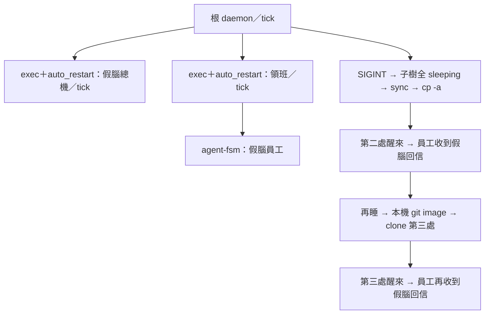

# image-move-check — 自建假腦試驗場，驗證整棵 daemon 休眠搬家後可醒來。

← [extras](../README.md)



一行自建、實跑、收尾；不碰正式 playground、不 build、不呼叫真腦。成功退 `0`，失敗退 `1`，輸出英文。

```sh
python3 proto8/extras/image-move-check/check.py
```

<details>
<summary>驗什麼、證據在哪、限制與清理</summary>

- 前置：Linux `/proc`、Python 3、`cp`、`sync`、`git`、`pgrep`，以及已裝在 `~/.local/bin` 的 aos 指令；沿用現有執行檔，不自動安裝。
- 每次用 `tempfile.mkdtemp` 建獨立 `/tmp/aos-image-move-*`，複製 repo 的 lib／py／templates；兩個子 daemon 在根的表上都是 exec 型、`auto_restart: true`。三台 daemon 都開 `tick: true`。
- 三台 daemon、總機 kernel 與員工 loop 都加 `--enable-counters`；等各台 state 窗旁的 `counter_runs.txt` >= 1，再逐台 ping；沒有用固定睡幾秒猜啟動。輪詢的 0.1 秒只是檢查間隔。員工至少跑三拍，再用 `say`／`listen` 驗回信。
- 根收 SIGINT 後等它退出，讀三台 `ctl ls --json` 驗所有列都是 `sleeping`；`sync` 後 `cp -a` 到另一位置，重設 `AOS_LLM_KERNEL` 再起根，驗列回到 `running`，再問一次假腦。
- **計數語義**：loop／daemon 的 `counter_runs.txt` 每次重啟從零開始（11-09 起 state 不再有 `counter_runs`），兩次數字變大不能證明累加。這裡用跨次累加的總機 `$AOS_STACK/counter_kernel_runs.txt`（aos-llm-kernel 開 `--enable-counters` 才寫）驗搬家後累加；各台 state 與所有 ctl 表仍完整留證。這不主張 loop 的執行次數能跨重啟延續。
- cp 驗過後再睡，三台 stack 各放正式 `stack.gitignore`、image 根放 `stack.gitattributes` 與只擋 `ws/.trash/` 的 `.gitignore`，在臨時 image 建專用 git repo；用 `commit-tree` 建無父 commit、更新 `main`，再 `git clone --local --no-hardlinks` 到第三處。全程本機；clone 的 origin 只指向 `/tmp` 來源，不連網、不 push、不碰原始碼 repo 索引；本機 commit 的姓名與信箱只給該命令用。第三處再驗三層表列 running 與假腦回信，保存 git commit、追蹤檔數與省略的空目錄。
- **git 計數**：正式 `stack.gitignore` 不擋 `queue.json`（11-07 sol 審查 #18 起；原本擋，搬家後等待時間與判官隊序歸零），`clone-evidence.json` 驗它有被追蹤。計數器 `counter_*.txt` 只給人看，11-09 起照 #20-1 擋掉、不進 image，所以 git clone 後 kernel 計數從頭數：檔有帶過去就驗它接著累加，沒帶就驗它重新數起（> 0）；`clone-result.json` 保存前後數字與 `kernel_counter_retained`。
- `--work-prefix p9-tick-move-` 可指定臨時證據夾前綴。`--timeout-s 40` 可調每一步期限。只記錄本次根行程的 descendants 與 `/proc` starttime，只向身分仍相符的 PID 送 SIGINT／SIGTERM；不用 KILL。最後 `pgrep -a aos-` 保存觀察輸出；用已記錄的身份確認沒有自己的殘留，不拿搜尋結果殺程序。
- stdout 印證據路徑。成功失敗都保留：原始、cp 搬後與 git clone image、命令及 stderr、前後 JSON 快照、持久計數比較、自己啟動的 PID、最後 pgrep 觀察。資料不自刪，確認看完後由使用者自行清理該次印出的臨時資料夾。
- 只驗「已完成回信後休眠、搬家、新問答成功」；不驗搬家時仍在途的 kernel 回信或跨主機環境。

</details>
