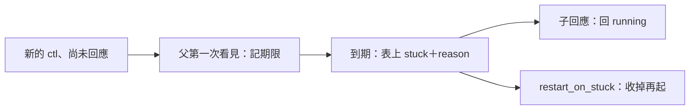
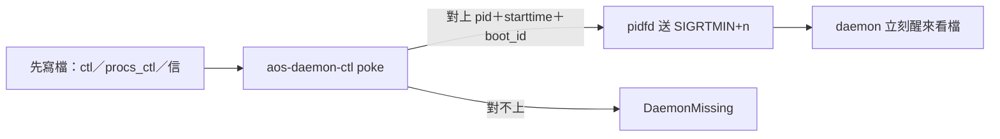

← [回入口 README.md](../README.md)｜段落：用法｜上一份：[03-起-停-暫停](03-起-停-暫停.md)｜下一份：[05-信箱](05-信箱.md)

### 兩個手把、兩扇穩定窗與一扇回音窗

| 面向 | 手把（人寫） | 狀態窗（daemon 寫） |
|---|---|---|
| loop 面向與自身 | `ctl.json`（慣用名）：一道指令 `cmd`（`pause`／`resume`／`stop`）、`max`、`interval_ms`、`seq`（同 aos-loop，起來第一拍比上一份 state_flux 的 ctl_seq，相同不重做、其餘照做） | `state.json`（慣用名）：同 aos-loop（`phase`、`max`、`interval_ms`、`paused`、收尾的 `code`、`pid`、`started_at_ticks`、`boot_id`、`updated_at`），有 `exec` 時另有 **`body_code`**（最後一次身體的結束碼；還沒跑＝`null`），另多頂層 **`daemon`**（no-pid P2，見下）與 **`poke`**（`{"ctl": N, "mail": N, "all": N}`，三個門鈴訊號的號碼，見下「poke 門鈴」），**沒有 `procs`** |
| 管轄（名單） | `procs_ctl.json`：`procs`、`procs_added`、`procs_removed`、`procs_stopped`、`procs_started`、`procs_slept`、`procs_woken`、`seq`；另可同時開信箱 `procs_requests`（見下） | `procs_state.json`：`{"procs_loop", "procs_exec", "procs_stderr", "procs_requests"（名字回報，沒開信箱＝null）, "daemon", "procs", "pid", "started_at_ticks", "boot_id", "updated_at"}` |

- `state_flux.json` 第一份一定寫，之後整份有變才寫，不含 `updated_at`；state／procs_state 先寫、state_flux 最後寫，所以看到回音時穩定狀態已落地。對表途中也先寫自身 state 的生效設定，再寫表與回音；任何穩定窗寫失敗，該次不提前回音。
- 自己的 state／state_flux 開門讀回也走 aos-loop 的留證流程：缺檔安靜，讀不了／JSON 壞／根非物件就改名 `.bad-<UTC 毫秒時間>`、印一行 warning，再從新狀態開始；另一扇好窗照常讀回。
- `adopt_warning` 記這次開門接表的英文警告；沒有問題（含檔不在）＝`null`，這次活著期間不變。主檔讀不了、不是 JSON 物件、缺 `procs`、`procs` 解引用失敗或不是物件，主檔改名為 `procs_state.json.bad-<UTC 毫秒時間>`（冒號換連字號、撞名加尾碼）後從空表開始，daemon.json 定義的列照起；只有個別列不是物件，先複製主檔留證、跳過壞列，好列照接。每個原因同步印一行 stderr warning 與一行 adopt log（開了 `--enable-logs` 才印）；多個壞列的原因以換行合成一個字串。留證只處理主檔，這一班不清舊分檔。
- 每圈先讀 ctl（`ctl.json`）、再讀 `procs_ctl.json`，**各自**採用或不採用（一份壞不影響另一份；回音統一進 `state_flux.json`：loop 的 `ctl_seq`／`ctl_warning`、管轄的 `procs_ctl_seq`／`procs_ctl_warning`；開信箱再加 `mailbox_warning`）。ctl.json 裡的名單 key（舊名 `loops*`、或 `procs*`）一律不認、不提醒。
- `procs_state.json` 的 `procs`：`{名字: {"pid", "started_at_ticks", "phase", "code", "signal", "stack", "ws"?, "exec"}}（`exec` 見 [02](02-看寫法決定怎麼起.md)）`，`phase`∈`running`／`stuck`／`stopping`／`stopped`／`sleeping`；`stopped`、`sleeping` 的列 `pid`、`started_at_ticks` 是 null。**auto_restart／restart_on_stuck（no-pid P6）**：寫了 `auto_restart: true`／`restart_on_stuck: true` 的列多同名一欄（只在 true 時寫；沒寫的列不變；P7 已使用 `restart_on_stuck`；`stuck_after_cycles` 不是預設 10 才記；寫了 `stuck_after_ms` 的列改記 `stuck_after_ms`）。
- `procs_state.json` 跟 state 一起看（`Loop::write_more`，每次要寫 state 都呼叫；沒開 state 也照呼叫），**有變才寫**：組好的那份（分檔前的表、四個公開檔名、`daemon`，不含 pid 那幾欄與 `updated_at`）跟上一份寫出去的一樣就不碰檔，不一樣才寫分檔→清舊分檔→寫主檔；daemon 對表時起一個、退一個也各寫一次。`pid`、`started_at_ticks`、`boot_id` 同一個行程的值——只讀這扇也能判 daemon 死活（N-17）。
- **表上不記時鐘的值**（[clock-and-hot-writes 題 3](../../../thinking/2026-11/09/clock-and-hot-writes/03-衝突與方向題.md)）：`procs_state.json` 頂層沒有時鐘觀察值，時鐘走時這扇窗不跟著重寫。想看時鐘走不走就 `cat "$AOS_CLOCK"`（鐘檔本身），或看跑鐘那列（範本叫 `_clock`，通常只在根）是不是 `running`。時鐘久沒動不退牆鐘、不 warning。
- **`counter_runs.txt`**（[N-09「計數器」](../../../docs/NORMS/05-基礎設施-窗/02-N-09～N-11.md)）：state 沒有 `counter_runs`。給 `--enable-counters` 而且有 state 窗時，每一圈開跑時把「這個行程起來後跑到第幾圈」寫進 state 窗同資料夾的 `counter_runs.txt`（同 aos-loop 的次數，沒有身體也照數）（十進位整數＋換行，先寫 `.counter_runs.txt` 再改名）；沒給旗標＝完全不寫。
- **`responded_at`**（只在 `state_flux.json`；no-pid P2，[thinking no-pid](../../../thinking/2026-11/05/no-pid/README.md)）＝最近一次有反應的時間（ISO 8601 UTC 到毫秒，同 `updated_at`；起來時 `null`）。daemon 的「有反應」＝aos-loop 那種（讀到新的一道 ctl 並處理了，好壞都算、第一道已套用過的不算），再加：這圈**收到信**（好信壞信都算，含 `ping`）、**採用了內容不同的新 procs_ctl**、表上**起了或收了一個子項**（放上表、拿掉、留成 `stopped`／`sleeping`）。自己的身體跑完一次（起不來也一樣）不算（[clock-and-hot-writes 題 2](../../../thinking/2026-11/09/clock-and-hot-writes/03-衝突與方向題.md)；父判卡住只拿子 ctl 的 mtime 跟它比，不受影響）。它算進「有變才寫」，所以閒著（沒指令、沒信、沒子項起落；有身體在跑也一樣）時 `responded_at` 不動，回音窗沒其他變動就不寫；state／procs_state 不受這欄影響。要看最近還有沒有在跑，開 `--enable-counters` 看 `counter_runs.txt` 有沒有在變。`responded_at` 不是心跳。上一層只拿公開 ctl／state_flux 窗判 `stuck`，不看信箱（見下）。
- **`daemon`**（兩扇都有、同一個值；no-pid P2）＝**管這台的上一層 daemon 的 stack**：起來時先記下繼承到的 `AOS_DAEMON`（照字面；父 daemon 給的是它自己的 stack，絕對、結尾 `/`），再把自己行程的 `AOS_DAEMON` 蓋成自己（[05「子項的 AOS_DAEMON」](05-信箱.md#子項的-aos_daemon)）。沒設或空＝`null`＝**根 daemon**（頭上沒人，由使用者自己顧）；繼承到的解開後就是自己的 stack（人殼 export 了指自己、再在同一個殼起它）也記 `null`（代定）。想知道「這台 daemon 怎麼了」就順著這欄去讀上一層的 `procs_state.json`（上一層按公開窗判卡住、按列上的 `auto_restart`／`restart_on_stuck` 決定是否重起）。
- **`stop`**＝這圈收工（收子項照 P-36），之後不看名單。**`pause`**（`resume` 解除）＝整圈暫停：不跑 `exec`、**也不調表**（不收多的、不起少的、起停也等；procs_ctl 的變動與信等解除暫停那圈才生效），
  但照讀兩份 ctl（`ctl_seq` 照回）、三扇狀態窗照規則寫（有變才寫）、照收已在收的、照記自己結束的（`done`：印 log、拿掉、本次不再起）、daemon 要停的退了照樣留成 `stopped`。

### 判卡住 `stuck`（11-06 P7）



父只看公開窗，任何程式都能照 aos-loop 公開的窗格式寫；父不認子是不是 daemon。預設只標記，行程仍算活著；`stuck` 是內部旗標投影到表上的樣子，退出照 `auto_restart`／收列規則。

<details><summary>讀哪些檔、期限與重起</summary>

- 任何 proc 都讀公開窗：父寫的 loop 設定有非空 ctl 才用它，否則 ctl.json；state_flux 有父設定照用，否則 state_flux.json。任一窗不存在，或 state_flux 設定為 null／非字串、內容非物件，就不判；要判卡住就要開 state_flux。
- 旁觀子項的狀態窗讀不了、JSON 壞或根非物件，當作沒有；同一個 daemon 行程對同一路徑只印一次 warning，不改名也不改寫子項的檔。
- 只看正在跑的列：ctl 修改時間比子 `responded_at` 新（null 也算），且比父這次起它或接回它的時間新，才算刺激（修改時間在未來＝時鐘倒退或手改，不算，P9）；此處只限定父判卡住的刺激時間；子 loop 起來仍會套用尚未回音的 ctl。沒有刺激不判，也不讀信箱。
- 父第一次看見刺激才記 `deadline_after(stuck_after_cycles)`；預設 10，兩鐘規則見 [02](02-看寫法決定怎麼起.md)。寫了 `stuck_after_ms` 的列改記牆鐘期限（不看時鐘，reason 寫 `control window has not been answered within N ms`），給跑鐘那列用——鐘被 SIGSTOP 或卡 I/O 時才判得出 `stuck`（clock-decouple，[02](02-看寫法決定怎麼起.md#時鐘普通一列)）。到期仍未回應＝`stuck`＋英文 `reason`；子 `responded_at` 跟上就清旗標與原因、回 `running`。接回時先回 `running`、重新記觀察基準，不沿用舊 `stuck`。
- `restart_on_stuck: true`：標記當拍送 SIGTERM，10 秒後還沒退就 SIGKILL 整群，走現成 settle 後照表重起、log 一行。第一次卡住也計入連續次數；第三次連續完全沒回應又卡住，收完留 `stopped`＋英文 `reason`、要人 `start`（最多實際重起兩次）；有回應就清連續次數。這 10 秒從送 TERM 起算，是 Linux 收行程的牆鐘期限；未設時鐘且採預設門檻時，從刺激到強制換新行程約需 10＋10 秒，另加巡查延遲。
- 父 paused 仍觀察與標記，但不重起；resume 後才收。`stopping`／`stopped`／`sleeping` 不判。paused 的子仍讀 ctl、回 `responded_at`，不因信箱積信而誤標。
- 身體跑很久會來不及讀 ctl，照樣可能被標；這種列自行調大門檻。直接往子 ctl 寫 stop 後若被重起，新子第一拍會照做尚未回音的 stop；掛在父下要留成 stopped 列，仍用父的 `aos-daemon-ctl stop`。
- **手寫子的 ctl 每次要換 `seq`**（使用者 11-06 晚「好」，[17](../../../thinking/2026-11/05/no-pid/17-P7實作結果.md#使用者裁定11-06-晚家機)）：子照內容分新舊，把一模一樣的 ctl 再寫一次＝修改時間變新、子卻當同一道不回應，到期會被標 `stuck`（`restart_on_stuck` 時會被重起），直到寫進內容不同的一道才清。`aos-daemon-ctl` 寫 ctl 自帶遞增 `seq`，不會撞。父也不看子的信箱：子信箱積信不算刺激（同一處裁定）。

設計與代定見 [16](../../../thinking/2026-11/05/no-pid/16-P7重設計.md)，實作與驗證見 [17](../../../thinking/2026-11/05/no-pid/17-P7實作結果.md)。

</details>

### procs_ctl 只寫變動（N-54）

使用者「ctl這塊我會想要是"啓動XXX loop/刪除XXX loop"，而不是每次都讓他讀全部」，選「維持宣告式，但可以只寫變動的」：

```json
{"seq": 3, "procs_added": {"carl": "agent-carl"}, "procs_removed": ["bob"], "procs_stopped": ["ann"]}
```

- `procs_added`＝名單上要多這些（寫法同 `procs`，也能 `{"$ref": [檔, …]}`）；`procs_removed`＝名單上要少這些（名字的陣列）；`procs_stopped`／`procs_started`＝要停／要起的名字（下「起、停、暫停」）。
- `procs_slept`／`procs_woken`＝現在睡／叫醒的名字（字串陣列，信箱也收同名 key）；sleep 立即 SIGTERM，列留 `sleeping`、stack 留著，wake 用同一個 stack 再起。所有 proc 都能用（裁定 B）；睡眠集合＝底＋`procs_slept`－`procs_woken`，同名兩邊都寫＝醒。
- **期望表＝（procs_ctl 的 `procs`，沒寫＝底）＋`procs_added`－`procs_removed`**，先加後減：同一個名字兩邊都寫＝不要；`procs_removed` 裡名單上沒有的名字不管；名單上已有的名字寫進 `procs_added`＝設定換成這份，已在跑的不重起。
- **stopped 集合＝底＋`procs_stopped`－`procs_started`**（同名兩邊都寫＝起）。
- 還是宣告（N-06）：只看這一份 procs_ctl 與底，讀幾次都一樣；**procs_ctl 拿掉 `procs_added`＝加進來的收掉**、拿掉 `procs_removed`＝減掉的照底重新起、拿掉 `procs_stopped`＝起。要一直加著、停著就一直寫著。
- 壞（不是 JSON 物件、`seq` 不是非負整數、五個名字陣列不是字串陣列、`procs`／`procs_added` 寫法或名字不合、指示詞解不開）＝整份不採用、記 state_flux 的 `procs_ctl_warning`。daemon.json 不認這幾個 key。
- **底**：起來時 daemon.json 的 `procs`（開了信箱再加 adopt 接回、不在上面的）＋信改過的，存在記憶體裡；stopped 集合的底＝adopt 接回的 `stopped` 列＋信改過的。只開 procs_ctl＝底就是 daemon.json（＋adopt 的 stopped）。

切整份 target 也可寫 `{"seq": 4, "procs": {"$ref": "procs-full.json"}}`；每圈解引用，路徑從 procs_ctl 所在資料夾算。移出名單的行程收掉後移除列，不會留 `stopped`；新增的起，同名活列不重起（見 [02](02-看寫法決定怎麼起.md#等-ready-與切-target)）。

每列另存 `launch`（重放入口、參數；只供再起）、stopping 列另存 `stop_mode`（stop／sleep／remove，供 adopt 接著處理）。兩者都不代表生命週期型別。

### poke 門鈴（11-09）



平常每圈看檔；急的時候先寫檔、再 poke，daemon 不等下一圈。鈴不帶內容，檔才是真相；鈴丟了也只是等回下一圈。

<details><summary>三種模式、state 欄、合併與不打斷</summary>

- state 穩定欄 `poke`：`{"ctl": SIGRTMIN+1, "mail": SIGRTMIN+2, "all": SIGRTMIN+3}`（寫的是這台的實際號碼）；寄件人只照這欄送，沒這欄＝`PokeFailed`。
- `ctl`（`aos-daemon-ctl poke` 預設）：立刻跑一圈——讀 ctl.json、procs_ctl、對表、寫窗；這圈不認領信箱、不跑身體。`mail`：再加信箱（套信、回信），仍不跑身體。`all`：提前一整圈，含身體（不管 `interval_ms` 到了沒；`max` 照算）。
- 平常的 super loop 圈完全不變，poke 只是提早叫醒；暫停中也叫得醒（立刻讀到 `resume`），`all` 在暫停中不跑身體。
- 連 poke 幾下（即時訊號會排隊）：醒來一次全取出、取最強的模式做一次。
- 身體跑到一半（不論是一支程式還是內嵌單子 `run_inline`）不打斷：poke 排在 kernel 裡，身體跑完立刻補看。
- 只有 aos-daemon 接 poke；aos-loop 不接（引擎的 `wake_`／`woke` 掛鉤它不設），SIGRTMIN+n 送給 aos-loop 照系統預設會把它打死。
- 不是收工訊號、不轉給身體；SIGUSR1／SIGUSR2 也一律擋住（[06](06-結束碼等.md#結束碼)）。子項起來前遮罩還原成 daemon 擋之前的樣子，子項與身體照常收得到這些訊號。
- 寄件人的護欄與錯誤代號見 [aos-daemon-ctl poke](../../../cmd/docs/03-aos-daemon-ctl.md)；這是「其他人不碰 pid」的唯一例外，條文在 [N-17「例外一：poke」](../../../docs/NORMS/05-基礎設施-窗/06-N-17.md)。

</details>
