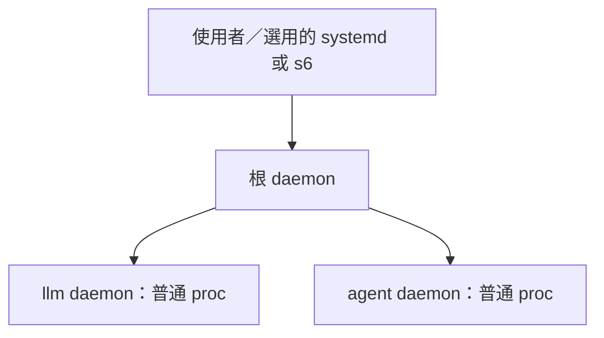

# 根 daemon 是普通 daemon，由使用者決定怎麼顧。

← [入口](../README.md)｜選用範例：[examples/root](../examples/root/README.md)



根用同一支 aos-daemon、同一套檔，只是頭上沒有 daemon。可以就是普通使用者行程，壞了就壞了；要持續運行，由使用者交給外部監管。aos 不預設 systemd 或 s6，也不另造「根的根」。

```sh
env -u AOS_DAEMON aos-exec --stack /absolute/image /absolute/root_definition
```

<details><summary>怎麼看根、怎麼等 ready</summary>

根的 `state.json` 與 `procs_state.json` 頂層 `daemon` 都是 `null`；`aos-daemon-ctl ls` 尾行是英文 `# root daemon (no supervisor)`。這只說沒有上一層 aos daemon，外面仍可有 systemd／s6。根 crash 後重起與普通 daemon 相同：從自己的 stack 接回活列、醒來續跑，不另有根專用復原流程。

啟動根後，要確認它能收信，明確 ping（不靠固定延遲）：

```sh
aos-daemon-ctl --daemon /absolute/image ping
```

根回信不代表所有子服務都 ready；需要 llm daemon 可呼叫，就對它自己的 stack ping。沒有信箱的 loop，起它時給了 `--enable-counters` 就可讀它 state 窗旁的 `counter_runs.txt`，等數字 >= 1；這只保證第一次已經開跑（開跑時就寫），不保證身體跑完、更不保證成功。父只看子「活著、叫得動」的公開訊號，不讀子的信箱、子項表或業務內容。

</details>

<details><summary>用 target 換一份名單</summary>

在根 stack 放兩份名單（目標路徑按 daemon cwd 算，自行換成實際定義）：

```json
// procs-demo.json 的內容（JSON 檔不要寫這行註解）
{"llm": {"exec": "/absolute/llm_definition", "auto_restart": true}}
```

```json
// procs-full.json 的內容（JSON 檔不要寫這行註解）
{"llm": {"exec": "/absolute/llm_definition", "auto_restart": true},
 "agents": {"exec": "/absolute/agents_definition", "auto_restart": true}}
```

先把 `procs_ctl.json` 寫成 `{"seq":1,"procs":{"$ref":"procs-demo.json"}}`；再用暫存檔改名，換成 `{"seq":2,"procs":{"$ref":"procs-full.json"}}`。full 多的 agents 起來；切回 demo，agents 收掉後列消失，stack 留著。它不是 `stopped`。同名 llm 活列不重起；名單的相對 `$ref` 從 procs_ctl 所在資料夾算。

</details>

<details><summary>資源與遠期方向</summary>

整樹總額可選用 [09 的 systemd scope](09-份額.md#整棵樹的總額外面包)；未具備 systemd 的公司 WSL 不適用，家機要先確認 user slice 控制器。

遠期是「一個 agent 一個 Linux 帳號」、根掛沙箱、用有 root 權限的小程式切帳號；這次不做、不預留 key。

</details>

<details><summary>本次驗證範圍（11-06 家機）</summary>

正式試驗場已確認根兩扇窗 `daemon: null`、`ctl ls` 尾行 `# root daemon (no supervisor)`；領班被殺後由根約 0.060 秒重起。獨立 `/tmp` fixture 用原子改名依序切 `$ref` demo（a）→full（a、b）→demo（a），約 0.021／0.061／0.162 秒取得快照；三次 `ctl_warning` 都是 `null`，a 的 pid 不變，b 收掉後消失。最後只向本次子程序送 SIGINT 並收回。

家機 user slice 的 `cgroup.controllers` 實查有 `cpu memory pids`；本次沙箱連 user bus 被 `Operation not permitted` 擋住，**scope 未實跑**。systemd unit 已對照本機 systemd 手冊；最後一版 `systemd-analyze verify` 初始化驗證器時被沙箱 socket 權限擋住（退1），未取得語法通過結果。s6 run 的 `sh -n` 通過；兩種監管器均未做端到端驗證。

</details>
