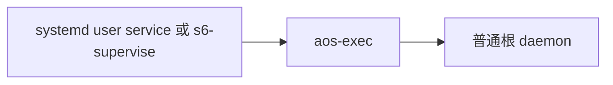

# 兩個外部監管根 daemon 的選用範例，不預設安裝。

← [根 daemon](../../docs/10-根daemon.md)



先改範例中的執行檔、PATH、工作區、image 與定義路徑；PATH 要包含所有子項需要的 aos 指令。根在前台跑，`_entry` 用 argv 直接起 aos-daemon；不可自行放背景。選一種即可，不要兩邊同時管同一個 stack。

| 選項 | 好處 | 代價 |
|---|---|---|
| systemd user unit | 系統已有 user manager 時，啟停與 journal 都現成 | 要 systemd user session；登出後維持運作需另外配置 linger；連續啟動失敗會撞啟動限流 |
| s6/run | 簡單的 exec 鏈，不依賴 systemd | 要安裝 s6，並由使用者安排 s6-supervise／s6-svscan 自己的生命週期與日誌 |

<details><summary>systemd user unit：安裝、啟停</summary>

改好 [aos-root.service](aos-root.service)，複製到 `~/.config/systemd/user/aos-root.service`：

```sh
systemctl --user daemon-reload
systemctl --user enable --now aos-root.service
journalctl --user -u aos-root.service -f
systemctl --user stop aos-root.service
```

`Restart=always` 包含正常退出；要停必須用 systemctl stop。範例 `KillMode=mixed` 先只向根送 TERM，讓它逐層收工；60 秒還未收完，systemd 可收整個 unit。這種外部強制收尾與 daemon crash 後接回不同，按需要調整期限。公司 WSL 若無 systemd，此例標「家機才有」。

</details>

<details><summary>s6：啟停</summary>

把 [s6/run](s6/run) 複製到自己可寫的服務資料夾並保留執行權限（supervise 與 event 會寫在服務資料夾）：

```sh
s6-supervise /absolute/service_directory
# In another terminal:
s6-svc -d /absolute/service_directory
s6-svc -u /absolute/service_directory
s6-svc -xd /absolute/service_directory
```

`run` 用 exec，讓 s6 直接監管根。正常退了也會再起；要停用 `-d`，停且讓 supervisor 退出用 `-xd`。正式長駐可讓既有 s6-svscan 管這個服務資料夾；不加 ready 通知，ready 仍用 aos 的 ping／公開窗。

</details>

依據：[systemd.service](https://www.freedesktop.org/software/systemd/man/latest/systemd.service.html)、[systemd.kill](https://www.freedesktop.org/software/systemd/man/latest/systemd.kill.html)、[s6-supervise](https://skarnet.org/software/s6/s6-supervise.html)、[s6-svc](https://skarnet.org/software/s6/s6-svc.html)。
