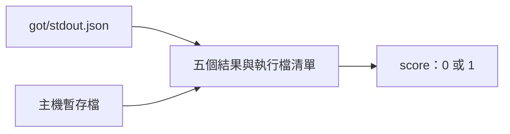

# box_check — 檢查關箱探測輸出與主機暫存檔是否符合隔離界線。

比對器供 [box-probe](../../../cases/box-probe/README.md) 使用；任一探測缺漏或越界就給零分。

判準與執行

stdin 依 [case 比對器契約](../../../cases/README.md) 給 `expect`、`got`、`input`。R1 必須成功但主機 `/tmp/aos-box-probe` 不得存在；R2 網路必須失敗；第 5 條必須有唯一的 `P5 <路徑>`，並以主機上該路徑不存在為通過條件，不看 R5 的結束碼；R3、R4 列舉必須成功；不得列出主機使用者家目錄的內容。執行檔集合取自 bash-boxed 的公開 `_metainfo.json#/sandbox/ro`，同時容許 Python 捷徑的實體檔。主機探測檔若存在會清除並判零分。P5 保留 `$AOS_STACK/../../history.jsonl` 的原字串（含 `../..`），沙箱空殼目錄寫入成功仍可通過。

`python3 -m unittest discover -s proto8/lib/aos/box_check/tests -v`

測試實際呼叫 aos-exec、aos-sandbox 與 measure；不把 sandbox 權限失敗跳過成通過。

