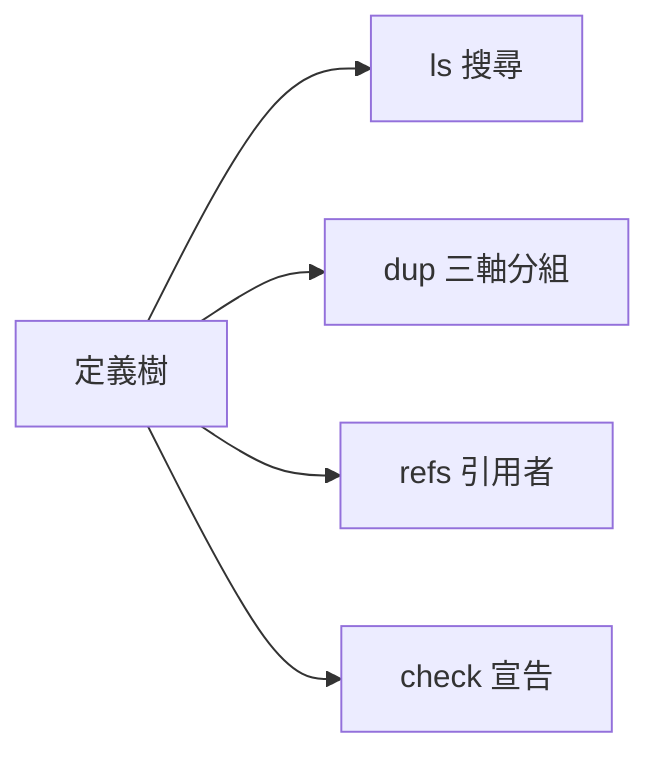
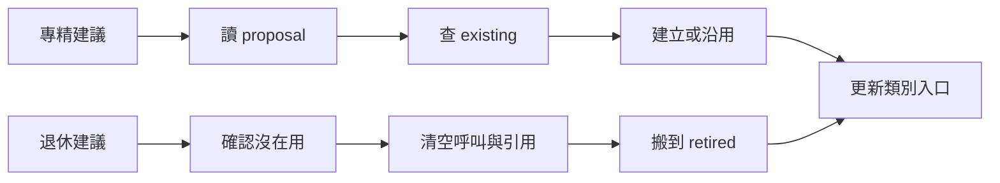

定義目錄工具只讀公開宣告，列出定義、同質群與靜態引用，並檢查定義是否齊全。

同質只看工具、腦端點、記憶；只改開場白仍然同質。工具不改定義、不讀帳、不查 daemon。

`echo '{"op":"ls","root":"/absolute/defs"}' | proto8/lib/aos/defs/_entry`

介面與判準

stdin：`{"op":"ls|dup|refs|check","root":"/absolute/defs","match":"optional substring","def":"optional target"}`。旗標與英文說明見 `_entry --help`。

- `ls` 回 `{"defs":[...]}`，列含 `path`、`summary`、`brain`；有腦再帶 `tools`、`endpoint`、`knowledge`，有出身則帶 `lineage`。`match` 只比路徑與 summary，不分大小寫。
- 遞迴遇 `interfaces.json` 或 `_metainfo.json` 就當作定義並停止往下；不走隱藏夾或目錄捷徑；退休樹應放 defs 根旁同層。
- `dup` 回 `{"groups":[{"key":"canonical JSON signature","members":["category/a","category/b"]}]}`。只算 `aos-agent`；工具解析真實路徑、去重排序，不比登記名與 env；端點未提供時為 `default`，明給空字串照空字串；沒有記憶為 `null`。記憶 `base` 字串相對宣告檔所在夾，環境物件照字面比較。輸出路徑相對 root。
- `refs` 必須給 `def`，回 `{"refs":["category/caller"]}`；讀各 agent 公開工具宣告的 `path` 與 env 的 `AOS_DO_TASK_FROM`，工具 path 相對工具表所在夾；AOS_DO_TASK_FROM 相對目前 AOS_WS（未設時無法解析的相對值不計），絕對值直接解析。回引用者路徑，排序去重，不包含自己。
- `check` 回 `{"problems":[{"path":"category/a","reason":"English reason"}]}`。README 第一行非空、meta 有非空 summary、interfaces 是物件；agent 宣告的 tools／llm 必須存在且可讀，選填 knowledge 有宣告才檢查。tools.json 有 `"$override"`（範本疊 `lib/packs`）時交給 `aos-tools ls -l` 合併再看，只帶 `env` 的格沿用底檔的 `path`；沒設 `AOS_HOME` 用這份 proto8（11-10 tool-packs）。定義路徑各段符合 `[a-z0-9_-]+`。不要求 lineage 親代還在。
- `check` 發現問題仍保留 JSON stdout，stderr 一行 `defs: error: DefBad ...`，退 1；正常退 0。根不在為 `RootMissing`，其他壞宣告為 `DefBad`。所有 op 只讀；根指向空目錄時回空清單。

## 處方

建議由隊長執行；撞同質只提醒長特色，不能直接視為合併許可。

specialize 四步

以下使用 shell 變數 `DEFS`（定義根）、`REVIEW`（review.json）、`SOURCE`（來源定義）、`TARGET`（新定義）、`AGENT_DEF_TOOL`（`lib/agent/agent_def` 的絕對路徑）；路徑依自己的工作區填入。

1. 讀 review 的 `suggest.specialize`，核對 `proposal` 與 `evidence`。`context_too_big` 的 proposal 為 null 時，先由隊長決定要拆的職責或記憶。
2. 用 `defs --op ls --root "$DEFS"` 對照三軸與 `existing`。有同三軸現成定義就沿用它，不另生一隻。
3. 無現成定義時，用 `agent_def` 的 `new` 把來源整份複製成新定義（只複製；不帶 `reason`／`review`，血統先不記（使用者 11-10「血統記錄...可以先不做」））；再用一般檔案工具照 proposal 改新定義的 `tools.json`、`llm.json` 與記憶那格；要跑起來用 `subagent`（記帳、算配額）或 `agents_ctl`（不記帳）掛：
   `jq -n --arg from "$SOURCE" --arg path "$TARGET" '{op:"new",from:$from,path:$path}' | aos-exec --ws "$PWD" "$AGENT_DEF_TOOL"`
4. 更新目標類別 README，再以 `defs --op check --root "$DEFS"` 檢查。

上面 `defs` 表示本夾 `_entry`；工具不會代做此處方。

retire 四步

連續三個 case 沒被叫、而同類別兄弟有被叫，才有退休訊號。類別只有一隻時不退。以下 `TARGET` 是相對 defs 根路徑，`RETIRED` 是 defs 根旁同層的 retired 根。

1. `aos-agent ctl ls --json` 查看每個相關 daemon；只要有列的 def 指到目標或子路徑，就不動。
2. 讀建議中的 callers，並跑 `defs --op refs --root "$DEFS" --def "$TARGET"`。先改呼叫方，直到 callers、refs 都清空。
3. `mkdir -p "$RETIRED/$(dirname "$TARGET")"`，再 `git mv "$DEFS/$TARGET" "$RETIRED/$TARGET"`。不刪、不留轉向捷徑；復職則搬回原位。
4. 更新來源與退休類別的 README。

驗證

`PYTHONDONTWRITEBYTECODE=1 python3 -m unittest discover -s proto8/lib/aos/defs/tests -v`

測試在系統暫存目錄造定義，涵蓋三軸、搜尋邊界、兩種靜態引用與各項 check 判準，不寫 repo 內的執行資料。

