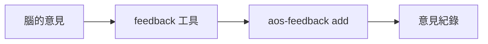

將指令或函數的使用意見交給 `aos-feedback add`，不推測呼叫者。

stdin 收一份 JSON；必填 `command`、`pain`，選填 `suggest`、`kind`、`score`、`by`。未給 `by` 時明確傳 `aos-agent`。

參數與結果

`command` 是原樣保存的指令或函數名稱；`pain` 是遇到的問題，`suggest` 是改善建議。`kind` 可填 `usage`、`help`、`errors`、`args`、`other`，預設由下層採 `other`；`score` 選填 0～1，1 表示很順手。

工具透過 PATH 尋找 `aos-feedback`，將旗標值與位置參數分開傳送，文字即使以 `--` 開頭也按原值處理。不自行寫紀錄、不讀取呼叫者身分；紀錄位置與參數內容檢查由命令列負責。試跑時將 `AOS_FEEDBACK` 指向 `/tmp` 暫存夾。

成功時原樣輸出下層的一行 `aos-feedback: recorded <file>`。下層 stderr 直接透傳；下層非 0 時，工具透過 `tool_io` 在 stdout 與 stderr 各印一行 `feedback: error: CommandFailed ...`、退 1，不解析下層錯誤文字。啟動失敗是 `LaunchFailed`。

