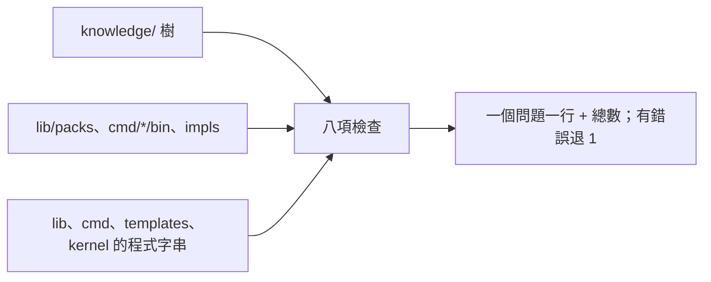

# knowledge_check — 檢查出廠知識庫：指標、表與孤兒、工具與指令有沒有節點、錯誤代號、開發殘留、大小；只讀不寫。



一句話：改完知識庫或工具說明後跑一次，看有沒有指不到的路徑、沒進表的檔、缺節點的工具與指令。

`python3 proto8/lib/aos/knowledge_check/_entry`（不給參數＝查 `$AOS_HOME/knowledge`；只看一類：`--only tools`，可重複）

<details><summary>八項檢查與級別</summary>

| 檢查（`--only`） | 級別 | 看什麼 |
|---|---|---|
| `refs` | 錯誤 `RefMissing`／`RefBad` | 庫內每個字串值裡的 `aos/….json#/…`、`aos/…/`，`{"$ref": …}`（相對＝含它那份檔的資料夾）；`lib`、`cmd`、`templates`、`kernel` 底下 `.py`、`.json`、`_entry`、`bin/` 裡的檔出現的同樣字串（含每支 `_tooldef.json` 的 `Details: knowledge_read …`）。跳過 `tests`、`thinking`、`archive`、`fixtures`、`build`、`__pycache__`。只認帶 `.json` 或以 `/` 結尾的；前面接路徑字元的（`knowledge/aos/x.json`）是 repo 路徑、不算 |
| `index` | 錯誤 `NodeMissing`／`IndexEntryMissing`／`IndexBad`／`FileBad` | 每個資料夾的 `_index.json`、每個帶 `_index` key 的物件：表裡列的都在；資料夾裡的檔與資料夾、物件裡的 key 沒列＝孤兒（`.`、`_` 開頭的不算，所以 `_description`、`_index` 例外）。`$env` 格看環境，不判 |
| `tools` | 錯誤 `ToolNodeMissing`／`ToolDefMissing` | `lib/packs/*.json` 登記的每支工具 |
| `cmds` | 錯誤 `CmdNodeMissing` | `cmd/*/bin/aos-*` 每支指令 |
| `impls` | 提醒 | `impls/*/CMakeLists.txt` 的 `add_executable(aos-X_main …)` 每支執行檔 |
| `codes` | 提醒 | 登記工具的 `_tooldef.json` 的 `errors`：庫裡全文找不到的代號；結尾不在 C-54 表（`Missing`、`Unknown`、`Bad`、`Failed`、`Exists`、`Rejected`，另加 `Internal`）的代號 |
| `residue` | 錯誤 `DateNoteBad`／`ThinkingRefBad`／`PlaceholderBad` | 庫內字串值裡的 `11-06 note` 這種日期註、`thinking/`、`XXX` |
| `size` | 提醒 | 一份 `.json` 超過 `--max-file-bytes`（預設 8192）、一個字串值超過 `--max-text-bytes`（預設 1024） |

</details>

<details><summary>節點怎麼認（覆蓋的規則）</summary>

- **工具有節點**＝它的 `_tooldef.json` 的 `description` 裡有 `Details: knowledge_read 路徑`，而且那條路徑從庫根解得到（句尾的 `.`、`)` 不算路徑）。沒有這行、或解不到＝`ToolNodeMissing`；工具資料夾沒有 `_tooldef.json`＝`ToolDefMissing`。路徑解不到時 `refs` 也會報一次（兩個問題：指標壞了、工具沒節點）。
- **指令有節點**＝樹裡某張表（`_index.json` 或 `_index` key）某一格的 `_description` 寫出完整指令名（整個字，`aos-agent` 不算 `aos-agent-x`）。現有 `aos/cli/` 的格就是這樣寫的（「Use aos-daemon-ctl …」）；檔名不必等於指令名（`daemon.json` 寫 `aos-daemon-ctl`、`grow_screen.json` 一格管兩支）。
- 工具清單、指令清單都從磁碟讀，新包、新指令不用改這支。

</details>

<details><summary>輸入、輸出、結束碼</summary>

旗標與 stdin JSON 同源（`_tooldef.json`）：`root`、`home`、`only`、`json`、`max_file_bytes`、`max_text_bytes`。`home`＝proto8（預設 `$AOS_HOME`，沒設＝這支所在的 proto8）；`root`＝庫根（預設 `home/knowledge`）；相對路徑從 `$AOS_WS`，沒設＝目前資料夾。

stdout 一個問題一行，最後一行總數：

```text
knowledge_check: error: IndexEntryMissing docs/01-x.md: not listed in its index
knowledge_check: warning: size aos/me.json: file is 17779 bytes (over 8192)
knowledge_check: error: CheckFailed 45 errors, 80 warnings
```

沒有錯誤＝最後一行 `knowledge_check: total: 0 errors, M warnings`、退 0；有錯誤＝最後一行是錯誤行 `CheckFailed`（stderr 也印同一行）、退 1。`--json`＝stdout 改印一份 JSON（`problems` 每筆 `level`、`check`、`code`、`where`、`reason`；`errors`、`warnings` 總數），錯誤行只到 stderr。參數壞＝`ArgumentsBad`，`home`／`root` 不是資料夾＝`HomeBad`／`KnowledgeBad`。

路徑解析用 `lib/agent/knowledge_fs`（`knowledge_read` 的同一份）；位置在不在直接讀 JSON（路上的 `$ref` 照跟），不起 `aos-json`。只查 `.json` 內容，`README.md`、`docs/` 這類給人看的檔只算在表與孤兒裡。

`python3 -m unittest discover -s proto8/lib/aos/knowledge_check/tests -v`：每項在 tmp 造的小樹上各變紅、變綠一次。

</details>
