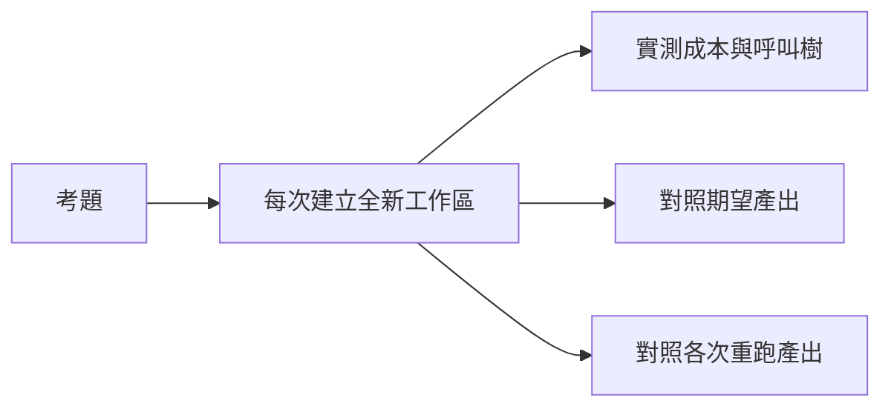

# measure — 隔離執行考題，回報產出比對、成本與重跑一致性。



每次執行都在本工具的 stack 內建立獨立工作區與 stack。結果只印一份 JSON 到 stdout，由呼叫者決定存在哪裡。

```sh
aos-exec proto8/lib/aos/measure --case "$PWD/proto8/cases/smoke" --defs "$PWD/proto8" --repeat 3
```

<details><summary>輸入契約與記帳方式</summary>

stdin 收一份物件，包含 `case`、`defs`、`repeat`（正整數，預設 1），以及選填的 `check` 覆寫值。考題的 `run.json` 使用 `exec`／`stdin` 或 `agent`／`say` 其中一組；另可放初始工作區 `ws/`、期望產出 `expect/`、比對設定 `check.json`。比對設定接受 `compare` 與 `min_score`（預設 1）。執行目標與相對比對器路徑以 `defs` 為根；輸入檔路徑以考題夾為根。agent 考題另接受 `timeout_s`（預設 60），在目前 daemon 掛上唯一名稱，依序 add／say／listen／stop，翻帳後移除實例。

原始 stdout 位元組存成該次工作區的 `stdout.json`，供比對。內建逐 byte 比對器逐一檢查期望檔案；多出的檔案不扣分，空期望資料夾得 1 分。沒有 `expect/` 時，以第一次執行的工作區為基準。目標非零結束碼記在 sample 的 `code`，並強制使 `check.pass` 為 false。自訂比對器收到絕對路徑 `expect`、`got`、`input`，回傳介於 0～1 的 `score`、字串陣列 `diff`，以及選填的 `why`；非零結束碼同樣判定失敗。比對器成本（含重跑一致性比對）記入 `check.cost`，不計入產出成本 `cost`。

頂層 `cost` 是各 sample 成本逐欄取中位數，`tree` 使用第一次執行的呼叫樹。`size_bytes` 是輸入檔加初始工作區檔案的位元組數。`repeat >= 2` 時，用同一個比對器與門檻，將後續每次工作區與第一次比對，產生 `consistency`。`check.scores` 表示對照期望產出的分數；`consistency.scores` 表示重跑之間的分數。

單一考題的暫存位置是本工具 stack 內的 `runs/<未使用整數>/ws` 與同層 `stack`；既有執行資料夾會保留。套題使用 `cases/<考題名>/runs/<未使用整數>/`。沒有 `run.json` 的資料夾視為套題，執行直接下一層含 `run.json` 的子考題，各題完整結果保留在 `cases`。套題每份 sample 加總各題成本，保留比對結果與結束碼；第一份 sample 的呼叫樹建立 script 根節點，本地 token 為零、時間為子節點時間總和。套題每輪的 consistency 分數是各子題分數的算術平均，各題等權（含自訂比對器）；各題原始分數仍可分開查看。

套題的一致性總分只適用於同一粒度的考題。腳本單步、LLM 單步（按 endpoint 分開）、整體執行三層必須分開量測，不跨三層合成確定性結論。

副產物只寫在本工具 stack 內，不回寫定義的 metadata。

</details>
