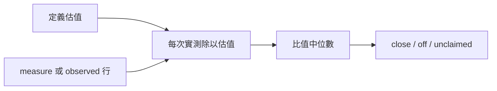

# metainfo_check 比較定義自稱與實測成本，只回報、不寫檔。

比值在 0.8～1.25（含邊界）就是 `close`；超出為 `off`，沒有估值為 `unclaimed`。

`echo '{"def":"/abs/defs/tool","observed":[{"cost":{"time_ms":1000}}]}' | aos-exec proto8/lib/aos/metainfo_check`

輸入、輸出與邊界

stdin 給 `def`（定義夾或 JSON 工具）及 `observed` 陣列。成本只比較 `/time_ms`、`/token/in`。輸出是 `checked_at` 與 `defs`，每列含 `def`、`key`、`claimed`、`observed`、`ratio`（有估值時）、`verdict`。多次輸入逐次算比值後取中位數，兩個數字欄也各報其中位數。

measure 有 `samples` 時只讀樣本，不重算彙總與第一份 tree；每份有 tree 時只選目標定義節點，沒有 tree 則讀 sample 的 cost。tree 的相對 def 由 measure 的 defs 解析。公式交給 `lib/metainfo.eval_cost`，只給實測上的 `in_bytes`，缺變數報 `CalBad`，不拿包含工作區的 `size_bytes` 冒充。

直接的 observed 行：tool 的 elapsed_ms 及 in_bytes 對應該 def；self 指定 think 行的擁有者，think 的 prompt_tokens 在每段 self 內加總為該擁有者一個樣本；cmd 行略過。不讀任何 child 路徑，不重建未提供的子帳。要比較完整每次呼叫的時間與 token，優先提供 measure 樣本。

零估值與零實測比值定為 1；零估值但正實測為 off，ratio 輸出 null。缺少該項實測就不出該項；完全沒有目標實測、負數或非有限數、格式錯誤為 ArgumentsBad。metadata 錯為 FileBad，公式錯為 CalBad。無 metadata 與不認識的求值器皆為 unclaimed。

