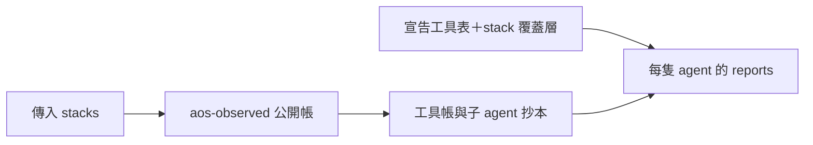

# shell_report：唯讀彙整公開 shell 帳、有效工具階段與指令形狀。



看一隻 agent 還有哪些任意執行工具，以及哪些指令反覆出現。`boxed` 只代表工具宣告有沙箱，實際關住要另跑 `box-probe`。

```sh
printf '%s\n' '{"stacks":["/abs/run/stack"],"defs":"/abs/defs"}' | aos-exec /abs/proto8/lib/aos/shell_report
```

<details>
<summary>輸入、輸出與小選擇</summary>

stdin 收 `{"stacks":["絕對 stack 路徑", ...], "defs":"定義根（選填）"}`；`defs` 用來解公開 `self.def` 的相對路徑。stack 必須存在。空陣列回空報告。

stdout 固定為 `{"reports":[...]}`，按絕對 agent 定義路徑彙整並排序；每份包含 `agent`、`shell_stage`、`arbitrary`、`binaries`、`shapes`。相同定義在多個 stack 用過不同工具時，階段取最鬆的、任意執行工具名取聯集。

```json
{"reports":[{"agent":"/abs/defs/worker","shell_stage":"open","arbitrary":["bash"],"binaries":["/usr/bin/rg"],"shapes":[{"shape":"rg -n <arg> <arg>","count":2,"exit_zero":1,"cases":["/abs/run/stack"]}]}]}
```

公開帳沒有 case 名宣告，所以 `cases` 原樣使用傳入的絕對 stack 路徑；不猜目錄名代表哪個 case。多個 repeat stack 會各列一次，呼叫者可用 measure 的 case／run 對照表解讀。重複傳入同一實際 stack 不重複計數。

有效工具表只從定義 `interfaces.json#/aos-agent/tools` 找，stack 裡同一宣告路徑有這隻自己那份就只把它交 `aos-tools --file ... ls --json`（它 `$override` 定義那份，疊法歸 aos-tools；11-10），否則交定義那份；未宣告 tools 視為沒有工具。任一 `arbitrary_exec: true` 工具缺 `sandbox`＝`open`，全有＝`boxed`，沒有任意執行工具＝`none`。`arbitrary_exec` 必須是 JSON 的 `true`；`sandbox` 看 key 是否存在。

</details>

<details>
<summary>公開帳、形狀規則與限制</summary>

只讀各 stack 的 `interfaces.json#/aos-observed/file` 所指帳。工具的 `tool.stack` 往下翻，`tool.child` 指到的 `observed/子名/` 抄本另立 agent 擁有者；一般工具自己的 `self.def` 不搶走父 agent 的指令帳。不走訪無引用的目錄；無宣告的帳即使存在也不讀。帳有循環或重複引用只讀一次。

指令用 `shlex.shlex(punctuation_chars=True)`，按 `|`、`&&`、`||`、`;` 分段。每段第一字保留、`-` 開頭字保留，其餘成為 `<arg>`；重導向連同目標合成一個 `<redir>`，數字檔案描述符一起吃掉。這是詞法形狀，沒有執行、展開 shell 變數或解析完整 shell 語法。

每段用原始 `cmd.exit` 計 `exit_zero`，並沒有各管線段自己的結束碼。第一字交主機 `shutil.which`，找到後解實際路徑列入 `binaries`；因此受讀報告時主機 PATH 影響，不代表當時沙箱內實際執行檔。找不到的程式仍有形狀，只是不列 binary。

未宣告的 stack 回空報告；宣告帳壞掉、指令引號不成對、有效工具表讀失敗等都退 `ReportFailed`，錯誤由 `tool_io.py` 印到 stdout／stderr，退 1。輸入型別／必填欄錯誤由共用介面退 `ArgumentsBad`。不讀下層 stderr。

</details>

<details>
<summary>驗證</summary>

```sh
PYTHONDONTWRITEBYTECODE=1 python3 -m unittest discover -s proto8/lib/aos/shell_report/tests -v
```

涵蓋 open／boxed／none、巢狀宣告工具表與覆蓋層、管線與重導向形狀、子帳歸屬、重複 stack、未宣告不讀、相對定義解法及工具錯誤介面。

</details>
