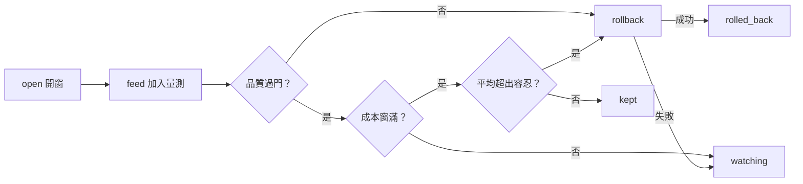

# watch — 記錄換上後的品質與單位成本，必要時自動退回前版。

← [lib](../../README.md)｜退回工具 [rollback](../rollback/README.md)

品質不過立刻退；成本要等整個窗滿才判。退回失敗保留 `watching`，下一次 feed 重試。

`aos-exec proto8/lib/aos/watch --help`

輸入、輸出與紀錄

`open` 收 `op`、絕對路徑 `watch`、`target`、絕對路徑 `defs`、`round`、`promoted_at`、`metric`、`baseline`、`window`、`tolerance`。新增窗帶 `samples: []`、`state: watching`；缺檔時建出 `{"watch": []}` 再追加。`round` 可為字串或整數。

`feed` 收 `op`、`watch`、`case`、整份 `measure`。只讀這份 watch 檔與傳入的量測，不搜尋其他 review。每個 watching 窗追加 `{"case", "unit_cost", "pass"}`；單位成本是 `measure.cost` 沿 `metric` JSON 指標取值，再除以 `measure.size_bytes`。成本需有限非負數，大小需大於零，品質值需 boolean。

stdout 固定 `{"changes": [{"target", "state", "reason", "error"?}]}`，每個本次處理的窗各一筆；沒有 watching 窗時回空陣列，feed 缺檔也回空陣列、不建空檔。`reason` 為英文。只處理 `watching`，已轉正或退回的窗保持原樣。

任一歷史 sample 品質不過即叫 rollback；否則湊滿 `window` 筆時，比前 `window` 筆平均與 `baseline × (1 + tolerance)`，嚴格超過才退，等於門檻會轉正。rollback 失敗後仍保留原窗的判準與所有 samples，後續 feed 重試，不讓新樣本洗掉已確定的退回決定。

rollback 透過 `observed.call()` 呼叫，使用窗內的 `defs`、`target`；daemon 檢查沿用 rollback 的 `$AOS_DAEMON` 預設。失敗的代號與原因轉接到 change 的 `error` 字串，尾端帶 `[exit code N]`；stdout 仍是 JSON、stderr 不印錯誤、退出 0。watch 自己的壞參數／讀寫錯誤則透過 tool_io 兩邊印同一行、退出 1。

watch 文件用同目錄暫存檔寫完再 `os.replace()`，保留文件其他鍵。沒有鎖；工具標記 `parallel: false`，呼叫端應串行使用。

