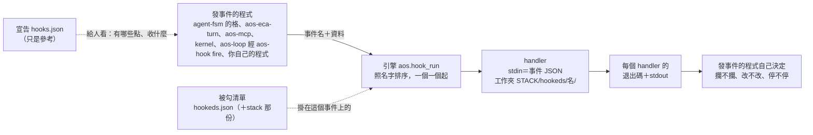

hook 一頁看懂：三樣東西（宣告、被勾清單、interfaces.json 的兩個鍵）與一條流程（發事件 → 叫 handler → 發事件的程式自己決定怎麼用結果）。

← [入口](README.md)｜下一份 [02-宣告格式](02-宣告格式.md)

## 三樣東西

| 東西 | 是什麼 | 誰讀 | 例子 |
|---|---|---|---|
| **宣告** `hooks.json`（kernel 叫 `kernel_hooks.json`，aos-loop 的叫 `loop_hooks.json`） | 有哪些鉤子：每個 hook 點的 id、handler 會收到什麼（`input`，JSON Schema） | 人、agent、測試；**沒有程式照它做事** | [lib/aos/apps/agent_fsm/hooks.json](../../agent_fsm/hooks.json) |
| **被勾清單** `hookeds.json`（kernel 叫 `kernel_hookeds.json`） | 有哪些被勾著：`{hook 名: {"event", "handler", "timeout_ms"?, …} 或 null}` | 發事件的程式（經共用的 [`aos.hook_lists`](../../../hook_lists.py)） | [templates/agents/agent-fsm/hookeds.json](../../../../../templates/agents/agent-fsm/hookeds.json) |
| **`interfaces.json` 最外層**的 `hooks`、`hookeds` | 指出上面兩份在哪：檔名、指示詞、或它們的陣列（只收檔名，不收直接寫內容） | `aos.hook_point`（`aos-hook fire --def`、agent 一家、kernel 都經它） | `"hooks": [{"$env": "AOS_HOME", "$path": "/lib/aos/apps/hook/loop_hooks.json"}, "hooks.json"], "hookeds": "hookeds.json"` |

- 相對檔名從定義夾算；指示詞（`{"$env": …, "$path": …}`）經 `aos-directive` 解成路徑，只有物件那項才起行程。
- agent 的被勾清單有兩層：定義那份，疊上 stack 裡同名的那份（`<stack>/hookeds.json`；同名蓋過、`null`＝關掉、檔不在＝沒有 hook）。`aos-agent hook`／`self_hook` 只寫 stack 那份。
- 沒寫 `hookeds`＝這個程式沒有 hook；寫了 `hooks` 卻沒有那份檔，什麼都不受影響（宣告只是參考，實測過）。

## 一條流程



1. **誰發事件**：在某個時刻（工具要跑、loop 起來、kernel 要判一封信…）決定發哪個事件、附什麼資料。aos 自己有幾家：agent 一家、aos-loop 四點（經 `aos-hook fire`）、eca 的壓縮兩點（經 `aos-hook fire`）、kernel 三點；你自己的程式也可以（[06](06-自己發事件.md)）。
2. **照清單叫 handler**：引擎讀被勾清單裡 `event` 等於這個事件的格，照 hook 名字排序，一個跑完才起下一個（[03](03-寫handler.md)）。
3. **handler 的輸入、輸出、退出碼**：stdin 是一份 JSON（資料加上 `event`、`hook`、`stack`）；引擎收 stdout 與退出碼；`timeout_ms`（預設 60000，0＝不限）到了整群殺掉。
4. **發事件的程式自己決定怎麼用結果**：agent 一家把退 10 當「攔下」、把 stdout 的 JSON 物件當「改欄位」；loop 四點把退出碼原樣交給 aos-loop；kernel 失敗就停這一輪（[05](05-各家的點與規矩.md)）。引擎本身不懂「攔」「改」「失敗」。

## 最短的例子

agent 擋掉腦叫 `shell` 工具（`before_tool` 是 agent 一家能攔的點）：

```sh
cat > guard <<'EOF'
#!/bin/sh
echo "shell is turned off by hook guard"   # 腦看到的工具結果
exit 10                                    # agent 一家：before_tool 退 10＝這次工具不跑
EOF
chmod +x guard
aos-agent hook -t bob add --event before_tool --condition shell ./guard
```

結果寫進 bob 的 `<stack>/hookeds.json`：`"guard": {"event": "before_tool", "handler": "<相對 stack 的路徑>/guard", "condition": "shell"}`；下一個事件就生效，不用重起。

自己的 shell 腳本提供一個 hook 點、讓別人掛：

```sh
echo '{"file": "notes.txt"}' | aos-hook fire --list hookeds.json --stack "$STATE" before_save
# {"event": "before_save", "hooks": [{"hook": "a_deny", "code": 10, "stdout": "...", "error": null}, ...]}   一律退 0，結果自己讀
```

## 名詞

- **hook 點**（鉤子）＝一個事件名，例 `before_tool`；**hook**＝被勾清單裡的一格（有名字、掛在一個事件上、指一個 handler）；**handler**＝被叫起來的那支程式（aos-exec 跑得動的都算）。
- **hook 遙控器**＝程式裡開一次、之後每個點一行 `fire` 的那個東西（agent 一家：[`agentlib/agent_hooks.py`](../../../agentlib/agent_hooks.py)；kernel：[`tools/aos/kernel/hooks.py`](../../../../tools/aos/kernel/hooks.py)）。
