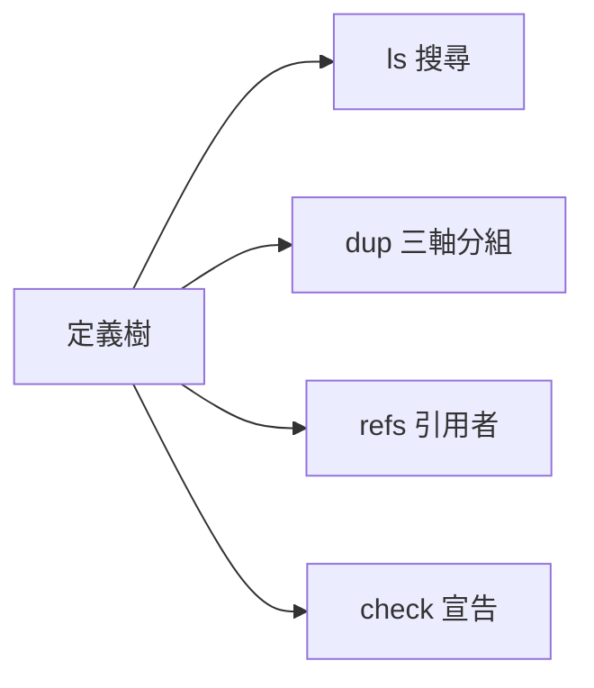
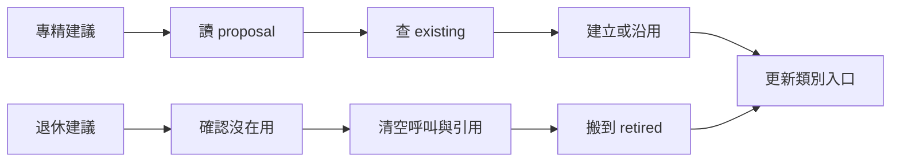

定義目錄工具只讀公開宣告，列出定義、同質群與靜態引用，並檢查定義是否齊全。

同質只看工具、腦端點、記憶；只改開場白仍然同質。工具不改定義、不讀帳、不查 daemon。

`echo '{"op":"ls","root":"/absolute/defs"}' | proto8/py/tools/aos/defs/_entry`

介面與判準

stdin：`{"op":"ls|dup|refs|check","root":"/absolute/defs","match":"optional substring","def":"optional target"}`。旗標與英文說明見 `_entry --help`。

- `ls` 回 `{"defs":[...]}`，列含 `path`、`summary`、`brain`；有腦再帶 `tools`、`endpoint`。`match` 只比路徑與 summary，不分大小寫。
- 遞迴遇 `interfaces.json` 或 `_metainfo.json` 就當作定義並停止往下（例外：沒有 `_entry`／`_entry.json`、`_metainfo.json` 非空而且只有 `index`／`tooldef` 這兩格的，是放了註記的普通夾，不算定義、繼續往下找；`{}` 或有其他鍵的仍算定義，使用者「只有{}的_metainfo.json也算agent定義。」，[N-69](../../../../docs/NORMS/10-基礎設施-定義與工作區/11-N-69.md)、[thinking 11-12 metainfo](../../../../thinking/2026-11/12/metainfo/README.md) M11）；不走隱藏夾或目錄捷徑；退休樹應放 defs 根旁同層。
- `dup` 回 `{"groups":[{"key":"canonical JSON signature","members":["category/a","category/b"]}]}`。只算 `aos-agent`；工具解析真實路徑、去重排序，不比登記名與 env；端點未提供時為 `default`，明給空字串照空字串。輸出路徑相對 root。
- `refs` 必須給 `def`，回 `{"refs":["category/caller"]}`；讀各 agent 公開工具宣告的 `path`，相對工具表所在夾；env 裡寫的路徑不算引用。回引用者路徑，排序去重，不包含自己。
- `check` 回 `{"problems":[{"path":"category/a","reason":"English reason"}]}`。README 第一行非空、meta 有非空 summary、interfaces 是物件；agent 宣告的 tools／llm 必須存在且可讀。tools.json 有 `"$override"`（範本疊 `py/packs`）時交給 `aos-tools ls -l` 合併再看，只帶 `env` 的格沿用底檔的 `path`；`aos-tools` 從 PATH 找（不假設 `bin/` 在哪），找不到＝那份定義一條 problem `cannot merge …: aos-tools is not on PATH (source $AOS_HOME/env.sh)`；沒設 `AOS_HOME` 用放這份 lib 的資料夾（tool-packs）。定義路徑各段符合 `[a-z0-9_-]+`。
- `check` 也查**叫的東西在不在**（11-19 線 aos-check-refs，使用者對照 C 第 1 題選「只放進檢查指令」：「編譯不管，跑 agent_def check 才查。要記得跑。」；`agent.py --compile` 不查這些；缺口出處 [aos-vs-c-1119 G1](../../../../thinking/2026-11/19/aos-vs-c-1119/02-缺口清單.md)；細則在 `refs_check.py` 檔頭）。規則照執行時：
  - 工具：tools 檔交給 `aos-tools ls -l`（agent 跑時拿清單的同一支，`$override` 照疊、指示詞照解），它標 broken 的那支＝problem（執行時那支被略過、腦看不到）。
  - 會被執行的程式：`aos-agent.entry` 的 argv；入口是 `aos-loop`／`aos-fsm` 時跟著讀 loop 的 `exec`、`on_start`、`on_stop` 與狀態表每格的 `exec`；`aos-agent.hooks` 每格的 `handler`。argv 只查分得出是檔的位置：argv[0]、`python3`／`bash` 等直譯器後第一個不是旗標的字（`-m`、`-c` 之後不查）、`aos-loop`／`aos-fsm` 的設定檔、任何位置寫成 `{"$env": "AOS_HOME", "$path": …}` 的。相對路徑照執行時的基準（單子從 `cwd` 欄、沒寫從寫它的檔的資料夾；字串目標與 handler 從寫它的檔的資料夾），「補找 `.json`」「`檔#/指標`」照 aos-exec 認。
  - 腦設定：llm 檔每個鍵照執行時 `brain.py` 用的 `llm_settings.body_fields` 轉型（`$AOS_HOME/lib/aos/apps/agent_fsm/llm_settings.py`；不執行定義夾裡的程式），轉不了＝problem（例 `temperature in llm.json must be a number, not "hot"`）；`max_tokens` < 1、`temperature` < 0、`top_p` 不在 0～1＝problem；有 `llm_keys` 時不在裡面的鍵（`description` 以外）＝warning（body 不讀它）。
  - **不查**：`model` 的名字對不對（要問 kernel 的 endpoint 包才知道）；argv 其他位置的字串（分不出是不是檔名）；stack 裡那份疊上去的設定（只看定義）。
  - 查不了的照實說、放進 `warnings`（跟 `problems` 同形狀 `{"path", "reason"}`，有才出現、不讓 check 失敗）：指示詞的變數這裡沒設（`AOS_STACK`、`AOS_CO` 只在執行時有、不查也不提；`AOS_CD`／`AOS_CF` 用寫它的檔的資料夾／檔）、指令名不在這裡的 PATH 上、`aos-tools` 不在 PATH（沒疊 `$override` 的表；疊了的照上面報 problem）。`AOS_WS` 這類照 check 當下的值解，跟 agent 跑時的工作區不同時結果可能不同。
  - 一樣只讀：`aos-tools` 不給 `AOS_STACK`（不留 tooldef 快取）；`exe` 類工具照 aos-tools 的讀法會被叫一次 `--tooldef`。
- `check` 最先查**斷掉的連結**（11-20 編譯程式庫第 4 刀，線 aos-pylib-k4-1120：`defs.extern` 編成連結，使用者「創建一個symlink…編譯的時候就是只生成symlink」；細則在 `links_check.py` 檔頭）：定義夾最上層有連結指到不在的東西＝每個一條 problem（`system.txt is a link to ../shared/system.txt, which is not there …`）；有斷鏈時這份定義其餘會順著它去讀的檢查先不做，免得同一個斷鏈又被當缺檔報一次。斷掉的 `system.txt` 執行時是靜靜地沒有 system 文字，只有這裡會說。
- `check` 發現問題仍保留 JSON stdout，stderr 一行 `defs: error: DefBad ...`，退 1；正常退 0。根不在為 `RootMissing`，其他壞宣告為 `DefBad`。所有 op 只讀；根指向空目錄時回空清單。
- **root 本身就是一份定義**（`agent_def` 的 check 就這樣叫，[defs-check-align](../../../../thinking/2026-11/12/defs-check-align.md) Q10）：路徑照「相對 root」印成 `.`；名字檢查改查這個資料夾自己的名字（樹的根不是定義時，根自己的名字不查）；root 底下找不到任何定義（空夾、只有 README）＝空清單，`check` 也算過——「它是不是一份定義」不歸這支判。

## 處方

建議由隊長執行；撞同質只提醒長特色，不能直接視為合併許可。

specialize 四步

以下使用 shell 變數 `DEFS`（定義根）、`REVIEW`（review.json）、`SOURCE`（來源定義）、`TARGET`（新定義）、`AGENT_DEF_TOOL`（`py/tools/agent/agent_def` 的絕對路徑）；路徑依自己的工作區填入。

1. 讀 review 的 `suggest.specialize`，核對 `proposal` 與 `evidence`。`context_too_big` 的 proposal 為 null 時，先由隊長決定要拆的職責或記憶。
2. 用 `defs --op ls --root "$DEFS"` 對照三軸與 `existing`。有同三軸現成定義就沿用它，不另生一隻。
3. 無現成定義時，用 `agent_def` 的 `new` 把來源整份複製成新定義（只複製；不帶 `reason`／`review`）；再用一般檔案工具照 proposal 改新定義的 `tools.json`、`llm.json` 與記憶那格；要跑起來用 `subagent`（記帳、算配額）或 `agents_ctl`（不記帳）掛：
   `jq -n --arg from "$SOURCE" --arg path "$TARGET" '{op:"new",from:$from,path:$path}' | aos-exec --ws "$PWD" "$AGENT_DEF_TOOL"`
4. 更新目標類別 README，再以 `defs --op check --root "$DEFS"` 檢查。

上面 `defs` 表示本夾 `_entry`；工具不會代做此處方。

retire 四步

連續三個 case 沒被叫、而同類別兄弟有被叫，才有退休訊號。類別只有一隻時不退。以下 `TARGET` 是相對 defs 根路徑，`RETIRED` 是 defs 根旁同層的 retired 根。

1. `aos-agent ctl ls --json` 查看每個相關 daemon；只要有列的 def 指到目標或子路徑，就不動。
2. 讀建議中的 callers，並跑 `defs --op refs --root "$DEFS" --def "$TARGET"`。先改呼叫方，直到 callers、refs 都清空。
3. `mkdir -p "$RETIRED/$(dirname "$TARGET")"`，再 `git mv "$DEFS/$TARGET" "$RETIRED/$TARGET"`。不刪、不留轉向捷徑；復職則搬回原位。
4. 更新來源與退休類別的 README。

驗證

`PYTHONDONTWRITEBYTECODE=1 python3 -m unittest discover -s proto8/py/tools/aos/defs/tests -v`

測試在系統暫存目錄造定義，涵蓋三軸、搜尋邊界、兩種靜態引用與各項 check 判準，不寫 repo 內的執行資料。

