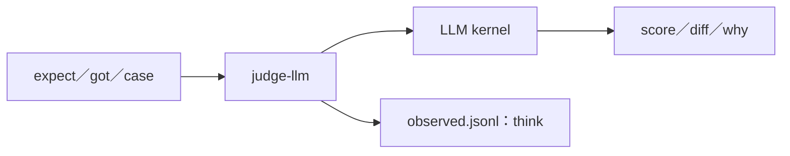

# judge-llm — 以一次問腦比對產出並留下獨立裁判帳。



這是同步比對函數；`measure` 的 `check.json` 指向它，裁判成本進 `check.cost`。複製本夾、改 `judge.json` 的 `endpoint` 即可換模型。

預設的 `"endpoint": "judge"` 在出廠的 [`kernel/llm-kernel/kernel.json`](../../kernel/llm-kernel/kernel.json) 有登記，設定跟 `smart-high` 同一組（LiteLLM 的 claude haiku），兩個範本直接搭就能跑。裁判要換模型，改 kernel.json 裡 `judge` 那格。

```sh
printf '%s' '{"expect":"/abs/expect","got":"/abs/got","input":"/abs/case"}' | aos-exec /abs/judge-llm
```

<details>
<summary>設定、輸出與錯誤</summary>

先設 `AOS_LLM_KERNEL`；設 `AOS_STACK` 時會透過共用 `observed.append` 留 `think` 帳。共用模組從 repo 的 `lib/` 找，複製到 repo 外則依安裝的 Python 路徑或 `PYTHONPATH` 找。

`judge.json` 的 `max_bytes` 預設 60000，expect、got、input 三段各自按 bytes 截斷，尾加 `[truncated]`。兩夾遞迴讀取所有檔，按相對路徑排序，每檔用 `== relative/path ==` 標題；input 帶現有的 `stdin.json` 與 `say.txt`。文字以 UTF-8 解碼，壞 bytes 顯示替代字元，截斷處略過不完整字元。三段以同名 JSON 字串欄位送給腦，檔案內文視為資料。

每次只執行一次 `aos-llm ask --full`。回覆 content 的第一個 `{` 起解析一個 JSON 物件；score 必須是有限數，夾到 0～1；diff 非字串陣列改為 `[]`。缺 why 或 why 不是字串時回空字串。成功輸出例：

```json
{"score":0.95,"diff":[],"why":"same"}
```

未設 kernel＝`LlmKernelMissing`，設定或檔案讀取失敗＝`FileBad`，回覆無法解析或缺有效 score＝`ReplyBad`。下層問腦失敗轉接最後一行錯誤代號；沒有可轉接的錯誤行＝`BrainFailed`。下層 stderr 原樣透出；本層錯誤由 `tool_io` 在 stdout 與 stderr 印同一行，退 1。

</details>

<details>
<summary>測試</summary>

```sh
PYTHONDONTWRITEBYTECODE=1 python3 -m unittest discover -s proto8/templates/tests/judge-llm -v
```

測試只起暫存 kernel daemon，使用本夾的測試端點與既有 `llm_fake`。測試端點依 expect／got 是否相同給高低分，回非零假 usage；兩題 measure 驗證一題過、一題不過及獨立成本。另驗無 kernel、非 JSON 回覆、分數夾限、壞 diff、缺 score、檔案排序與截斷。不呼叫真 LLM。

</details>
