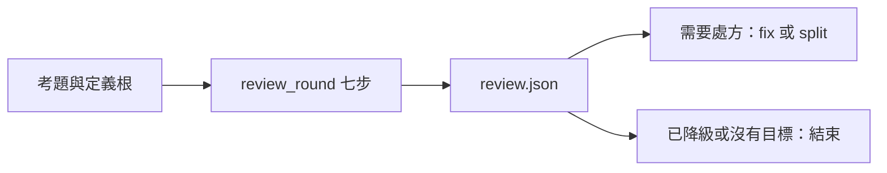

reviewer 根據量測審視定義並開立後續實作處方。



審視者重用相鄰 `agent-fsm/` 的格；算術、試跑、換上與盯梢都交給 [`review_round`](../../lib/aos/review_round/README.md)。agent 只在 `prescribe` 時用 `json_edit` 寫一到三條處方。

```sh
python3 -m unittest discover -s proto8/templates/reviewer/tests -p 'test_*.py'
```

<details><summary>配置、呼叫與限制</summary>

掛載方式與 [`agent-fsm`](../agent-fsm/README.md) 相同，向 agent 提供 `case`、`defs`、`ladder` 的絕對路徑，另可給 `ws`、`daemons`。`ladder` 指向本定義的 `ladder.json`；kernel 要先登記其中的 endpoint。預設使用 kernel 的預設腦，`llm.json` 可加 `endpoint` 指定。

範本 `promote_by` 預設 `self`；使用 GPT 腦的副本要設為 `claude`，腳本會留下 `pending_promote`，交 Claude 審視者或隊長換上。agent 本身不直接叫 `promote`。

`fix` 必須有量測 `consistency.pass: true` 的訊號；沒有訊號就只考慮 `split`。兩者都只開處方，不寫定義。工具清單沒有 bash、thought 或其他任意執行入口。紀錄位於工作區的 `reviews/<round>/review.json`，改好的整棵副本位於同輪的 `defs/`，盯梢狀態在 `reviews/watch.json`。

複製範本就 `cp -r $AOS_HOME/templates/reviewer <目的資料夾>`：借 agent-fsm 的格與 lib 的工具都寫成 `{"$env": "AOS_HOME", …}`（11-10 templates-cp），抄到哪都能跑，這台要有 `AOS_HOME`；格讀取設定時依 `AOS_CD`，自身檔案位置只用於找共用模組。測試在 `/tmp` 建暫存定義與工作區，使用真 daemon、kernel、review_round、measure 和 json_edit，只替換腦的端點，不叫真 LLM。

</details>

ladder 的 max_prompt_tokens_median 預設 10000、retire_after_cases 預設 3。suggest 只寫不做；extract、box、unshell 是交給後續實作者的處方，不會自動執行。
