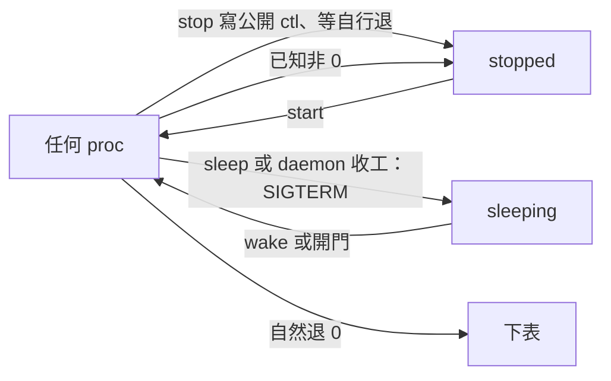

daemon 依 11-07 裁定 B 統一生命週期，保留起法，並完成 build、回歸測試與真程式實測。

← [入口](README.md)｜[原問題與原話](07-停不下與消失.md)

## 結果

已完成，**沒有 commit、沒有 push，也沒有碰 ~/code/playground***。從乾淨 HEAD 開始。



auto_restart 照舊優先處理自然結束後重起；adopt 接回後拿不到自然結束碼，照舊下表。stop／sleep 收途中退出保留 stopped／sleeping；原本已 held 的列在收工時保留。

## 實測表

真 aos-daemon、aos-daemon-ctl；aos-fsm 用單格 work→work，不接 LLM。a 是不讀 ctl 的 Python 腳本；b 兩種 body.json 寫法各測一次；c 用 loop 包最小 fsm。自然退 0 的 loop 設 max:1；失敗腳本退 7。

| 身體 | stop | sleep＋wake | 自然退 0 | 出錯退 7 |
|---|---|---|---|---|
| a 一次性腳本 | stopped／0 | sleeping／143→running | 下表／0 | stopped／7 |
| b 陣列 aos-loop | stopped／0 | sleeping／143→running | 下表／0 | stopped／7 |
| b argv 物件 aos-loop | stopped／0 | sleeping／143→running | 下表／0 | stopped／7 |
| c 最小 fsm | stopped／0 | sleeping／143→running | 下表／0 | stopped／7 |

16 格全部符合。表中的數字是 **proc 結束碼**；正常控制命令都退 0。stop／sleep 的 reason 為 null；失敗四格都有英文 reason（code 7 與本次 stderr 最後一行），且留在表上。sleep 的 143 是 SIGTERM；wake 後是新行程 running。一次性腳本 stop 確實先留 stopping、等自己睡完退 0，沒有被訊號收掉。

結束碼、命令訊息、phase／reason 與下表結果見 [實測資料表](08-daemon不分類實測.json)（17 列＝16 格＋1 個寫入失敗補測）。scratch：`/tmp/aos-daemon-b.rV6SXE`；各格保留 daemon.log、daemon.err 與小格檔案。

## 修改範圍與 once

完整 [檔案清單](08-daemon不分類檔案.json) 共 53 檔；逐處 [once 盤點](08-daemon不分類once盤點.json) 共 31 處，欄位是檔案、HEAD 行號、原程式、處理方式。`#pragma once` 與身體 API `run_once` 無關，保留。

Child::once 與兩處賦值刪除；procs.cpp 的 is_once／格式檢查、reconcile.cpp 的局部 once 僅用於起法。nap、sleep、add＋sleep、接回存活行程均不分類。

tend.cpp：halt 一律寫該列公開 ctl，進 stopping；寫不了只 warning、等自行退，不改送 SIGTERM。look 的非 0 留表不看型別；finish 對所有仍活著的列（含 stopping）設定睡眠，送 SIGTERM、必要時 10 秒後 SIGKILL，留下 sleeping。

adopt.cpp：刪除兩處「有無 loop.json」分類與其後的型別分支；讀保存的 launch、phase 與 stop_mode。stop 恢復後仍走 ctl，避免重開偷偷變成 SIGTERM。已 held 的 stopped 保留原因、sleeping 開門醒；自然結束碼未知照下表，auto_restart 例外照舊。

stuck.cpp：任何 proc 都看公開 ctl／state 窗，父設定或預設名，restart_on_stuck 不看型別；缺窗不判，沒有另外認程式名。windows.cpp 的 check_once 整段與 read_procs_ctl 的呼叫刪除；daemon.hpp 宣告與 mailbox.cpp 的呼叫一併移除。其餘 JSON／seq／名字／指示詞錯仍不採用或當壞信；PhaseBad 照舊。

Python 的 entry.py 刪掉辨認 aos-loop 陣列、偷讀其設定的特例；陣列與 argv 物件都保留為原目標。直接有 exec 的 loop 設定仍走原路，**保留 interval_ms:0 的補值**，因它仍決定 daemon 要不要包 loop，不影響生命週期。ctl.py 的 need_ctl 只算公開路徑；need_stoppable 連同匯出與 CLI／aos-agent 呼叫刪除，不再有 auto_restart 特別放行。pause／resume 無父設定也等預設 state.json 回音；PhaseBad 保留。

aos-agent 的 off_table／InstanceMissing 不再聲稱「一次性不論結束碼都消失」；改為退 0、被 rm 或 adopt 不知碼的可能原因，明說已知非 0 留 stopped＋reason。NORMS N-28／N-54／N-17、daemon README 與 01～04、06～09、cmd 文件與英文 help、aos-loop 窗文件、aos-agent 文件、knowledge、待使用者提示、code map 均同步；全域搜尋結果已逐項核對，舊 thinking／archive 的歷史證據保留，兩份直接相關裁定加後續註。

## 驗證

```sh
(cd proto8/impls && nice -n 15 cmake --build build -j4)
python3 proto8/impls/aos-daemon/tests/test_ctl.py
python3 proto8/impls/aos-daemon/tests/test_lifecycle.py
```

build 退 0。test_ctl **7 項通過**；test_lifecycle **17 項通過**（含 16 格矩陣）。git diff --check 退 0。code map 已 --apply；再查 **0 stale**。兩個既存檔頭提醒為 templates/agent-fsm 的 llm.json、system.txt，與這次修改無關。

**沒有現存 daemon／daemon_ctl／aos-agent 測試可跑**：wf/workflows/testing.md 與 git 檔案盤點確認 11-04 已整批刪除；這次依你明確要求新增上述獨立回歸，不恢復舊測試／ctest。

補測也全部通過：ctl 寫不了仍自然退 0；自訂／null／壞 ctl 名回退；無父設定的 pause／resume；procs_ctl 四個動詞與壞結構；訊號 137、MkdirFailed 留表；auto_restart 三連敗；任意身體收工重開；stop 中途 adopt；未建格的 add＋sleep 重開；失敗列重開再 start；adopt 未知碼下表；公開窗 stuck 重起；入口隨 stack 搬家、參數保留；真 aos-agent ctl 操作兩種 loop body。各測試名稱與判準見上述兩支測試，scratch 已確認無殘留行程。

## 與舊原話的衝突

N-54 原話「只有指令叫醒。然後loop就是原生支援暫停和休眠的，exec就是只有執行中和拔掉」與「他停下來就是沒了，新開的就是新的CPU了」：B 改為任何 proc 都能 stop／sleep，列可留 stopped／sleeping，也能 start／wake；不再以起法拒絕。N-54 原句與 11-06「auto_restart 才放行、沒 ctl 送 SIGTERM」改讀都留著，旁註已翻。

N-28 使用者 11-02「改成子項結束後不留名單」、11-03「照舊拿掉」及 11-05 ⑤ 舊規則「exec 型照舊下表」：B 只讓退 0 的自然完成下表；已知非 0 都留 stopped＋reason。舊收工段「loop 型睡下、exec 型拿掉」也翻成所有仍活著的列睡下。各原句旁已標 **11-07 使用者裁定 B**。

os-impl/09 使用者先選 A「維持現狀，只補文件」，原話「A。」：其中一次性 proc 失敗仍下表被本次 B 翻掉；直掛定義照樣跑 _entry、但 InstanceExists 退非 0 現在留下 stopped 列。原 A 決定保留並加後續註，不改寫過去的實測。

11-04 自動識別的認名實作「陣列 aos-loop 就讀設定」已刪；使用者「add這塊，就是看最終指向的json的內部結構」仍用於入口遍歷與直接 loop 設定的起法，不拿來推導管理權限。這次兩句新原話與最後「選 B：daemon 不分類」已逐字記回 N-28、N-54 與原問題。先想改看 interval_ms 是中途想法，最後 B 才是依據。

## 實作時代定

sleep 不寫 ctl，因公開協定只有 pause／resume／stop；照已授權的收工路徑送 SIGTERM。公開 ctl 名稱規則在 daemon／Python 相同：父寫的小格 loop 設定有非空字串 ctl 就用它，其他都是 ctl.json；不往目標定義偷讀 loop 設定。

為了不在 adopt 猜型別，又能讓信箱加的任意 proc 開門醒，表內新增 **launch**（可重放入口與完整參數；尚未啟動存原設定）與 stopping 時的 **stop_mode**（stop／sleep／remove）。入口相對 daemon stack、參數原樣；不加型別欄、不做舊格式遷移，也解掉了 exec 重開丟參數。

收工時把**所有仍活著**的非 held 列都留 sleeping，包含本來正在 stopping／卡住重起中的列；已 held 的 stopped／sleeping 保留。建立小格、寫啟動設定、fork 這類起不來的錯也只留單列 stopped＋reason，不讓整台 daemon 收工。上述處理均有實跑。
