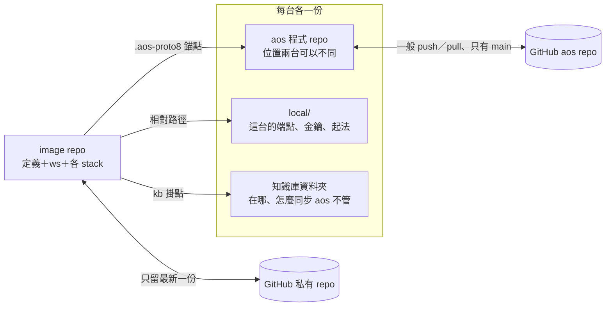

← [入口](README.md)｜涵蓋：三樣東西各擺哪、怎麼相連、進不進 git｜下一份 [02-機器專屬設定](02-機器專屬設定.md)

# 整體圖像

## 三樣東西、三種同步



| 東西 | 是什麼 | 怎麼同步 | 兩台位置 |
|---|---|---|---|
| aos 程式 repo | `proto8/` 原始碼；bin 各機自己建、`install.sh` 連進 `~/.local/bin` | 照舊：GitHub、只有 `main`、一般歷史 | 可以不同（公司 `~/repo/aos-tools`，家機隨意） |
| **image repo** | 一棵樹（一個根 daemon）的全部：各定義資料夾、`ws/`、各 stack | 專門的私有 repo；每次收工一個沒有父的 commit、強推 `main`（11-06 裁定照舊） | 可以不同；必須在 Linux 檔案系統（不能在 `/mnt/c`） |
| 知識庫 | 一個資料夾（可能是 git、可能是掛載） | **它自己的事** | 可以不同；image 根的 `kb` 掛點指過去 |

**一棵樹一個 image repo。** 標記「現在誰在跑」是整棵樹一個、強推也是整個 repo 一起，所以一個 repo 裝兩棵樹會互相擋。要第二棵樹就再開一個 repo。

**image repo 的分支**：只有 `main`，加兩種標籤——`prev`（上一份，每次收工往前挪）與 `rescue-<機器>-<時間>`（搞混時輸的那一邊）。不開其他分支。

## image 根的佈局

沿用 [04-搬家/03](../../../../cmd/aos-agent/docs/04-搬家/03-重建root與環境.md) 的三層名字，只多五樣（粗體）：

```text
<image 根>/                     例 ~/aos/img
  **image.json**                佈局：根的定義與 stack 在哪（人寫一次）
  **image_info.json**           標記：誰在跑、第幾代（aos-image 寫）
  .gitignore  .gitattributes
  **local.example/**            給新機器照抄的樣板（進 git）
  **local/**                    這台的值（不進 git）
  **kb** -> 這台的知識庫         掛點（不進 git；捷徑、掛載點都行）
  root_def/     root_image/     根 daemon：定義與 stack
  llm_def/      llm_image/      總機（llm kernel）
  foreman_def/  foreman_image/  領班；agent 的 stack 預設在 foreman_image/procs/<名>/
  agents/<名>/                  每隻 agent 的定義（copy-out 抄出來的）
  ws/                           工作成果
```

- 原文件範例在 image 裡另抄一份 `lib/`、`py/`；有了錨點就不抄，定義經 `.aos-proto8` 用 repo 那份。
- 每個「有指到 repo 的定義資料夾」與「有覆蓋層的 stack」各有一條 `.aos-proto8`（`copy-out` 與 `--relink` 建）。
- 樹裡彼此的關係照舊全相對：daemon 表相對 daemon stack、信的回信地址相對信箱根、`AOS_CLOCK=${AOS_STACK}/clock`。

## 進不進 git

逐類的表已抽到 [files_in_git.json](files_in_git.json)（37 列）。欄位：`id`、`what`（哪類檔）、`in_git`（進／不進／不在 image）、`why`、`now`（現在的 gitignore 擋對了沒）、`add`（要補哪一行、補在哪）。統計：進 git 17 類、不進 17 類、不在 image 裡 3 類；現在已經對的 26 類、要補的 8 類、只能靠文件約束的 3 類。

要補的只有這幾行：

**image 根 `.gitignore`**（新範本 `cmd/aos-image/image.gitignore`，`aos-image init` 放、`freeze` 每次核對）：

```gitignore
/local/
/kb
**/.aos-proto8
**/__pycache__/
ws/.trash/
```

**`stack.gitignore` 加兩行**：

```gitignore
**/cooldown.json
**/think/wait_warned.txt
```

（`cooldown.json` 是 [06](06-長跑自動重起.md) 新加的冷卻檔；`wait_warned.txt` 是等腦提醒印到第幾次，它靠 `pending.txt` 的檔案時間算，換台後檔案時間變了、帶著只會讓提醒算錯。）

`.session_home`（[05](05-eca換台.md) 新加的記號檔）點開頭，已被 `**/.*` 擋，不用加。

## 不靠掃描也會把金鑰推上去的地方

裁定 8 不做掃描。下面四處沒有任何東西擋，緩解與要不要再多做見 [09 題 1](09-衝突與要裁的.md#題-1金鑰)：

1. **`ws/` 整份會推**：agent 或你放在 ws 裡的 `.env`、金鑰檔、下載的東西。
2. **定義資料夾的 `.env`**：會進 git，也必須進（根的 `AOS_CLOCK` 那行）；人順手把金鑰寫進去就推上去了。
3. **工具登記檔的 `env` 值**（`aos-tools add --envs K=V`）：照字面存在定義或 stack 覆蓋層。
4. **`history.jsonl`**：有 bash 類工具的 agent 跑一次 `env`、或讀到金鑰檔，輸出整段進 history。現行做法金鑰在根的殼裡 export，整棵樹的每個行程都繼承得到，所以這條最容易發生。
