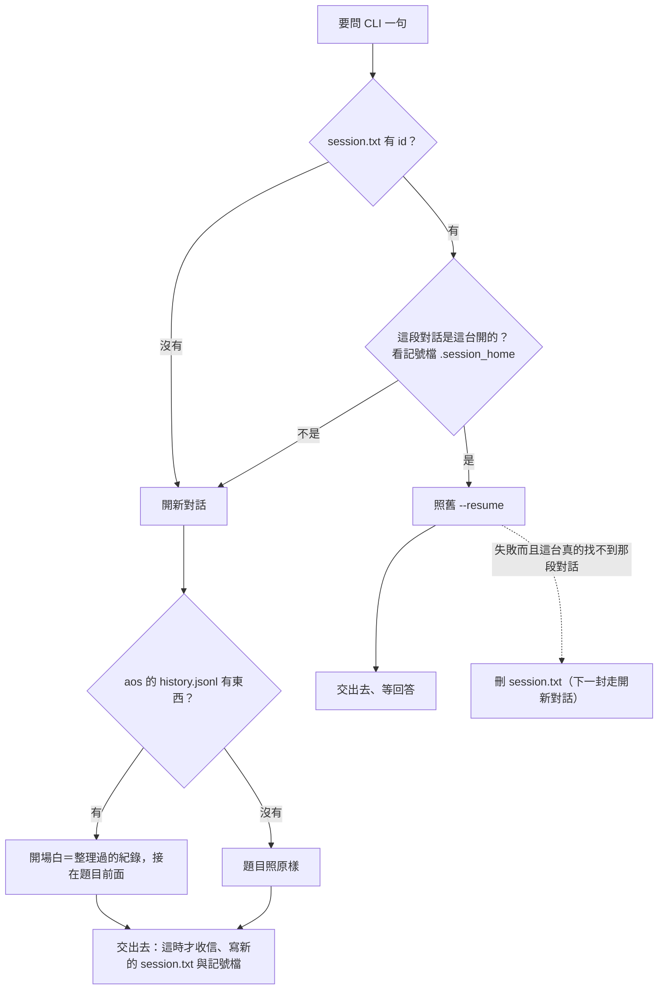

← [入口](README.md)｜涵蓋：eca（claude／codex 當 agent）換台後怎麼接著做（裁定 4、5）｜上一份 [04-防呆](04-防呆.md)｜下一份 [06-長跑自動重起](06-長跑自動重起.md)

# eca 換台接對話

## 現在會怎樣（讀碼，[cli_session.py](../../../../lib/agent/cli_session.py) `print_claude`）

claude 的對話本體在各台自己的 `~/.claude/projects/<工作區路徑換成破折號>/<id>.jsonl`，image 只帶 `session.txt` 裡的 id。換台後照樣 `claude -p --resume <id>`，題目寫進去的那一刻信就收了（11-03「交出去就算收了」），然後 claude 找不到那段對話、失敗——**信沒了、agent 停、`session.txt` 沒人清，之後每一封都一樣**。搬家文件寫的「找不到就從頭開」程式裡沒有。

## 新流程：先認「是不是這台的」，不是就在交信之前改開新對話



重點：**判斷發生在交信之前**，所以換台這件事本身不掉信。只有「開了新對話之後 claude 又因為別的原因失敗」才走裁定 5（掉那一封、自動重起）。

### 怎麼判定「不是這台的」

小格（`$AOS_STACK/claude/`）多一個不進 git 的記號檔 `.session_home`（點開頭，現有的 `**/.*` 已擋）：

```json
{"session": "8c1e…", "ws": "/home/guanyu/aos/img/ws", "home": "/home/guanyu/.claude"}
```

寫 `session.txt` 的同時寫它。之後每次要 `--resume` 前比三樣，任一不同＝這段對話不在這裡：

| 比什麼 | 抓到的情況 |
|---|---|
| 記號檔在不在、`session` 跟 `session.txt` 一樣嗎 | 換了機器（記號檔沒跟來，或這台留著舊記號但 id 已被另一台換新） |
| `ws`（工作區的真實路徑；只有 claude 比） | 同一台但 image 搬了位置——claude 是照工作區路徑分資料夾存的 |
| `home`（`CLAUDE_CONFIG_DIR` 或 `~/.claude`；codex 是 `CODEX_HOME` 或 `~/.codex`） | 換了帳號資料夾（額度緊時改用 `~/.claude-alt`）——對話存在帳號資料夾底下 |

這個判斷**不讀 claude 的任何檔、不靠它的錯誤訊息**，所以 CLI 升級改格式也不會壞。

兩個補丁：

- **記號檔不在、但這台其實有那段對話**（功能上線前就在跑的 eca）：用現成的 `transcripts()`（它已經會去 `~/.claude/projects/*/<id>.jsonl` 找）找得到＝當成這台的、補寫記號檔。只在這個過渡情況用。
- **以為是這台的、resume 卻失敗**（claude 自己會清太舊的對話）：失敗後用 `transcripts()` 找不到那個 id＝刪掉 `session.txt`。那一封照裁定 5 掉了，但下一封會走新流程，不會永遠卡住。

### 開場白怎麼組

來源只有 aos 自己的 `$AOS_STACK/history.jsonl`——eca 的 history 只有「經 aos 送進去的話」與「claude 每輪最後的回答」，**沒有中間的工具呼叫與輸出**（那些在 `live.jsonl`，不進 git、不帶）。所以開場白是「記得大意」，不是逐字接回。

```text
[aos: this conversation continues on another machine. The earlier session is not available here.
Below is the record aos kept of it: what you were asked and your final answers (tool calls and
their output are not included; long or old messages are shortened or left out).
The complete record is the JSON-lines file <路徑>. The new message follows the record.]

--- record: 86 messages, 31 shown ---
[user] <第一則，通常是任務開場>
[... 55 earlier messages left out ...]
[user] …
[assistant] …
--- end of record ---

<這一批信的內容>
```

| 規則 | 數字（`cli.json` 可選新 key，加法） |
|---|---|
| 整段開場白上限 | `reseed_bytes`，預設 48000 bytes（約一萬出頭 token）；`0`＝不附紀錄，只留第一段說明 |
| 第一則 user 一定帶 | 它通常是任務說明或 `--prompt` 的開場白 |
| 其餘從最新往回裝，裝滿為止 | 中間省掉幾則就寫一行 |
| 單則太長 | 超過 6000 bytes 留頭 4000＋尾 2000，中間寫 `[... N bytes left out ...]` |
| 完整紀錄的路徑 | 寫出 `history.jsonl` 的位置（相對工作區）；claude 有 Read 工具，想看更早的自己去讀 |

- 整段經 stdin 給（現在就是），沒有命令列長度問題。
- **畫面開著時**（tmux 貼字那條路）：大段貼進互動畫面不穩，開場白上限改 8000 bytes，其餘一樣。長跑建議不要留畫面開著。
- **工具形**（`aos-eca-turn --one`、lib 的 claude／codex 工具）沒有 history：只開新對話、不附紀錄，stderr 一行 warning。

這也順手做掉 10-30 你記下的「停著時改 history 再繼續」：停著、改 `history.jsonl`、**刪掉 `session.txt`**，下一封就用改過的紀錄開新對話。

### `session.txt` 何時寫、何時清

| 時機 | 現在 | 改成 |
|---|---|---|
| 新對話第一輪 | 答完才寫；第一輪就失敗的話 id 丟了、下輪又開新的，前一段成孤兒 | **交出去的那一刻就寫**（claude 的 id 是我們自己產的，本來就知道）連同記號檔 |
| 判定不是這台的 | — | 不先刪；交出去時被新 id 蓋掉 |
| resume 失敗且這台找不到那段對話 | 留著（永遠卡住） | 刪 |
| 人想重開 | 手刪 | 一樣手刪（文件寫明這是正式用法） |

### 觸發的那封信（裁定 5）

- 換台、搬位置、換帳號：判斷在交信前，**不掉信**。
- 開了新對話之後失敗、或同一台 resume 失敗：信已收、不重答；[06](06-長跑自動重起.md) 的冷卻與自動重起接手。history 裡會有 user 沒有 assistant，下次組開場白時照樣帶著（讓 claude 知道有一題沒答到）。

## claude 與 codex 的差別

| | claude | codex |
|---|---|---|
| 對話存哪 | `<帳號資料夾>/projects/<工作區路徑>/<id>.jsonl`（綁工作區） | `<CODEX_HOME>/sessions/年/月/日/rollout-…-<id>.jsonl`（不綁工作區） |
| 記號檔比 `ws` | 比 | 不比 |
| 新對話的 id | 我們產、`--session-id` 給 → 交出去就能寫 | codex 自己產，要從輸出的 `thread.started` 讀 → **跑完才知道**；改成「不管成功失敗，讀到 id 就寫」 |
| 接回 | `--resume <id>` | `exec resume <id> -` |
| 找不到時的行為 | 沒實跑 | 沒實跑 |

兩條都改在 `cli_session.py`（`print_claude`、`print_codex`、畫面的 `start`）與 `aos-eca-turn`（組開場白要讀 history，只有它知道 history 在哪）。

## 真機驗證（給你親手試，約 15 分鐘）

設計不靠 CLI 的行為，但下面幾件知道了比較安心，也決定兩個補丁有沒有用。每步花費都是一兩句話的量。

1. **resume 不存在的 id**：`cd /tmp && echo hi | claude -p --resume 00000000-0000-4000-8000-000000000000; echo "exit=$?"` → 記下印了什麼、退幾。
2. **對話檔在哪**：`cd /tmp && U=$(uuidgen) && echo "say ok" | claude -p --session-id $U && ls ~/.claude/projects/*/$U.jsonl` → 應該列出一個檔（補丁用的找法成立）。
3. **換資料夾 resume**：`mkdir /tmp/other && cd /tmp/other && echo "what did I just say" | claude -p --resume $U; echo "exit=$?"` → 預期失敗（證明要比 `ws`）。
4. **換帳號資料夾**：`cd /tmp && CLAUDE_CONFIG_DIR=~/.claude-alt claude -p --resume $U <<< hi; echo "exit=$?"` → 預期失敗（證明要比 `home`）。
5. **codex**：`echo hi | codex exec resume 00000000-0000-4000-8000-000000000000 -; echo "exit=$?"`。
6. **整條**（施工完才做）：在 `/tmp` 的試驗 image 掛一隻 eca-claude，`aos-agent say` 告訴它一個暗號、等它答；刪掉小格的 `.session_home`（假裝換台）；再 `say` 問暗號是什麼 → 它答得出來、`session.txt` 的 id 換了、`queue` 沒有殘信、history 多兩則。
7. **aos-mcp 的說明 claude 讀不讀**（WAIT_USER 既有的未驗項，順手）：第 6 步時看它有沒有主動用 memory。

1～5 的結果請貼回來，會記進這份與搬家文件。
