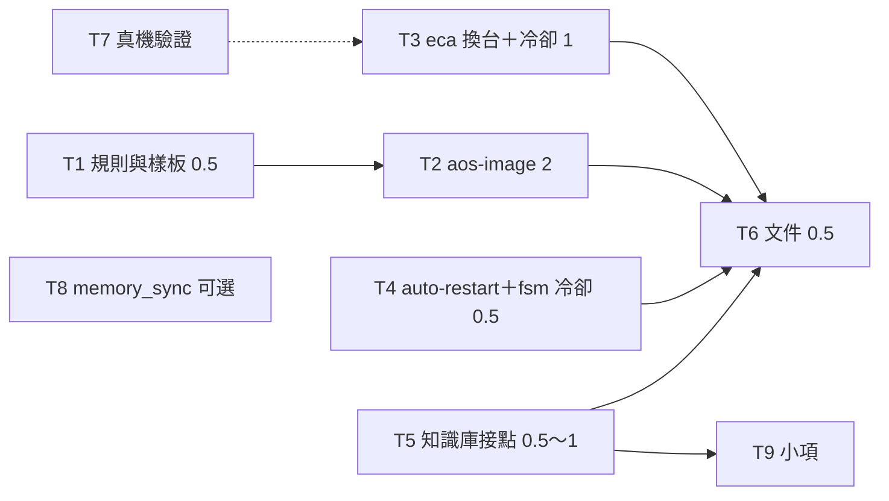

← [入口](README.md)｜涵蓋：給隊長的施工線、/tmp 模擬兩台的驗法、要更新的文件｜上一份 [09-衝突與要裁的](09-衝突與要裁的.md)｜下一份 [11-給使用者的一頁](11-給使用者的一頁.md)

# 施工步驟（給之後的 opus 隊長）

## 施工線

已抽到 [work_lines.json](work_lines.json)（9 列）。欄位：`id`、`name`、`does`（做什麼）、`files`（碰哪些檔）、`lang`、`rebuild`（要不要重建 C++）、`verify`（怎麼驗）、`depends`（先後）、`effort`（粗估）、`before_start`（使用者開工前必做嗎）。

統計：開工前必做 6 條（T1～T6）共約 5 個人天，加使用者自己的 T7；可邊用邊補 2 條（T8、T9）共約 1 天。**全部是 Python、設定檔與文件，沒有一條要重建 C++。**



- **互不踩檔**：T2 全是新檔；T3 碰 `cli_session.py`＋`aos-eca-turn`；T4 碰 `daemon_ctl/entry.py`＋兩支 add＋`wait.py`；T5 碰 `brain.py`＋範本的 `tools/`＋`memory_write`＋`knowledge/`。四條可以同時開。
- **跟別隊的交界**（他們今天還在動、有的沒 commit）：`templates/copy-out`、`cmd/aos-agent/stack.gitignore`、`templates/*/README.md`、`cmd/aos-tools`。T1、T5 動這幾個檔之前先確認他們已 commit。
- **並行估時**：T2 兩天是最長的一條；四條並行約兩個工作天收完，第三天上午 T6 與整條驗收。
- 冷卻檔的格式（`cooldown.json` 的 key）T3、T4 要寫成同一個樣子、T2 的 status 要讀：開工先三方對一次，照 [06](06-長跑自動重起.md) 的例子。
- 每條線照鐵律 3：新檔第一行一句話、commit 前跑 `codemap_gen.py --apply`。新增的持久檔（`image.json`、`image_info.json`、`cooldown.json`、`.session_home`）加進 NORMS 附錄 4，照 11-09 的規矩在當天日誌寫一句「要重建什麼」（這輪都是新增，答案是「不用」）。

## /tmp 模擬兩台（T2 的驗收，也是整條的驗收）

佈置（全在一個 `mktemp -d` 底下，跑完整個刪掉、確認沒留行程；不碰 `~/code/playground*`、不跑真 CLI）：

```text
$T/github.git                bare repo，當 GitHub
$T/homeA/                    當公司：HOME=$T/homeA
  repo/proto8                aos repo 的複本（cp -r，去掉 build 與 .git）
  aos/img                    image
$T/homeB/                    當家機：HOME=$T/homeB、repo 放在不同深度的位置
  src/deep/aos/proto8
  work/img
$T/kbA、$T/kbB               兩台各自的知識庫資料夾（故意不同步）
$T/bin/claude                假 CLI（T3 那支），PATH 最前面
```

bin 用機器上裝好的（`~/.local/bin`），兩台共用；端點全用假腦。可以從 `extras/image-move-check/check.py` 借起樹與等待的寫法。

| # | 劇本 | 要看到 |
|---|---|---|
| 1 | A：`init`、抄兩隻 agent（一隻 fsm、一隻 eca）、`thaw`、各問一題 | 樹起來、兩題有答；`image_info.json` 寫 A 在跑且已推到 bare |
| 2 | A：`freeze` | 沒殘留行程；bare 的 `main` 是沒有父的 commit、標記 `frozen` 代數 1；`git ls-tree -r` 裡沒有 `local/`、`kb`、錨點、`stderr.txt`、`cooldown.json`、`.session_home`；全樹 grep 不到 `$T/homeA` |
| 3 | B：clone、放 `local/`（端點指不同的假模型名）、`kb`→`$T/kbB`、`thaw` | 錨點指到 B 的 repo；fsm 接著答、history 接續；eca 開新 id、假 CLI 收到的 stdin 開頭是開場白、沒掉信；請求檔裡的 model 是 B 的 |
| 4 | B：`freeze`；A：`thaw` | A 拿到 B 的那一代；A 的 `local/` 與 `kb` 沒被動到；eca 又開一次新對話 |
| 5 | A 開著不收工；B：`thaw` | `OwnerElsewhere`、B 什麼都沒變。B：`thaw --takeover` 起得來 |
| 6 | 接 5，A：`freeze` | `OwnerMismatch`、`main` 沒被動。A：`freeze --rescue` 推出 `rescue-A-…` 標籤 |
| 7 | A：`freeze --no-push` 之後 B：`thaw` | B 拒絕（遠端還寫 A 在跑）。A 再 `freeze`＝只補推 |
| 8 | A 凍了兩代但 B 的 clone 比遠端新（人為把 bare 退一代） | `LocalNewer` |
| 9 | A 跑著時 `kill -9` 根與全部子項（模擬斷電），A：`thaw` | 不拉、直接起、warning；樹恢復 |
| 10 | 忙碌：fsm 的端點換成慢 30 秒的假腦、問一題後馬上 `freeze --wait-s 5` | `StillBusy` 且樹照跑；`--now` 收得掉、到 B 醒來那題照樣收到回信 |
| 11 | 放一個 96 MB 的檔在 ws | `FileTooBig`、沒 commit |
| 12 | 每個指令的 `--dry-run` | 前後整棵樹與 bare 一個 byte 都沒變 |

## 要更新的文件

| 文件 | 改什麼 |
|---|---|
| `cmd/aos-agent/docs/04-搬家.md`＋`04-搬家/` | 新增一份「兩台輪流」：佈局、`local/`、`kb`、`aos-image`、每日流程；`02` 的「找不到就從頭開」改成新流程、五行 git 食譜標「`aos-image freeze` 已包」；`01` ③④ 與 `03` ⑥ 改成 `local/`；`03` 的佈局拿掉 `lib/`、`py/` 與 `PYTHONPATH` |
| `cmd/aos-image/README.md`（新）、`cmd/README.md`、`cmd/docs/01-逐支說明.md` | 新指令 |
| `cmd/docs/03-aos-daemon-ctl.md`、`cmd/aos-agent/README.md` | `--auto-restart` |
| `templates/README.md`、`templates/docs/02-agent-fsm.md`、eca-claude 的說明 | `memory_write` 怎麼登記、`kb` 掛點、冷卻、`--history task`、eca 的預算與逾時怎麼調 |
| `knowledge/README.md`、`knowledge/aos/` | 兩層原則、`memory_write` 的前提、W6 那段 |
| `kernel/llm-kernel` 的說明 | `endpoints` 用 `$ref` 疊本機檔、金鑰用單子的 `envs` |
| `proto8/docs/NORMS/附錄4-持久檔`（md 與 json） | 四個新檔 |
| `impls/aos-daemon/docs`（auto_restart 那段） | 加一句「暫時性失敗的冷卻在 agent 那層，見…」 |
| 試驗場 `~/code/playground` 的 README | 頂層安排時機（今天不能動）：照新佈局重刷或另起一棵 |
| 桌面 `aos-入門-ELI5.html`、`aos-詳細參考.html` | 加「兩台輪流」一節（圖多、細節摺疊） |
| 桌面 `aos-大修材料` | 問題清單標記這輪順手解掉的（設計-41 image 不記版本、eca 換台、坑-51 金鑰預檢）；新增給大修的題（daemon 層的重起退避、history／ledger 輪替、定義要不要有歷史） |
| `wf/`（日索引、SESSION-LOG、WAIT_USER） | 頂層安排：WAIT_USER 加 T7 與 3 題 |
