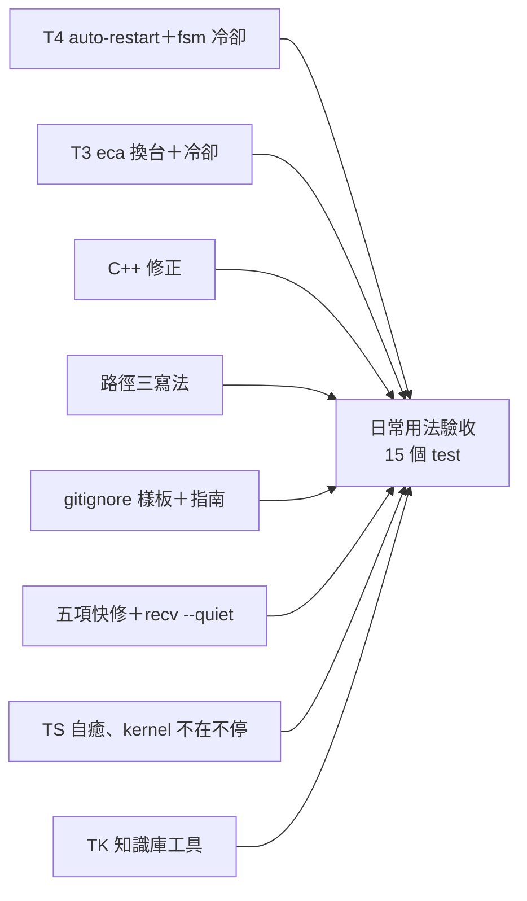

← [入口](README.md)｜涵蓋：11-10 午後各施工線的結果總覽、代定表、持久格式要重建什麼、prefix-fixes 跨機待辦對照、/mnt/c 數字｜上一份 [12-圖紙對照](12-圖紙對照.md)｜下一份 [14-真機驗證](14-真機驗證.md)

# 施工結果（11-10 午後）

**一句話**：「clone 過去、一行起根、接著跑」在 `/tmp` 與 `/mnt/c` 都跑通了（假腦、假 claude；三個專案、兩個前綴、刪掉上一台整個資料夾）。還沒好的只剩一個常會碰到的洞：專案外的 stack／定義換了相對位置起不來（要 `rm` 再 `add`）。

## 各線一覽

<!-- wf-nav -->
| 線 | commit | 結果 | 細節 |
|---|---|---|---|
| T4 `--auto-restart`＋fsm 冷卻 | `23511666f` | 做了 | [01](13-施工結果/01-各線-上.md#t4) |
| T3 eca 換台＋冷卻 | `89edaeef5` | 做了；兩個設計缺口在 `55bc1205b` 修掉 | [01](13-施工結果/01-各線-上.md#t3) |
| C++ 修正 | `052ef37a1` | 五件都做了 | [01](13-施工結果/01-各線-上.md#cpp) |
| 路徑三寫法 | `adb2a427a` | 九點都做了 | [01](13-施工結果/01-各線-上.md#paths) |
| gitignore | `7f014e48e` | 樣板、指南、分類表；完整檢查仍紅一項 | [02](13-施工結果/02-各線-下.md#gitignore) |
| 五項快修＋recv `--quiet` | `1e8e29689`、`43d0f2661` | 做了 | [02](13-施工結果/02-各線-下.md#quickfix) |
| TS 自癒、kernel 沒開不停 | `55bc1205b` | 做了；另含隊長補的 `stored_here` | [02](13-施工結果/02-各線-下.md#ts) |
| TK 知識庫工具 | `875aff2b2` | 做了（含快修第六項坑-76） | [02](13-施工結果/02-各線-下.md#tk) |
| shutdown 等不到改錯誤 | `4f24d867a` | 做了：等不到 daemon 退出＝`StillRunning` 退 1（原本提醒退 0，會讓人以為可以 push）；頂層交代要看的那點 | 本檔 |
| `--help` 改正 rm 做法 | `8eeb2426a` | 做了（B23） | 本檔 |
| 日常用法驗收 | `55bc1205b` | 15 個 test 綠；專案外 stack／定義換位置那 2 條標 expectedFailure | [02](13-施工結果/02-各線-下.md#daily) |

跟圖紙不同之處、要動 C++ 的、未經真機驗證的假設、留給明天：[03](13-施工結果/03-不同之處與留給明天.md)。

## 代定表

今天隊員自己拿的小決定（真的落地的；作廢的 aos-image 那些不列），已抽到 [decided.json](decided.json)。欄位：`id`、`line`（哪條線）、`what`（決定什麼）、`decided`（定成什麼）、`why`、`overturn`（要翻案改哪裡）。統計：34 列；全部可翻案。

最常會碰到的四條：

- 冷卻 30 秒起、加倍、封頂 30 分鐘（`lib/agent/cooldown.py`）。
- 被 stop 的問腦列停滿 **300 秒**就放掉那一格、回 `EndpointFailed`。
- `aos-lock release` 放別人的鎖＝warning、**退 10**，`--force` 才放；鎖殘骸超過 **10 分鐘**才清。
- `copy-out` 預設寫 `{"$env": "AOS_PROTO8", …}`，每台設一次 `AOS_PROTO8`。

## 持久格式：要重建什麼

**不用重建**。今天動到的持久格式都是加法：表的選填 `as_written`（`procs_state.json` 每列）、kernel 在途請求 `proc.json` 的選填 `stopped_seen_at`、新檔 `cooldown.json`、新檔 `.session_home`（含 `machine`）、`cli.json` 的選填 `reseed_bytes`。唯一要注意：11-10 之前用信箱加、寫了指示詞的列，表上沒有原形，要 `rm` 再 `add` 一次才會每次起都重解。

## prefix-fixes 的「跨機遷移待辦」五條

出處：[prefix-fixes 04](../prefix-fixes/04-施工結果.md#跨機遷移待辦順手看到沒修)（那份不改）。

| 待辦 | 今天 |
|---|---|
| agents 工具 `relpath` 算出經家目錄的路徑 | **做了**：`new` 用 copy_def 改寫、`from` 用字面路徑；`add` 的 tools 轉成相對 cwd（`adb2a427a`） |
| aos-tools 主登記檔照舊存絕對 | **做了**：`add` 照使用者的寫法存（`adb2a427a`）；當時的 `--anchor` 經錨點寫法 11-10 下午已拔 |
| 登記格 `env` 的值照字面存 | **一半**：覆蓋層的 `env` 現在收 `$env` 指示詞（手寫可以）；`aos-tools add --envs` 仍照字面存 |
| kernel 定義抄出 repo 要手改 `kernel.json` | **做了**：`copy-out kernel/llm-kernel` 改寫 exec、endpoints、argv（`adb2a427a`） |
| daemon 表跨機只驗了直接跑 | **做了**：經 daemon 起、clone 到別的前綴再起（`test_paths_move` 5 輪、`test_daily` 15 個） |

## /mnt/c 實測數字

假腦三層樹＋agent；同一台公司 WSL（9p drvfs、沒掛 `metadata`）。

| | 全 ext4（/tmp） | 全 /mnt/c |
|---|---|---|
| 起到三層 ready | 0.11 s | 0.35 s |
| fsm 問一題（含工具往返） | 4.1～4.4 s | 8.4 s（最大 9.1） |
| eca 問一題（假 claude） | 0.36～0.39 s | 0.69 s |
| root 每拍 | 100 ms | 125 ms |
| `ping` | 57～107 ms | 197～263 ms |
| 閒置 CPU（整棵樹） | 1.2 % | 3.2 % |
| shutdown | 0.13 s | 0.24 s |
| git clone／push | 0.01／0.02 s | 1.2／1.1 s |

四種佈局、原始資料

- 四種佈局（全 /mnt/c、defs 在 /mnt/c＋stacks 在 ext4、反過來、全 ext4）修完 C++ 後都通，沒有 error 行（TX）；修之前三種在第一題前就壞（M1）。
- 每拍延遲逐筆：`TA-mntc-beats.json`；佈局表：TX 回報。依賴的檔案系統特性 × 零件：[fs_features.json](fs_features.json)（施工前調查）。
- 11-10 TD 照 [11](11-給使用者的一頁.md) 的指令整套跑一次（兩個專案、clone 到另一個前綴、fsm＋eca 各問兩題）：/tmp 21.6 s、/mnt/c 34.9 s，都答得出來、沒留行程。

## 施工前的調查表（快照）

施工前的現況盤點，行號是當時的；今天修掉的看上面各線。

- [path_fields.json](path_fields.json)：指到外面的路徑欄位，三種寫法收不收（35 列）。
- [leftovers.json](leftovers.json)：cp 過去後的執行期殘留誰會自癒（30 列）。
- [cached_values.json](cached_values.json)：解一次就存起來的值（21 列）。
- [fs_features.json](fs_features.json)：檔案系統特性 × 零件、/mnt/c 實測（19 列）。
