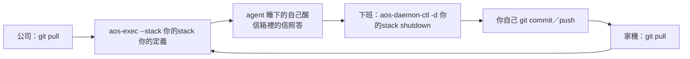

# 2026-11-10 兩台機器經 GitHub 輪流跑同一批 agent（two-machines：上午 fable 規劃、午後方向大改後施工）

← [2026-11-10](../README.md)｜同日：[prefix-fixes](../prefix-fixes/README.md)（錨點 `.aos-proto8`、`copy-out --relink`、`shutdown`）、[sweeper](../sweeper/README.md)｜前情：[11-05 portable-flow](../../05/portable-flow/README.md)、[11-06 git-image](../../06/git-image/README.md)、[10-30 eca](../../../2026-10/30/eca/README.md)、[11-05 knowledge-write](../../05/knowledge-write/README.md)｜搬家文件：[04-搬家](../../../../cmd/aos-agent/docs/04-搬家.md)

狀態：**規劃＋施工（11-10 午方向大改）**。上午的圖紙（01～11）照「一棵樹一個 image repo＋`aos-image freeze／thaw`」寫；午後使用者改成「cp 或 git 過去、起根就接著跑」，`aos-image` 整個不要。哪些圖紙還算數看 [12 對照表](12-圖紙對照.md)，做了什麼看 [13 施工結果](13-施工結果.md)。兩台＝公司（Windows＋WSL，`/home/guanyu`）與家機（Manjaro，`/home/lorkhan`，repo 位置不同、LM Studio 本機、模型代號不同）。

**後續**：11-10 下午使用者裁定拔掉 `.aos-proto8` 錨點（原話：「怎麼還是有.aos-proto8 ?」「那就拔掉，可以動程式」）；copy-out 只剩 env／relative／absolute，`--relink`、`aos-tools add --anchor` 已拔。

## 使用者原文（11-10，逐字）

> 行程有變。我需要提前使用現有的aos體系去做事了。幸好我們以檔案為主，只要環境變數、json格式、資料夾佈局、各種腳本所依賴的aos lib或函數庫腳本，他們沒變的話，我們大修完後也可以大致接入。

> 我要拿aos去做知識庫運用，並且要長時間做事，應該會大量使用eca。

> 主要包claude。然後會搭配一些loop fsm agent，接llm endpoint的。兩台都會要。

（問：兩台各跑各的，還是同一批 agent、同一份知識庫輪流接著跑？）

> 後者

> 會頻繁遷移，透過github

> 好，可以開fable agent。所以就請盡量支援相對路徑...

> 不要因為太敢就省略東西，時間沒有緊急到那樣。

（「太敢」＝太趕）

> 因為是快速抉擇，主要靠直覺，其中可能有些錯誤，但沒關係，大修的時候再來處理

（問 push 前要不要掃金鑰）

> 不用掃。

知識庫（規劃途中補的三句）：

> 知識庫這東西不用想太多，他就是一個資料夾，這個資料夾可能是git repo也可能不是。甚至搞不好他是透過plan 9偽裝成資料夾的東西

> 我們使用知識庫，就不要與其耦合

> 是可以做一些可適用於知識庫的aos工具，這些工具就可以更進一步，可以假設知識庫內是git資料夾，有鎖之類

> 收尾時另一條原則（11-10，→ [C-85](../../../../docs/CONCEPTS/01-設計理念/10-C-85.md)）：「老實說，我感覺aos-tools這個指令的用法，整個都怪怪的，能否開fable去思考一下？」「就是說，我們能用一段白話就將他的功能描述個大概嗎」「齁齁對啦就是這樣。這也要放入原則」

## 使用者裁定（11-10 上午選項框；快裁，大修時可重看）

1. 路徑寫法＝**本機捷徑錨點**：要指到 repo 的資料夾放一條不進 git 的捷徑 `.aos-proto8`，進 git 的檔寫經過它的相對路徑；換台跑 `copy-out --relink <image 根>`。（**午後改**：三種寫法都收；11-10 下午錨點整個拔掉）
2. git 歷史＝stack（image）照舊**只留最新一份**。（**午後改**：image 作廢）
3. 知識庫**在 image 之外、獨立同步**（原選項「自己一個 repo」「只有知識庫留歷史」照上面三句重讀：它怎麼同步、留不留歷史是它自己的事，aos 不管）。
4. eca 換台找不到舊對話＝**用 aos 自己記的紀錄整理成開場白、開新對話接著做**。
5. 腦或 Claude 暫時失敗時那封信＝**掉那一封、但自動重起**。
6. **加 `aos-agent ctl add --auto-restart`**。
7. 知識庫編輯**不加版本檢查，後寫的贏**。
8. **不做金鑰掃描**；但機器專屬的設定與金鑰不該跟著 image 進 git。
9. 知識庫分兩層：**核心層不耦合**（只當它是一個路徑上的資料夾）；**工具層可以假設**（git、鎖），前提寫在工具自己的說明與錯誤裡。

上午 [09](09-衝突與要裁的.md) 的三題（選項框）：金鑰擺放＝「只給問腦那支行程 (Recommended)」；額度窗的信＝「失敗後冷卻，只拿一封試 (Recommended)」；指令名＝「aos-image freeze / thaw (Recommended)」（午後被 14 推翻）。

約束：不改既有的環境變數、json 格式、資料夾佈局、lib 介面，加法可以；proto8 不寫舊版遷移；程式輸出英文。

## 午後方向改變（逐字）

引號裡是使用者原話；括號是頂層轉達時的讀法。

> 換台還要特別跑東西...，我原本預期他就是cp過去，起daemon她就自動繼續了。頂多就是各種路徑(ws,知識庫)和環境變數準備好就好。

錨點（選項框自填）：

> 使用者自己準備。要用相對位置、絕對位置、環境變數指定都可

> 兩台各自設一次...不要限制只設一次

> 我期望到時候的用法是，我在C:/code/mine/something，建立defs/, stacks/，剩下就是something自身的東西。git clone下來之後直接aos-exec --stack stacks/daemon defs

> 然後我要下班前，就是aos-daemon-ctl sleep stacks/root，把他停掉，然後git push

更正：

> 喔不是，就shutdown

> gitignore要弄好

後補：

> gitignore這塊，就是我們提供的範本與定義中，會提供一些樣板，如果用戶想要stack進去的話可以使用。或是不提供樣板，但是提供指南

> 要自動繼續的話，有需要的話可以加上boot指令

> aos image...拿掉吧。我繼續說一些可能的日常用法：可能會在C:/code/mine/another底下，有一些可以被參考的def之類，然後可能在C:/code/mine/llms那邊，是最終的llm kernel，請求要丟到那邊。

> 這些路徑，llms我可能會用環境變數指定。然後如果llms那邊我沒開aos daemon，那就是我自己的問題，但我也希望他不要搞壞

> 喔喔，其實是/mnt/c

> 或者說，WSL能訪問到的都可能是目標

隊長兩題的裁決：

> 1.可以。2.可以，這個就隨意，不要去假設或限制，然後defs/, stacks/都只是舉例，搞不好他會是其他名字，乃至於分散於defs_1, defs_2, stacks/root，或其中一些放在其他外部資料夾。

（1＝准動 C++，含 /mnt/c 兩處、(a)(b)(c)；2＝stacks 進不進專案 repo 隨使用者）

> 他有需要的話可以派fable

六項快修（選項框勾選，現在修）：stop→sleep→start、設計-56、設計-52、open-14、坑-76、坑-102；留大修：設計-44、adopt 接回失敗看不到原因。

> 總之我五點下班，下班前全部弄好。剩下的明天再做

隊長再問的兩題（1＝kernel 不在＝印 warning、原地等，不論有沒有 auto-restart；kernel 回錯照舊停下等人。2＝kernel 收件匣裡排隊的信，樣板和指南不擋、照帶）：

> 都按照推薦

## 結論（11-10 午後起算數的）

### 用法

- **專案裡任意名字的定義與 stack**：`defs/`、`stacks/` 只是例子；可以分散在幾個資料夾、可以放在專案外。
- **clone 後一行起**：`aos-exec --stack <stack> <定義>`。換台不必跑任何指令；睡下的 agent 自己醒，留在信箱的信照答。
- **下班**：`aos-daemon-ctl -d <stack> shutdown`；git 由使用者自己下，aos 不碰。
- **不做 boot**：起根本身就會把睡下的列叫醒，沒有要多一支指令的情況。

### 路徑與這台的值

- **指到外面的路徑三種寫法都收**：相對、絕對、`{"$env": …}`。用到時才解，兩台各設各的、不固化。daemon 表多存一份使用者寫的原形（`as_written`），每次起再解。
- **指到 proto8 的路徑**：`copy-out` 預設寫 `{"$env": "AOS_PROTO8", …}`，每台設一次 `AOS_PROTO8`；錨點 `.aos-proto8` 只是可選的一種寫法（11-10 下午已拔，copy-out 只剩 env／relative／absolute）。
- **`aos-image` 作廢**，連同 `image.json`、`image_info.json`、`prev`／`rescue` 標籤、`local/`、`local.example/`、`kb` 掛點、freeze／thaw。這台的值用環境變數或使用者自己放的檔。

### 放哪、帶什麼

- **/mnt/c 能跑**：C++ 修了「靠 +x 判斷入口」與「放鎖時 fd 沒關」兩處；unix socket 移出小格。/mnt/c 每輪慢約 2～5 倍、閒置 CPU 約 3 %。
- **gitignore 只給樣板與指南**：`stack.gitignore`＋[05-gitignore指南](../../../../cmd/aos-agent/docs/05-gitignore指南.md)；aos 不自動寫、不擋啟動。
- **kernel 不在不搞壞**：kernel 沒開＝warning、原地等，不論有沒有 `--auto-restart` 都不停；kernel 回錯才停。kernel 收件匣排隊的信照帶（換台前讓 kernel 處理完，或接受重寄、回信可能沒人收）。
- **eca 換台＝新對話＋開場白**（aos 自己記的紀錄），換台本身不掉信；失敗後冷卻 30 秒起、加倍到 30 分鐘。`shutdown` 打斷正在答的那輪＝那封不重答（裁定 5），下一封照常。

### 還沒好的（明天或大修）

- 專案外的 stack／定義，兩台相對位置不同就起不來（要 `rm` 再 `add`）。
- 清單與理由在 [13 留給明天](13-施工結果/03-不同之處與留給明天.md)。

## 分檔目錄

<!-- wf-nav -->
| 檔 | 內容 |
|---|---|
| [01-整體圖像](01-整體圖像.md) | （上午圖紙）三樣東西各擺哪；進不進 git 的分類表（資料在 [files_in_git.json](files_in_git.json)）。image repo 部分已作廢 |
| [02-機器專屬設定](02-機器專屬設定.md) | （上午圖紙）`local/` 與 `$ref` 疊本機檔。`local/` 已作廢，`$ref`／`$env` 的實測仍有用 |
| [03-收工與開工](03-收工與開工.md) | （上午圖紙）`aos-image` 規格。整份作廢 |
| [04-防呆](04-防呆.md) | （上午圖紙）`image_info.json` 標記。整份作廢 |
| [05-eca換台](05-eca換台.md) | 記號檔、開場白、`session.txt` 何時寫何時清、真機驗證步驟（已施工，見 13） |
| [06-長跑自動重起](06-長跑自動重起.md) | `--auto-restart`、冷卻（已施工；`aos-image status` 那段作廢） |
| [07-知識庫接點](07-知識庫接點.md) | 耦合清單（資料在 [kb_coupling.json](kb_coupling.json)）、W5／W6、`memory_sync`（`kb` 掛點作廢） |
| [08-邊緣狀況](08-邊緣狀況.md) | 執行失敗、各種失敗、延遲（資料在 [edge_cases.json](edge_cases.json)） |
| [09-衝突與要裁的](09-衝突與要裁的.md) | 上午的三題、衝突與代定表 |
| [10-施工步驟](10-施工步驟.md) | 上午的施工線（資料在 [work_lines.json](work_lines.json)） |
| [11-給使用者的一頁](11-給使用者的一頁.md) | **照實際做出來的寫**：每天、這台要備好什麼、第一次建立、坑 |
| [12-圖紙對照](12-圖紙對照.md) | 圖紙各部分保留／修改／作廢 |
| [13-施工結果](13-施工結果.md) | 每條線做了什麼、怎麼驗、代定、未驗假設、/mnt/c 數字、留給明天 |
| [14-真機驗證](14-真機驗證.md) | 給你親手做的步驟（真 claude、/mnt/c、兩台來回） |
| [15-回家那台開工](15-回家那台開工.md) | 家機 11-10 晚開工照抄步驟、常見錯誤、驗不了的部分 |
| [16-B01後半施工結果](16-B01後半施工結果.md) | 絕對路徑原樣存、JSON 純字串照字面送（11-10 晚家機）、代定四條 |
| [17-B07到B10施工結果](17-B07到B10施工結果.md) | 一列 `$ref` 壞不拖垮整台、EntryMissing 印基準與絕對路徑、budget.senders key 對不上提醒、四句訊息講清楚（11-10 晚家機）、代定與待裁 |
| [decided.json](decided.json) | 11-10 午後隊員代定的小決定，每列寫怎麼翻案（34 列） |
| [assumptions.json](assumptions.json) | 未經真機驗證的假設（17 列） |
| [next_todo.json](next_todo.json) | 留給明天／大修的問題（23 列，open 9） |
| [gitignore_classes.json](gitignore_classes.json) | stack 裡每類檔進不進 git（實跑分類，86 列） |
| [path_fields.json](path_fields.json) | 指到外面的路徑欄位，三種寫法收不收（施工前調查，35 列） |
| [leftovers.json](leftovers.json) | cp 過去後的執行期殘留誰會自癒（施工前調查，30 列） |
| [cached_values.json](cached_values.json) | 解一次就存起來的值（施工前調查，21 列） |
| [fs_features.json](fs_features.json) | 依賴的檔案系統特性 × 零件、/mnt/c 實測（施工前調查，19 列） |

## 拿不準與未實跑

- **沒跑過真的 claude／codex、沒真的兩台來回**：全用假 CLI、假腦，在 `/tmp` 與 `/mnt/c` 用兩個前綴、兩個 HOME 模擬。靠著的假設在 [assumptions.json](assumptions.json)（17 列），照 [14](14-真機驗證.md) 試一次。
- **`stored_here` 猜的 claude 專案夾命名**（工作區真實路徑把非英數字元換成 `-`）沒在真機驗過；猜錯＝每輪都開新對話（變差、不會卡住）。[14](14-真機驗證.md) 第 6 步順手看。
- WSL 閒置自動關機、SIGHUP 時 daemon 是不是乾淨收工、GitHub 對大檔的上限：沒測。
