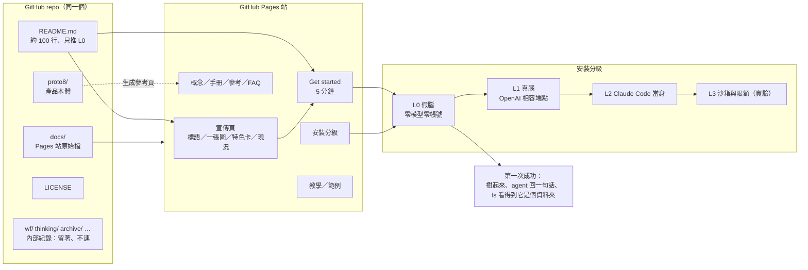
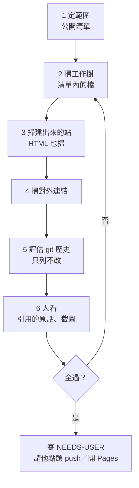

本檔是 fable 對「aos 公開 demo 發佈版」的整套發佈設計稿（11-14），給 ok-release（opus）細化成實作計劃、送 Argon 審用。

# 02 fable 稿：aos 公開 demo 發佈版怎麼發

← [release-1114](../release-1114.md)｜輸入：[01-備料](01-備料.md)（含 sol-1～3、同類專案調查）

**讀法**：第 0 節是全部結論；第 1 節一張圖；第 2～12 節逐題展開；第 13 節是交給 opus 的「待驗清單」。

**依據聲明**：本稿只讀了備料與四份原始蒐集、任務書、wf 規矩、知識庫入口頁；**沒有另外開 repo 的檔查證**。凡是備料沒寫、我推出來的，都標「待驗」，集中在第 13 節。本稿不改 aos 的概念，只設計「怎麼發」。

---

## 0. 結論（先看這裡）

1. **同一個 repo 發，不另開 repo**。對外的東西只有三樣：新的頂層 `README.md`、新的頂層 `docs/`（Pages 站）、`LICENSE`；產品本體還是 `proto8/`。內部資料（wf、thinking、user-advice、archive、impl_cpp）原地不動、對外入口不連過去，另用一份「公開清單」檔把界線寫死，日後要改成乾淨發佈包或另一個 repo，只是照清單匯出。
2. **安裝分四級，第一級不需要任何模型、任何帳號**：L0 假腦（clone、建置、五分鐘看到 agent 回話）→ L1 接任何 OpenAI 相容端點 → L2 用 Claude Code 當身 → L3 沙箱與限額（實驗）。首頁與 README 只推 L0。
3. **站台分兩層**：宣傳頁是**手寫的單檔 HTML**（零依賴、雙擊就能開，草稿和成品同一種東西）；文件用 **Jekyll**，直接從 `main` 的 `docs/` 發（Pages 原生、不用 workflow、不用 Node）。文件只用標準 Markdown，日後要換產生器成本低。
4. **語言推薦「核心雙語、參考只英文」**：宣傳頁、Get started、安裝、教學做英文＋繁中；參考頁從程式與知識庫生成，只有英文。草稿先寫中文給使用者審，定了再出英文。
5. **防文件過時靠三件事**：參考頁從 `proto8/knowledge` 與指令的 `--help` **生成**；教學裡的指令**抽出來在乾淨複本上實跑**，預期輸出用實跑抄錄；每頁頁尾蓋「對過哪個 commit」。
6. **文案只有一個正本**：一份「文案表」，每句標語、每張特色卡都記中英文、依據哪句原話、是「現在就有」還是「願景」、使用者點頭了沒。宣傳頁照表做，改意見先改表。
7. **第一批最小上線版**約十頁：LICENSE、新 README、宣傳頁（雙語）、Get started（L0）、安裝分級頁、一篇教學、兩個範例、FAQ、現況頁，外加通過發佈前掃描。其他分批補。
8. **要使用者拍板的 10 題**在第 10 節；其中 5 題（語言、授權、範圍、歷史、新增頂層夾）不答就不能上線，其餘可以先照推薦做草稿。

---

## 1. 一頁總覽



一句話：外人從 README 或宣傳頁進來，照 Get started 走 L0，五分鐘內看到「一棵樹、一隻 agent、一句回話」，然後才決定要不要接真模型。

---

## 2. 發佈範圍

### 2.1 含什麼、不含什麼

| | 內容 | 處理 |
|---|---|---|
| **對外主打** | 新 `README.md`、`docs/`（站）、`LICENSE`、`proto8/` 的 `impls`、`cmd`、`py`、`lib`、`kernel`、`templates`、`knowledge`、`cases`、`install.sh` | 進「公開清單」；發佈前掃描必過；文件只連這些 |
| **對外可見、標「設計筆記」** | `proto8/docs`（CONCEPTS／NORMS／CONVENTION 中文條文） | 站上「wiki 預留」區放一個連結，說明是中文、內部條文、可能過時；不翻譯 |
| **不主打、不連** | `wf/`、`proto8/thinking`、`proto8/user-advice`、`proto8/notes`、`proto8/feedback`、`proto8/extras`、`proto8/archive`、`archive/`、`impl_cpp/`、`AGENTS.md`、`CLAUDE.md`、`.claude/` | 原地不動；README 最後一節用一句話交代「其餘資料夾是開發過程紀錄，不是產品的一部分」 |
| **demo 版明講沒有的** | 多機、版本相容承諾、Windows／macOS 原生、套件管理器安裝、穩定 API | 寫進「現況」頁與 README 的 Status 節 |

### 2.2 內部資料怎麼處理：四案比較

| 案 | 做法 | 好處 | 代價 | 對「長期多次修改」 |
|---|---|---|---|---|
| **甲：同 repo、只是不連** | 內部夾原地不動；README 與站台只指產品本體 | 今天就能做；文件跟程式同一個 commit；不動歷史 | clone 下來 192 MB、一萬多個檔，其中約 700 個檔帶本機路徑（都已經是公開的）；外人會翻到內部調度文件 | 最好：改文件就是改檔、commit |
| **乙：甲＋公開清單＋發佈包** | 甲之外，多一份清單檔寫明哪些路徑算產品；日後用清單打出只含產品的 tarball，掛在 GitHub Release | 界線寫死、掃描有範圍；想要乾淨下載時不必另開 repo；安裝腳本可改抓發佈包 | 多維護一份清單；打包與掛 Release 是對外動作，要另外點頭 | 好：平常跟甲一樣，只有出版本時多一步 |
| **丙：另開乾淨發佈 repo** | 現 repo 當開發 repo；新 repo 只放產品＋站，由匯出腳本同步 | 外人看到的最乾淨；clone 小；新 repo 的歷史不帶個人 email | 兩邊要同步，同步一漏文件就跟程式脫節；issue／star 分散；每次改都多一跳 | 差：每輪微調都要「改→匯出→推另一個 repo」 |
| **丁：把內部資料搬走或改歷史** | 刪掉或搬出內部夾，或重寫歷史 | 最徹底 | 不可逆；現有連結全斷；wf 是每天在用的工作流；任務書明定不自己改歷史 | 很差，且風險最大 |

**推薦乙**，分兩步：第一批只做到甲＋清單檔（不打包），之後要不要掛發佈包再問。理由：

- 使用者原話是「github這邊看看要不要也來整理一下，比如頂層README.md修一下，然後讓人能clone下來馬上用」，指的是這個 repo。
- 他說要「長期多次修改」，同 repo 的修改成本最低。
- 清單檔讓丙隨時可做：哪天覺得太亂，照清單匯出就是乾淨 repo，不用重新盤點。

**一個可以轉成賣點的角度**（交使用者決定，第 10 節題 3）：內部紀錄留在公開 repo，可以正面講成「這個專案就是用 aos 自己的 agent 團隊做出來的，過程全在 repo 裡」。講不講、講到多白，是他的方向。

**公開清單檔**：建議放 `docs/_data/public-surface.json`（待 opus 定名），內容是路徑白名單＋每條一句理由。三個用途：發佈前掃描的範圍、日後打包的依據、給審稿的人看界線。

---

## 3. 軟體包與安裝分級

### 3.1 分級表

| 級 | 你會得到 | 多裝什麼 | 需要帳號／金鑰 | 首頁怎麼講 |
|---|---|---|---|---|
| **L0 假腦** | 一棵樹、一隻 agent-fsm、用假腦回話；另外可以直接玩「資料夾＝函數」 | Linux（含 WSL2）、git、bash、python3、CMake ≥ 3.21、C++20 編譯器、nlohmann-json | 不用 | 「五分鐘，不用任何模型」 |
| **L1 真腦** | 同一隻 agent 換成真模型，會想、會叫工具 | 任何 OpenAI 相容端點：LiteLLM proxy、LM Studio、其他相容服務 | 端點自己的金鑰（走環境變數） | 「換一個設定就接上你的模型」 |
| **L2 Claude Code 當身** | 把 Claude Code 掛進樹裡當一隻 agent，有互動畫面 | claude CLI（已登入）、tmux | Claude 帳號 | 「把你已經在用的 Claude Code 納進來」 |
| **L3 沙箱與限額（實驗）** | 隔離、資源上限、分享、監管 | bubblewrap、s6、newuidmap、setfacl、systemd 或 s6-supervise | 不用 | 標「實驗」，只在手冊出現 |

必需只有 L0 那一列。其餘全是可選，文件用「你想做 X 才需要 Y」的寫法，不列成一長串前置條件。

Python 沒有第三方套件，這件事要在安裝頁第一屏講出來（沒有 pip install、沒有 venv），是少見的優點。

### 3.2 一鍵腳本：做什麼、不做什麼

建議新增一支 `proto8/quickstart.sh`（放在 `install.sh` 旁邊；是新檔，不在活樹的 import 路徑上，但照任務書仍要先報 xiaosi 放行）。

**做的事**（每步印一行英文說明，失敗就停、印原因與下一步）：

1. `--check`：檢查 L0 需要的工具與版本，缺什麼就印各發行版的安裝指令，**只印不裝**。
2. 建置 C／C++（照現有 `cmake -B build && cmake --build build`）。
3. 在使用者指定的資料夾（預設 `./aos-demo/`）建一棵示範樹：llm kernel（假腦）、根 daemon、一隻 `ann`。
4. 寫一份 `aos-demo/env.sh`，裡面只有這個示範要的 `PATH`、`PYTHONPATH`、`AOS_HOME`；印出「接下來打這三行」。
5. `--stop`：只收它自己起的那棵樹（用該樹 stack 的絕對路徑下 shutdown）。
6. `--clean`：刪掉 `aos-demo/`。

**不做的事**（要寫進腳本開頭註解與安裝頁）：

- 不 sudo、不呼叫套件管理器、不下載安裝編譯器。
- 不改 `~/.bashrc`、`~/.zshrc` 或任何 shell 設定。
- 預設**不寫家目錄**：不放 symlink 到 `~/.local/bin`、不寫 Python user site。要長期安裝才另外跑現有的 `install.sh`（它會寫這兩處，文件要講白）。
- 不從網路抓東西來執行（不提供 `curl | bash`；腳本在 repo 裡，先 clone 再跑）。
- 不留下使用者不知道的背景行程：起了什麼、怎麼停，結尾一定印。
- 不碰既有的 aos 環境：開頭發現殼裡有 `AOS_*` 變數就拒絕，請使用者開乾淨的殼（跟 `aos-tree-start` 同一個態度）。

「只靠 `PATH`＋`PYTHONPATH`、不跑 `install.sh` 就能起樹」這點備料只有間接證據（sol-2：複製出來的程式要 `.pth` 或明給 `PYTHONPATH`），**待驗**。不成立的話，退一步：quickstart 明白問一句再跑 `install.sh`。

### 3.3 預編二進位、Docker、devcontainer：要不要

| 項目 | 推薦 | 判準（什麼情況改變決定） |
|---|---|---|
| **原始碼建置** | 第一批就有，是唯一正式路線 | 無 |
| **Dockerfile** | 第一批做，但**定位是我們自己的乾淨測試機**，順便當「不想裝東西也能試」的路線；先不推映像到任何 registry | 映像要不要公開推：等有預編檔、且使用者點頭 |
| **預編二進位** | 第二或第三批。執行檔本來就是 `-static-pie`，理論上一包 x86_64 可以到處跑，L0 就變成「只要 python3」 | 提前到第一批的條件：在四種常見發行版的乾淨容器裡，原始碼建置有任何一種失敗，或從 clone 到建完超過 10 分鐘，或一定得先 bootstrap vcpkg |
| **devcontainer／Codespaces** | 第三批。有了 Dockerfile 之後幾乎是附贈，好處是「瀏覽器裡零安裝試玩」 | Dockerfile 連續兩輪沒改才做，免得兩份一起漂 |
| **vcpkg** | 文件優先教「用發行版的 nlohmann-json 套件」，vcpkg 當第二選擇 | 前提是不設 vcpkg 時 CMake 找得到系統套件，**待驗**；不行就照舊教 vcpkg，並把初次 bootstrap 寫清楚 |

掛預編檔、推映像、開 Release 都是對外動作，要使用者另外點頭。

---

## 4. 文件站

### 4.1 產生器比較與推薦

| | Jekyll（推薦） | MkDocs Material | VitePress | Docusaurus／Starlight |
|---|---|---|---|---|
| Pages 部署 | 原生：設定選 `main` 的 `/docs` 就發，**不用 workflow** | 要 Actions 建置 | 要 Actions 建置 | 要 Actions 建置 |
| 額外依賴 | 發佈零依賴；本機預覽要 Ruby | Python（pip） | Node | Node |
| 雙語 | 自己分 `en/`、`zh/` 兩棵目錄 | 每語一個子專案；i18n 外掛已凍結 | 內建 | 內建，最完整 |
| 手寫宣傳頁 | 沒有 front matter 的 HTML 原樣搬，最順 | 要改模板 | 有現成首頁版型，但單檔 HTML 不好塞 | 同左 |
| 沒建置時可讀性 | Markdown 在 GitHub 上直接看也通 | 同 | 多半也通 | 用了元件就不通 |
| 長期風險 | Pages 內建版本舊、外掛受白名單限制 | 官方已提到轉向新工具 | 生態活，但綁 Node 與 Vue | 重 |

**推薦 Jekyll＋現成文件主題（例如 just-the-docs），從 `main` 的 `/docs` 發**。理由按重要性：

1. 宣傳頁草稿要「本機可開」、要反覆改。手寫單檔 HTML 草稿和成品是同一個檔，放進 `docs/` 就上線，不經任何轉換。
2. 不用 workflow：少一個 `.github/` 夾、少一條會壞的管線；推上 main 就是發佈，符合「只有一個 main」的慣例。
3. 產品本身零 Node、零 pip，文件站也不該逼維護者裝一套。
4. 內容守一條紀律：**只用標準 Markdown、front matter、`<details>`、mermaid 區塊**，不用主題專屬語法。頁數長大後要換 VitePress 或 Starlight，搬的是純文字。

**什麼時候換**：頁數超過約 80 頁、需要文件分版本、或雙語手動同步明顯跟不上（連續兩輪有英文頁落後中文頁）。

**待驗**：Pages 內建的 Jekyll 版本配遠端主題與 mermaid 能不能正常出圖。第一批先做一頁煙霧測試（本機用 Ruby 或容器建一次），不通就改用 Actions 建置同一份原始檔，目錄不用動。

**`docs/` 還是 gh-pages 分支**：用 `main` 的 `docs/`。gh-pages 分支違反「本地與遠端都只有一個 main」的慣例，而且文件會跟程式分家。新增頂層 `docs/` 夾改到「頂層只留入口」的佈局，要使用者點頭（題 5）。

### 4.2 完整目錄樹

```
docs/
  _config.yml                 站台設定（主題、導覽、mermaid）
  index.html                  宣傳頁（英文，手寫單檔）
  zh/index.html               宣傳頁（繁中）
  assets/                     圖、終端畫面、樣式
  _data/public-surface.json   公開清單
  _tools/                     生成與檢查腳本（底線開頭，不會被發佈）
  en/
    get-started.md
    install/      index  requirements  real-brain  claude-code  optional  uninstall
    tutorials/    01-first-tree  02-real-brain  03-two-agents  04-write-a-tool
                  05-claude-code-body  06-a-kernel-that-says-no
    examples/     index  ＋每個範例一頁
    concepts/     in-one-page  folder-as-function  tree  kernel-and-letters
                  bodies-and-brains  vision
    manual/       run-a-tree  agents  mail  brains  limits-and-sandbox
                  home-layout  troubleshooting
    reference/    cli/  tools/  errors  env  files  glossary      ← 生成
    faq.md
    status.md
    wiki/index.md               預留
  zh/                           同結構；reference 不翻，直接連英文
```

每篇要點：

| 頁 | 要點 |
|---|---|
| **首頁** | 見第 5 節 |
| **Get started** | 只有 L0 一條路：clone、建置、起樹、說一句話、看回覆、`ls` 看 agent 的資料夾、停樹。每步附實跑抄錄的預期輸出。結尾三個去向：接真腦、看範例、看概念 |
| **install/index** | 分級總表（3.1 那張）＋「我該選哪級」的三句判斷 |
| install/requirements | 各發行版裝 L0 工具的一行指令；WSL2 注意事項（repo 不要放 `/mnt/`）；macOS／Windows 請走容器 |
| install/real-brain | 在自己的 `kernel.json` 加一個 endpoint pack 指到端點、金鑰走環境變數、用 `/v1/models` 核對模型名；分 LiteLLM、LM Studio、其他三小段 |
| install/claude-code | 登入 claude CLI、裝 tmux、第一次信任工作區 |
| install/optional | L3 每個工具「想做什麼才裝」；全頁標實驗 |
| install/uninstall | `install.sh --uninstall`、刪示範夾；說清楚曾經寫過家目錄哪兩處 |
| **tutorials** | 六篇，見第 7 節 |
| **examples** | 見第 8 節 |
| concepts/in-one-page | 直接沿用知識庫入口頁的「八個詞、五條規則」，改成給人看的口吻 |
| concepts/folder-as-function | 一個資料夾加 `_entry` 就能被執行；旁邊可以放說明與資料 |
| concepts/tree | daemon、proc、定義、stack、工作區各是哪個資料夾（一張圖） |
| concepts/kernel-and-letters | 請求是一封信、kernel 是門、被拒絕是決定不是錯誤 |
| concepts/bodies-and-brains | 兩種身（agent-fsm、外部 CLI）與腦（endpoint pack） |
| concepts/vision | 使用者的願景原話，整頁標「這是方向，不是現有功能」 |
| **manual**（使用手冊） | 起停與查看、掛／停／移除 agent、寄信收信、換腦、限額與沙箱、長住的家怎麼擺（aos-home 佈局與備份）、疑難排解（照錯誤代號查） |
| **reference** | 全部生成：每支指令的 `--help`、工具清單、錯誤代號表、環境變數、檔案格式、名詞表 |
| **faq** | 為什麼是資料夾、跟其他 agent 框架差在哪、要不要付費模型、能不能用在正事上（答：prototype）、支援哪些系統 |
| **status** | 現在能做的／實驗中的／還沒有的三欄；格式會變的警告；更新紀錄 |
| **wiki** | 一頁目錄：連到 `proto8/docs` 三套條文（標中文、內部）、之後慢慢加的細節頁 |

「使用手冊」對應 `manual/`、「安裝手冊」對應 `install/`、「範例」「教學」各有一區，使用者原話點到的四樣都有獨立入口。

### 4.3 怎麼避免文件跟程式脫節

proto8 明講沒有版本相容、格式常改，所以原則是「會過時的細節不手寫」。

| 內容 | 來源 | 作法 |
|---|---|---|
| 參考頁（指令、工具、錯誤代號、名詞） | `proto8/knowledge/aos/*.json`（出廠知識庫，本來就是英文、給模型讀的單一來源）與各指令的 `--help` | `docs/_tools/` 一支生成腳本轉成 Markdown；檔頭寫「generated, do not edit」；跟程式同一個 commit 重生（同現有 index_gen 的習慣） |
| 概念頁 | 知識庫入口頁與同夾幾份 | 手寫，但每頁頁首註明對應知識庫哪個檔；知識庫改了就該回頭看 |
| Get started 與教學裡的指令 | 教學本身 | 指令寫在固定標記的程式區塊；檢查腳本把它們抽出來，在 `git archive` 的乾淨複本、清過環境的殼裡用假腦實跑；跑不過就不發 |
| 預期輸出 | 實跑 | 由檢查腳本抄錄，不手打 |
| 版本戳 | git | 每頁頁尾「Checked against `<短雜湊>`, `<日期>`」；現況頁列目前站台對的是哪個 commit |
| endpoint pack 範例 | `proto8/kernel/llm-kernel/kernel.json` | 文件不抄內容，教「怎麼在自己的複本加一個」，並連到檔案 |

L1、L2 的教學沒辦法在無模型的環境自動跑，改成「每次發佈前人工跑一遍、把日期寫進頁尾」，頁首誠實標「上次實跑：某日」。

生成與檢查腳本都是 `docs/_tools/` 底下的新檔，不改 `proto8/` 的程式。

---

## 5. 產品頁（landing）

### 5.1 區塊順序

| # | 區塊 | 放什麼 |
|---|---|---|
| 1 | **主視覺** | 標語、一句話介紹、兩顆鈕（Get started／GitHub）、右邊一塊終端畫面：五行指令加真實輸出。上方小字 `prototype · demo release` |
| 2 | **一張圖講核心** | 左邊一個資料夾展開（`_entry`、說明、資料），右邊它被當函數呼叫；圖下一句「一個資料夾就是一個函數；agent 也是」 |
| 3 | **特色卡** | 4～6 張，見 5.4 |
| 4 | **怎麼組起來** | 三層圖：exec／loop／daemon 對應「CPU 指令／CPU／板子」，kernel 是門。可以拿現成的「daemon 是手、kernel 是門」那張圖重畫 |
| 5 | **五分鐘試試** | L0 的指令，下面三個小分頁：接真腦、用 Claude Code、看範例 |
| 6 | **現在有的 vs 要去的地方** | 兩欄：左「今天 clone 下來就能做的」，右「願景」。這一塊是誠實聲明，不能省 |
| 7 | **範例牆** | 3～6 張小卡，各連一頁範例 |
| 8 | **現況與邀請** | 這是 prototype、格式會變、歡迎試玩與回報；連 status 頁 |
| 9 | **頁尾** | 文件、GitHub、授權、語言切換 |

照使用者的頁面風格：每塊一張圖加一兩句，細節收進可展開區；不寫大段文字。

終端畫面第一批用手排的 HTML 區塊配實跑輸出，不用錄影工具；之後想要動畫再換。

### 5.2 標語候選

（行號沿用 sol-3 的標法；英文是我譯的，要使用者看過。）

| # | 英文 | 中文 | 依據 | 性質 |
|---|---|---|---|---|
| 1 | **Folders are functions.** | 資料夾，就是函數。 | 20261027:1 | 已實作 |
| 2 | **The filesystem is the programming language.** | 把檔案系統當成程式語言來用。 | 20261106:6 | 已實作 |
| 3 | **An operating system for agents, built on any resource.** | 給 agent 的作業系統，不靠硬體，靠任意資源。 | 20261113:5 | 定位（部分實作） |
| 4 | **Unix philosophy for the age of agents.** | 把 unix 哲學帶進 agent 時代。 | 20261106:10 | 定位 |
| 5 | **Start with an agent. End with a program.** | 從一隻 agent 開始，最後換成一支程式。 | 20261113:13 | 願景 |

推薦主標用 1（最短、最具體、是使用者自己的第一句話），副標用 3 或 4。5 很有力，但它是願景，放在第 6 塊當小標比較安全。

「the new age of programming」（20261106:3）和「RSI的飛輪，自此而始」（20261106:61）口氣很大，建議只放在願景頁，並標是作者的話。

### 5.3 一句話介紹候選

1. *aos runs AI agents as ordinary Linux processes inside folders. Every tool, every agent, every message is a folder you can `ls`, read, and set permissions on.*（改寫自知識庫入口頁，全是已實作的事實，推薦）
2. *A small set of Unix-style programs that turn a directory tree into a running team of agents.*（依據 20261106:10、29）
3. *aos treats a folder as a function and an agent as a function too, so that, step by step, the agent can be replaced by plain code.*（依據 20261027:1、20261113:13；後半是願景，用的話要帶「we aim to」）

### 5.4 特色卡

| # | 卡 | 一句話 | 依據 | 性質 |
|---|---|---|---|---|
| 1 | **Folder = function** | 資料夾裡放一個 `_entry` 就能被呼叫，旁邊可以放說明與資料 | 20261027:1、20261027:3、20261106:6 | 已實作 |
| 2 | **Native to LLMs** | 模型本來就會讀寫檔案與資料夾，不用另外學一套框架 | 20261106:9、20261113:9 | 設計主張（不是量測結果，文案不寫「更準」「更快」） |
| 3 | **Rides on Linux** | 權限就是檔案權限；工具用什麼語言寫都行 | 20261106:6 | 跨語言已實作；權限隔離部分屬 L3 實驗 |
| 4 | **Small parts, Unix style** | 幾支各做一件事的小程式：exec、loop、daemon | 20261106:10、20261106:29 | 已實作 |
| 5 | **Bring your own brain and body** | 假腦、任何 OpenAI 相容端點、或把現成的 Claude Code 掛進來 | 20261027:6、20261027:25 | 已實作 |
| 6 | **A kernel is a door** | 起行程、問模型都是寄一封信；門可以排隊、限額、拒絕 | 20261113:5 | 部分實作（文案只寫已有的：排隊、預算、拒絕） |

**願景帶**（獨立一塊、有底色、標 Vision）：

| 句 | 依據 |
|---|---|
| 逐步把 agent 換成確定的程式，token 用量往零走 | 20261106:45、20261106:56、20261113:13 |
| 會改進自己的函數：先做一個能幫你寫函數的函數 | 20261113:19 |
| 像管公司一樣看全景：部門、員工、狀態 | 20261114:7（進行中，可放截圖時再升級成特色卡） |

**全名**：「akatosh operating system」（20261113:5）要不要寫上去是題 6。

以上每一句進正式頁面前，都要列成清單給使用者確認（任務書規定）。清單就是第 11 節的文案表。

---

## 6. 頂層 README 新骨架

目標約 100 行、英文為主，細節全部交給站台。

| 節 | 行數 | 內容 |
|---|---|---|
| 標題列 | 6 | 名稱、標語、三顆徽章（license、status: prototype、docs）、語言切換連結（→ `README.zh-TW.md`） |
| 一句話 | 3 | 5.3 的第 1 句 |
| 一張圖或終端畫面 | 3 | 跟宣傳頁第 1 塊同一張 |
| **Quickstart** | 20 | L0：需求一行、clone、建置、起樹、說話、停。附最後兩行預期輸出。下面一句「卡住了看 troubleshooting」 |
| What you just ran | 8 | 四行說明剛才那幾個資料夾各是什麼（daemon、agent、stack、信），連概念頁 |
| Next steps | 8 | 三個連結：接真腦（L1）、Claude Code 當身（L2）、範例 |
| Why folders | 12 | 四到五條特色，每條一行、各連文件 |
| How small | 6 | 用數字講規模：核心幾支程式、Python 零第三方套件、靜態執行檔（學 smolagents 的「How smol」；數字生成，不手打） |
| Status | 8 | prototype、格式會變、只支援 Linux、沒有多機；連 status 頁 |
| Repository layout | 10 | 一張小表：`proto8/` 是產品、`docs/` 是站；其餘資料夾一句話帶過「development history and working notes, not part of the product」 |
| Security | 5 | agent 會執行程式；請在你信得過的環境試；沙箱是實驗功能 |
| License | 3 | |

另外放一份 `README.zh-TW.md`，內容對應。`AGENTS.md`、`CLAUDE.md` 是 agent 的入口，照舊不動；新 README 不再連進 `wf/`。

現在的 README 內容（建置要點、佈局表）不丟：建置搬進安裝頁，佈局表縮成上面那張小表。

---

## 7. 佈署分派

### 7.1 外人怎麼做（單機）


| 步 | 外人要做的 | 文件怎麼教 |
|---|---|---|
| 起樹 | 複製根範本與 kernel 範本、設 `AOS_HOME`、用 `aos-tree-start` 起 | quickstart 幫他做一次；教學 01 帶他手動做一次、每步說為什麼 |
| 掛 agent | 複製 `agent-fsm` 範本成自己的定義、`aos-agent … ctl add` | 教學 01；手冊 `agents` 列全部動作 |
| 派工 | 對一隻 agent 用 `say／listen／chat`；agent 之間用信（REQUEST → DONE／BLOCKED／FAILED） | 教學 03；手冊 `mail` |
| 換腦 | 改 `llm.json` 的 pack 名，或在自己的 kernel 加 pack | 教學 02；手冊 `brains` |
| 長住 | 把樹搬到固定的家（aos-home 佈局）、起停、備份 | 手冊 `home-layout`（從現有 aos-home 手冊改寫，去掉私人環境的部分） |
| 管控 | 限額、沙箱、會拒絕的 kernel | 教學 06、手冊 `limits-and-sandbox`，全標實驗 |

現在起樹的說明散在三處、另一條 Claude Code 路線有版本落差（備料第 2 節）。對外文件**以實跑通過的那一條為準重寫**，不整段搬舊文。

### 7.2 多機：誠實寫

備料沒有任何多機已實作的證據，所以對外只寫三句（**確切現況待驗**，請 opus 查一個事實再定稿）：

- 目前一棵樹住在一台機器上。
- 多台機器可以各起各的樹；樹和樹之間現在沒有內建的連線方式。
- 跨機是之後的方向，不在這個 demo 版裡。

放在 status 頁與 FAQ，不寫教學。

### 7.3 要寫成哪幾篇教學

| # | 篇名 | 級 | 做完會什麼 |
|---|---|---|---|
| 01 | Your first tree | L0 | 手動起一棵樹、掛一隻 agent、說話、看它的資料夾、停樹 |
| 02 | Give it a real brain | L1 | 加一個 endpoint pack、換腦、看它真的在想 |
| 03 | Two agents and a letter | L1 | 掛第二隻、讓一隻寄信請另一隻做事、收到 DONE |
| 04 | Write a tool | L0 | 從工具骨架做一個自己的工具、掛給 agent（寫與檢查不用模型；讓 agent 自己去叫要 L1） |
| 05 | Claude Code as a body | L2 | 把 Claude Code 掛進樹、開畫面、讓它看自己的狀態 |
| 06 | A kernel that says no | L1 | 設預算或開一道門、看請求被拒、理解「拒絕是決定」 |

第一批只寫 01；02～04 第二批；05、06 第三批。

---

## 8. 範例清單

| # | 範例 | 一句目的 | 級 | 預期看到 |
|---|---|---|---|---|
| 1 | **hello-tree** | 最小的一棵樹 | L0 | daemon 的表上有一隻 `ann`；對它說話得到假腦的固定回覆；`ls` 看到它的 stack |
| 2 | **folder-as-function** | 不用任何模型，體會核心想法 | L0 | 一個只有 `_entry` 的資料夾被 `aos-exec` 當程式跑；同一個函數用 shell 和 Python 各寫一次，呼叫方式一樣 |
| 3 | **ask-with-tools** | 真模型用工具回答問題 | L1 | 問一題算術或「這個夾裡有幾個檔」，歷史裡看得到它叫了工具再回答 |
| 4 | **mail-relay** | 兩隻 agent 用信協作 | L1 | 信箱裡出現 REQUEST，之後出現 DONE；兩封信都是看得見的資料夾 |
| 5 | **claude-in-a-tree** | 現成的 Claude Code 變成樹裡的一員 | L2 | tmux 畫面裡的 Claude Code 能列出自己的工具與狀態 |
| 6 | **budget-gate** | 看 kernel 怎麼擋 | L1（實驗） | 超過預算的那次請求被拒，agent 回報而不是硬闖 |

每個範例一個資料夾（建議 `proto8/examples/<名>/`，是新夾，要報備）：README、一支 `run.sh`、一份實跑抄錄的 `expected.txt`。範例頁從 README 生成，`run.sh` 進檢查腳本。

第一批只做 1、2。這兩個剛好都是 L0，可以全自動驗。

範例 3～6 能不能照描述跑出來，備料沒有直接證據，**待驗**；跑不出來的就換題或降級，不寫沒跑過的東西。現有 `proto8/cases` 的 smoke 套題可以當第 7 個候選（「量一隻 agent」），等前面幾個穩了再說。

---

## 9. 發佈前掃描與授權

### 9.1 掃描流程



| 步 | 掃什麼 | 過關條件 |
|---|---|---|
| 1 定範圍 | 公開清單列的路徑 | 清單有人審過 |
| 2 工作樹 | 本機家目錄路徑、帳號名、真名、email、主機名、金鑰形狀（常見前綴、私鑰檔頭、Bearer）、內網位址；另掃**內部才有意義的名字**（見下） | 清單內零命中；每個例外逐條寫理由 |
| 3 建出來的站 | 同第 2 步的規則，對產生的 HTML 再跑一次 | 零命中 |
| 4 對外連結 | 公開頁連到 `wf/`、`thinking/`、`user-advice/` 的連結；連到 claude.ai artifact 的連結；壞連結 | 零個 |
| 5 git 歷史 | 作者欄的 email；歷史上曾出現、後來刪掉的金鑰形狀 | **只出報告**，交使用者決定（題 4），不改歷史 |
| 6 人看 | 文案表裡每句引用、每張截圖與終端畫面（提示字元、路徑、主機名常從這裡漏） | 使用者逐條點頭 |

幾個容易漏的點：

- **掃描規則本身含個人值**（帳號名、主機名、email）。含值的規則檔**不能進 repo**，放在本機忽略的地方；repo 裡只放通用形狀的規則。
- **產品本體裡有只對這個環境有意義的名字**：出廠的 `kernel.json` 裡有指向本機 proxy 的 endpoint pack，模型名是使用者自己 proxy 上的名字，外人照抄不會動。這不算洩密，但會讓 L1 第一步就卡住。兩個解法：文件教外人自己加 pack（不改程式）；或在範本加一個中性的示範 pack（要改 `proto8/`，得報備）。推薦先走前者。
- sol-1 的掃描跳過了二進位檔（templates／lib／cmd 各有幾十個）。要確認它們是不是被 git 追蹤的；是的話要另外處理。**待驗**。
- 範本文件裡有內部代號的命中（sol-1 補掃那六個檔），發佈前逐個看。
- `.vscode/` 有個人路徑、目前沒追蹤也沒忽略，建議加進 `.gitignore`，免得哪天被 `git add` 進去。
- 截圖與終端畫面一律在乾淨的示範帳號或容器裡擷取。

掃描腳本放 `docs/_tools/`，每次要上線前跑，輸出一份報告存進這條線的紀錄夾。

### 9.2 授權（方向題，細節在題 2）

現在沒有 LICENSE，法律上等於「看得到但不能用」，跟「讓外人用」矛盾，所以第一批一定要有。推薦程式 MIT、文件與站台文字 CC BY 4.0。連結進執行檔的 nlohmann-json 是 MIT，將來發預編檔時要附它的聲明。

---

## 10. 方向題清單（給使用者）

每題：選項、後果、推薦、判準。★ 是不答就不能上線的。

### ★ 題 1　對外文件用什麼語言

| 選項 | 後果 |
|---|---|
| A 只英文 | 觸及最廣、維護一份；你審稿要看英文或另看中文草稿 |
| B 只中文 | 你改最順；外面的人大多看不懂，跟程式輸出（全英文）不一致 |
| C 全站雙語 | 最完整；每次改都是兩倍工，最容易一邊過時 |
| **D 核心雙語、參考只英文（推薦）** | 宣傳頁、Get started、安裝、教學有中英兩版；參考頁從英文知識庫生成、不翻。工作量約 1.3 倍 |

推薦 D。流程是「中文草稿給你審 → 定稿 → 出英文」。判準：之後若連續兩輪英文頁落後中文頁，就縮成 A（保留中文宣傳頁一頁）。

### ★ 題 2　授權

| 選項 | 後果 |
|---|---|
| **MIT（推薦）** | 最簡單、大家最熟；別人可以拿去閉源商用，只要留聲明 |
| Apache-2.0 | 同樣寬鬆，多了專利條款；條文長一點 |
| AGPL-3.0 | 別人改了拿去做服務也得開源；會讓一部分公司不敢碰 |
| 先不放 | 別人法律上不能用，等於沒發佈 |

推薦 MIT，文件 CC BY 4.0。判準：你如果在意「別人拿去閉源賺錢」，選 AGPL；在意「越多人用越好」，選 MIT。11-13 討論提過工作流模板 CC0＋MIT，跟這個推薦不衝突。授權範圍預設涵蓋整個 repo（含 archive、impl_cpp）；想排除哪個夾請講。

### ★ 題 3　內部資料怎麼處理（第 2.2 節）

| 選項 | 後果 |
|---|---|
| 甲 同 repo、不連 | 最快；外人翻得到內部調度文件 |
| **乙 甲＋公開清單，之後可出乾淨發佈包（推薦）** | 平常跟甲一樣；界線寫死，隨時能轉丙 |
| 丙 另開乾淨 repo | 最乾淨；每次修改多一跳、容易脫節 |
| 丁 搬走或改歷史 | 不可逆，不建議 |

推薦乙。附帶一問：內部紀錄留在公開 repo，要不要在宣傳裡正面講「這個專案是用 aos 的 agent 團隊做的，過程都在 repo 裡」？（可講、可不講、可晚點講）

### ★ 題 4　git 歷史裡的個人 email

現況：四千多個 commit 的作者欄是你的 GitHub 帳號與個人 email，repo 一直是公開的，這些已經在外面。

| 選項 | 後果 |
|---|---|
| **A 不動，照現狀（推薦）** | 零風險、零成本；email 繼續可見 |
| B 不動舊的，之後的 commit 改用 GitHub 提供的 noreply 信箱 | 新 commit 不再帶個人 email；舊的還在 |
| C 重寫歷史 | 所有雜湊都變、文件裡引用的雜湊全斷、別人的 clone 作廢；而且 GitHub 上舊資料不保證消失 |
| D 走題 3 的丙，新 repo 從乾淨歷史開始 | 新 repo 乾淨；舊 repo 仍公開就沒有實質差別 |

推薦 A 或 B（B 只是你改一下 git 設定）。判準：這個 email 你平常就對外用 → A；不想再多曝光 → B。

### ★ 題 5　頂層新增 `docs/`（以及可能的 `.github/`）

現在的規矩是「頂層只留入口，其他收在 wf／proto8」。Pages 要從 `main` 的 `docs/` 發，就得在頂層多一個夾。

| 選項 | 後果 |
|---|---|
| **A 頂層加 `docs/`，不加 `.github/`（推薦）** | Pages 原生可用；頂層多一個外人一看就懂的夾 |
| B 站台放 `proto8/site/`，用 Actions 部署 | 頂層不變；要加 `.github/workflows`、多一條管線 |
| C 用 gh-pages 分支 | 違反「只有 main」 |

推薦 A。

### 題 6　名字與全名

- 對外名稱就叫 **aos** 嗎？（外面有名字很像的專案，例如 AIOS；搜尋時會混）
- 全名「akatosh operating system」要不要寫在宣傳頁？寫了有記憶點，也會引來「為什麼叫這個」的問題。
- 推薦：名稱用 aos，全名放在宣傳頁副標下方一行小字與 FAQ；主標用標語 1。這題完全是你的品味，草稿會兩種都排給你看。

### 題 7　宣傳用哪幾句原話

第 5 節列了標語 5 個、介紹 3 句、特色卡 6 張、願景 3 句，每句都標了依據行號。請逐條標：用／不用／改成什麼。沒標的先當「草稿可用、上線前再確認」。

### 題 8　願景講多大

| 選項 | 後果 |
|---|---|
| A 首頁只講現在有的，願景收在一頁 | 最穩，少了野心 |
| **B 首頁有一塊明標 Vision 的願景帶（推薦）** | 看得到方向，也分得清現在與未來 |
| C 願景當主標 | 最吸睛；外人試了發現還沒有，容易失望 |

### 題 9　要不要預編執行檔與 Docker

推薦：第一批只有原始碼建置＋一份 Dockerfile（不推映像）；乾淨環境實測若建置失敗或太慢，再提前做預編檔。掛發佈檔、推映像是對外動作，到時另外問。你若現在就想要「下載即用」，講一聲，順序會調。

### 題 10　對外互動開到哪

| 選項 | 後果 |
|---|---|
| **A 開 issue，暫不收 PR（推薦）** | 收得到回報；不用處理外部程式碼（格式常改，PR 很難合） |
| B issue、PR 都開 | 要寫貢獻指南、要花時間審 |
| C 都不開 | 最省事；沒有回饋管道 |

判準：你一週願意花在外部回報上的時間，少於一小時選 A 或 C。

另有兩件小事不列題、照預設做，不同意再說：Pages 網址先用 GitHub 給的預設網址（帶帳號名，避不掉）；「全景」網頁等確認能脫離私人樹之後，再考慮放上宣傳頁當展示。

---

## 11. 第二段草稿怎麼做、怎麼給使用者看、怎麼留底

### 11.1 草稿長什麼樣

```
wf/temp/ok-release/drafts/        施工區（已忽略，不進 git）
proto8/thinking/2026-11/14/release-1114/
  06-草稿/
    文案表.json                   文案唯一正本
    v1/  index.html               審稿入口頁
         landing.zh.html  landing.en.html
         README.draft.md  README.zh-TW.draft.md
         docs/…                   第一批那幾頁的 Markdown
    v2/ …                         每輪一份完整複本，舊的不改
  07-使用者意見/
    第1輪.md  第2輪.md …          原話一字不改＋採納表
```

- **審稿入口頁**（`v1/index.html`）：一頁、雙擊就開。上面是這一版有什麼（每樣一張縮圖加連結）、下面是「請你決定的事」（第 10 節的題，每題選項可展開）。照他的頁面風格：圖多、結論、細節摺疊。
- **宣傳頁草稿**：自帶樣式的單檔 HTML，不連外部資源，沒網路也能開。中文版先做，英文版同版面。
- **文件草稿**：Markdown。另外用本機建站把它們串成可點的站；若本機沒有 Ruby，入口頁直接連 Markdown 檔，由編輯器或 GitHub 預覽。
- **不發佈**：全部只在本機。路徑寄給 xiaosi、由頂層轉給使用者。

### 11.2 文案表（長期修改的關鍵）

一列一句：編號、用在哪（主標／副標／卡 3／願景帶…）、中文、英文、依據（檔名：行號）、性質（已實作／部分／願景）、使用者狀態（未看／可用／要改／不用）、最後改動的輪次。

規矩：**改文案先改表，再改頁面**。這樣第七輪時還查得到某一句為什麼長這樣、是誰哪一輪改的；中英文也不會各改各的。表超過 1 KB，照鐵律 6 用資料檔。

### 11.3 每輪意見怎麼留底

1. 使用者的意見原話一字不改貼進 `07-使用者意見/第N輪.md`。
2. 下面一張採納表：每條意見一列，寫採納／不採納／要再問，以及改了哪個檔、哪一版。
3. 改完出 `v(N+1)`，入口頁最上面列「這版跟上一版差在哪」（三到五條）。
4. 方向性的意見（改定位、改範圍）不直接做，先回一句確認理解再改。

已上線之後同一套照用：改動先進草稿版、給他看、他點頭才進 `docs/`。小錯字這類不用走一輪。

Argon 的審查意見照任務書放 04、05，跟使用者意見分開。

### 11.4 分工建議（opus 決定）

- astra：另出一版宣傳頁的視覺與文案（它擅長圖像創意），讓使用者有兩版可挑。
- Argon：現在就看第 2、3 節（範圍、安裝分級）與第 9 節掃描流程，早點挑毛病；實作計劃出來再審一次。
- sol：照定好的目錄寫文件初稿、生成腳本、檢查腳本、在乾淨複本上實跑抄錄輸出。文案定稿與「這句能不能說」的判斷不交給 sol。

### 11.5 分批順序

| 批 | 內容 | 門檻 |
|---|---|---|
| **0 先驗事實** | 第 13 節的待驗清單，在 `git archive` 乾淨複本＋暫存樹上跑通 L0 一條龍，把實際指令與輸出記下來 | 沒跑通就不寫 Get started |
| **1 最小可上線版** | LICENSE；新 README（中英）；宣傳頁（中英）；Get started；install/index 與 requirements；教學 01；範例 1、2；FAQ；status；公開清單；掃描通過 | 題 1～5 有答案；使用者看過宣傳頁草稿；他點頭 push 與開 Pages |
| **2 接真腦** | install/real-brain；教學 02～04；範例 3、4；`quickstart.sh`；Dockerfile；參考頁生成 | 第 1 批上線、收過一輪意見 |
| **3 完整體驗** | install/claude-code；教學 05、06；範例 5、6；使用手冊全套；概念頁全套；預編檔或 Codespaces（看題 9） | |
| **4 之後慢慢加** | wiki 細節、更新紀錄、貢獻指南、全景展示 | |

使用者說「ok-release線要先好，這樣我才能開始微調」，所以第 0、1 批要快：第 1 批的草稿 v1 不等 quickstart 腳本，Get started 先用手打的幾行指令。腳本晚一批到沒關係，流程要先跑得通。

---

## 12. 風險與未知

| 風險 | 影響 | 對策 |
|---|---|---|
| **程式常改、格式不相容** | 文件幾天就過時 | 4.3 的生成＋實跑檢查＋版本戳；首頁與 README 明標 prototype |
| **C++ 建置門檻** | 外人卡在編譯器、vcpkg、靜態連結 | 批 0 在四種發行版容器實測；優先教系統套件；Dockerfile；必要時提前做預編檔 |
| **外人沒有 Claude 帳號** | 最有看頭的 L2 很多人試不了 | L0 零帳號、L1 可接本機模型；L2 用截圖與終端畫面讓人先看到 |
| **假腦的第一印象太平淡** | 五分鐘後覺得「就這樣？」 | Get started 的重點不放在回話內容，放在「agent 是個資料夾，你可以 ls 它」；緊接著推範例 2 與 L1 |
| **出廠 pack 指向私人環境** | L1 第一步就失敗 | 文件教自己加 pack；必要時報備加中性示範 pack |
| **願景被當成功能** | 信用受損 | 每句標性質；願景獨立一塊；status 頁三欄 |
| **起樹文件有版本落差** | 照舊文寫出錯的教學 | 一律以批 0 實跑為準重寫 |
| **雙語脫節** | 兩版說法不同 | 文案表一句兩語同列；參考頁不翻 |
| **Pages 內建 Jekyll 太舊** | 主題或 mermaid 出不來 | 批 1 先做一頁煙霧測試；不通改用 Actions 建同一份原始檔 |
| **隱私從截圖、終端畫面、範例輸出漏出去** | 個人路徑、主機名上線 | 一律在乾淨帳號或容器擷取；掃描第 3、6 步 |
| **在活樹旁邊驗安裝** | 弄壞使用者正在用的樹 | 照任務書硬規則：乾淨複本、清環境的 bash 包裝、暫存夾、不在 repo 裡編 C++ |
| **repo 很大（192 MB、歷史 94 MB）** | clone 慢、第一印象差 | Quickstart 教 `git clone --depth 1`；日後有發佈包可只抓產品 |
| **名字撞名** | 搜尋不到、被誤認 | 題 6；宣傳頁與 README 的描述句寫清楚定位 |
| **安全** | 外人讓 agent 在自己機器上跑程式 | README 與安裝頁各有一節講白；L0 假腦不會自己執行任意指令這點待驗後再寫 |

**未知**（備料沒有、我也沒查）：多機現況；本機有沒有 Docker 與 Ruby；Pages 目前有沒有開過；「全景」網頁能不能脫離私人樹；範例 3～6 現在的程式跑不跑得出來。

---

## 13. 交給 opus 的待驗清單

批 0 在乾淨複本上確認，結果直接決定文件怎麼寫：

1. **L0 一條龍**：從 `git archive` 的複本開始，照備料第 2 節八步，用假腦做到「說一句、收到回覆、停樹」。記下每一步的實際指令與輸出。
2. **不寫家目錄行不行**：不跑 `install.sh`，只設 `PATH`、`PYTHONPATH`、`AOS_HOME`，能不能起樹與交談。
3. **不用 vcpkg 行不行**：只裝發行版的 nlohmann-json 套件，CMake 找不找得到；`-static-pie` 在各發行版還缺什麼套件。
4. **四種發行版**（建議 Ubuntu LTS、Debian 穩定版、Arch、Fedora）的容器裡，建置各花多久、卡在哪。
5. **Python 最低版本**：L0 路線實際需要幾版（備料只知道 `aos-asuser` 要 3.12）。
6. **假腦回什麼**：固定回覆長什麼樣、能不能演出叫工具（決定範例 1、4 怎麼設計）。
7. **L1**：照文件在自己的 kernel 複本加一個 pack，接一個 OpenAI 相容端點能不能通（真模型只給真的小工作）。
8. **多機現況**一句話的事實。
9. **被追蹤的二進位檔**：sol-1 掃描跳過的那些是什麼、有沒有進 git。
10. **Jekyll 煙霧測試**：`docs/` 一頁 Markdown 加一頁純 HTML，本機建得出來、mermaid 出得了圖。
11. **現成圖**：「daemon 是手、kernel 是門」那張圖去掉日期與內部字樣後能不能重用。

以上任何一項的結果跟本稿假設不同，以實測為準改計劃，並在實作計劃裡註明改了哪一節。
