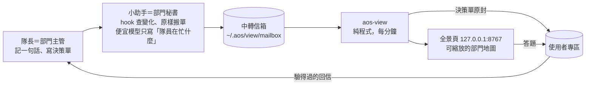
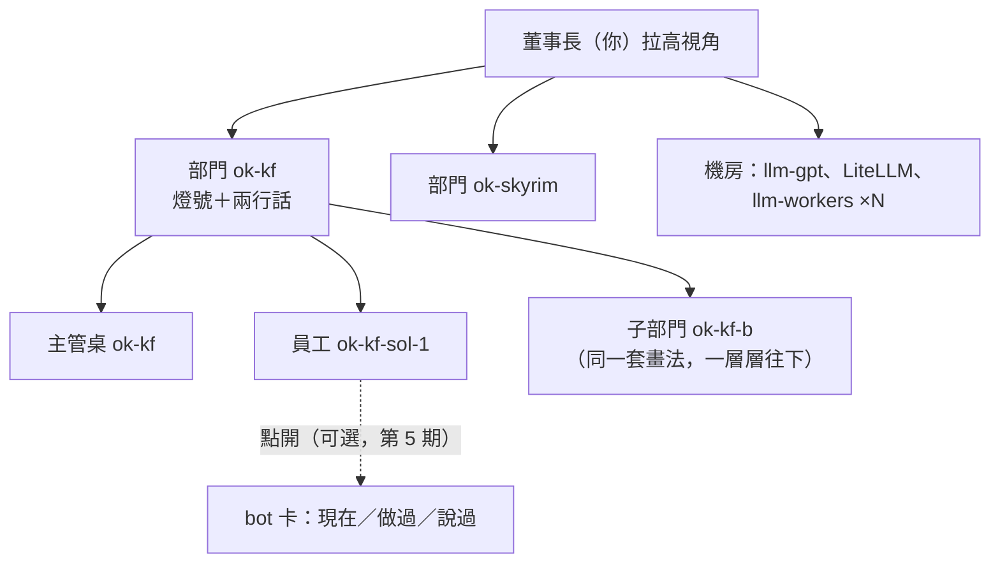

# 全景頁（view-1114）：像管公司一樣看全景——每隊一個便宜小助手 → 中轉信箱 → 固定程序 → 可縮放的部門地圖

← [2026-11-14](README.md)｜[thinking](../../README.md)｜線景 ok-view（只規劃、不施工）

## 使用者原話（11-14，一字不改）

> 對了，再派一條線去幫我規劃，關於如何讓我掌握全景。就是說，現在雖然我可以cd到各ws和子ws，利用say/listen跟他們溝通。但這麼多，其實有點麻煩。我想了一個餿主意，就是每個工作團隊(有隊長的，或是自己本身就兼任隊長的)，都跟他們說，請他們盡量聘請一個小助手，可以用sonnet,haiku,terra,luna這種便宜的，根據隊伍工作複雜性而定，讓小助手定期搜集隊伍進度和狀況，包括需要使用者決策的(不要讓便宜模型寫對於使用者的決策請求單，要讓隊伍先準備好，便宜模型就負責傳遞)，統一丟到一個信箱，不是直接丟到使用者信箱，而是一個中轉信箱，然後一個固定程序負責從中轉信箱收取這些，拿去present到網頁上，這樣使用者就看網頁和操作網頁就好。

追加（第二個點子，經頂層轉述，原話照錄）：

> 讓我掌握全景這塊，我這邊還有個餿主意：就像是管理公司一樣，要讓我這個董事長掌握狀況，所以就是分部門這樣
>
> 就是說，我們人類使用者，比較擅長3d/2d空間的縮放移動，我可以拉高視角看到各部門，也可以點進去看到各部門內部各員工的狀況(這個比較麻煩，未必一定要做)。
>
> 然後這可以嵌套
>
> 啊，要看員工狀況，就是用bot模型，他現在處在啥狀態，他過去幹了啥，說了啥。
>
> 對，就是這個意思。普通的proc，或許...也可以看到狀況？

## 已上線（11-14 第 0 期）

瀏覽器打開 **http://127.0.0.1:8767/**，只聽本機。這一頁能做的事：
- 看部門樹，每列有燈號、在做什麼、queue 數、多久前有動靜、最近回報的標題、最後一句話。
- 「要你決定」的信直接在頁面上回答。
- 對任何一個 agent 說一句話或寄一封信，回覆會串在「往來」裡。
- 點進單一 agent 看它的現在狀態和最近的對話。

後端（JSON API）和前端已經分開，擴充部門、HR、電力的接口留好了，見 [03 §11](view-1114/03-計劃.md)。使用者的裁示：方向題全照推薦，只有兩處不同：手機先不做；要能說話、也要能寄信。

## 結論

- **兩個點子是同一套系統**：第一個點子是管線（怎麼收、怎麼送），第二個點子是語言和畫面（公司、部門、主管、秘書）。部門不用另外劃：**有底下成員的節點就是部門**，從 aos 的 kernel 樹自己長出來，部門裡可以再有部門，每一層格式和畫法都一樣。定稿：[03 §8–§10](view-1114/03-計劃.md#10-依-argon-第二輪修訂9-之上的定稿)。
- **畫面**：2D 平面圖，像在看一層辦公室。可以拖、縮放，點一下就飛進那個部門。每個框只看自己在螢幕上多大，決定畫多少：很小只是一個色點，大一點有名字和燈號，再大有兩行話（主管自己留的話、秘書看到的隊員在忙什麼），夠大就展開裡面的人。位置固定，不會亂跳。要你決定的事固定在旁邊抽屜裡，地圖上有藍色圖釘指著是哪個部門的。不做 3D，理由是手機、白話、不用裝任何東西；資料格式不綁畫法，以後要 3D 是換一層外觀。
- **決策單的字不經過模型**：隊長自己寫，小助手的程式原樣搬，hash 跟著走。回答走專區原本的驗證鏈，回到寫單的隊長那裡，算你本人的話。
- **員工層（bot 模型，可選，第 5 期）**：點開一個員工看三樣東西：現在（在跑或停了、忙不忙、用多少記憶體）、做過什麼（用過的工具）、說過什麼（收發的信）。都走 aos 的正式指令，點了才讀，不存檔、不匯出。Claude 型員工「做過什麼」正式指令讀不到，頁面照實寫 `not recorded`（第 7 題）。
- **普通 proc 第二優先**：跟員工用同一個外殼，只是少了「說過什麼」。llm-gpt、LiteLLM 放在「機房」區；一次性的腦工作（`llm_*`）只算個數。
- **分期**：0a 一頁清單（不用模型，只讀 daemon 表和專區，就標得出「隊長倒了、底下還在跑」）→ 0b 地圖 → 1 中轉信箱和只送事實的小助手 → 2 機房 → 3 加模型（terra）→ 4 收掉舊看板 → 5 員工層（可選）→ 6 手機外連等其他。
- **成本**：程式、hook、網頁都不花模型錢。預設用 terra（訂閱額度），六隊一般一天大約 288 次呼叫；沒變化就不叫模型；額度用完就只送事實。任何模型都要先過 20 份格式考試（luna 之前格式出過錯）。
- **「07 不用 terra」不衝突**：07 那條管蒐集和施工。小助手只傳遞，只寫一句觀察，不做判斷，也沒有別的工具。
- 現有的東西：xiaosi 變窄（只收 agent 之間的事）；quiet、gate 自動初審、decide-page 不動；桌面看板和 `progress_post.sh` 由全景頁取代；論壇併成長文；手機 artifact 先留著。

## 要問使用者的（方向題 7，附推薦）

1. 只有隊長一個人的小隊，小助手要不要叫模型？推薦 **a 不叫**：沒有隊員可以觀察，只把隊長那句話原樣送出。
2. 出門時手機要看到什麼程度？推薦 **a 在家看即時的，出門看 claude.ai 上的快照（含地圖，要手動更新）**（b 是你自己裝 tailscale，c 是不要手機）。另外請確認一條收緊：**不是在這台機器上按的回答，不算 push／刪檔的授權**。
3. 網頁要不要開「對某隊說一句話」？推薦 **a 先不開**（b 開，但走專區簽發；c 直接 say）。
4. 桌面看板（8765）收掉可以嗎？推薦 **a 第 4 期收掉**，前端搬去全景頁。
5. `WAIT_USER` 的 36 筆舊帳要搬嗎？推薦 **a 派一隊 opus 逐筆重寫寄進專區**（b 不搬）。
6. 部門讓它自己長，還是你自己劃？推薦 **a 自己長**：一條線（隊長＋員工）就是一個部門；想按性質看，就用標籤上色、篩選。b 是你給一張分法表（例如 kernel 部、工具部），每開一條新線就要多填一格。a 的資料不用改就能走到 b。
7. 全景頁的程式可以直接唯讀翻 agent 的 stack 嗎？推薦 **a 不行，只走正式指令**：看不到的地方寫 `not recorded`，例如 Claude 型員工用過的工具、頂層壓著幾封請求、llm 用量。b 是開一張白名單讓程式唯讀，代價是開了先例，而且整段對話會進到程式的記憶體裡。c 是替 aos 補正式指令，最乾淨，但要另開一條線。這題只影響第 5 期和幾個數字，不擋前面任何一期。

我代你決定、你可以推翻的：2D 不做 3D；全景頁只呈現部門之間的協調，不去協調；員工層不另外記改檔，commit 改在部門層讀 commit-request 自己的帳。

## 要點頭才做的（鐵律 2）

1. 施工本身（開工）。
2. 把 `aos-view` 裝進 `~/aos-home/ws/tools/`，並啟用 systemd user 單元（第 0a 期）。
3. llm-gpt 加 pack `terra-aide`（第 3 期）。
4. 改專區 `door.json` 那句「進度去看板」，以及知識庫裡對應的字（第 4 期）。
5. 刪掉看板程式和 `progress_post.sh` 等（第 4 期；第 4 題答 a 才做）。

第二輪沒有新增要點頭的事：新加的部分全是唯讀。第 7 題如果選 b，就多一件。

旁支：LiteLLM 實際聽的是 `0.0.0.0:4000`，區網裡別台機器連得到。跟本案無關，記給你知道（第 2 期的機房卡會標出來）。

## 材料

| 檔 | 內容 |
|---|---|
| [01-備料](view-1114/01-備料.md) | 第一輪現況盤點（sol ×3 蒐集、opus 抽查） |
| [01b-備料-部門與空間介面](view-1114/01b-備料-部門與空間介面.md) | 第二輪盤點：員工層有哪些現成紀錄、普通 proc、kernel 樹、前端 |
| [02-fable稿](view-1114/02-fable稿.md) | fable 第一輪設計 |
| [02b-fable稿-部門與空間](view-1114/02b-fable稿-部門與空間.md) | fable 第二輪設計（兩個點子合併） |
| [03-計劃](view-1114/03-計劃.md) | opus 實作計劃；§8 第一輪定稿，§9 第二輪定稿與實測，§10 第二輪 Argon 修訂 |
| [04-Argon原文](view-1114/04-Argon原文.md) | Argon 第一輪：審查 8 條、提案 4 條 |
| [04b-Argon原文-第二輪](view-1114/04b-Argon原文-第二輪.md) | Argon 第二輪：審查 15 條、提案 6 條 |
| [05-採納表](view-1114/05-採納表.md) | 第一輪 12 條全採（其中 3 條部分採） |
| [05b-採納表-第二輪](view-1114/05b-採納表-第二輪.md) | 第二輪 21 條全採（其中 2 條部分採） |
