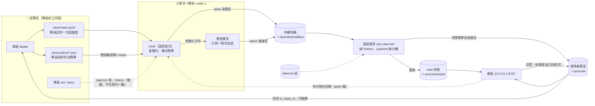

# 02 fable 設計稿：全景網頁（view-1114）
← [view-1114](../view-1114.md)｜fable，11-14

材料：只靠 [01-備料](01-備料.md)。另外點讀了三處（都是 01 列到的檔，為了確認欄位）：專區的 `~/.aos/user/schema/letter.json`（欄位清單，有 `origin`、status 只收四個字）、`~/.aos/user/door.json`（十條規則）、知識庫 `aos/mailbox.json#/rules`（status 六個字：`REQUEST DONE BLOCKED NEEDS-USER FAILED PROGRESS`）。沒有讀 repo 其他地方。

本稿只是設計，沒有施工、沒有改任何現有檔。下面凡是「改活樹」「刪檔」「開新工作」的步驟都要使用者點頭才做（鐵律 2），集中列在第 14 節。

## 0. 結論先講

骨架照使用者原話，一步不少：每隊聘小助手 → 定期蒐集 → 決策單隊伍自己寫、小助手只傳 → 中轉信箱 → 固定程序收 → 網頁看與操作。我定的是骨架裡沒講的細節：

1. **中轉信箱**放 `~/.aos/view/mailbox/`，跟使用者專區 `~/.aos/user/` 並排、各管各的。進度留在 view 這邊；決策單由固定程序原封送進專區，所以回答仍走專區的驗證鏈，算使用者本人的話。
2. **小助手分兩半**：一半是固定程式（`on_clock` hook：查有沒有變化、把決策單整個檔原樣搬走），一半是便宜模型（只做一件事：把蒐集到的事實寫成一兩句白話）。**決策單的字從頭到尾不經過模型**，所以模型想改也改不到；另外加 hash，寫單的隊長收到回答時自己再對一次。
3. **每隊自己的小助手直接寄中轉信箱，網頁負責組樹**。不讓上層小助手轉述下層（傳話會走樣、還花兩次錢）。
4. **固定程序是純 Python、不用模型**，systemd 每分鐘跑一次，自己也讀 daemon 表。所以就算一個小助手都還沒聘，網頁第一天就看得到「誰在跑、誰停了、隊長倒了底下還在跑」。
5. **網頁新做一個**（`aos-view serve`，`127.0.0.1:8767`），把專區的「待你決定」收進同一頁；桌面看板 8765 收掉；手機 artifact 先留著當唯一的外出路。
6. **網頁第一批只開五種操作**：答決策、收起、叫某隊現在回報、靜音某隊、切在家／出門。不開「自由下指令」、不開停隊。
7. **預設模型是 terra**（`chatgpt-gpt-5.6-terra`，訂閱額度）。任何模型要先過一次格式考試才能當小助手；luna 之前格式出錯過，沒過考試不用。
8. **最早能看到東西的一步（第 0 期）不用模型、不改活樹**：固定程序＋網頁，只讀 daemon 表與專區。

要問使用者的：**5 題方向性問題＋3 件要點頭的事**（第 14 節）。

## 1. 整體資料流



一句話：**進度走上面那條（中轉 → view 狀態 → 網頁），決策走下面那條（中轉 → 專區 → 網頁 → 專區 → 寫單的隊長）**。兩條在中轉信箱之後由固定程序分流，這樣專區「不收進度」的規矩不用改。

## 2. 中轉信箱

**放哪**：`~/.aos/view/`（一個 Linux 帳號一份，跟 `~/.aos/user/` 同一種擺法）。

```
~/.aos/view/
  mailbox/        中轉信箱（aos-post init 建的 tmp/new/cur）
  done/<月>/      收過的信原樣留底
  rejected/       格式不對、hash 不對的信
  state/          固定程序算出來的東西（teams/*.json、tree.json、passed/…）
  poke/           網頁要某隊「現在回報」的旗子檔
  web/token       網頁 token（0600）
  config.json     門檻、埠號
  schema/letter.json
  log.jsonl
```

**誰能寫**：規矩上只有小助手（和第 0～1 期還沒小助手的隊長，用同一支工具 `view_send`）往 `mailbox/` 寄信；只有固定程序收（`aos-post take`）；其他人不讀不寫。全部 agent 同一個 Linux 帳號，技術上擋不住，靠規矩＋固定程序驗格式（跟專區同一種程度）。

**信的格式**：沿用 aos 的信（資料夾＋`letter.json`，信封 `sender sent_at reply_to body`），body 沿用 `from status title what in_reply_to`，另外加：

| 欄位 | 意思 |
|---|---|
| `zone` | 固定 `"view/1"` |
| `kind` | `report`（進度）、`beat`（沒變化，報平安）、`pass`（轉送決策單）、`post`（給使用者讀的長文，接手論壇） |
| `team` | 隊名＝隊長在 daemon 表上的名字 |
| `parent` | 上層隊伍的隊名；頂層底下的隊寫 `repo-aos`；沒有就 `null` |
| `seq` | 這隊第幾封，從 1 遞增（固定程序用來發現漏信、重複） |

status 只有六個字，對法固定：`report`→`PROGRESS`（隊伍卡住寫 `BLOCKED`、收隊寫 `DONE`）；`beat`→`PROGRESS`；`pass`→`NEEDS-USER`；`post`→`DONE`。不用 `REQUEST`（中轉信箱不接受請求）。

**進度信與決策信怎麼分**：看 `kind`，不看內文。

<details><summary>report 與 pass 各長怎樣（欄位細節）</summary>

`report`：

```json
{"zone":"view/1","kind":"report","team":"ok-kf","parent":"repo-aos","seq":12,
 "from":"ok-kf-aide-1","status":"PROGRESS",
 "title":"ok-kf: B2 drawings revised, waiting for build",
 "what":"一句白話：現在在做什麼",
 "said":{"now":"…","next":"…","blocked":""},
 "summary_by":"terra-aide",
 "snapshot_sha256":"…",
 "facts":{"leader":{"name":"ok-kf","state":"running"},
          "members":[{"name":"ok-kf-sol-1","state":"busy","queued":0}],
          "notes":[{"ts":"…","status":"progress","text":"…"}],
          "pending_pass":["d-003"]}}
```

- `facts` 全部由 hook 填（程式抄來的事實）；`what` 與 `said` 是模型寫的；`summary_by` 記是哪個 pack 寫的，沒用模型就寫 `"none"`。網頁上兩種字分開顯示，使用者看得出哪句是模型講的。
- `pass`：信的資料夾裡多放一個 `payload.json`，是隊長那個檔**逐位元組的複本**；`letter.json` 只放信封資料：`payload_id`（`<隊名>/<檔名>`）、`payload_sha256`、`written_by`（隊長名）、`reply_to_team`（隊長信箱的絕對路徑）。`title` 由 hook 從 payload 的 `title` 用程式抄，不經模型。
- 信的資料夾能不能多放一個檔，01 沒寫；不行的話改成 body 裡一個字串欄位 `payload_text` 放原檔全文，hash 照算。opus 深化時確認。
</details>

## 3. 小助手

**誰聘**：隊長用 `subagent add` 聘（這樣有歸屬紀錄，親子查得到）。名字照 07 的命名規矩：`<隊名>-aide-1`。隊長的任務書加一段「開工先聘小助手」，內容固定，隊長不用自己想。

**身體**：agent-fsm，腦走 llm kernel 的專用 pack（第 9 節）。帶 `--limits {"mem_mb":1024,"files":256}`（07 的 sol 預設）。

**一隻小助手＝兩半**：

| | 固定程式那一半（`on_clock` hook） | 模型那一半 |
|---|---|---|
| 做什麼 | 蒐集事實、比對有沒有變、搬決策單、報平安 | 把事實寫成一兩句白話 |
| 花不花模型 | 不花 | 每次回報約 2 次腦呼叫 |
| 手上的工具 | 讀隊伍工作區的 `view/`、`aos-agent ctl ls/state`、`aos-agent history`、寄中轉信箱 | 只有一個：`view_report`（交出那幾句話） |

**它讀什麼**（全部唯讀、都不會讓隊伍多想一輪）：

1. 隊伍工作區的 `view/notes.jsonl`：隊長在「開線、做完一批、代定、卡住、交棒、收隊」時用 `view_note <status> '一句'` 記一行。這就是原本 `progress_post.sh` 的那七個字（`start progress done blocked decision handoff ask`），換個地方寫。
2. daemon 表上這隊成員的那幾列（名字以 `<隊名>-` 開頭的，加上隊長 `state` 的 subagents 部分）。
3. 隊長與成員的 `aos-agent history -t NAME ls`（最後幾則、每則 200 字）。
4. `view/outbox/` 有沒有新的決策單。

**它絕不做**：對隊伍 `say`／`ask`（那會花隊伍一輪）、讀別人的 stack、改隊伍工作區裡 `view/` 以外的任何檔。

**多久跑一次**：

- 決策單：hook 每 60 秒看一次 `outbox/`，有就立刻搬（不花模型）。
- 事實快照：hook 每 5 分鐘蒐一次，算 hash；跟上次一樣就什麼都不做。
- 叫模型：快照變了、而且離上次叫模型已經 15 分鐘以上，才把快照放進自己的 queue 叫模型寫一次（這條門檻沿用看板總結器「有變動且隔 15 分鐘」的前例）。
- 報平安：連續 15 分鐘沒寄任何信，hook 寄一封 `beat`（不花模型），讓固定程序知道它還活著。

所以「沒變化就不花模型」是 hook 先查做到的；隊伍整晚沒動，小助手一次模型都不叫。

**每次都從空白開始**：模型那一半不累積歷史（01 E：一題大的就 20 萬 bytes），每次只拿到這一份快照（上限約 6 千 token，hook 會截）和上一次自己寫的那幾句。怎麼在 agent-fsm 上做到（每次清歷史或重起），opus 深化時定。

**選模型的判準**（定案）：

| 隊伍 | 用什麼 |
|---|---|
| 只有隊長自己 | 不叫模型，只送事實（`summary_by: "none"`）——這條要問使用者，見第 14 節第 1 題 |
| 隊長＋1～4 個成員 | terra（`chatgpt-gpt-5.6-terra`） |
| 5 個以上成員、或底下還有隊伍、或 terra 一天內兩次交不出合格格式 | haiku（`claude-haiku-4.5`），再不行 sonnet |
| luna、本機模型 | 先過考試才能用；沒過就不用 |

- **格式考試**：任何模型當小助手之前，拿 20 份固定的快照叫它寫，20 份都通過 `view_report` 的格式檢查才算合格。luna 在 arknights 線格式錯過一次、本機 12B 那輪 0 題可用，所以都不預設；考過了才列入。
- **格式錯了怎麼辦**：`view_report` 當場檢查格式，不合格就退給模型重寫一次；再錯，hook 改寄一封只有事實的 report（`summary_by: "none"`），並記一筆。連兩次這樣，網頁在這隊標 `aide unfit`，由隊長或頂層換 pack。**不自動升級模型**（免得帳單自己長大）。
- 額度用完被 llm kernel 拒絕（`spent=refuse`）：那是決定不是錯，同樣退成只送事實。

**怎麼保證不改寫決策單**（四道，前兩道是主力）：

1. **字不經過模型**。決策單是隊長寫在 `view/outbox/<id>.json` 的檔，由 hook 用程式整個檔複製進信裡。模型那一半沒有讀 outbox 的工具，也沒有寫檔工具。
2. **hash 隨信走**。hook 算 `payload_sha256` 放進信；固定程序收到先重算，不對就退件（`PayloadHashBad`），不送專區。
3. **寫單的人自己留底**。隊長寫單用工具 `view_decide`：先拿專區的 schema 檢查一次（格式不對當場擋，不會白跑一趟），存檔，同時記下這份的 hash。
4. **回答回來時隊長再對一次**。隊長收到回信先 `user_verify`（確認是專區寄的），再 `view_match`：查固定程序留的收據（哪封專區信對應哪個 `payload_id`、hash 多少），跟自己留底的 hash 比。一樣才照做；不一樣就不動、回報 `BLOCKED`。

網頁上每張決策卡下面有一行小字：`written by ok-kf · carried by ok-kf-aide-1 · unchanged`。

## 4. 隊伍層次

**定案：每隊自己的小助手直接寄中轉信箱，網頁組樹；上層小助手不彙整下層。** 理由：轉述會走樣；同一件事花兩次模型；下層的信晚到會拖住上層。上層那張卡只顯示「底下 3 隊：2 綠 1 紅」，數字由固定程序算。

**什麼算一隊**：有隊長、底下掛了東西的（例如一隻 opus eca 開 gate 掛 sol）。sol／astra 這種孫代不是隊，是它那隊卡片裡的成員；底下又開了 gate 掛人的 eca，自己是一隊、自己聘小助手、`parent` 填上層隊名。

**親子關係從哪來**（沒有全域 parent 欄位，所以用三個來源，前面的優先）：

1. 信裡的 `team`／`parent`：聘小助手時隊長寫進它的設定，之後每封信都帶。隊長的 `parent` 寫在任務書裡。
2. `subagent` 歸屬（`state` 的 subagents 部分）。
3. 名字前綴（07 規矩 `<eca名>-<角色>-<編號>`，`ok-kf-sol-1` 屬於 `ok-kf`）。

三者對不上，網頁在那個節點打問號、照第 1 個畫。daemon 表上有、但三個來源都歸不到任何一隊的程序，收在頁尾「未歸隊」那一摺。

**隊長停了、孫代還活著**（01 結論 5 的實況）：固定程序自己讀 daemon 表就看得出來，不靠小助手。網頁把這隊標紅：「隊長停了（code 143），底下 3 隻還在跑」。小助手是 daemon 的子程序，隊長停了它照跑、照報。網頁第一批不提供「一鍵停掉底下的」（停是不可逆的活樹操作），只顯示可以複製的指令。

**只有隊長自己的小隊**：使用者原話把它算在內（「或是自己本身就兼任隊長的」）。我的定案是照樣聘，但不叫模型、只送事實——隊長自己寫的 `view_note` 本來就是一句白話，再叫模型改寫一次沒有增加東西。這等於把「按複雜度選模型」往下延伸到零，動到了骨架的邊，所以列第 14 節第 1 題請他裁。

## 5. 固定程序

**是什麼**：一支純 Python 的指令 `aos-view`，不用模型。擺法跟 `aos-user` 一樣（工具夾＋systemd）。

| 指令 | 做什麼 |
|---|---|
| `aos-view init` | 建 `~/.aos/view/` |
| `aos-view tick` | 收信、分流、讀 daemon 表、算狀態 |
| `aos-view serve` | 網頁 |
| `aos-view rebuild` | 從 `done/` 的信與 daemon 表重算整個 `state/` |
| `aos-view export` | 輸出一份給手機 artifact 的 JSON |
| `aos-view digest` | 印一段文字總覽（給頂層 agent 讀） |

**怎麼跑**：systemd user timer 每分鐘跑 `tick`（跟專區的 `tick` 同一個前例）；`serve` 是 systemd user service、常駐。**不做成 daemon proc**：停樹換檔時它要還活著，網頁才能顯示「樹現在停著」；而且這樣不用改活樹。

**tick 每次做四件事**：

1. 收中轉信箱的新信：檢查格式 → `report`／`beat`／`post` 寫進 `state/teams/<隊>.json`；`pass` 驗 hash、驗專區 schema、查重，然後用 `aos-user send --reply-to <隊長信箱>` 原封送進專區，`origin` 填 `"<隊名>/<id> sha256:<hex> via <小助手名>"`，並在 `state/passed/<隊>/<id>.json` 留收據（專區信名、hash、時間）。收過的信搬 `done/<月>/`。
2. 讀 daemon 表（`aos-agent ctl ls --json`），補每隊成員的即時狀態，並找出沒有小助手的隊與未歸隊的程序。
3. 讀專區的待辦清單（走專區自己的程式，不直接翻它的信箱）。
4. 算每隊的燈號，寫 `state/tree.json`。

**狀態存哪**：`~/.aos/view/state/`，全部可以從 `done/` 與 daemon 表重算（`rebuild`）。所以它壞了就重建，不用備份。

**怎麼判斷「可能卡住」**（門檻放 `config.json`，下面是預設）：

| 燈 | 條件 | 網頁上的字 |
|---|---|---|
| 紅 | 隊長在 daemon 表上是停的（或結束碼不是 0），底下還有成員在跑 | 隊長停了，底下 N 隻還在跑 |
| 紅 | 小助手不在 daemon 表上，或 35 分鐘沒收到它任何信（含 `beat`） | 小助手沒聲音 |
| 黃 | 有成員一直在忙，但快照 60 分鐘沒變 | 忙了 60 分鐘沒新進度 |
| 黃 | 最新一封是 `BLOCKED` | 隊伍說它卡住了 |
| 藍 | 有決策單在等使用者 | 等你 N 分鐘 |
| 綠 | 以上都沒有，且 60 分鐘內有變化 | 正常 |
| 灰 | 最新一封是 `DONE`，或整隊都不在表上 | 收隊 |

**送專區的流量**：專區規定每個寄件人每小時 10 封，固定程序對專區來說是同一個寄件人。所以它自己排隊：每小時最多送 8 封，`urgent` 的先送，其餘排到下一小時，網頁顯示「排隊中，還沒進專區」。一小時超過 8 張決策單本來就不是人答得完的量，這個上限順便當保護；真的不夠再改專區（改成看 `origin` 計數），現在不改。

## 6. 網頁

**建議：新做一個「全景頁」，收編專區的回答功能，收掉桌面看板，手機 artifact 先留。**

| 現有的 | 去留 | 理由 |
|---|---|---|
| 專區網頁 8766 | **功能收進全景頁**；它自己留著不動（專區的工具不改） | 使用者要「只看一個網頁」。全景頁答題時呼叫的是專區自己的回答程式，驗證鏈完全沿用，一行都不重寫 |
| 桌面看板 8765 | **收掉**（第 3 期） | 快照停在 11-08、設定還是舊線、今天的線都沒在用；它的「待你裁」沒有驗證鏈。前端的卡片與手機版排版可以拿來當全景頁的底 |
| 手機 artifact | **先留**，資料改由 `aos-view export` 供應（第 4 期） | 今天外出只有這條路。要不要換成別的路是第 14 節第 2 題 |

全景頁：`aos-view serve`，綁 `127.0.0.1:8767`，前端每 5 秒問一次 `/api/state` 自己更新（專區頁不會自己更新，這裡補上）。

**頁面長怎樣**（照「圖多、只講結論、細節摺疊、白話」）：

```
┌──────────────────────────────────────────────────────────────┐
│  要你決定 2      可能卡住 1      在跑 5 隊 / 14 隻            │  ← 三個大數字
├──────────────────────────────────────────────────────────────┤
│ ① 要你決定                                                    │
│  ┌ ok-kf ─ B3 要不要先停樹換檔？ ──────────── 等你 12 分 ┐   │
│  │ 白話兩句（eli5）                                        │   │
│  │ [ a 現在換（推薦）]  [ b 明早換 ]  [ 其他… ]            │   │
│  │ ▸ 細節   written by ok-kf · carried by … · unchanged    │   │
│  └─────────────────────────────────────────────────────────┘   │
├──────────────────────────────────────────────────────────────┤
│ ② 隊伍樹（一張圖）                                            │
│   repo-aos                                                    │
│    ├─ ● ok-kf      B2 圖紙改完，等 build        3 分前        │
│    │     sol-1 忙  sol-2 閒  astra-1 忙                       │
│    ├─ ● ok-skyrim  隊長停了，底下 4 隻還在跑    41 分前  紅   │
│    └─ ● ok-misc    收隊                                  灰   │
│   點一隊展開：最近 5 則、事實表、可複製的 listen 指令         │
├──────────────────────────────────────────────────────────────┤
│ ▸ ③ 最近發生的事（20 行）   ▸ ④ 長文   ▸ ⑤ 未歸隊的程序      │
└──────────────────────────────────────────────────────────────┘
```

- 每隊只有一句白話（小助手寫的）＋一個燈＋「幾分鐘前」。其他全部摺起來。
- 模型寫的字跟程式抄的事實用不同底色，旁邊標是誰寫的。
- 樹停著時頁首一條橫幅：`tree is down since 08:41`。
- **手機版**（寬度 600 以下）：單欄，只顯示「要你決定」和紅燈、黃燈的隊；每張卡只留 eli5 兩句與按鈕；綠的隊收成一行「其他 3 隊正常」。

## 7. 回覆怎麼回到隊伍

**決策回答**：使用者在全景頁按選項 → 伺服器呼叫**專區自己的回答程式**（等同 `aos-user answer`）→ 專區照舊寄回信給那封信的 `reply_to`。因為固定程序送進專區時 `reply_to` 填的是**寫單那隊隊長的信箱**，回信直接到隊長，不經小助手、不經中轉信箱。隊長用 `user_verify` 驗、`view_match` 對 hash，通過就算使用者本人的話，含 push、刪檔（鐵律 2 原樣適用）。

全景頁自己**不產生任何「授權」**：它只是專區的另一個入口。不可逆的題照專區的規矩，沒有「全部照推薦」那顆鈕。

**網頁上能做的事**：

| 操作 | 第一批開不開 | 怎麼落地 |
|---|---|---|
| 答決策（選項、其他＋備註、存草稿、正常風險可全部照推薦） | 開 | 呼叫專區的回答程式；回信到寫單的隊長 |
| 收起一則（fyi、看過的進度） | 開 | 只改 view 的顯示狀態；fyi 走專區的 `ok` |
| 叫某隊現在回報 | 開 | 寫旗子檔 `~/.aos/view/poke/<隊>`；小助手的 hook 下一次（60 秒內）看到就立刻蒐一次、叫一次模型。不進隊伍的 queue，不花隊伍一輪 |
| 靜音某隊 N 小時 | 開 | 只改顯示；紅燈不受靜音影響 |
| 切在家／出門 | 開 | 走專區的 `door` |
| 對隊伍說一句話（自由文字） | **不開** | 見第 14 節第 3 題 |
| 停隊、停某隻、重起 | **不開** | 只顯示可複製的指令，由使用者在終端機下 |
| 改門檻、改設定 | 不開 | 改 `config.json` |

不開自由下指令的理由：一個能把任意文字塞進 agent queue 的網頁表單，是整台機器上最危險的入口（同帳號任何程序拿到 token 就能冒使用者的名字指揮各隊）；而且使用者本來就能在終端機 `say`。

## 8. 安全

- **誰看得到**：只綁 `127.0.0.1`；Host 只收 `127.0.0.1`／`localhost`。同機同帳號的程序（含所有 agent）都讀得到 `state/`，這跟現在兩個網頁一樣。
- **誰能按**：沿用專區那套——POST 要 cookie 與表單 token 都對、有 Origin 就要是本機。token 在 `~/.aos/view/web/token`（0600）。答決策那一步另外過專區自己的檢查。
- **擋不住的**：同帳號、會開 shell、存心造假的 agent（跟專區一樣，鐵律 2 已寫明）。全景頁沒有讓這件事變糟：授權只在專區產生。
- **key 不外流**：固定程序收每封信時掃一次像 key 的字串（`sk-…`、`…_KEY=`、很長的亂碼），掃到就遮掉並在 log 記一筆 `SecretMasked`；`export` 給手機之前再掃一次（那一步資料會離開這台機器）。頁面不顯示任何環境變數。
- **手機外連的三條路**（今天機器上沒有 tailscale、cloudflared、ngrok）：

| 路 | 看得到 | 能答 | 風險 |
|---|---|---|---|
| 不外連，只在家看 | 家裡 | 家裡 | 無新增風險 |
| claude.ai artifact（現有） | 手機，但要 Claude 手動推才更新 | 能寫回 db，但要 Claude 手動拉 | 資料上到 claude.ai；回答是 agent 拉回來的，等於轉述 |
| tailscale（要使用者自己裝） | 手機即時 | 手機即時 | 手機掉了或被借走，別人能按；頁面要改綁 tailnet 位址 |

  不管選哪條，我的定案是：**不是在本機按的回答，不算 push／刪檔的授權**；不可逆的題在外面只能看、回家才能答。這條要使用者確認（第 14 節第 2 題）。
- 旁支（01 F 記的）：LiteLLM 實際聽 `0.0.0.0:4000`，區網內別台機器碰得到。跟本設計無關，但值得使用者知道。

## 9. 成本

**假設**（寫死在設計裡，hook 負責守住）：

- 每次回報 2 次腦呼叫（一次寫、一次收尾），每次輸入最多約 1 萬 token（說明與一個工具約 2 千＋快照上限 6 千＋餘裕），兩次合計輸出約 400 token。也就是**每次回報約 2 萬輸入、400 輸出**。對照 01 E：ok-pilot 一題 3 次呼叫 3.6 萬輸入，平均一次 1.2 萬，同一個量級。
- 每隊最多一小時 4 次（15 分鐘門檻）；隊伍有在動的時候估平均一小時 2 次。

| | 回報次數／天 | 腦呼叫／天 | 輸入 token／天 | 輸出 token／天 |
|---|---|---|---|---|
| 一隊，一般（一天動 12 小時） | 24 | 48 | 約 48 萬 | 約 1 萬 |
| 一隊，最壞（24 小時每次都變） | 96 | 192 | 約 190 萬 | 約 4 萬 |
| 六隊，一般 | 144 | 288 | 約 290 萬 | 約 6 萬 |
| 六隊，最壞 | 576 | 1152 | 約 1150 萬 | 約 23 萬 |
| 只有隊長的小隊（只送事實） | — | 0 | 0 | 0 |
| 固定程序、網頁、hook | — | 0 | 0 | 0 |

- terra（`chatgpt-*`）走訂閱額度，不按 token 算錢；上表對它的意義是「一天吃掉約 300 次呼叫的額度」。
- haiku／sonnet 按 token 算錢；01 沒有單價資料，所以這裡只給用量，錢＝上表的 token 數乘單價。
- 對照現在：小廝 xiaosi 是 sonnet eca，每封信都花一輪；看板總結器是 terra、15 分鐘一次。新做法的模型用量落在看板總結器那一級。

**llm kernel 要加的 pack**（改活樹的 `~/aos-home/kernels/llm-gpt/kernel.json`，**要使用者點頭**）：

| pack | 模型 | slots | 每日上限 | 什麼時候加 |
|---|---|---|---|---|
| `terra-aide` | `chatgpt-gpt-5.6-terra` | 1 | 800 次 | 第 2 期 |
| `haiku-aide` | `claude-haiku-4.5` | 1 | 300 次 | 真有大隊需要時 |

小助手用自己的 pack 與自己的 slot，不佔 sol／astra 的位置；總 slots 從 3 加到 4。800 次蓋得住六隊一般用量的兩倍多；最壞情況會被拒絕，小助手退成只送事實，不會超支。

## 10. 跟現有東西的去留

| 現有的 | 定案 | 怎麼過渡 |
|---|---|---|
| 小廝 xiaosi | **保留，但變窄** | 它服務的是頂層 agent，全景頁服務的是使用者，兩個對象不同。第 3 期起各隊的普通進度只寫 `view_note`，不再另外寄 xiaosi；xiaosi 只收 agent 之間的請求與要緊事。它每 20 分鐘那封彙整改成頂層需要時跑 `aos-view digest`（純程式）。之後它沒信可收就自然可以停 |
| quiet | **保留不動** | 它管的是「某隻 agent 自己清淨一段時間」，跟給使用者看是兩回事 |
| gate 自動初審 | **保留不動** | 之後可以讓全景頁多顯示一個數字「頂層手上保留了幾封請求」（讀 `triage.jsonl`），不在前三期 |
| `progress_post.sh`、桌面看板、看板總結器 | **被取代** | `view_note` 接手那七個字；看板的伺服器、`collect.py`、`/api/answer`、`progress_answers.sh` 第 3 期收掉。舊的 `progress.jsonl` 不搬（proto8 當沒有舊版） |
| 論壇 `forum_post.sh` | **收編** | 變成中轉信箱的 `kind: post`，在全景頁的「長文」那一摺；第 3 期換 |
| 手機 artifact 看板 | **先留** | 第 4 期改由 `aos-view export` 供資料，三個分頁照舊 |
| `WAIT_USER.md` 舊帳 36 筆 | **不自動搬** | 便宜模型不能代寫決策單，這條對舊帳一樣成立。要搬就派一隊（opus）逐筆判斷還有效的、照專區格式重寫後寄專區。這是開新工作，要使用者點頭（第 14 節） |
| decide-page | **保留不動** | 桌面上一次三題以上的互動頁照舊；回覆行格式跟專區的 `answer_line` 本來就一樣 |
| 專區 `door.json` 那句「progress goes to the board」 | 字面要改 | 改成指向 view；這是改活樹裡的字，跟 pack 一起請使用者點頭 |

## 11. 「07 不用 terra」與「小助手可以用 terra」

兩條管的是不同的工作，不衝突：

- **07「不要 terra，盡量用 sol」**管的是**蒐集資料與施工**：讀程式、查東西、寫碼、寫文件。這些工作做錯了會錯進成果裡，所以要 sol。
- **使用者這次點名「小助手可以用 sonnet、haiku、terra、luna」**管的是**傳遞與一兩句白話**：事實是程式抄的、決策單是原樣搬的，模型只把已經蒐好的事實換句話說。做錯了頂多是一句話寫得不好，旁邊就擺著程式抄的事實可以對。

界線一句話：**小助手一旦要做判斷、要蒐資料做設計、要寫決策單，就不是小助手的工作，回到 07 的規矩（sol 以上，設計歸 opus／fable）。** 小助手的工具只有 `view_report` 一個，想越界也沒工具可用。

## 12. 分期

| 期 | 做什麼 | 用不用模型 | 改不改活樹 | 驗收條件 |
|---|---|---|---|---|
| **0 最早看得到** | `aos-view init/tick/serve`：只讀 daemon 表與專區待辦，畫隊伍樹（靠名字前綴與 subagent 歸屬）、燈號、決策卡（答題走專區） | 不用 | 不改 | 開 `127.0.0.1:8767` 看得到當天所有 ok-* 隊與成員；把 11-14 那種「隊長 143、底下還在跑」的情況重現一次，頁面標紅；寄一封測試 decide 進專區、在全景頁回答，收信方 `aos-user verify` 印 `ok:`；整段沒有任何模型呼叫 |
| **1 中轉信箱＋只送事實的小助手** | `~/.aos/view/mailbox`、`view_note`、`view_decide`、`view_match`、小助手定義（先只有 hook 那一半）；挑一隊試 | 不用 | 不改（小助手定義放新檔） | 試點隊寫一行 `view_note`，5 分鐘內出現在頁面；隊伍沒動的一小時裡只收到 `beat`、沒有 report；隊長寫一張決策單，60 秒內進專區，專區收到的內容與隊長原檔逐位元組相同；故意改掉信裡一個字，固定程序退件 `PayloadHashBad`；回答後隊長 `view_match` 印 `ok: match` |
| **2 加上模型** | 加 pack `terra-aide`；格式考試；試點隊開模型，再推到全部隊；任務書硬規則加「開工先聘小助手」 | terra | **改**（加 pack，要點頭） | terra 考 20 份過 20 份；試點隊跑一個工作天，每封 report 的 `what` 是白話一句；一天的腦呼叫數不超過第 9 節一般估計的兩倍；模型被拒絕或格式錯時頁面仍有事實、標 `summary_by: none` |
| **3 收舊的** | 看板、`progress_post.sh`、論壇換到 view；xiaosi 變窄；改 04／06／07 的條文與專區門口那句話 | — | 改（門口那句） | 新開的線任務書裡不再出現 `progress_post.sh`；8765 沒有程序；頂層用 `aos-view digest` 拿得到跟頁面一樣的總覽 |
| **4 之後** | 手機（照第 2 題的答案）、gate 保留數、舊帳重寫、要不要開「說一句話」 | 視題 | 視題 | 各自另定 |

每一期做完都能單獨停下來用；第 0 期做完，使用者就有一頁能看。

## 13. 邊緣狀況

| 狀況 | 處理 |
|---|---|
| 小助手寄信失敗（信箱不在、磁碟滿） | hook 不刪來源，下次再試；決策單留在 `outbox/` 直到寄成功才搬走；連三次失敗在 `view/` 留一個 `send_failed` 檔，固定程序從 daemon 表與那 35 分鐘門檻標紅 |
| 中轉信箱塞爆 | 每隊每小時最多 12 封（4 report＋4 beat＋決策單），超過的退到 `rejected/` 並在頁面那隊標 `too many letters`；固定程序每分鐘清空信箱，正常不會積 |
| 小助手自己卡住或死了 | 35 分鐘沒信就標紅「小助手沒聲音」；頁面仍有 daemon 表來的事實；由隊長（或頂層）重聘，設定一樣所以 `seq` 接著走 |
| 小助手活著但模型一直壞 | 連兩次格式不合格 → 只送事實＋標 `aide unfit`，不自動換模型 |
| 重複的決策單（同一張被搬兩次） | 固定程序用 `payload_id`＋hash 查重，同的丟掉 |
| 同一個 id、內容不同 | 退件 `PayloadChanged`；規矩是 id 不重用，要改就開新 id |
| 兩隊問同一件事 | 隊伍自己在單子裡寫 `dedupe_key`（專區原有功能）：使用者答一次，兩隊都收到 |
| 回答時隊伍已經不在 | 專區照寄，信留在隊長信箱；固定程序看到隊長不在表上，頁面在那張卡提示 `team is gone; answer will wait in its mailbox`，並在頂層的 digest 裡列出來，由頂層決定誰接 |
| 隊長還沒收到回答就自己照 `default_if_silent` 做了 | 專區原規矩（過期照預設、使用者可事後翻）；頁面上這張卡過期後標 `expired, team went on with default`，仍可回答，回信照寄 |
| 使用者答的是舊版問題 | 靠 `view_match` 對 hash：隊長手上的單子跟被回答的不是同一份就不照做、回報 `BLOCKED` |
| 網頁跟信箱對不上 | `state/` 全是算出來的；`aos-view rebuild` 從 `done/` 與 daemon 表重算。頁尾顯示 `last tick` 時間，超過 3 分鐘沒 tick 頁首出橫幅 |
| 固定程序沒在跑 | 信留在中轉信箱不會丟；網頁橫幅 `collector stopped`；起來後一次收完 |
| 機器睡眠、時鐘跳一大段 | tick 發現離上次超過 3 分鐘，記 `resumed`，所有「多久沒聲音」的計時從醒來那刻重算，不會一醒來滿頁紅；hook 錯過多次只補一次（aos 原有行為） |
| 停樹換檔 | 固定程序在樹外，照跑；頁面橫幅 `tree is down`，各隊凍結在最後狀態、不標紅 |
| 專區每小時 10 封上限 | 固定程序自己排隊每小時 8 封，`urgent` 優先；頁面顯示排隊中的張數 |
| 小助手名字撞到 | 照 07 命名 `<隊名>-aide-1`，隊名本身在 daemon 表上唯一，所以不會撞 |
| 信裡有 key | 收信與 export 各掃一次，遮掉並記 log |
| 隊長忘了寫 `view_note` | 頁面還是有 daemon 表與 history 的事實，小助手照樣能寫一句；只是比較粗 |
| 隊長是不同身體（eca／agent-fsm） | `view_note`／`view_decide`／`view_match` 兩種身體都給（shell 指令與 aos 工具各一份，同一份邏輯），跟 `aos-user send`／`user_send` 的做法一樣 |

## 14. 要問使用者的

### 方向性問題（5 題）

**第 1 題：只有隊長自己的小隊，小助手要不要叫模型？**
白話：這種隊只有一個人在做事，它自己記的那句進度本來就是白話。再請便宜模型改寫一次，多花額度但沒有多講什麼。
- a（推薦）：照樣聘小助手，但不叫模型，只把事實與隊長那句話原樣送上來。後果：這種隊不花模型；頁面上那句話是隊長寫的。
- b：一律叫 terra。後果：每隊每天多約 50 次呼叫；句子風格比較一致。
- 為什麼要問：您的原話是「便宜的模型，根據複雜性而定」，a 等於把最低一級定成「不用模型」，動到骨架的邊。

**第 2 題：出門時要用手機看到什麼程度？**
白話：現在這台機器沒有任何對外的通道，手機只能靠 claude.ai 那個頁面，而且要 Claude 手動幫您更新。要即時就得裝一條通道。
- a（推薦，先這樣）：只在家看；出門沿用現有 artifact、手動更新。後果：零新增風險；出門看到的可能是舊的。
- b：您自己裝 tailscale，全景頁多綁一個只有您裝置連得到的位址。後果：手機即時看、即時答；手機遺失就多一個風險點。
- c：不要手機，artifact 也收掉。後果：最單純；出門完全看不到。
- 連帶要您確認的原則：**不是在這台機器上按的回答，不算 push／刪檔的授權**（外面只能看和答一般題，不可逆的回家再答）。11-13 您定的是「專區驗過的回信算本人的話，含 push、刪檔」，那時只有本機網頁；手機這條路是新情況，我傾向收緊。

**第 3 題：網頁要不要開「對某隊說一句話」？**
白話：就是在網頁上打字、直接送到隊長那裡，等於終端機的 `say`。方便，但這個輸入框誰拿到網頁的鑰匙就能冒您的名字指揮各隊。
- a（推薦）：先不開；要說話照舊用終端機。後果：網頁只能答題與看。
- b：開，但每句話都走專區簽發（隊長用 `user_verify` 驗得出是您說的）。後果：要在專區加一種「使用者主動發話」的信，是專區的新功能。
- c：開，直接 `say`。後果：最快做好；隊伍分不出是您還是別的程序送的。

**第 4 題：桌面看板（8765）收掉可以嗎？**
白話：那個看板是您 11-07 要的，但 11-08 之後就沒更新，今天的線也沒在用。全景頁會接手它的功能。
- a（推薦）：第 3 期收掉，能用的前端程式搬去全景頁。後果：只剩一個網頁；舊的進度紀錄不搬。
- b：兩個都留。後果：各線要回報兩個地方，或其中一個繼續沒人更新。

**第 5 題：`WAIT_USER` 的 36 筆舊帳要不要搬進全景頁？**
白話：那些是 11-13 以前累積、等您一句話的事。全景頁只會顯示寄進專區的東西，舊帳不會自己出現。
- a（推薦）：派一隊 opus 逐筆看，還有效的照專區格式重寫後寄進去，過期的刪掉。後果：一次清乾淨，之後只看一頁；要花一隊的工。
- b：不搬，舊帳留在原檔，您想到再看。後果：不花工；您要看兩個地方。

### 要您點頭才做的事（3 件，不是方向問題，是鐵律 2 的授權）

1. **llm kernel 加 pack `terra-aide`**（改活樹；第 2 期才需要；細節在第 9 節）。
2. **改專區門口那句「progress goes to the board」**與知識庫 `user_zone.json` 裡對應的字，指到 view（改活樹裡的字；第 3 期）。
3. **第 3 期刪掉看板的程式與 `progress_post.sh` 等**（刪檔；同第 4 題，答 a 才做）。

### 跟既有原則的對照（沒有發現需要您裁的衝突）

- 專區「不收進度」：不衝突，進度不進專區。
- 鐵律 2 的授權來源：不新增。全景頁只是專區的另一個入口，回答由專區的程式產生。
- 鐵律 5 與 01 F：沒有拿「全改成固定程式」取代小助手；哪些步驟本來就不用模型（查變化、搬決策單、報平安、固定程序、網頁），都攤在第 3、5 節。
- gpt 系不做設計：小助手不做判斷，只換句話說（第 11 節）。
- 命名、rlimit、少用 sh：照 07 與 user/03。
- 「需求不清先發想」：這題骨架清楚，走正統規劃；頁面長相只給了一個起點，手機與說話功能留給您定。
