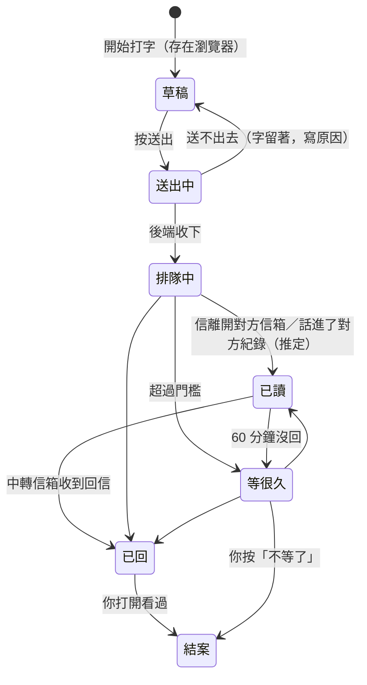

# 02c fable 設計稿（第三輪）：公司部門新 UI（v2，前端使用者體驗）

← [view-1114](../view-1114.md)｜依據 [01c](01c-備料-新UI.md)｜fable，11-14

只規劃、不施工。後端照舊，只補缺的 API。v1 凍結在 8767 不動，新 UI（下面叫 v2）開在 8768，同一個 `aos-view` 程序提供。

## 0. 結論先講

1. **畫面固定三欄，整頁不捲**：左邊是「待辦欄」（要你處理的事，照輕重排好），中間是「公司」（部門牆或地圖），右邊是「這個人／這個部門」加上一個永遠在那裡的打字框。
2. **第一眼只看左欄**：要你決定的、出事的、回了話的、等很久沒回的，四種都排在同一條隊伍裡，一張一張處理。頁首四個數字就是這四種的張數，點了就篩。
3. **往下看只有兩個動作**：點一下＝選它（右欄換成它），再點一下或按 Enter＝走進去。位置寫在網址裡，重新整理、按上一頁都回得來。
4. **說話最多兩下**：選一個對象（一下），按 `/` 或點打字框（一下），開始打字。說話、寄信、三種指令是同一個打字框的三個模式。草稿每打一個字就存在瀏覽器裡，送出成功才清掉。
5. **送出後一路看得到**：左欄第二頁「追蹤」列出每一件送出去的東西走到哪：排隊中（前面還有幾則）→ 對方讀了 → 回了 → 你看過了。卡住的會自己跳回待辦欄，並寫出原因（例如「對方停了，信沒人讀」）。
6. **技術棧**：React 19＋TypeScript＋Tailwind 4＋Vite 8，build 成純靜態檔。不用 Next（這頁不需要伺服器端渲染）。
7. **後端只補六樣**，其中第一版要用的是四樣：第二個 port、一個「有沒有變」的小接口、寄件匣、存畫面狀態的小抽屜。
8. **第一版（v2.0）不含地圖**：先做三欄、部門牆、待辦、打字框、追蹤。地圖是 v2.1，從 v1 的 `map.js` 搬過來並補上缺的。

## 1. 整體畫面

```
┌──────────────────────────────────────────────────────────────────────────────────────┐
│ 全景 › 公司 › ok-kf › ok-kf-b      [🔵3 要決定][🔴2 出事][🟡4 留意][✉ 5 等回音]         │
│                                   🔍 找人 Ctrl+K   📌 我在睡覺，15:00 回   ● 3 秒前  舊版 │
├───────────────────┬──────────────────────────────────────┬───────────────────────────┤
│ 待辦 9｜追蹤 5｜已處理 │  [部門牆] [地圖]            ＋ － 全覽   │ ok-kf-b（部門）🟢  底下 🔴1  │
│                   │                                      │ 主管留話（隊長原話）12 分前   │
│ 🔵 要你決定         │  ┌─主管桌──────┐ ┌─ok-kf-b-sol-1─┐   │ 「B4 做完，等 gate 放行」    │
│ ▸ ok-kf：B4 要不要… │  │🟢 ok-kf-b   │ │🟢 think       │   │ 小助手 3 分前有心跳          │
│   急｜2 題｜10 分前  │  │ 留話：B4 做完│ │ 最後一句：…   │   │─────────────────────────│
│ ▸ ok-skyrim：…     │  └────────────┘ └──────────────┘   │ [現在] [往來] [做過・說過]    │
│                   │  ┌─ok-kf-b-sol-2─┐ ┌─子部門 ok-kf-c┐  │                           │
│ 🔴 出事            │  │🔴 exited 143  │ │🟡 4 人 ●●●○   │   │  ▸ 你 10:02 說：做得如何？    │
│ ▸ ok-kf-b-sol-2    │  │ 2 分前停了    │ │ 留話：…       │   │    ✓ 已讀 → ✓ 已回 10:05     │
│   exited code 143  │  └──────────────┘ └──────────────┘  │  ◂ ok-kf-b 10:05：B4 做完…   │
│                   │                                      │                           │
│ ✉ 回了話           │                                      │─────────────────────────│
│ ▸ ok-skyrim 回：…  │                                      │ 對：[ok-kf-b ×] ＋           │
│                   │                                      │ (說話) 寄信  指令▾            │
│ ⏳ 等很久           │                                      │ ┌───────────────────────┐ │
│ ▸ 給 eca_main 的信  │                                      │ │ 在這裡打字…（草稿自動存） │ │
│   40 分鐘沒讀       │                                      │ └───────────── Ctrl+Enter ┘ │
└───────────────────┴──────────────────────────────────────┴───────────────────────────┘
   左欄 340px（自己捲）       中間（部門牆自己捲；地圖不捲）        右欄 420px（往來自己捲，打字框釘住）
```

三欄各自只有一個捲軸，整頁沒有捲軸。視窗窄於 1100px 時，右欄變成可收起的抽屜，左欄縮成一條只有圖示和張數的窄條。這一輪不做手機。

## 2. 第一題：第一眼看到什麼、什麼要推到眼前

**打開就看到左欄的待辦，其他都是背景。** 待辦欄只放「要董事長動手或知道」的事，固定四種，照這個順序排：

| 順序 | 種類 | 什麼時候出現 | 什麼時候消失 | 點下去 |
|---|---|---|---|---|
| 1 | 🔵 要你決定 | 專區有信在等（`/api/asks`）；急件、期限近的排前面 | 你送出回答 | 開「決定單」（見 §4.3） |
| 2 | 🔴 出事 | 節點自己亮紅燈，或隊伍燈紅（`team_light`，例如小助手沒聲音） | 燈不紅了，或你按「知道了」 | 中間飛到那個節點，右欄開它 |
| 3 | ✉ 回了話 | 中轉信箱有新回信，而且你還沒打開過 | 你打開那段往來 | 右欄開那段往來，停在那封信 |
| 4 | ⏳ 等很久 | 你送出的東西超過門檻沒動靜（門檻見下） | 對方讀了／回了，或你按「不等了」 | 右欄開那段往來，並寫原因 |

「等很久」的門檻和原因（都由現有的送達狀態和樹推得出來，不用模型）：

- 對方**停了**而信還在排隊 → 立刻出現，寫「對方停了，信沒人讀」。
- 對方**在跑、不忙**，10 分鐘沒讀 → 寫「對方閒著但沒讀」。
- 對方**在一輪裡**，排隊超過 30 分鐘 → 寫「對方這一輪還沒結束，前面還有 N 則」。
- 對方讀了，60 分鐘沒回 → 寫「讀了但沒回」。

**黃燈不進待辦**，只算在頁首的「留意」數字裡，點數字才列出來。黃燈太多，推到眼前會把真正要處理的事淹掉。

**頁首四個數字**分別是待辦欄四種的張數（第二格是紅燈、第三格是黃燈）。點一下：左欄只剩那一種，中間把相關的部門標亮、其他變淡，按 `n` 一個一個飛過去看。再點一下取消。

**不在這一頁時**：分頁標題寫 `(3) 全景`（3＝要決定＋出事的張數），圖示上加一個點。這一輪不發系統通知（見開放題 6）。

**什麼都沒選時，右欄顯示「公司總覽」**：布告欄（可直接改）、各部門一行（燈、主管留話）、最近動態（回信、主管留話、你送出的回答，照時間排，全部來自現有資料）。

## 3. 第二題：一層層往下看

### 3.1 兩個狀態，寫在網址裡

- **所在位置（focus）**：你現在「站在」哪個部門裡。頁首的麵包屑永遠照它畫。
- **選中的對象（selection）**：右欄顯示誰。可以是部門、員工、proc、外部服務，也可以多選。

網址長這樣：`http://127.0.0.1:8768/#/ok-kf/ok-kf-b?sel=ok-kf-b-sol-1&tab=thread&view=wall`。所以：

- 重新整理 → 回到同一個部門、同一個人、同一頁。
- 瀏覽器的上一頁 → 回上一個位置。
- 每個位置都可以加書籤。

### 3.2 怎麼走


- **點一下＝選**：右欄換成它，中間不動。選部門看到的是「部門卡」（主管留話、小助手心跳、成員名單、跟主管的往來）；選員工看到的是 bot 卡。
- **點兩下、按 Enter、或點已經選中的部門＝走進去**。
- **回上一層**：麵包屑、Backspace、或瀏覽器的上一頁。
- **方向鍵**在同一層的卡片之間移動選取。
- **Ctrl+K 找人**：打名字的一部分，Enter 直接跳到那個人所在的部門並選中他，游標落在打字框。這是「不用找」的捷徑。
- **Esc 一次只關一層，而且只關最上面那個**：彈出的選單 → 決定單 → 取消選取。游標在有字的輸入框裡時，Esc 只會讓游標離開輸入框，不關任何東西。

### 3.3 部門牆和地圖並存，共用同一個位置

中間有兩種看法，用頁籤或按 `w`／`m` 切換，切換時所在位置和選中的對象都不變。

- **部門牆（預設）**：一次只畫一層。所在部門的直屬成員排成卡片格子：第一格固定是主管桌，接著是員工和子部門。子部門卡上有它底下的人的色點和最糟的那盞燈，所以實際上一眼看得到兩層。卡片位置固定（照座位表），字多、好讀、鍵盤好操作。v1 的「清單」由它取代。
- **地圖**：整個公司畫在一張大平面上，連續縮放。規則照已定稿的（05b A10、A11）：每個框只看自己在螢幕上多寬來決定畫多少，位置在排版時一次算定。它是「拉高視角」用的，適合看全局和部門之間的關係。

兩種看法用**同一個卡片元件**，只是大小不同（色點、小籤、兩行話、完整卡四級），所以資訊一致、程式只寫一份。

不另外保留 v1 那種整棵樹的長清單：要找人用 Ctrl+K，要看問題用左欄，真的想看舊清單還有 8767。

### 3.4 地圖比 v1 多做的事

| v1 的問題 | v2 的做法 |
|---|---|
| 重新整理回到全覽 | 所在位置在網址裡；鏡頭位置按所在部門記在瀏覽器裡，重新整理後還原 |
| 手動縮放後麵包屑不跟 | 鏡頭停下來時，取「畫面中心落在哪個房間、而且那個房間佔畫面寬度六成以上」當所在位置，麵包屑跟著變 |
| 樹變了鏡頭不跟 | 鏡頭記的是「相對於所在部門那個框」的位置，框被擠開時鏡頭一起移 |
| 視窗變大小不重排 | 本來是「剛好裝滿」的狀態就重新裝滿，否則保持畫面中心 |
| 點房間不開主管 | 點一下房間＝選這個部門，右欄就是部門卡，主管的往來直接在裡面 |
| 藍色圖釘點不了 | 藍釘點了開那個部門的決定單；紅釘點了選中出事的那個節點 |
| proc、外部服務沒有詳情 | 一樣可以選，右欄有它們的卡（見 §4.5） |
| 沒有縮放按鈕、鍵盤走不到 | 加「＋ － 全覽」按鈕；方向鍵、Enter、Backspace 跟部門牆同一套 |
| 有人離開時座位被補上 | 座位表存起來（§7 的 B4），空位留著 |

## 4. 第三題：說話、寄信、下指令

### 4.1 一個打字框，三種模式

打字框釘在右欄底部，永遠看得到，不用展開任何東西。它上面就是跟這個對象的往來，像一般的聊天軟體。

```
│ 對：[ok-kf ×] [ok-skyrim ×] ＋        ← 對象。點卡片就換；Ctrl+點＝加一個
│ (說話)  寄信  指令▾                    ← 模式。預設說話
│ ┌──────────────────────────────────┐
│ │ 大家先停一下手上的 B5，等我回來再說     │
│ └──────────────────────────────────┘
│ 草稿已存 10:31            [送出 Ctrl+Enter]
```

- **說話**：只有一格。走 `/api/say`。
- **寄信**：多一格標題和一個狀態選單（預設 REQUEST）。走 `/api/mail`。
- **指令**：先選擴充／加人／電力，下面出現那一種的欄位。模型是下拉選單、人數是數字格，不再是隨便填的文字。換種類時各自填過的值都留著。走 `/api/order`。接單的人如果不是對象本人，打字框下面寫明「這張單會寄給 repo-aos（代 HR）」。

**幾下才能開始打字**：

| 情境 | 動作 |
|---|---|
| 對象已經選著（最常見） | 按 `/`（一下） |
| 畫面上看得到對象 | 點卡片 → 按 `/` 或點打字框（兩下） |
| 對象不在畫面上 | Ctrl+K → 打名字按 Enter（游標直接落在打字框） |
| 回一封剛收到的信 | 點待辦欄那一張（右欄開往來，游標直接落在打字框；一下） |

### 4.2 一次對多人說

- Ctrl+點多個卡片，或在打字框的「＋」裡打名字，對象變成好幾個小籤。
- 部門的小籤預設只代表**主管**。小籤上有「連底下所有人」的開關，打開後展開成名單讓你看到到底會寄給誰。
- 送出時一人一封，逐一送，打字框上顯示「已送 3／5」。失敗的留在小籤上可以重送，成功的不會重複送。
- 這一批在「追蹤」裡算一組，可以展開看每個人各自走到哪。

### 4.3 決定單（回答「要你決定」）

點待辦欄的藍色那張，中間蓋上一張決定單，一次只看一張；中間的畫面同時移到出題的部門，右欄開那個部門，所以回答時看得到它的留話和往來。

```
┌──────────────── 決定單 2／3 ────────────── ‹ 上一張 K   下一張 J › ──┐
│ ok-kf 問：B4 要不要收緊 daemon 的額度？              急｜期限 15:00    │
│ （隊長寫的原文，一字不改）                                             │
│                                                                    │
│ 1. 收緊到什麼程度？                                                  │
│    白話：……                                                         │
│    (●) a 照現在的一半 ★推薦      後果：……                             │
│    ( ) b 不動                    後果：……                             │
│ 2. ……                                                              │
│ 備註：[                                    ]                        │
│                                 [全照推薦]   [送出 Ctrl+Enter]        │
└────────────────────────────────────────────────────────────────────┘
```

- 數字鍵選選項，Tab 到下一題，J／K 換張，Ctrl+Enter 送出，送出後自動換下一張。
- 一次只看一張，所以沒有「送出後卡片賴著、捲動亂跳」的問題。
- 不可逆的單：不預選、沒有「全照推薦」，送出鈕寫「送出（不可逆）」。
- 選到一半的答案和備註存在瀏覽器裡（按信的編號存），關掉再開還在。
- 送出後這張進「已處理」頁，列著你選了什麼。上面有「更正」鈕：打字框切成寄信模式，對象填好出題的隊、標題填好「更正：…」，你只要寫內容。專區的信只能答一次，所以更正仍然是另寄一封信，這點照現況不變，只是頁面會把更正和原來的回答掛在一起顯示。
- 決定單的字照隊長寫的原樣顯示，頁面不摘要、不改寫。

### 4.4 送出之後：從送出到「已回」



同一件東西在三個地方看到同一個狀態：

1. **往來裡，那句話的正下方**：一排小點 `● 送出 10:02 ─ ● 排隊（前面 2 則）─ ○ 已讀 ─ ○ 已回`。對方在一輪裡時多一句「它這一輪結束才會讀」。
2. **左欄「追蹤」頁**：所有還沒結案的送出物，一件一行，照「最需要注意」排。
3. **待辦欄**：只有「回了」和「等很久」會出現在這裡。

誠實標示：

- 「已讀」是推定的（信離開了信箱），頁面上寫「已讀（推定）」，滑過去有說明。
- 說話的「已回」是「你說完之後它寄過信來」，不保證是回這一句，頁面上寫「之後有來信」。
- 讀不到狀態時寫「狀態不明」，不猜。
- **指令**多一項結果：對方回信的狀態欄（DONE、BLOCKED、PROGRESS、NEEDS-USER、FAILED）直接當成這張單的結果顯示。指令如果寄給別人代辦，它同時出現在「對象部門」和「接單者」兩邊的往來裡。這一輪不另外做「gate 放行了沒」的正式狀態（見開放題 5）。

### 4.5 右欄的卡

| 選中的是 | 右欄內容 |
|---|---|
| 部門 | 自己的燈和底下最糟的燈（各寫原因）、主管留話（標「隊長原話」）、小助手心跳、成員名單（可點）、等待決定的張數、跟主管的往來 |
| 員工（agent） | 三頁：現在（狀態、在忙什麼、記憶體、跑多久、信箱裡等著的信）／往來／做過・說過（最近 30 筆，讀不到的照實寫 `not recorded`） |
| proc | 樹上有的：狀態、原因、冷卻。資源詳情等 B6 補上，之前寫 `not recorded` |
| 外部服務 | 健康檢查網址、聽在哪些位址、上次檢查時間；聽在所有介面時標黃並說明 |
| 多個 | 名單，加上最近對這幾位送出的東西 |

右欄開著時會自己更新：每 15 秒，或一收到「有變」的通知就重抓那個人的現在和往來。離開這一頁（分頁不在前景）就停。頁首的燈跟著樹即時變。

### 4.6 草稿

- 每一份草稿按「對象＋模式＋指令種類」存在瀏覽器的 localStorage，打字後 0.3 秒存一次。
- 換對象、關右欄、重新整理、換指令種類，都不丟。回到同一個對象，字自己回來。
- 頁首有「草稿 2」，點開列出所有沒送的草稿，點一份就回到那個對象。
- 只有兩種情況會清掉：送出成功，或你按「丟掉」。
- 布告欄和決定單的備註也照這套存。

### 4.7 布告欄

頁首固定一格：`📌 我在睡覺，15:00 回`。點開是一個小視窗：一格文字、一格預計回來時間、幾個常用句（睡覺、出門、開會）。清空就是取下。沒貼時顯示淡色的「📌 留話」。

### 4.8 鍵盤一覽

| 鍵 | 動作 |
|---|---|
| `/` | 游標到打字框 |
| Ctrl+K | 找人、找部門 |
| Ctrl+Enter | 送出 |
| 方向鍵／Enter／Backspace | 移動選取／走進去／回上一層 |
| `w`／`m` | 部門牆／地圖 |
| `1`–`4` | 頁首四個數字的篩選 |
| `n` | 飛到下一個被標亮的節點 |
| `J`／`K` | 下一張／上一張決定單 |
| Esc | 關掉最上面那一層 |

游標在輸入框裡時，單鍵快捷鍵都不作用。

## 5. 第四題：v1 九組摩擦逐條回答

| # | v1 的問題 | v2 的答案 |
|---|---|---|
| 1 | 找東西靠捲；切到地圖就看不到清單、機房、回覆 | 三欄並排，整頁不捲。待辦和右欄不管中間是牆還是地圖都在。Ctrl+K 找人。機房是公司底下的一個部門格，跟其他部門同一層。回覆不再是獨立區塊：新的進待辦欄，舊的在各人的往來裡 |
| 2 | 說話、寄信、下指令至少三下才打字；不能對多人 | 打字框釘在右欄底，永遠看得到；選人後按 `/` 就打字。三種東西是同一格的三個模式。Ctrl+點多選，一次送多人 |
| 3 | 頁首數字點不進去；紅燈的算法跟隊伍燈不一致 | 四個數字都是篩選鈕，點了左欄列出、中間標亮、`n` 逐個飛過去。紅燈數＝自己紅的節點＋隊伍燈紅的隊，跟左欄「出事」的張數永遠相等 |
| 4 | 草稿會丟；Esc 打字時會關面板 | 草稿按對象存在瀏覽器，送出成功才清。右欄不是彈出視窗，不會被關掉。Esc 在有字的輸入框裡只移開游標 |
| 5 | 面板不會自己更新 | 右欄開著就每 15 秒或一有變化就更新；頁首的燈、送達狀態、現在狀態都是活的 |
| 6 | 地圖的位置不留 | 所在位置在網址裡，鏡頭按部門記著；麵包屑跟著鏡頭；樹變了鏡頭跟著框走（§3.4） |
| 7 | 地圖上很多東西點不了 | 所有框都可選；點房間就看到部門和主管；圖釘可點；proc、外部服務有卡；鍵盤走得到每一格 |
| 8 | 一頁多個捲軸；面板在窄螢幕蓋掉整個畫面 | 每欄只有一個捲軸，沒有捲軸套捲軸。打字框在捲動區外面，展開表單不會吃掉往來的高度（往來區有最小高度，表單太長時是表單自己捲）。窄於 1100px 才把右欄變抽屜 |
| 9 | 新鮮度不誠實；一個請求卡住整輪停 | 頁首的「● N 秒前」指的是後端上一次採樣完成的時間；採樣失敗時變黃並寫「資料停在 N 分鐘前：原因」。每種資料各抓各的、各有 8 秒逾時，一個卡住不拖其他的；哪一欄的資料超過 30 秒沒更新，那一欄自己標出來。「幾分鐘前」這類字每 10 秒重算一次 |

另外兩條使用者當天從頁面提的：

- **「送出後卡片賴著不走，捲動亂跳」**：決定單一次一張，送出就換下一張，已送的進「已處理」頁，可以寄更正（§4.3）。
- **「我寄了信怎麼沒回」**：追蹤頁加上「等很久」會自己寫出原因（§2、§4.4）。

## 6. 第五題：技術棧

**選 React 19＋TypeScript 5＋Tailwind 4＋Vite 8，build 成純靜態檔。**

| 選什麼 | 為什麼 |
|---|---|
| React 19＋TS＋Tailwind 4 | 是使用者自己網站模板的組合，他看得懂、改得動。畫面是「一份狀態畫很多地方」，框架自己比對差異、只改變了的地方，v1 靠 `busy()` 擋重畫、記捲動位置的那些補丁都不需要了 |
| Vite 8，不用 Next | 這頁只在本機、一個人用，不需要伺服器端渲染和 Next 的路由。Vite 出來就是 `index.html` 加幾個檔，Python 後端直接給。機器上已有 vite 8.3.5 |
| `@tanstack/react-query` | 管「向後端要資料」：定時抓、逾時、失敗重試、資料沒變就不重畫、每種資料各自的新鮮度。第 9 組摩擦靠它解 |
| `zustand` | 管畫面狀態（所在位置、選取、打字框、草稿）。很小，寫法直白 |
| 路由自己寫 | 只是「狀態 ↔ 網址 `#` 後面那段」互相同步，約 60 行，不值得多裝一個套件 |
| 地圖自己寫 | 從 v1 `map.js` 搬成一個排版函式（純計算，可單獨測）加一個元件。照定稿用 HTML 盒子加 CSS transform，不用 canvas、不用繪圖套件 |
| 不裝的 | 元件庫、圖示庫、動畫庫、日期庫都不裝。圖示用幾個內嵌 SVG，彈出視窗用瀏覽器原生的 `<dialog>` 和 popover（Chrome 157 都有） |

執行時的相依一共四個：`react`、`react-dom`、`@tanstack/react-query`、`zustand`。開發時另有 `vite`、`@vitejs/plugin-react`、`typescript`、`tailwindcss`、`@tailwindcss/vite`、`vitest`、`@playwright/test`。

**離線與安全**：

- 所有套件 build 時打包進靜態檔，執行時不連任何外部網址，不用 CDN，不載網路字型（用系統字型）。
- 版本寫死，`pnpm-lock.yaml` 進版控；安裝用 `pnpm install --frozen-lockfile --prefer-offline`，本機 store 有的就不上網。第一次缺的套件要連一次 npm registry（要點頭，見 §10）。
- Vite 產出的是外部的 `.js`／`.css` 檔，沒有行內 script，現有的 CSP `script-src 'self'` 不用放寬。地圖用到行內 style，現有 CSP 已允許。
- 來自 agent 的字一律走 React 的文字節點。build 前檢查原始碼裡沒有 `dangerouslySetInnerHTML`，有就失敗。
- JS 壓縮後不超過 250 KB，超過 build 失敗。

**檔案佈局**（開發副本 `~/code/view-1114/aos-view/`）：

```
ui/
  v1/                       凍結，不動
  v2/
    VERSION                 一行，例如 view-v2 2.0.0
    package.json  pnpm-lock.yaml  vite.config.ts  tsconfig.json  index.html
    src/
      main.tsx  App.tsx
      api/        每個後端接口一個函式＋型別（照 API.md）
      state/      所在位置、選取、草稿、網址同步
      shell/      頁首、三欄框架、快捷鍵
      inbox/      待辦、追蹤、已處理、決定單
      stage/      部門牆、地圖（layout.ts 純計算）、卡片元件
      inspector/  部門卡、bot 卡、proc 卡、外部服務卡、往來
      composer/   說話、寄信、三種指令（每種一個小模組）、對象小籤
    dist/                   build 產物：index.html＋assets/*.js、*.css（檔名帶雜湊）
```

- **裝到活樹的只有 `ui/v2/dist/` 和 `VERSION`**。活樹那邊不需要 node，也沒有 `node_modules`。`dist/` 跟原始碼一起進版控，這樣安裝就是抄檔。
- 新面板（以後的 HR、電力）＝ `inspector/` 或 `composer/` 底下多一個資料夾，照 API.md「一個面板一個模組」那句。
- **開發時**：`pnpm dev` 把 `/api` 轉給一個**暫存樹**上的 `aos-view`（或它的 fixture 模式），不接活樹的 8767，免得測試時真的把話送給在工作的 agent。
- **測試**：排版函式和「等很久」判定用 vitest 測；整頁用 playwright 對 fixture 後端跑（答題、說話、草稿重新整理還在、鍵盤走完一輪）。

## 7. 第六題：後端要補的 API

只列真的缺的。v1 在用的欄位和行為一律不改。

**第一版（v2.0）要用的四樣：**

| # | 補什麼 | 形狀 | 為什麼缺它不行 |
|---|---|---|---|
| B1 | 第二個 port | 同一個程序再開一個 listener 在 `127.0.0.1:8768`，共用 collector、home、token；給 `ui/v2/dist/` 的 `index.html` 和 `/assets/<檔名>`（檔名只收英數、點、底線、連字號；依副檔名給 MIME；帶雜湊的檔可以長快取，`index.html` 不快取）。`/api/*` 兩個 port 完全一樣。`dist/` 不在就不開 8768。`/api/version` 的 `ui`、`ui_dir` 照各自的 port 回 | 新舊並存，而且只能有一個程序收中轉信箱。Host／Origin 檢查本來就照各自 listener 的 port 算，不用改 |
| B2 | 有沒有變 | `GET /api/pulse` → `{"now": epoch_s, "tick": {"at": epoch_s, "took_ms": int, "ok": bool, "error": str\|null}, "rev": {"tree": str, "asks": str, "relay": str, "outbox": str, "board": str, "answered": str}}`。`rev` 是內容的雜湊（扣掉 `generated_at` 這類每輪都變的欄位，照 05b A6）。上面六個 GET 都加 `ETag` 並認 `If-None-Match`，沒變回 304；200 和 304 都帶 `X-Last-Tick` | 頁面每 5 秒問一次這個很小的接口，哪一種變了才去抓哪一種。這同時補上圖紙答應過的 rev／304，也是誠實新鮮度的來源 |
| B3 | 寄件匣 | `GET /api/outbox?days=7` → `{"items": [{"letter", "batch": str\|null, "kind": "say"\|"mail"\|"order", "to", "target": id\|null, "title", "what"（截 300 字）, "sent_at", "delivery": "queued"\|"read"\|"replied"\|"unknown", "queue_ahead": int\|null, "turn": {...}\|null, "reply": {"letter","status","title","at"}\|null, "order": {...}\|null, "correction_of": str\|null}]}`。送達狀態照 `/api/thread` 現有的算法，不改語意。後端每輪替「24 小時內、還沒回」的送出物更新狀態，每輪最多查 6 個對象、輪流查 | 現在送達狀態只能一個人一個人打開往來才看得到，做不出「追蹤」頁和「等很久」 |
| B4 | 畫面狀態的小抽屜 | `GET /api/ui-state?key=K` → `{"key", "value": 任意 JSON\|null, "at"}`；`PUT /api/ui-state?key=K`（跟 POST 同一套 token 檢查）body 是 value，上限 256 KB。`K` 只收 `seen`（看過哪些回信）、`dismissed`（按過「知道了／不等了」的）、`seats`（座位表）、`prefs`。存在 `~/.aos/view/state/ui/<K>.json` | 「看過了沒」「不等了」要跨重新整理、跨視窗；固定座位要落地。草稿不放這裡，留在瀏覽器 |

**同一期順手的小改：**

| # | 補什麼 | 形狀 |
|---|---|---|
| B5 | 批次和更正的關聯；離開的人的往來 | `/api/say`、`/api/mail`、`/api/order` 多收兩個選填欄位 `batch`、`correction_of`，原樣記進 `sent.jsonl`；`/api/say` 的回應補上 `letter`。`/api/answered` 每筆多 `corrections: [letter…]`。`/api/thread?name=` 遇到已經不在樹上的名字，改回歷史信件加 `"gone": true`、`"turn": null`，不再 404 |

**之後的期別：**

| # | 補什麼 | 形狀 | 哪一期 |
|---|---|---|---|
| B6 | 推播 | `GET /api/events`（`text/event-stream`）：事件 `pulse`，內容就是 B2 那個物件；任何 `rev` 變了就送，另外每 15 秒送一次當心跳。只送「哪個變了」，不送資料本身，所以不用另外處理遮罩，斷線重連後直接重抓即可。檢查 Host；同時最多 4 條連線。連不上時頁面自動退回每 5 秒問 B2 | v2.2 |
| B7 | bot 卡補完、proc 詳情 | `/api/agent?name=&before=<line>&limit=` 可以往前翻；加 30 秒快取和共用的並行上限（05b A13）。`GET /api/proc?id=` → 資源詳情 | v2.3 |
| B8 | 你不在時發生了什麼 | 後端在採樣時把「燈變了、主管留話變了、有人來了走了、回信到了」各記一行；`GET /api/feed?since=<epoch>` → `{"events": [{"at","type","node","from","to","text"}]}` | v2.3 |

**明確不補的**（不是忘了）：

- `/api/node`、`/api/bot`：樹裡已經有節點資料，`/api/agent` 已經有 bot 卡，不用另開兩個名字。
- 指令的執行狀態（gate 放行了沒、做完了沒）、正式的已讀回條：這是 aos 那邊的事，頁面先照實顯示推定的狀態和回信的狀態欄。
- commit 和 claims 統計：不影響這一輪的操作體驗，照 03 §9.3 原本的期別。
- 後端的 `layout.json`：座位表改放 B4 的 `seats`，排版由前端算。這一條跟 03 §10 原本「後端發座位」不同，請 opus 深化時確認。
- 推播不會讓採樣變快（sol-8 §4.3），所以排在後面；第一版用 B2 就夠。

## 8. 第七題：分期

每一期做完都能用，都不動 v1。

| 期 | 內容 | 後端 | 做完時使用者得到什麼 |
|---|---|---|---|
| **v2.0 最小可用** | 三欄框架、頁首四個數字可點、Ctrl+K；待辦欄四種＋追蹤＋已處理；決定單；部門牆（一層一層走，網址記位置）；右欄的部門卡和 bot 卡（自己更新）；打字框（說話、寄信、三種指令，單一對象）；草稿；布告欄；誠實的新鮮度 | B1–B5 | 不用捲、兩下就打字、草稿不丟、寄出去的東西看得到走到哪。可以取代 v1 的日常使用 |
| **v2.1 地圖** | 從 v1 搬地圖並補齊 §3.4；固定座位；圖釘可點；鏡頭記憶；牆和地圖共用位置；proc 和外部服務的卡 | 不用新增 | 拉高視角看公司，縮放進去，位置不亂跳 |
| **v2.2 多人與推播** | 多選、一次對多人、「連底下所有人」；送出後 5 秒可撤回（決定單和指令）；更正跟原回答掛在一起；推播 | B6 | 群發；變化更快出現；送錯來得及收回 |
| **v2.3 補完** | 「你不在時發生了什麼」；bot 卡往前翻；proc 資源；標籤上色與篩選；等待箭頭 | B7、B8 | 睡醒看一眼就知道這段時間的事 |
| 之後 | HR、電力各自的面板（等那兩個部門有了再說）；手機（使用者說要再做） | — | — |

v2.0 的驗收（用 fixture 後端和真的 Chrome）：

1. 打開頁面不捲動，就看得到全部「要你決定」和「出事」的標題。
2. 從任一畫面到「對某個指定的人開始打字」不超過兩個動作（不算打字）。
3. 打到一半重新整理、換對象、換指令種類，字都還在。
4. 送出一句話後不重新整理，狀態會自己從排隊中走到已讀、已回。
5. 把後端的採樣弄停，30 秒內頁首變黃並寫出資料停在什麼時候。
6. 重新整理後回到同一個部門、同一個人、同一頁。

## 9. 要問使用者的（附推薦）

1. **預設先看部門牆還是地圖？** 推薦**部門牆**。字多、好讀、鍵盤順；地圖按 `m` 就到，而且頁面會記住你上次用哪個。地圖 v2.1 才有，所以第一版本來就只有牆。
2. **對「部門」說話，是對誰說？** 推薦**只對主管**；要連底下所有人，得多按一下開關，並且先看到名單。避免一句話不小心打斷十個在做事的員工。
3. **「等很久」的門檻**：推薦對方停了＝立刻；閒著沒讀＝10 分鐘；一輪裡排隊＝30 分鐘；讀了沒回＝60 分鐘。數字放在設定裡，用了覺得太吵或太慢再調。
4. **回信怎樣算「看過了」？** 推薦**打開那段往來就算**，不用另外按。想留著提醒自己的，可以按「標成沒看過」。
5. **指令（擴充、加人、電力）要不要顯示「gate 放行了沒」這種正式進度？** 推薦**這一輪不做**：頁面先顯示排隊／已讀／已回，加上回信裡寫的結果（DONE、BLOCKED…）。要正式進度得 aos 那邊補一套回報，另開一條線比較乾淨。
6. **分頁不在前景時要不要跳系統通知？** 推薦**先不要**，只改分頁標題的數字和圖示上的點。真的漏看了急件再加，而且只對「急件的決定」跳。
7. **送出後 5 秒可撤回，要不要？** 推薦**要，但只用在決定單和指令**（這兩種送錯代價高），說話和寄信照舊立刻送。排在 v2.2。
8. **v1 頁面上要不要加一個連到新版的連結？** 推薦**不加**，v1 已經凍結；新版頁首有「舊版」連結，兩個網址各加一個書籤就好。

我代你定、你可以推翻的：

- 黃燈不進待辦欄，只算在頁首的數字裡。
- 不保留 v1 那種整棵樹的長清單（8767 還在）。
- 機房當成公司底下的一個部門格來畫，不另開區塊。
- 用 Vite 而不是你模板裡的 Next（React、Tailwind、TypeScript 都跟模板一樣）。
- 座位表由前端算、存在後端的小抽屜裡。

## 10. 要點頭才做的（鐵律 2）

1. **施工本身**（開工）。
2. **裝套件要連一次 npm registry**：本機 store 沒有的套件（大概是 `@tanstack/react-query`、`zustand`、`@vitejs/plugin-react`、`@tailwindcss/vite`、`vitest`）要下載。之後都離線。
3. **改後端並重啟活樹上的 `aos-view`**：加第二個 port 和 B2–B5。動 `~/aos-home/ws/tools/aos-view/` 前先備份（照 03 §11.1）；重啟的那幾秒 8767 會斷一下。
4. **機器上多開一個 port `127.0.0.1:8768`**，以及 `aos-view.service` 跟著改。

沒有新增刪除、push、對外送出的動作。頁面的寫入仍然只有答題、說話、寄信、指令、布告欄，加上 B4 存畫面狀態（只寫 `~/.aos/view/state/ui/`）。

## 11. 跟已定的事對照

| 已定的 | 這份怎麼守 |
|---|---|
| 2D 不做 3D | 部門牆和地圖都是 2D |
| 先不用手機 | 最窄只處理到 1100px 的桌面視窗 |
| 頁面只呈現協調，不去協調 | 「等很久」只寫看得到的事實（停了、閒著、在一輪裡），不下「卡死」這種判斷；互等照 05b A9 只寫各自說了什麼 |
| 決策單不經模型 | 決定單和主管留話一字不改地顯示，並標明是誰寫的；頁面沒有任何摘要功能 |
| 沒有 stop／rm／push 端點 | 不新增；三種指令仍然只是寄一封 REQUEST 信 |
| 只聽 127.0.0.1、CSRF token、CSP `script-src 'self'`、不用 CDN | B1 沿用同一套檢查和同一個 token；build 產物沒有行內 script；套件全部打包 |
| 讀 agent 只走正式指令（第 7 題 a） | B3 用的是 `/api/thread` 現有的算法；讀不到的寫 `not recorded` 或「狀態不明」 |
| 一個後端程序收中轉信箱 | 8768 是同一個程序的第二個 listener |
| 每個框只看自己在螢幕上多寬（05b A11）、HTML 盒子加 SVG 圖釘（A10）、主管桌在第 0 格（A2）、小助手是徽章不佔座位（A3）、點了才拉 bot 資料（A12） | 地圖和部門牆都照用；右欄一次只拉選中的那一個 |
| v1 凍結，只修 bug | 不改 v1 任何檔；後端只加新接口和選填欄位 |

## 12. 給 opus 深化時要查的

1. B3 每輪多查 6 個對象的送達狀態，實際多花多少時間（現在一輪 24 列約 2.4 秒）。太貴就降到 3 個，或只在有人開著 8768 時才查。
2. 兩個 port 共用同一個 cookie 名 `aosview`（cookie 不分 port）：token 相同所以應該沒事，請在真 Chrome 上兩頁同時開著各送一次確認。
3. 本機 pnpm store 裡實際有哪些套件和版本，定出寫死的版本表。
4. `rev` 要扣掉哪些欄位才不會每輪都變（`generated_at`、`llm_workers` 的個數照 05b A4 不算）。
5. v1 `map.js` 的排版拆成純函式時，座位表（`seats`）的格式，以及有人離開後空位留多久。
6. 決定單送出後自動換下一張時，出題部門不在樹上（已收隊）的情況：右欄照 B5 顯示歷史往來。
