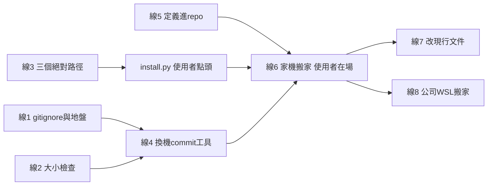

「私有地盤＋`_stack` 取代 `~/aos-home`」怎麼施工：八條線的先後、每條要改的檔與驗法、要使用者點頭的步驟、邊緣狀況與待決三題。

# 02 規劃

← [入口](README.md)｜上一份：[01-決定與調查](01-決定與調查.md)

## 大白話摘要

- **做得到，分八條線。** 前四條只動 repo 裡的檔、不碰活樹，可以馬上開；後面才是搬家。
- **先做不痛的**：`.gitignore` 加兩行（`_stack/`、任何一層的 `temp/`）、開 `wf/ws/` 與地盤規矩、commit-request 加單檔大小檢查（預設 1 MB，可調）。
- **再修程式**：三個存絕對路徑的地方改成「相對 daemon 的 stack」的寫法，修完要跑一次 `install.py`（要你點頭）。
- **然後搬家**：樹的定義（根、llm kernel、權限站）進 repo；你在場時停掉 `~/aos-home`、把各隻 agent 的 stack 抄進 `~/repo/aos/_stack`、在那裡起新 daemon、重掛 eca-aos 和三個 subagent；舊樹改名留著，不刪。
- **換台靠一支小工具**：離開這台時它確認 daemon 已停、只挑該帶走的檔交一個 commit（實測現在是 63 個檔、約 99 KB）；到另一台時它檢查能不能安全起樹。
- **公司那台最後做**，要在那台上看過現況才能動；那台現有的樹跟漫遊過去的 `_stack` 不合併。
- **三題要你決定**（在最後）：定義放 repo 哪裡、`eca-claude` 與 `ann` 要不要跟著搬、公司那台舊樹怎麼收。
- 最大的新坑：`_stack` 的檔一旦進過 git，`git stash`、`git reset --hard` 會把正在跑的樹倒回舊狀態；還沒交件的檔不會跟著換台。

## 線與先後

| 線 | 做什麼 | 等誰 | 模型 | 動不動活樹 |
|---|---|---|---|---|
| 1 `ws-stack-1122-ignore` | `.gitignore` 兩行、`wf/ws/` 與地盤規矩、建現有四隻的地盤 | 無 | opus（寫規矩條文，不算簡單） | 不動 |
| 2 `ws-stack-1122-size` | commit-request 交件時查單檔大小 | 無 | opus | 不動 |
| 3 `ws-stack-1122-abs` | 修三個絕對路徑（C++ 與 Python） | 無 | opus | 不動；修完要 `install.py` |
| 4 `ws-stack-1122-move-tool` | 換機 commit 小工具（離站、到站） | 線 1、線 2（同改 `commit_queue.py`，要排前後） | opus | 不動 |
| 5 `ws-stack-1122-defs` | 根、llm kernel、權限站的定義進 repo | 待決題 1 | sonnet 抄檔＋opus 驗（起暫存樹） | 只讀 |
| 6 `ws-stack-1122-home` | 家機搬家 | 線 3 裝好、線 4、線 5；**使用者在場** | opus 寫步驟腳本，使用者下指令 | **動** |
| 7 `ws-stack-1122-docs` | 改現行文件與知識庫 | 線 6 做完（寫的是做完後的實況） | opus | 不動 |
| 8 `ws-stack-1122-wsl` | 公司 WSL 搬家 | 線 6、第一次換機 commit 已 push；待決題 3 | opus，在公司那台 | **動**（那台的樹） |

線 1、2、3、5 互不相依，可以同時開。線 1 與線 2 都很小；線 3 最吃力。

共通的驗法（每條線都照做，下面不重複寫）：

- 測試在 `git archive <commit>` 抄到 `~/.aos/scratch/<線名-1122>/` 的乾淨複本上跑；複本先在它的 `proto8` 跑一次 `install.py`，再把 `AOS_HOME` 指到複本。這個 `install.py` 在複本裡跑，不動活樹，不用問。
- aos 指令與測試一律經 bash 腳本先 unset 所有 `AOS_*`。
- 交件走 `commit-request`，不 push。
- 任務書照貼活樹旁九條硬規則（[06](../../../../../wf/workflows/dispatch/aos-teams/06-公司WSL活樹與任務書硬規則.md)）。

---

### 線 1：`.gitignore` 與私有地盤

要改的檔：

- `.gitignore:32` 附近：把 `wf/temp/` 那一行換成兩行規則。
  - `temp/`（不帶開頭斜線＝任何一層叫 `temp` 的資料夾都不進；`wf/temp/` 也被它蓋到，原註解保留）。
  - `/_stack/`（只認 repo 根那一個）。
- 新檔 `wf/ws/README.md`：地盤規矩（下面「地盤規矩」那幾條），第一行一句話。
- 新檔 `wf/ws/eca-aos/README.md`，以及 `wf/ws/eca-aos/eca-aos-templates/README.md`、`wf/ws/eca-aos/eca-aos-kb/README.md`、`wf/ws/eca-aos/aos-eca-frontend/README.md`：各一句話說這是誰的地盤（git 不收空資料夾，所以用 README 佔位）。

地盤規矩（寫進 `wf/ws/README.md` 的內容，照使用者的決定 B、C）：

1. 工作區（cwd）不變，大家都是 `~/repo/aos`；地盤是另外配的一塊，放自己的草稿、筆記、任務書、自己做的定義夾。
2. 路徑照掛的層級：頂層 agent 是 `wf/ws/<名>/`，它掛的 subagent 是 `wf/ws/<上層>/<名>/`，再往下照樣嵌。
3. 地盤進 git；任何一層的 `temp/` 不進。放不放 `temp/` 的判準一句話：**換台之後還要用的放地盤，其他放 `temp/`**（大檔、跑出來的產物、log、抄來的複本、暫存樹都算其他）。
4. 誰建：上層替下層建（`subagent add` 之前 `mkdir` 並放 README），在任務書裡告訴它地盤在哪。
5. 現在只是規矩，不是牆：commit-request 不查誰交了誰地盤裡的檔，其他 agent 讀得到也改得到；牆等權限系統（見「怎麼接上別的規劃」）。
6. 交件一樣走 commit-request；單檔超過門檻會被擋（線 2）。

驗法：`git check-ignore -v wf/ws/x/temp/a _stack/a proto8/x/temp/a` 三個都被擋、`git check-ignore wf/ws/x/a.md` 不被擋；`git ls-files -ci --exclude-standard` 是空的（沒有哪個已追蹤的檔被新規則蓋到；11-22 查過 repo 沒有被追蹤的 `temp/` 資料夾，也沒有 `_stack`）；交件後 `wf/_index.json` 多一項 `ws`、`wf/ws/` 裡面不建索引。

### 線 2：commit-request 的單檔大小檢查

要改的檔：

- `wf/tools/commit_queue.py:46` 旁邊加常數（預設門檻），`:599-602`（忽略檢查）後面、`:603`（拍快照）前面加檢查。
- `wf/tools/commit_queue.py:1-22` 檔頭的用法說明補一段。
- 新檔 `wf/tools/commit_queue.json`（可調的設定，第一個鍵寫 `description`）。
- `wf/tools/tests/` 加測試（跟現有的 commit-request 測試放一起）。

判準（寫進程式與設定檔的說明）：

- **查什麼**：這次 `--files` 點名的每個檔在工作樹的大小（bytes），新檔與改過的舊檔都查；symlink 看連結本身。`--rm`、`--op` 產生的共用索引檔、排隊自己生的索引不查。
- **門檻**：預設單檔 1,048,576 bytes（1 MB）。11-22 量過 repo 追蹤中的檔沒有一個超過（最大 953 KB）。
- **超過**：整個申請不收，回 `FAILED RequestBad`，訊息點名檔與大小，hint 寫「把它放進 `temp/`，或請頂層放行」。什麼都不 commit。
- **怎麼調**：`wf/tools/commit_queue.json` 兩個鍵——`max_file_bytes`（改門檻）、`big_ok`（放行名單，repo 根相對路徑或 glob，例如哪天 `json.hpp` 升版超過 1 MB）。這個檔本身進 git，改它要走交件，誰放行過什麼查得到。設定檔不在或讀不懂＝用預設值並警告。
- **`_stack/` 底下的檔不查**（線 4 的工具才交得進去，對話紀錄長大是正常的）。

驗法：測試三種情況——超過被擋且 main 沒動、列在 `big_ok` 的通過、改小門檻後原本通過的被擋；整套 commit-request 測試照綠。`wf/tools/` 不在 `py/` 裡，不用 `install.py`。

### 線 3：修三個換台會壞的絕對路徑

共同原則：**落在 daemon 的 stack 底下的路徑，存成相對 daemon stack 的寫法**（跟 `child.cpp:195` 存 `cwd` 的做法一樣，起的時候從當下的 `AOS_DAEMON` 拼回）。proto8 當成沒有舊版：不寫舊格式相容，活樹上的舊資料在線 6 搬家時直接重寫。

| 哪個 | 現在哪裡寫的 | 建議改法 |
|---|---|---|
| 一、表上的 `as_written` | `proto8/py/tools/agent/subagent/_entry:194`（subagent 工具給 daemon 的 `--stack` 是絕對路徑，所以被當成「使用者寫的絕對路徑」原樣存）；讀的那頭 `proto8/cpp/aos-daemon/src/daemon/reconcile.cpp:195-208` | 改 subagent 工具：stack 不給絕對路徑，改給指示詞 `{"$env": "AOS_DAEMON", "$path": "procs/<名>"}`（`ctl add` 已有 `--stack-json`，11-10 B01）。daemon 那頭不動（「使用者寫絕對路徑就原樣存」是 11-10 裁過的） |
| 二、子 agent `exec.json` 的 `AOS_NOTIFY_BOX`、`AOS_PARENT_STACK` | `proto8/py/tools/agent/subagent/_entry:186`（補上絕對的通知信箱）；`proto8/py/aos/daemon_ctl/entry.py:251-284`（只收絕對路徑）；daemon 寫小格 `proto8/cpp/aos-daemon/src/child/child.cpp:199`（`rel_refs`） | 信上照舊收絕對路徑（介面不變）；daemon 把這兩個值寫進 `exec.json` 時，落在自己 stack 底下的換成相對 daemon stack 的指示詞，起子行程時解回絕對。要先確認 `envs` 的值起的時候會不會解指示詞，不會就在 `child.cpp` 寫入與讀回兩頭各補一步 |
| 三、`subagents.json` | `proto8/py/tools/agent/subagent/_entry:198`（記絕對）、`:99-101`（對帳要求絕對） | 改記相對 daemon stack 的路徑（例 `procs/eca-aos-kb`）；對帳時把表上那列的 stack 也換成相對再比。檔頭 `:20` 那句說明跟著改 |

順手一起修（同一類、線 6 會踩到）：

- subagent 的 `system.txt` 裡寫死的 `/home/lorkhan/repo/aos`：這是 eca-aos 寫給它們的提示詞文字，不是程式存的；線 6 搬家時改寫成 `~/repo/aos`。
- `procs/llm/` 的 `state.json`、`procs_state.json` 的 `daemon` 欄是舊樹的絕對路徑：先確認起來時會不會照當下重寫，不會就列進這條線。

其他要改的檔：`proto8/knowledge/aos/agents/subagent.md`（記帳格式那句）、`proto8/py/aos/apps/agent/docs/04-搬家/04-兩台輪流.md`（補「subagent 也換得了台」）、`proto8/thinking/2026-11/10/two-machines/11-給使用者的一頁.md` 過期的 `stack.gitignore` 路徑（線 7 一起改也可以）。

驗法：

- 既有測試：subagent 工具的測試、`aos-daemon` 的測試、`proto8/templates/tests/image-move-check/check.py`。
- 新增一個「換家目錄」的檢查（加進 `image-move-check`）：在暫存夾 `A/` 起一棵假腦的樹，掛一隻 agent、由它 `subagent add` 一隻；shutdown；整夾改名成 `B/`；再起。要看到：`subagent ls` 還認得那隻（沒被忘掉）、子的通知信寄得到父的信箱、`grep -r "/A/" B/_stack` 在會帶走的檔裡對不到任何一筆。
- 改了 `py/` 與 `cpp/`：在乾淨複本裡 `install.py` 後跑全套。**在 repo 裡跑 `install.py` 要使用者點頭**（會當場換掉活樹用的 `bin/`、`lib/`）。

### 線 4：換機 commit 小工具

新檔 `wf/tools/stack-commit`（名字暫定；Python，純標準庫，輸出英文），兩個動作：

**`leave`（離開這台）**

1. 確認 daemon 已經 shutdown：對 `_stack` 試拿 daemon 用的那把 flock（`proto8/cpp/aos-daemon/src/daemon/daemon.cpp:251-284`），拿不到就拒絕、什麼都不做。
2. 列出 `_stack` 以外還沒交件的髒檔（`git status --porcelain`），有就印出來、要加 `--leave-dirty` 才繼續（那些檔不會跟著換台）。
3. 組清單：
   - 新檔：`git ls-files -o --exclude-from=proto8/py/aos/apps/agent/stack.gitignore -- _stack`（11-22 試過，可行；不看根 `.gitignore`，只照 stack 的排除規則）。
   - 改過的：`git ls-files -m -- _stack`。
   - 不見的：`git ls-files -d -- _stack`（走 `--rm`）。
4. 掃金鑰樣式（照 [發佈前檢查](../../../../../wf/public/發佈前檢查.md) 的做法），命中就停、印出在哪個檔。
5. 經 commit-request 交一個 commit（訊息寫機器名與時間），不 push。push 由使用者說。

**`arrive`（到了這台，pull 之後、起樹之前）**

1. 確認這台沒有 daemon 握著 `_stack`。
2. `git status --porcelain -- _stack` 要是空的；不空＝這台上次離開後又跑過，停下來讓使用者決定留哪一邊。
3. 清掉 `_stack` 裡上次留下的執行期檔（沒追蹤的那些），保留各隻的 `.session_home` 與 `claude/`（這兩樣跟 `.claude` 那塊有關，這次不動）。
4. 提醒：pull 進來的 commit 有動到 `proto8/py/`、`proto8/cpp/` 的話先跑 `install.py`。
5. 印出起樹那一行指令，不代跑。

要改的既有檔：

- `wf/tools/commit_queue.py:599-602`：加一個只給這支工具用的旗標（例 `--stack-commit`），只對 `_stack/` 開頭的路徑跳過「被 `.gitignore` 忽略」與線 2 的大小檢查；其他路徑照舊擋。前綴寫死在常數，不讓呼叫的人指定。
- `wf/tools/index_gen.json`：`_stack` 的檔進 git 之後，repo 根那一筆範圍會看到它。先在乾淨複本上跑一次 `index_gen.py --apply` 看它會不會因為 `_stack` 沒有說明而失敗；會就把 `_stack` 加進 `skip_dirs`。**這一步不能省：生成器一失敗，所有人的交件都會被擋。**
- `wf/tools/tests/` 加測試。

驗法：在暫存夾做一個小 repo（照 11-22 那次試法），驗 daemon 沒停時 `leave` 拒絕、清單不含鎖與 `live.jsonl`、第二次 `leave` 沒改動時回「沒東西可交」、`arrive` 在 `_stack` 有髒檔時停下。再在乾淨複本上跑一次 index_gen。

### 線 5：樹的定義進 repo

位置等待決題 1（下面先用推薦的 `wf/tree/` 寫）。

- 新夾 `wf/tree/root/`、`wf/tree/llm/`、`wf/tree/perm/`：從 `~/aos-home` 的同名夾抄（只讀活樹），**不抄 `.bak-*` 備份檔**。`.env` 三份的值都是 `${AOS_HOME}`、`${AOS_STACK}/…`，沒有本機路徑與金鑰（11-22 看過），可以直接進 git；抄之前再掃一次金鑰樣式。
- 新檔 `wf/tree/README.md`：這棵樹怎麼起、怎麼關、換台怎麼做（指到線 4 的工具）。
- 起樹那一行會是 `cd ~/repo/aos && aos-exec --stack _stack wf/tree/root`；llm 掛上去是 `aos-daemon-ctl -d _stack add --auto-restart wf/tree/llm`。表上存的是相對 `_stack` 的路徑（`../wf/tree/llm`、`../proto8/templates/eca-claude`、工作區 `..`），兩台 repo 都在 `~/repo/aos`，相對位置一樣。
- `agents/ann` 與 `eca-claude` 搬不搬看待決題 2。

驗法：`git archive` 的乾淨複本裡照 `wf/tree/README.md` 從零起一棵（假腦）：表上 `_clock`、`_sweeper`、`llm` 都是 `running`，掛一隻 agent 問一句有回，shutdown 後再起全部醒來。跟 `proto8/templates/start-api` 的原範本（活樹是從它抄的）`diff -r` 一次，把差異列在 README（之後範本改了才知道要不要跟）。

### 線 6：家機搬家（使用者在場）

前提：線 3 已 commit 且使用者點頭跑過 `install.py`；線 4、線 5 已 commit。先在暫存夾用活樹的抄本整套演練一次（抄 `.stack`、照下面的步驟起、看四隻都醒），演練過才排使用者的時間。

步驟（★＝使用者當場點頭或親手做）：

1. ★ 使用者挑時間；四隻 eca 手上的事先收尾、該交件的交件（shutdown 會打斷正在答的那一輪，那封信不重答）。
2. ★ 使用者關掉 eca-aos 的畫面。
3. ★ `aos-daemon-ctl -d ~/aos-home/.stack shutdown`（動活樹）。`pgrep -u "$USER" -af aos-daemon` 確認沒有了。
4. 把四格 stack 抄進新位置：`~/aos-home/.stack/procs/{eca-aos,eca-aos-templates,eca-aos-kb,aos-eca-frontend}` → `~/repo/aos/_stack/procs/`（`cp -a`）。`llm` 那格也抄（帳本 `ledger.jsonl` 在裡面）。**不抄表**（`procs_state.json`、根的 `state.json`、`state_flux.json`、`ctl.json`、`clock`）：新 daemon 自己開一張空表，舊表上的路徑一筆都不帶過來。
5. 重寫三處舊資料（線 3 的新格式）：`_stack/procs/eca-aos/tools/subagent/subagents.json` 三筆、三個 subagent 的 `exec.json`（或刪掉讓重掛時重寫）、兩份 `system.txt` 裡的 `/home/lorkhan/repo/aos`。這一步是改別的 agent 的 stack，只在 daemon 停著、使用者在場時做。
6. ★ `mv ~/aos-home ~/aos-home.old-1122`（改名不刪；改了名，任何還記著舊絕對路徑的地方就找不到舊位置，不會默默接回舊樹）。
7. ★ 改 `~/.zshrc:93`（使用者自己的檔）：`source ~/aos-home/env.sh` 換成 `source $AOS_HOME/env.sh`，另加 `export AOS_DAEMON=~/repo/aos/_stack`（`_stack` 不叫 `.stack`，`aos-daemon-ctl` 不會自己找到）。
8. ★ 起根：`cd ~/repo/aos && aos-exec --stack _stack wf/tree/root`。
9. 掛回去：llm kernel、eca-aos（`-w ..` 寫相對、指到已抄好的 stack）、三個 subagent（帶 `--parent`、`--notify-box`，照線 3 的新寫法）。全部用相對路徑或指示詞，不打絕對路徑。
10. 核對：`aos-daemon-ctl -d _stack ls` 七列（`_clock`、`_sweeper`、`llm`、eca-aos、三個 subagent）都 `running`；eca-aos 的 `subagent ls` 是 3/4、三隻都在；`grep -rl /home/lorkhan _stack` 在會帶走的檔裡只剩對話紀錄與帳本這類內文；問每隻一句有回。
11. ★ 使用者重開 eca-aos 的畫面。四隻可能會開新對話、接整理好的開場白（續不續得上原對話跟 `.claude` 那塊有關，這次不處理，照實看結果記下來）。
12. ★ 第一次換機 commit：`aos-daemon-ctl -d _stack shutdown` → `wf/tools/stack-commit leave` → 再起樹。**在這之前不要在 repo 跑 `git clean -fdx`**（會刪光 `_stack`）。要不要馬上 push 由使用者說。

退路：第 8 步之後任何一步不對，shutdown 新樹、`mv ~/aos-home.old-1122 ~/aos-home`、還原 `~/.zshrc`、照舊起舊樹；`_stack` 留著查原因。舊樹的 stack 沒被改過（第 4 步是抄不是搬）。

不在這次範圍、但搬完會一起壞或本來就壞著的（只記不修）：`~/.config/systemd/user/aos-view.service`、`aos-user-tick.service` 指著 `~/aos-home/ws/…`（11-18 重建後就壞著）。

### 線 7：改現行文件

等線 6 做完，照實況改。清單（行號是 11-22 的）：

| 檔 | 哪裡 | 改成什麼 |
|---|---|---|
| `wf/workflows/dispatch/aos-teams.md` | `:10`（工作區 `wf/temp/<名字>/`）、`:49`（`~/aos-home/agents/`）、`:60-62`（第 5 件「活樹旁邊」） | 工作區是 `~/repo/aos`、地盤 `wf/ws/…`；定義在 `wf/tree/` 或地盤裡；活樹改指 `~/repo/aos/_stack` |
| `wf/workflows/dispatch/aos-teams/07-預設流程與agent-fsm.md` | `:31`（`${HOME}/aos-home/ws/.stack/procs/llm-gpt`）、`:80-86`（「頂層也當 kernel」：定義在 `~/aos-home/agents/`、工作區 `wf/temp/<名字>`） | 同上；使用者 11-14 那句原話留著，後面加 11-22 的新定 |
| `wf/workflows/dispatch/aos-teams/06-公司WSL活樹與任務書硬規則.md` | `:7-10`（現況）、硬規則第 1、9 條 | 活樹＝`~/repo/aos/_stack` 與 `wf/tree/`；另加一條「不在共用工作樹跑 `git stash`、`git reset --hard`、`git checkout -- .`、`git clean -fdx`」 |
| `wf/workflows/common/rules-card.md` | `:39`（活樹不碰）與第 7 條 | 跟著 06 改；卡要維持 8 KB 內 |
| `AGENTS.md` | `:47`（「公司 WSL 的樹住 `~/aos-home`」） | 兩台的樹都是 `~/repo/aos/_stack` |
| `wf/workflows/dev-env.md`、`dev-env/01-跨機與外部工具.md:7` | 樹住哪、每個視窗 source 什麼 | 加「換台步驟」：離站、到站、`AOS_DAEMON` |
| `wf/public/README.md:43`、`wf/public/pitfalls.md:26`、`wf/public/改文件與知識庫.md:9,44`、`wf/public/發佈前檢查.md:37`、`wf/public/活樹旁邊.md`、`wf/public/行程與環境.md`、`wf/public/派線與任務書.md` | 寫 `wf/temp/<線>/` 當工作區或草稿夾的地方 | 草稿夾改 `wf/ws/<agent>/temp/` 或地盤本身；`pitfalls.md:26` 那條坑（工作區外的檔讀不到）在 cwd 改回 repo 根之後不成立，改寫或刪（刪要使用者點頭） |
| `wf/workflows/dispatch/kits/site.json` | 兩處 `aos-home` | 跟著改 |
| `.gitignore:31` 的註解 | 「頂層分給…的工作區」 | 線 1 已改 |
| `proto8/frontend/systemd/aos-frontend.service:2,14` | `AOS_DAEMON=%h/aos-home/.stack/` | `%h/repo/aos/_stack/` |
| `proto8/knowledge/aos/user_zone.md:8,30,49` | `~/aos-home/ws/tools/aos-user/…`、`~/aos-home/ws/public/user.json` | 等待決題 3 定了 aos-user 的新家再改；這次先不動 |
| `proto8/py/aos/apps/agent/docs/05-gitignore指南.md` | A、B 兩種放法 | 補第三種：「根忽略整個 stack、換台時照範本挑檔加」（就是這次的做法） |
| `wf/progress.json` | `workspace-stack-alloc`、`default-stack` | 用 `--op progress_upsert` 改寫，見下一節 |

不改的：`proto8/templates/start-api/README.md`、`start-eca/README.md`、`proto8/docs/tutorial/01-開始前.md` 裡的 `~/aos-home` 是給一般使用者的例子位置，照舊；`proto8/py/tools/agent/kernel_gate/tests/test_triage.py:35-36` 的 `wf/temp` 是測試自己造的假資料；`wf/tools/commit_queue.py:398`、`index_gen.py:262` 的註解提到 `wf/temp` 只是舉例；舊的 thinking、封存的報告不回頭改。

驗法：`python3 wf/tools/check_anchors.py wf` 沒有新的壞連結；`grep -rn "aos-home" wf/workflows wf/public AGENTS.md` 剩下的每一筆都說得出為什麼留。

### 線 8：公司 WSL 搬家

家機看不到公司那台的現況，所以第一步是在那台盤點，盤完才定步驟。

1. 盤點（唯讀）：`~/aos-home` 還在不在、表上有哪幾列、`kernel_gate` 的 `triage.json` 在哪、`~/aos-home/ws/tools/aos-user` 與 `ws/public/user.json` 在不在、`git config pull.rebase` 的值、systemd 的 unit 指哪。
2. ★ 停那台的舊樹、改名留著（照待決題 3 的答案）。
3. `git pull`（家機已做過第一次換機 commit 並 push）→ `install.py`（★）→ `wf/tools/stack-commit arrive` → 設 `AOS_HOME`、`AOS_DAEMON` → 起樹。
4. 核對：七列醒來、`subagent ls` 3/4、每隻問一句有回。這一步同時是線 3 的真機驗收（家目錄從 `/home/lorkhan` 換成 `/home/guanyu`）。
5. `kernel_gate` 的放行範圍：如果那台之後還要開 gate，`triage.json` 的 `ws_roots` 要加 `~/repo/aos` 本身（方案 B 下每隻的工作區都是 repo 根，照舊的 `ws_roots` 會全部被留住），`def_roots` 從 `wf/temp/ok-*` 改成 `wf/ws/**/defs`。這是那台樹裡的設定檔，不在 repo。
6. 離開那台時 `shutdown` → `stack-commit leave` → push（★）。回家機 `pull` → `arrive` → 起樹，來回各一次都通才算完。

## 要使用者當場點頭的步驟

| 什麼時候 | 點頭什麼 |
|---|---|
| 線 3 交件後 | 在 repo 跑 `python3 proto8/install.py`（換掉活樹的 `bin/`、`lib/`） |
| 線 6 第 1～3 步 | 挑時間、關 eca-aos 畫面、shutdown 活樹 |
| 線 6 第 5 步 | 改四隻 agent 的 stack 裡三處舊資料 |
| 線 6 第 6、7 步 | `~/aos-home` 改名、改 `~/.zshrc` |
| 線 6 第 8、11 步 | 起新樹、重開畫面 |
| 線 6 第 12 步、之後每次換台 | 換機 commit 要不要 push（**push 上去的內容含四隻 eca 的對話紀錄與信**，遠端是 GitHub 的 `justty32/aos`） |
| 線 7 | 刪 `pitfalls.md:26` 那條（若選刪不選改寫） |
| 線 8 第 2、3、6 步 | 停公司那台的舊樹、`install.py`、push |
| 以後 | 刪 `~/aos-home.old-1122`、清 `wf/temp/`（760 MB）——這份規劃不安排，使用者想清時再說 |

每條線的 commit 走 commit-request、不 push；push 一律另外問。

## 怎麼接上別的規劃（只說接點，不定格式）

- **ok-sec 的接口 W**（一份「讀寫範圍」宣告，OS 層與 aos 層共用）：地盤的路徑規則就是這份宣告最自然的來源——一隻 agent 的寫入範圍＝自己的地盤（含底下子孫的）＋任務書點名的檔，讀取範圍照舊是整個 repo。地盤路徑可以從 daemon 表上「誰掛誰」機械地推出來，不用另外登記。W 的格式由 ok-sec 定，這份規劃只保證路徑規則穩定。
- **ok-onboard 的寫檔範圍**（`kits.json`、`AOS_WRITE_ALLOW`）：`aos-kit add` 將來填 `AOS_WRITE_ALLOW` 時，把那隻的地盤路徑放進去就接上了。這次不動 `kits.json`，只在線 7 改 `kits/site.json` 裡寫死的 `aos-home`。
- **`progress.json` 的 `workspace-stack-alloc`**：這份規劃做完，「工作區」那半有了第一版（cwd 共用＋私有地盤），「stack 分配」那半維持現狀（每隻在 `_stack/procs/<名>`、平放、由 daemon 與 subagent 工具決定）。線 7 把這一條的 `what` 改寫成「第一版已做，剩：地盤變成真的牆（等 ok-sec）、stack 要不要也照層級嵌套」，`see` 指到這裡。
- **`progress.json` 的 `default-stack`**：第 1 點（`~/aos-home` 要吃到新版得跑 `install.py`）在線 3 之後的那次 `install.py` 一併完成，之後這句改成 `_stack`。11-21 做的「不給 `-d` 時從 agent 的 stack 往上兩層找 daemon」對 `_stack/procs/<名>` 照樣成立（往上兩層就是 `_stack`，不看名字）；站在別處下指令才需要 `AOS_DAEMON`。第 3 點（stack 裡要不要記定義夾／工作區）這次用不到——表上的列已經用相對路徑記了這兩樣——照舊留著等使用者。
- **kernel_gate 的 `def_roots`、`ws_roots`**：見線 8 第 5 步。方案 B 之後「工作區在不在放行範圍內」這一項分不出誰是誰（大家都是 repo 根），gate 能分辨的只剩定義放哪；真正的界線要等地盤接上權限。

## 邊緣狀況（規劃員挖到、輸入檔沒寫的）

git 這一側：

1. `_stack` 的檔進過 git 之後，`git stash`、`git reset --hard`、`git checkout -- .`、`git pull --autostash` 會把正在跑的樹的檔倒回上次換機 commit 的樣子（11-22 試過 `git stash`）。後果：daemon 還握著舊狀態在記憶體裡，檔被換掉，對話紀錄與信箱錯亂。
2. `git pull --rebase` 與 `git rebase` 遇到有改動的追蹤檔會拒絕；daemon 一跑 `_stack` 就是髒的，所以這兩個指令從此在這個 repo 都跑不了。家機設定是不 rebase（沒事）；公司那台要查。
3. pull 進來的換機 commit 如果動到這台也改過的 `_stack` 檔，git 會整個拒絕 pull（連別的檔也拉不下來）。這其實是「兩台都跑過」的警報；後果是要人決定留哪一邊，不能硬蓋。
4. 到站那台的 `_stack` 裡還留著它上次跑的執行期檔（鎖、`endpoints.json`、冷卻時間…），跟拉下來的新狀態混在一起。後果：可能讀到上一輪的冷卻、舊的端點快取；所以 `arrive` 要清。
5. `_stack` 進 git 後，index_gen 在 repo 根會看到它；如果因此失敗，**所有人的交件都被擋**。線 4 一定要先在乾淨複本上試。
6. commit-request 每次交件都在快取樹簽出整份 HEAD，之後會多帶一份 `_stack`。後果：只是慢一點點、多佔約 100 KB，沒有害處。
7. 換機 commit 把四隻 eca 的對話紀錄、信、llm 帳本放進 git 歷史；agent 讀過的金鑰或私人內容如果出現在對話紀錄裡，push 之後收不回來。所以 `leave` 要掃金鑰樣式，push 要使用者說。
8. 對話紀錄壓縮（compact）是整檔重寫，不是往後加；每次換台的 commit 會存一份差異，repo 會慢慢變大。現在整包才 99 KB，短期看不出來。

換台這一側：

9. **還沒交件的檔不跟著換台**：agent 在這台寫了檔、沒交件就 shutdown，到另一台醒來時對話紀錄說「我寫了 X」，X 卻不在。`temp/` 裡的東西永遠不跟著走（這是設計），agent 不能指望換台後 `temp/` 還在。
10. 到站那台的 `bin/`、`lib/` 如果比離站那台舊，會用舊程式讀新程式寫的 stack。後果：可能讀不懂狀態檔（會留成 `.bad-*`）；所以到站先 `install.py` 再起樹。
11. `aos-daemon-ctl` 不給 `-d` 時找的是 cwd 的 `./.stack`，`_stack` 它找不到。後果：沒設 `AOS_DAEMON` 的視窗會報找不到 daemon；如果哪個資料夾剛好留著一個舊的 `.stack`，會對錯的 daemon 下指令。
12. 家機搬完如果 `~/aos-home` 沒改名、原地留著：任何還記著舊絕對路徑的列，daemon 會優先用舊位置（`reconcile.cpp:195-208`），等於默默接回舊樹的 stack。所以搬家不抄表、舊樹要改名。
13. subagent 的 `system.txt` 寫著 `/home/lorkhan/repo/aos`（提示詞文字）。後果：到公司那台不會壞，但那隻會照著一條不存在的路徑去找檔，白繞幾輪。
14. `procs/llm/` 的 `state.json`、`procs_state.json` 記著舊樹 daemon 的絕對路徑。後果不確定（可能起來就重寫）；沒重寫的話 llm kernel 會以為自己掛在舊樹上。線 3 要先確認。

地盤這一側：

15. `temp/` 規則蓋整個 repo，而 aos 的 grep／glob 與 Claude 的 Grep 都跳過被忽略的檔。後果：agent 用搜尋工具找不到自己 `temp/` 裡的東西，要直接給路徑。
16. 以後哪個程式資料夾剛好取名 `temp`，裡面的檔會交不了件（commit-request 會明講被 `.gitignore` 擋，不會默默漏掉）。
17. 地盤路徑把「誰掛誰」寫進了資料夾結構。把一隻 subagent 改掛到別人底下、或改名，地盤就要跟著 `git mv`，指到舊路徑的連結會斷。
18. 地盤現在只是規矩：commit-request 不查領地，別的 agent 可以交別人地盤裡的檔。後果：在權限接上之前，「私有」靠自律。
19. 大小檢查只看單檔。把大東西切成很多小檔、或一次交幾千個小檔，擋不住。要擋的話可以再加「一次交件總量」的門檻，這次沒排。
20. 地盤在 `ws` 資料夾底下，index_gen 不替裡面建索引。後果：用 `index_view` 從 `wf` 往下走，看得到 `ws` 這一項、看不到裡面有什麼；「新檔第一行寫一句話」在地盤裡沒有生成器幫忙檢查。

公司那台：

21. 公司那台現有的樹（`repo-aos`、`ok-*` 各線、`kernel_gate`）跟漫遊過去的 `_stack` 是兩棵不同的樹，不會合併。後果：那邊的 agent 與它們的對話紀錄留在舊樹裡，不再醒來。
22. 文件與知識庫叫 agent 用 `~/aos-home/ws/tools/aos-user/aos-user` 寄使用者專區。舊樹退場之後這條路徑就沒了（家機現在就沒有）。後果：「問使用者的題目寄專區」這條規矩在兩台都沒有工具可用，直到 aos-user 有新家。
23. 方案 B 下每隻的工作區都是 repo 根；公司那台 gate 的 `ws_roots` 照舊設定的話，新掛的 agent 會全部被留住不放行。

## 要使用者決定的三題

**題 1：根、llm kernel、權限站這三份定義，放 repo 哪裡？**

- a. `wf/tree/`（推薦）。頂層不多東西，符合「工作流的檔全收在 `wf/`」；路徑稍深。
- b. repo 根開一個 `_tree/`，跟 `_stack` 並排。好找、起樹指令短；頂層多一夾。
- c. 不放抄本，直接用 `proto8/templates/start-api` 裡那幾份。不用維護抄本；但這棵樹自己的調整（例如 llm kernel 的端點清單）會改到範本，範本的逐檔比對測試會紅。

**題 2：舊樹上的 `eca-claude`（工作區是 `~/aos-home` 自己）和 `agents/ann`，要不要跟著搬？**

- a. 不搬（推薦）。它們留在改了名的舊樹裡，要找對話紀錄還找得到；新樹只有 llm kernel、eca-aos 和三個 subagent。
- b. 搬。`eca-claude` 得另外給它一個工作區（它原本的工作區就是要退場的那個資料夾），`ann` 的定義要另外找地方放。

**題 3：公司那台現有的樹（`repo-aos`、`ok-*`、`kernel_gate`、`aos-user` 工具）怎麼收？**

- a. 整棵退場、改名留著，那台之後只跑漫遊過去的 `_stack`（推薦，符合「取代 `~/aos-home`」）。後果：那邊的 agent 不再醒來；`aos-user` 工具要另開一條線找新家，在那之前寄專區這條路是斷的。
- b. 先把 `aos-user` 與使用者專區的工具搬出來（另一條線），再做 a。多一條線，但專區不會斷。
- c. 公司舊樹暫時留著跑，跟 `_stack` 並存。後果：一台機器兩個 daemon、兩張名字表，跟決定 D 不合，只當過渡。

沒列成題目、直接照預設做的（使用者沒回答的邊緣狀況，不追問）：單檔門檻 1 MB；`temp/` 規則蓋整個 repo 而不是只蓋 `wf/ws/`；舊樹改名留著不刪。
