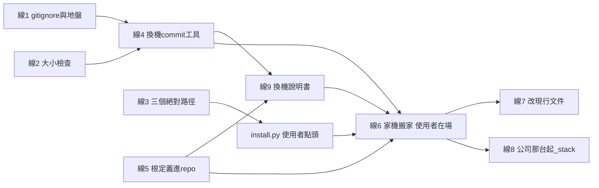
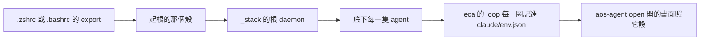

「私有地盤＋`_stack` 取代 `~/aos-home`」怎麼施工：九條線的先後、每條要改的檔與驗法、llm kernel 與權限站怎麼各台自己跑、要使用者點頭的步驟、邊緣狀況與待決一題。

# 02 規劃

← [入口](README.md)｜上一份：[01-決定與調查](01-決定與調查.md)

## 大白話摘要

- **做得到，分九條線。** 前四條只動 repo 裡的檔、不碰活樹，可以馬上開；後面才是搬家。
- **先做不痛的**：`.gitignore` 加兩行（`_stack/`、任何一層的 `temp/`）、開 `wf/ws/` 與地盤規矩、commit-request 加單檔大小檢查（預設 1 MB，可調）。
- **再修程式**：三個存絕對路徑的地方改成「相對 daemon 的 stack」的寫法，修完要跑一次 `install.py`（要你點頭）。
- **llm kernel 和權限站各台自己跑**（你 11-22 定的）：它們放在 repo 外、不跟著 `_stack` 走，每台在 `.zshrc`／`.bashrc` 裡 export `AOS_LLM_KERNEL`、`AOS_KERNEL` 指過去，`_stack` 的根從起它的那個殼拿到這些值、傳給底下每一隻。用的是現有的名字：你說的 `AOS_PERM_KERNEL` 就是 `AOS_KERNEL`，`AOS_DAEMON_ROOT` 就是 `AOS_DAEMON`。家機現在沒有權限站在跑，所以 `AOS_KERNEL` 先不設。
- **repo 裡只多 `_stack` 和根那份小定義**（只有時鐘 `_clock` 和清道夫 `_sweeper`）。根的定義放哪是唯一還要你決定的題目。
- **寫一份換機說明書**：教每台怎麼在 `.zshrc`／`.bashrc` 設 `AOS_HOME`、`AOS_DAEMON`、`AOS_LLM_KERNEL`、`AOS_KERNEL`（export 放在 source `env.sh` 之後），怎麼起 llm kernel、怎麼起根、怎麼換台。
- **然後搬家**：你在場時停掉 `~/aos-home`，把 eca-aos 和三個 subagent 的 stack 抄進 `~/repo/aos/_stack`；在 repo 外另起一台獨立的 llm kernel daemon（預設放 `~/.aos/llm/`，你可以另選）；照說明書改 `.zshrc`，再起 `_stack` 的根、重掛四隻。舊樹改名留著，不刪；`eca-claude`、`ann` 不搬（你定的）。
- **換台靠一支小工具**：離開這台時，它確認 daemon 已經停了、llm kernel 那邊沒有還沒回的信，然後只挑該帶走的檔交一個 commit（實測現在是 63 個檔、約 99 KB）；到另一台時，它檢查能不能安全起樹、三個變數有沒有設好。
- **公司那台**：那邊現有的樹你說別管。那台要跑 `_stack` 時只做必要的：pull、`install.py`、起那台自己的 llm kernel、照說明書設殼、起根。
- **llm kernel 的用量與預算不跟著換台**：你說額度自己心裡有數就好，這份不處理。
- 最大的新坑：`_stack` 的檔一旦進過 git，`git stash`、`git reset --hard` 會把正在跑的樹倒回舊狀態；還沒交件的檔不會跟著換台；殼裡 export 了 `AOS_KERNEL` 卻沒有權限站在跑，底下每一隻收信寄信都會失敗。

## 線與先後



| 線 | 做什麼 | 等誰 | 模型 | 動不動活樹 |
|---|---|---|---|---|
| 1 `ws-stack-1122-ignore` | `.gitignore` 兩行、`wf/ws/` 與地盤規矩、建現有四隻的地盤 | 無 | opus（寫規矩條文，不算簡單） | 不動 |
| 2 `ws-stack-1122-size` | commit-request 交件時查單檔大小 | 無 | opus | 不動 |
| 3 `ws-stack-1122-abs` | 修三個絕對路徑（C++ 與 Python） | 無 | opus | 不動；修完要 `install.py` |
| 4 `ws-stack-1122-move-tool` | 換機 commit 小工具（離站、到站） | 線 1、線 2（同改 `commit_queue.py`，要排前後） | opus | 不動 |
| 5 `ws-stack-1122-defs` | 根那份小定義進 repo（llm kernel、權限站不進） | 待決題 1 | sonnet 抄檔＋opus 驗（起暫存樹） | 只讀 |
| 9 `ws-stack-1122-manual` | 換機說明書（殼設定檔怎麼寫、怎麼起 llm kernel 與根、怎麼換台） | 線 4（工具的指令名）、線 5（根定義的位置） | opus（寫給使用者看的說明，不算簡單） | 不動 |
| 6 `ws-stack-1122-home` | 家機搬家 | 線 3 裝好、線 4、線 5、線 9；**使用者在場** | opus 寫步驟腳本，使用者下指令 | **動** |
| 7 `ws-stack-1122-docs` | 改現行文件與知識庫 | 線 6 做完（寫的是做完後的實況） | opus | 不動 |
| 8 `ws-stack-1122-wsl` | 公司那台起 `_stack`（那邊現有的樹不管） | 線 6、第一次換機 commit 已 push | opus，在公司那台 | 只動那台新起的 llm kernel 與 `_stack` |

線 1、2、3、5 互不相依，可以同時開。線 1 與線 2 都很小；線 3 最吃力。線 9 排在線 6 前面：搬家那天你就照說明書改 `.zshrc`，等於當場驗說明書。

共通的驗法（每條線都照做，下面不重複寫）：

- 測試在 `git archive <commit>` 抄到 `~/.aos/scratch/<線名-1122>/` 的乾淨複本上跑；複本先在它的 `proto8` 跑一次 `install.py`，再把 `AOS_HOME` 指到複本。這個 `install.py` 在複本裡跑，不動活樹，不用問。
- aos 指令與測試一律經 bash 腳本先 unset 所有 `AOS_*`。
- 交件走 `commit-request`，不 push。
- 任務書照貼活樹旁九條硬規則（[06](../../../../../wf/workflows/dispatch/aos-teams/06-公司WSL活樹與任務書硬規則.md)）。

---

### 線 1：`.gitignore` 與私有地盤

要改的檔：

- `.gitignore:32` 附近：把 `wf/temp/` 那一行換成兩行規則。
  - `temp/`（不帶開頭斜線＝任何一層叫 `temp` 的資料夾都不進；`wf/temp/` 也被它蓋到，原註解保留）。
  - `/_stack/`（只認 repo 根那一個）。
- 新檔 `wf/ws/README.md`：地盤規矩（下面「地盤規矩」那幾條），第一行一句話。
- 新檔 `wf/ws/eca-aos/README.md`，以及 `wf/ws/eca-aos/eca-aos-templates/README.md`、`wf/ws/eca-aos/eca-aos-kb/README.md`、`wf/ws/eca-aos/aos-eca-frontend/README.md`：各一句話說這是誰的地盤（git 不收空資料夾，所以用 README 佔位）。

地盤規矩（寫進 `wf/ws/README.md` 的內容，照使用者的決定 B、C）：

1. 工作區（cwd）不變，大家都是 `~/repo/aos`；地盤是另外配的一塊，放自己的草稿、筆記、任務書、自己做的定義夾。
2. 路徑照掛的層級：頂層 agent 是 `wf/ws/<名>/`，它掛的 subagent 是 `wf/ws/<上層>/<名>/`，再往下照樣嵌。
3. 地盤進 git；任何一層的 `temp/` 不進。放不放 `temp/` 的判準一句話：**換台之後還要用的放地盤，其他放 `temp/`**（大檔、跑出來的產物、log、抄來的複本、暫存樹都算其他）。
4. 誰建：上層替下層建（`subagent add` 之前 `mkdir` 並放 README），在任務書裡告訴它地盤在哪。
5. 現在只是規矩，不是牆：commit-request 不查誰交了誰地盤裡的檔，其他 agent 讀得到也改得到；牆等權限系統（見「怎麼接上別的規劃」）。
6. 交件一樣走 commit-request；單檔超過門檻會被擋（線 2）。

驗法：`git check-ignore -v wf/ws/x/temp/a _stack/a proto8/x/temp/a` 三個都被擋、`git check-ignore wf/ws/x/a.md` 不被擋；`git ls-files -ci --exclude-standard` 是空的（沒有哪個已追蹤的檔被新規則蓋到；11-22 查過 repo 沒有被追蹤的 `temp/` 資料夾，也沒有 `_stack`）；交件後 `wf/_index.json` 多一項 `ws`、`wf/ws/` 裡面不建索引。

### 線 2：commit-request 的單檔大小檢查

要改的檔：

- `wf/tools/commit_queue.py:46` 旁邊加常數（預設門檻），`:599-602`（忽略檢查）後面、`:603`（拍快照）前面加檢查。
- `wf/tools/commit_queue.py:1-22` 檔頭的用法說明補一段。
- 新檔 `wf/tools/commit_queue.json`（可調的設定，第一個鍵寫 `description`）。
- `wf/tools/tests/` 加測試（跟現有的 commit-request 測試放一起）。

判準（寫進程式與設定檔的說明）：

- **查什麼**：這次 `--files` 點名的每個檔在工作樹的大小（bytes），新檔與改過的舊檔都查；symlink 看連結本身。`--rm`、`--op` 產生的共用索引檔、排隊自己生的索引不查。
- **門檻**：預設單檔 1,048,576 bytes（1 MB）。11-22 量過 repo 追蹤中的檔沒有一個超過（最大 953 KB）。
- **超過**：整個申請不收，回 `FAILED RequestBad`，訊息點名檔與大小，hint 寫「把它放進 `temp/`，或請頂層放行」。什麼都不 commit。
- **怎麼調**：`wf/tools/commit_queue.json` 兩個鍵——`max_file_bytes`（改門檻）、`big_ok`（放行名單，repo 根相對路徑或 glob，例如哪天 `json.hpp` 升版超過 1 MB）。這個檔本身進 git，改它要走交件，誰放行過什麼查得到。設定檔不在或讀不懂＝用預設值並警告。
- **`_stack/` 底下的檔不查**（線 4 的工具才交得進去，對話紀錄長大是正常的）。

驗法：測試三種情況——超過被擋且 main 沒動、列在 `big_ok` 的通過、改小門檻後原本通過的被擋；整套 commit-request 測試照綠。`wf/tools/` 不在 `py/` 裡，不用 `install.py`。

### 線 3：修三個換台會壞的絕對路徑

共同原則：**落在 daemon 的 stack 底下的路徑，存成相對 daemon stack 的寫法**（跟 `child.cpp:195` 存 `cwd` 的做法一樣，起的時候從當下的 `AOS_DAEMON` 拼回）。proto8 當成沒有舊版：不寫舊格式相容，活樹上的舊資料在線 6 搬家時直接重寫。

| 哪個 | 現在哪裡寫的 | 建議改法 |
|---|---|---|
| 一、表上的 `as_written` | `proto8/py/tools/agent/subagent/_entry:194`（subagent 工具給 daemon 的 `--stack` 是絕對路徑，所以被當成「使用者寫的絕對路徑」原樣存）；讀的那頭 `proto8/cpp/aos-daemon/src/daemon/reconcile.cpp:195-208` | 改 subagent 工具：stack 不給絕對路徑，改給指示詞 `{"$env": "AOS_DAEMON", "$path": "procs/<名>"}`（`ctl add` 已有 `--stack-json`，11-10 B01）。daemon 那頭不動（「使用者寫絕對路徑就原樣存」是 11-10 裁過的） |
| 二、子 agent `exec.json` 的 `AOS_NOTIFY_BOX`、`AOS_PARENT_STACK` | `proto8/py/tools/agent/subagent/_entry:186`（補上絕對的通知信箱）；`proto8/py/aos/daemon_ctl/entry.py:251-284`（只收絕對路徑）；daemon 寫小格 `proto8/cpp/aos-daemon/src/child/child.cpp:199`（`rel_refs`） | 信上照舊收絕對路徑（介面不變）；daemon 把這兩個值寫進 `exec.json` 時，落在自己 stack 底下的換成相對 daemon stack 的指示詞，起子行程時解回絕對。要先確認 `envs` 的值起的時候會不會解指示詞，不會就在 `child.cpp` 寫入與讀回兩頭各補一步 |
| 三、`subagents.json` | `proto8/py/tools/agent/subagent/_entry:198`（記絕對）、`:99-101`（對帳要求絕對） | 改記相對 daemon stack 的路徑（例 `procs/eca-aos-kb`）；對帳時把表上那列的 stack 也換成相對再比。檔頭 `:20` 那句說明跟著改 |

順手一起修（同一類、線 6 會踩到）：

- subagent 的 `system.txt` 裡寫死的 `/home/lorkhan/repo/aos`：這是 eca-aos 寫給它們的提示詞文字，不是程式存的；線 6 搬家時改寫成 `~/repo/aos`。

（第一版還有一條「`procs/llm/` 的 `state.json`、`procs_state.json` 的 `daemon` 欄記著舊樹的絕對路徑」。決定 E 之後 llm kernel 不搬、表也不抄，這條不成立了，拿掉。）

其他要改的檔：`proto8/knowledge/aos/agents/subagent.md`（記帳格式那句）、`proto8/py/aos/apps/agent/docs/04-搬家/04-兩台輪流.md`（補「subagent 也換得了台」）、`proto8/thinking/2026-11/10/two-machines/11-給使用者的一頁.md` 過期的 `stack.gitignore` 路徑（線 7 一起改也可以）。

驗法：

- 既有測試：subagent 工具的測試、`aos-daemon` 的測試、`proto8/templates/tests/image-move-check/check.py`。
- 新增一個「換家目錄」的檢查（加進 `image-move-check`）：在暫存夾 `A/` 起一棵假腦的樹，掛一隻 agent、由它 `subagent add` 一隻；shutdown；整夾改名成 `B/`；再起。要看到：`subagent ls` 還認得那隻（沒被忘掉）、子的通知信寄得到父的信箱、`grep -r "/A/" B/_stack` 在會帶走的檔裡對不到任何一筆。
- 改了 `py/` 與 `cpp/`：在乾淨複本裡 `install.py` 後跑全套。**在 repo 裡跑 `install.py` 要使用者點頭**（會當場換掉活樹用的 `bin/`、`lib/`）。

### 線 4：換機 commit 小工具

新檔 `wf/tools/stack-commit`（名字暫定；Python，純標準庫，輸出英文），兩個動作：

**`leave`（離開這台）**

1. 確認 daemon 已經 shutdown：對 `_stack` 試拿 daemon 用的那把 flock（`proto8/cpp/aos-daemon/src/daemon/daemon.cpp:251-284`），拿不到就拒絕、什麼都不做。
2. 列出 `_stack` 以外還沒交件的髒檔（`git status --porcelain`），有就印出來、要加 `--leave-dirty` 才繼續（那些檔不會跟著換台）。
3. 看 llm kernel 那邊有沒有 `_stack` 的信還沒回：llm kernel 不跟著根一起停，它的 `$AOS_LLM_KERNEL/requests/`（`new/`、`cur/`）裡如果還有寄件人在 `_stack` 底下的信，就照實印出來、拒絕繼續（理由見邊緣狀況 14、15），要加 `--ignore-llm` 才繼續。`AOS_LLM_KERNEL` 沒設就跳過這一步，印一行說明。這一步只讀那邊的信箱，不收信、不刪信。
4. 組清單：
   - 新檔：`git ls-files -o --exclude-from=proto8/py/aos/apps/agent/stack.gitignore -- _stack`（11-22 試過，可行；不看根 `.gitignore`，只照 stack 的排除規則）。
   - 改過的：`git ls-files -m -- _stack`。
   - 不見的：`git ls-files -d -- _stack`（走 `--rm`）。
5. 掃金鑰樣式（照 [發佈前檢查](../../../../../wf/public/發佈前檢查.md) 的做法），命中就停、印出在哪個檔。
6. 經 commit-request 交一個 commit（訊息寫機器名與時間），不 push。push 由使用者說。

**`arrive`（到了這台，pull 之後、起樹之前）**

1. 確認這台沒有 daemon 握著 `_stack`。
2. `git status --porcelain -- _stack` 要是空的；不空＝這台上次離開後又跑過，停下來讓使用者決定留哪一邊。
3. 清掉 `_stack` 裡上次留下的執行期檔（沒追蹤的那些），保留各隻的 `.session_home` 與 `claude/`（這兩樣跟 `.claude` 那塊有關，這次不動）。
4. 提醒：pull 進來的 commit 有動到 `proto8/py/`、`proto8/cpp/` 的話先跑 `install.py`。
5. 查這個殼的環境（只看、不改）：`AOS_DAEMON` 解開後是不是 `_stack`；`AOS_LLM_KERNEL` 有設、而且那台 llm daemon 叫得動（`aos-daemon-ctl -d "$AOS_LLM_KERNEL" ping`）；`AOS_KERNEL` 有設的話那一站也要叫得動，沒設就印「沒有權限站」。對不上就印出哪一個、指到換機說明書（線 9），不停下（llm kernel 沒開時 agent 只是一直等，不會壞）。印的只有這三個變數的名字與路徑，不印整份環境。
6. 印出起樹那一行指令，不代跑。

要改的既有檔：

- `wf/tools/commit_queue.py:599-602`：加一個只給這支工具用的旗標（例 `--stack-commit`），只對 `_stack/` 開頭的路徑跳過「被 `.gitignore` 忽略」與線 2 的大小檢查；其他路徑照舊擋。前綴寫死在常數，不讓呼叫的人指定。
- `wf/tools/index_gen.json`：`_stack` 的檔進 git 之後，repo 根那一筆範圍會看到它。先在乾淨複本上跑一次 `index_gen.py --apply` 看它會不會因為 `_stack` 沒有說明而失敗；會就把 `_stack` 加進 `skip_dirs`。**這一步不能省：生成器一失敗，所有人的交件都會被擋。**
- `wf/tools/tests/` 加測試。

驗法：在暫存夾做一個小 repo（照 11-22 那次試法），驗以下幾件：
- daemon 沒停時 `leave` 拒絕。
- 清單不含鎖與 `live.jsonl`。
- 第二次 `leave` 沒改動時回「沒東西可交」。
- 暫存的假 llm kernel 的 `requests/new/` 放一封寄件人在 `_stack` 底下的信時，`leave` 拒絕。
- `arrive` 在 `_stack` 有髒檔時停下；殼裡沒設 `AOS_LLM_KERNEL` 時 `arrive` 印出提醒。

最後在乾淨複本上跑一次 index_gen。

### llm kernel 與權限站：各台自己跑（決定 E）

使用者 11-22：「爲何不能另外指定llm kernel, 權限站呢？就說換機的時候，要另外export AOS_LLM_KERNEL, AOS_PERM_KERNEL這樣，然後還有AOS_DAEMON_ROOT這種？」

**變數名對照**：不新造名字，用現有的三個。

| 使用者說的 | 現有的名字 | 指什麼 |
|---|---|---|
| `AOS_LLM_KERNEL` | `AOS_LLM_KERNEL`（同名） | llm kernel 的 stack；問腦的信寄進它的 `requests/` |
| `AOS_PERM_KERNEL` | `AOS_KERNEL` | 權限站的 `requests/` 信箱；沒設＝直接寄給 daemon |
| `AOS_DAEMON_ROOT` | `AOS_DAEMON` | daemon 的 stack，這裡就是 `~/repo/aos/_stack` |

**值從哪裡來、怎麼傳下去**：



- 根 daemon 從起它的那個殼繼承環境，再傳給底下每一隻。根定義 `.env` 裡寫的只是預設值，殼裡已經有的名字它不蓋（01「第二輪量到的」）。
- eca 的 loop 每一圈把手上的 `AOS_DAEMON`、`AOS_LLM_KERNEL`、`AOS_KERNEL` 等值記進自己小格的 `claude/env.json`。人用 `aos-agent open` 開畫面時，畫面照這份設，不看開畫面那個人的殼；還沒記過才用人的殼（`proto8/knowledge/aos/body.md:19`、`proto8/py/aos/agentlib/cli_mcp.py:100-139`）。所以 agent 看到的值，是「起根那一刻那個殼」的值。
- 表上與會帶走的檔裡都沒存這兩個路徑。11-22 在活樹裡找過，只有不進 git 的 `claude/env.json` 有。所以換台不用改 `_stack` 裡的任何檔，只要那台的殼設對。

**llm kernel**：

- 每台一台獨立的 llm kernel daemon，放在 repo 外。**預設位置 `~/.aos/llm/`**：定義在 `~/.aos/llm/def/`，stack 在 `~/.aos/llm/stack/`，`AOS_LLM_KERNEL=~/.aos/llm/stack`。跟使用者專區 `~/.aos/user`、人的 stack `~/.aos/stack` 放在一起，都是「這台自己的 aos 東西」。使用者想放別處就換一個路徑，說明書與搬家步驟照著換就好，不影響別的線。
- 家機的定義從舊樹 `~/aos-home/llm/` 抄（不抄 `.bak-*`）。它本來就是「自己一台 daemon」的形狀（01「第二輪量到的」），端點寫的是這台的 `localhost` 服務，所以留在各台。公司那台從家機那份或 `proto8/templates/kernel/llm-kernel` 抄，端點照那台改。
- **端點名字兩台要一樣**（例如 `sol`、`fake`），url 可以不同。agent-fsm 的 `llm.json` 記的是端點名字，換到一台沒有這個名字的 llm kernel 會拿到 `EndpointUnknown` 而停下（邊緣狀況 16）。
- 起它的那個殼要拿掉 `AOS_DAEMON`、`AOS_KERNEL`（邊緣狀況 18）：`env -u AOS_DAEMON -u AOS_KERNEL -u AOS_STACK -u AOS_CLOCK aos-exec --stack ~/.aos/llm/stack ~/.aos/llm/def`。在前台跑，放在 tmux 的一個視窗裡；要長駐可以照 `proto8/cpp/aos-daemon/examples/root/` 交給 systemd 或 s6（選用，不預設）。
- 四隻 eca 的腦是 Claude Code，本身不走 llm kernel。llm kernel 只給它們派出去的 agent-fsm（sol 施工員這類）用。它沒開時，那些 agent 只是一直等，不會壞。
- **用量與預算不跟著換台，使用者裁定不處理**：「這個沒差，額度就是使用者自己心裏有數就好，等以後規模大了才需要另外設計」。舊樹 llm 那格的帳本 `ledger.jsonl` 留在改了名的舊樹裡，新的 llm kernel 從零開始記。

**權限站**：

- 家機現在沒有權限站在跑（01「第二輪量到的」），所以 **`AOS_KERNEL` 先不設**。export 了卻沒有站在跑，底下每一隻收信、寄信、設計時器、`self_*` 都會在 3 秒後失敗（邊緣狀況 23）。
- 以後要開一站：放在 repo 外，例如 `~/.aos/perm/`，抄 `proto8/templates/kernel/daemon-kernel/` 當一台獨立的 daemon 起；`kernel.json` 一定要寫 `next`（`~/repo/aos/_stack/procs_requests`，`_stack` 根的 ctl 信箱）與 `count_daemon`（`_stack`），否則它會把放行的請求轉給自己那台（邊緣狀況 24）。`allowed` 名單照實改，範本裡那幾個是測試用的名字。起站之後，殼裡再 export `AOS_KERNEL=<它的 stack>/requests`，然後重起根（邊緣狀況 21）。
- 舊樹 `~/aos-home/perm/` 是一份沒掛上去的 loop 定義（要掛成某台 daemon 的一列）。掛到 `_stack` 的根上的話，它的 stack 會進 `_stack`、表上記著 repo 外的定義路徑，換台就壞，跟決定 E 不合，所以不用它。
- 這一段寫進換機說明書（線 9）的「選用：權限站」，這次不施工、不起站。

### 線 5：根那份小定義進 repo

llm kernel、權限站不進 repo（決定 E），進 repo 的只剩根。位置等待決題 1，下面先用推薦的 `wf/tree/root/` 寫。

- 新夾 `wf/tree/root/`：從 `~/aos-home/root/` 抄（只讀活樹），不抄 `.bak-*`。`.env` 拿掉 `AOS_LLM_KERNEL=${AOS_STACK}/procs/llm` 那行，換成一行註解：「`AOS_LLM_KERNEL`、`AOS_KERNEL` 由起根的殼 export，見換機說明書」。這樣忘了 export 的時候，agent 第一次問腦就停在 `LlmKernelMissing`，錯誤會明講；不拿掉的話，它會指向不存在的 `procs/llm`，agent 只是默默一直等（邊緣狀況 25）。原本那行「不要在這裡設 `AOS_KERNEL`」的註解保留，理由改成「權限站是各台的，見說明書」。
- 新檔 `wf/tree/README.md`：一句話說這是 `_stack` 的根，指到換機說明書（線 9），不重寫步驟。
- 起樹那一行：`cd ~/repo/aos && env -u AOS_DAEMON -u AOS_STACK -u AOS_CLOCK aos-exec --stack _stack wf/tree/root`。`AOS_LLM_KERNEL`、`AOS_KERNEL` 留著，讓根傳下去。表上只有 `_clock`、`_sweeper`，agent 之後掛上去；表上存的是相對 `_stack` 的路徑（`../proto8/templates/eca-claude`、工作區 `..`），兩台的 repo 都在 `~/repo/aos`，相對位置一樣。
- `eca-claude`、`agents/ann` 不搬（使用者「舊樹的不搬」）。

驗法：在 `git archive` 的乾淨複本裡，照 `wf/tree/README.md` 指的說明書從零起一棵：
1. 先在暫存夾起一台假腦的獨立 llm kernel，再起根。
2. 表上 `_clock`、`_sweeper` 都要是 `running`。
3. 掛一隻 agent-fsm，用 `fake` 端點問一句，要有回。
4. shutdown 後再起，要全部醒來。
5. 不 export `AOS_LLM_KERNEL` 再起一次，看到 `LlmKernelMissing`。
6. 跟 `proto8/templates/daemon-root` `diff -r` 一次，把差異列在 README。

### 線 9：換機說明書

新檔 **`wf/workflows/dev-env/03-換機.md`**（規劃員提的位置）：它跟 `01-跨機與外部工具.md`、`02-模型端點.md` 並排，都在講「這台機器要怎麼設」；`wf/workflows/dev-env.md` 的入口表與 `01` 的「跨機」那段各加一行指過來。第一行寫一句話。給使用者看的，繁體中文、先結論。

內容：
1. **每台要有的三樣**：repo（`~/repo/aos`，`AOS_HOME` 指它的 `proto8`）、這台自己的 llm kernel（預設 `~/.aos/llm/`）、選用的權限站。哪些跟著 `_stack` 走、哪些不走：用量與預算不走，使用者裁定不處理。
2. **殼設定檔怎麼寫**：`.zshrc`（家機）與 `.bashrc`（公司 WSL）各一份範例，寫法一樣：

   ```sh
   # aos：在 agent 的殼裡跳過（它帶著 AOS_STACK，值由 daemon 給）
   if [[ -z $AOS_STACK ]]; then
     export AOS_HOME=~/repo/aos/proto8
     source "$AOS_HOME/env.sh"          # 會清掉 AOS_HOME 以外的 AOS_*：下面幾行一定要在它之後
     export AOS_DAEMON=~/repo/aos/_stack
     export AOS_LLM_KERNEL=~/.aos/llm/stack
     # export AOS_KERNEL=~/.aos/perm/stack/requests   # 只在真的有權限站在跑時才打開
   fi
   ```

   另寫「不 source 的寫法」：照 `proto8/cpp/aos-daemon/examples/root/` 只設 `AOS_HOME` 與 `PATH`，export 順序就沒差。使用者「這塊就是精心設計.zshrc,.bashrc的事情，linux使用者都會的，只要說明書寫好」，所以只寫清楚，不改 `env.sh`。
3. **起 llm kernel**、**起根**：兩行指令（見上一節與線 5），各在 tmux 的一個視窗；先起 llm kernel 再起根。各要拿掉哪些變數、為什麼，一句話講完。
4. **換台**：離開＝`shutdown` 根 →（llm kernel 不用停）→ `stack-commit leave` → push。到了＝pull → 有動到 `py/`、`cpp/` 就 `install.py` → 起 llm kernel → `stack-commit arrive` → 起根。
5. **核對**：`echo $AOS_DAEMON $AOS_LLM_KERNEL $AOS_KERNEL`、對 llm kernel 與根各 `ping` 一次、`aos-daemon-ctl ls`。
6. **常見錯**：
   - export 寫在 source 前面，被清掉。
   - 把 export 寫在 `[[ -z $AOS_STACK ]]` 判斷外面（邊緣狀況 20）。
   - 改了 export 卻沒重起根（邊緣狀況 21）。
   - 設了 `AOS_KERNEL` 卻沒有站在跑（邊緣狀況 23）。
   - 從帶著 `AOS_DAEMON` 的殼起 llm kernel（邊緣狀況 18）。
   - 兩台的端點名字不一樣（邊緣狀況 16）。
7. **選用：權限站**：上一節「權限站」那段。

驗法：
- 在 `git archive` 的乾淨複本裡照說明書逐字做一次：用 `env -i HOME=<暫存家目錄> PATH=/usr/bin:/bin zsh -i` 加一份照說明書寫的暫存 `.zshrc`（`ZDOTDIR` 指暫存夾）；`bash` 用 `--rcfile` 再做一次。`AOS_HOME` 指複本，llm kernel 與根都起在 `~/.aos/scratch/<線名-日期>/` 底下。
- 起出來後掛一隻 agent-fsm 用 `fake` 端點問一句。故意把 export 移到 source 前面，看到值被清掉，跟說明書寫的對得上。
- 不碰家機真的 `~/.zshrc`、`~/.aos/llm`。

### 線 6：家機搬家（使用者在場）

前提：
- 線 3 已 commit，使用者也點頭跑過 `install.py`。
- 線 4、線 5、線 9 都已 commit。
- 先在暫存夾用活樹的抄本整套演練一次（抄 `.stack`、照下面的步驟起暫存的 llm kernel 與根、看四隻都醒），演練過才排使用者的時間。

步驟（★＝使用者當場點頭或親手做）：

1. ★ 使用者挑時間；四隻 eca 手上的事先收尾、該交件的交件（shutdown 會打斷正在答的那一輪，那封信不重答）。
2. ★ 使用者關掉 eca-aos 的畫面。
3. ★ `aos-daemon-ctl -d ~/aos-home/.stack shutdown`（動活樹；舊樹的 llm 是掛在舊根上的一列，跟著停）。`pgrep -u "$USER" -af aos-daemon` 確認沒有了。
4. 把四格 stack 抄進新位置：`~/aos-home/.stack/procs/{eca-aos,eca-aos-templates,eca-aos-kb,aos-eca-frontend}` → `~/repo/aos/_stack/procs/`（`cp -a`）。
   - 抄過去的四份 `claude/env.json` 刪掉。這是新抄本裡的檔，舊樹那份不動；刪了之後 loop 第一圈會照新環境重記。不刪的話，第一圈之前開的畫面會照它指回舊樹（邊緣狀況 22）。
   - **`llm` 那格不抄**：帳本留在舊樹，使用者裁定額度不處理。
   - **不抄表**（`procs_state.json`、根的 `state.json`、`state_flux.json`、`ctl.json`、`clock`）：新 daemon 自己開一張空表，舊表上的路徑一筆都不帶過來。
5. 重寫三處舊資料（線 3 的新格式）：`_stack/procs/eca-aos/tools/subagent/subagents.json` 三筆、三個 subagent 的 `exec.json`（或刪掉讓重掛時重寫）、兩份 `system.txt` 裡的 `/home/lorkhan/repo/aos`。這一步是改別的 agent 的 stack，只在 daemon 停著、使用者在場時做。
6. ★ 在 repo 外建這台的 llm kernel：`mkdir -p ~/.aos/llm && rsync -a --exclude='*.bak-*' ~/aos-home/llm/ ~/.aos/llm/def/`。只讀舊樹；位置用預設 `~/.aos/llm/`，使用者這時可以另選，後面幾步的路徑跟著換。
7. ★ `mv ~/aos-home ~/aos-home.old-1122`（改名不刪；改了名，任何還記著舊絕對路徑的地方就找不到舊位置，不會默默接回舊樹）。
8. ★ 照換機說明書改 `~/.zshrc`（使用者自己的檔）：把 `:92-93` 那兩行換成說明書的那一段（`AOS_HOME` → source `$AOS_HOME/env.sh` → export `AOS_DAEMON`、`AOS_LLM_KERNEL`；`AOS_KERNEL` 不設）。開一個新視窗，`echo $AOS_DAEMON $AOS_LLM_KERNEL $AOS_KERNEL` 看到前兩個有值、第三個空的。
9. ★ 在新視窗（tmux 的一格）起 llm kernel：`env -u AOS_DAEMON -u AOS_KERNEL -u AOS_STACK -u AOS_CLOCK aos-exec --stack ~/.aos/llm/stack ~/.aos/llm/def`；另一格 `aos-daemon-ctl -d ~/.aos/llm/stack ping` 有回。
10. ★ 在另一格起根：`cd ~/repo/aos && env -u AOS_DAEMON -u AOS_STACK -u AOS_CLOCK aos-exec --stack _stack wf/tree/root`（路徑照題 1 的答案）。
11. 掛回去：eca-aos（`-w ..` 寫相對、指到已抄好的 stack）、三個 subagent（帶 `--parent`、`--notify-box`，照線 3 的新寫法）。全部用相對路徑或指示詞，不打絕對路徑。llm kernel 不掛在這棵樹上。
12. 核對：
    - `aos-daemon-ctl -d _stack ls` 六列（`_clock`、`_sweeper`、eca-aos、三個 subagent）都是 `running`。
    - `aos-daemon-ctl -d ~/.aos/llm/stack ls` 有它自己的 `_sweeper`。
    - eca-aos 的 `subagent ls` 是 3/4，三隻都在。
    - 四份 `claude/env.json` 重記成新值（`AOS_DAEMON` 是 `…/repo/aos/_stack/`，`AOS_LLM_KERNEL` 是 `~/.aos/llm/stack`）。
    - `grep -rl /home/lorkhan _stack` 在會帶走的檔裡只剩對話紀錄這類內文。
    - 問每隻一句有回。
    - eca-aos 派一隻 agent-fsm 用 `fake` 端點問一句，確認走得到新的 llm kernel（不叫真模型）。
13. ★ 使用者重開 eca-aos 的畫面。四隻可能會開新對話、接整理好的開場白（續不續得上原對話跟 `.claude` 那塊有關，這次不處理，照實看結果記下來）。
14. ★ 第一次換機 commit：`aos-daemon-ctl -d _stack shutdown` → `wf/tools/stack-commit leave` → 再起根（llm kernel 不用停）。**在這之前不要在 repo 跑 `git clean -fdx`**（會刪光 `_stack`）。要不要馬上 push 由使用者說。

退路：第 9 步之後任何一步不對，就照這個順序退回：
1. shutdown 新根與新的 llm kernel。
2. `mv ~/aos-home.old-1122 ~/aos-home`。
3. 還原 `~/.zshrc`。
4. 照舊起舊樹；舊根的 `.env` 與 llm 那一列都還在。

`_stack`、`~/.aos/llm` 留著查原因。舊樹的 stack 沒被改過，因為第 4、6 步是抄不是搬。

不在這次範圍、但搬完會一起壞或本來就壞著的（只記不修）：`~/.config/systemd/user/aos-view.service`、`aos-user-tick.service` 指著 `~/aos-home/ws/…`（11-18 重建後就壞著）。

### 線 7：改現行文件

等線 6 做完，照實況改。清單（行號是 11-22 的）：

| 檔 | 哪裡 | 改成什麼 |
|---|---|---|
| `wf/workflows/dispatch/aos-teams.md` | `:10`（工作區 `wf/temp/<名字>/`）、`:49`（`~/aos-home/agents/`）、`:60-62`（第 5 件「活樹旁邊」） | 工作區是 `~/repo/aos`、地盤 `wf/ws/…`；定義在 `wf/tree/` 或地盤裡；活樹改指 `~/repo/aos/_stack` |
| `wf/workflows/dispatch/aos-teams/07-預設流程與agent-fsm.md` | `:31`（`${HOME}/aos-home/ws/.stack/procs/llm-gpt`）、`:80-86`（「頂層也當 kernel」：定義在 `~/aos-home/agents/`、工作區 `wf/temp/<名字>`） | 同上；使用者 11-14 那句原話留著，後面加 11-22 的新定 |
| `wf/workflows/dispatch/aos-teams/06-公司WSL活樹與任務書硬規則.md` | `:7-10`（現況）、硬規則第 1、9 條 | 活樹＝`~/repo/aos/_stack` 與 `wf/tree/`；另加一條「不在共用工作樹跑 `git stash`、`git reset --hard`、`git checkout -- .`、`git clean -fdx`」 |
| `wf/workflows/common/rules-card.md` | `:39`（活樹不碰）與第 7 條 | 跟著 06 改；卡要維持 8 KB 內 |
| `AGENTS.md` | `:47`（「公司 WSL 的樹住 `~/aos-home`」） | 兩台的樹都是 `~/repo/aos/_stack` |
| `wf/workflows/dev-env.md`、`dev-env/01-跨機與外部工具.md:7` | 樹住哪、每個視窗 source 什麼 | 樹＝`~/repo/aos/_stack`、llm kernel＝各台的 `~/.aos/llm/`；殼怎麼設、怎麼換台一律指到換機說明書 `dev-env/03-換機.md`（線 9 已寫），這裡不重寫 |
| `wf/public/README.md:43`、`wf/public/pitfalls.md:26`、`wf/public/改文件與知識庫.md:9,44`、`wf/public/發佈前檢查.md:37`、`wf/public/活樹旁邊.md`、`wf/public/行程與環境.md`、`wf/public/派線與任務書.md` | 寫 `wf/temp/<線>/` 當工作區或草稿夾的地方 | 草稿夾改 `wf/ws/<agent>/temp/` 或地盤本身；`pitfalls.md:26` 那條坑（工作區外的檔讀不到）在 cwd 改回 repo 根之後不成立，改寫或刪（刪要使用者點頭） |
| `wf/workflows/dispatch/kits/site.json` | 兩處 `aos-home` | 跟著改 |
| `.gitignore:31` 的註解 | 「頂層分給…的工作區」 | 線 1 已改 |
| `proto8/frontend/systemd/aos-frontend.service:2,14` | `AOS_DAEMON=%h/aos-home/.stack/` | `%h/repo/aos/_stack/` |
| `proto8/knowledge/aos/user_zone.md:8,30,49` | `~/aos-home/ws/tools/aos-user/…`、`~/aos-home/ws/public/user.json` | 這次不動：aos-user 工具的新家不在這份規劃的範圍（家機現在就沒有這支，見邊緣狀況 32） |
| `proto8/py/aos/apps/agent/docs/05-gitignore指南.md` | A、B 兩種放法 | 補第三種：「根忽略整個 stack、換台時照範本挑檔加」（就是這次的做法） |
| `wf/progress.json` | `workspace-stack-alloc`、`default-stack` | 用 `--op progress_upsert` 改寫，見下一節 |

不改的：`proto8/templates/start-api/README.md`、`start-eca/README.md`、`proto8/docs/tutorial/01-開始前.md` 裡的 `~/aos-home` 是給一般使用者的例子位置，照舊；`proto8/py/tools/agent/kernel_gate/tests/test_triage.py:35-36` 的 `wf/temp` 是測試自己造的假資料；`wf/tools/commit_queue.py:398`、`index_gen.py:262` 的註解提到 `wf/temp` 只是舉例；舊的 thinking、封存的報告不回頭改。

驗法：`python3 wf/tools/check_anchors.py wf` 沒有新的壞連結；`grep -rn "aos-home" wf/workflows wf/public AGENTS.md` 剩下的每一筆都說得出為什麼留。

### 線 8：公司那台起 `_stack`

使用者 11-22：「公司現有的樹沒在用，別管」。所以這條線不盤點、不停、不改名、不改那台現有的樹（`~/aos-home`、`ok-*`、`kernel_gate` 都不碰），只做「那台要跑 `_stack`」的必要步驟，照換機說明書：

1. 唯讀看一眼 `git config pull.rebase`。是 `true` 就照邊緣狀況 2 處理：那台的 pull 一律加 `--no-rebase`，或請使用者改設定。
2. `git pull`（家機已做過第一次換機 commit 並 push）→ ★ `install.py`。
3. ★ 在 repo 外建那台的 llm kernel（預設 `~/.aos/llm/`）：定義從家機那份或 `proto8/templates/kernel/llm-kernel` 抄，端點 url 照那台的服務改，**端點名字跟家機一樣**（邊緣狀況 16）。照說明書起它。
4. ★ 照說明書改那台的 `~/.bashrc`：`AOS_HOME`、`AOS_DAEMON`、`AOS_LLM_KERNEL`；`AOS_KERNEL` 不設。那台原本 source 舊樹 `env.sh` 的那一行怎麼處理由使用者自己看著辦，這份不管。
5. `wf/tools/stack-commit arrive` → ★ 起根 → 照線 6 第 11 步掛回四隻。
6. 核對：六列醒來、`subagent ls` 3/4、每隻問一句有回。這一步同時是線 3 的真機驗收：家目錄從 `/home/lorkhan` 換成 `/home/guanyu`。
7. 離開那台時：`shutdown` → `stack-commit leave` → ★ push。回家機：`pull` → `arrive` → 起根。來回各一次都通才算完。

## 要使用者當場點頭的步驟

| 什麼時候 | 點頭什麼 |
|---|---|
| 線 3 交件後 | 在 repo 跑 `python3 proto8/install.py`（換掉活樹的 `bin/`、`lib/`） |
| 線 6 第 1～3 步 | 挑時間、關 eca-aos 畫面、shutdown 活樹（舊樹的 llm 跟著停） |
| 線 6 第 4、5 步 | 刪抄本裡的四份 `claude/env.json`、改四隻 agent 的 stack 裡三處舊資料 |
| 線 6 第 6 步 | 在 `~/.aos/llm/` 建 llm kernel 的定義（位置可另選） |
| 線 6 第 7、8 步 | `~/aos-home` 改名、照說明書改 `~/.zshrc` |
| 線 6 第 9、10 步 | 起獨立的 llm kernel、起 `_stack` 的根 |
| 線 6 第 13 步 | 重開畫面 |
| 線 6 第 14 步、之後每次換台 | 換機 commit 要不要 push（**push 上去的內容含四隻 eca 的對話紀錄與信**，遠端是 GitHub 的 `justty32/aos`） |
| 線 7 | 刪 `pitfalls.md:26` 那條（若選刪不選改寫） |
| 線 8 第 2～5、7 步 | `install.py`、建並起那台的 llm kernel、改那台的 `~/.bashrc`、起根、push |
| 以後 | 刪 `~/aos-home.old-1122`、清 `wf/temp/`（760 MB）、開權限站——這份規劃不安排，使用者想做時再說 |

每條線的 commit 走 commit-request、不 push；push 一律另外問。

## 怎麼接上別的規劃（只說接點，不定格式）

- **ok-sec 的接口 W**（一份「讀寫範圍」宣告，OS 層與 aos 層共用）：地盤的路徑規則就是這份宣告最自然的來源——一隻 agent 的寫入範圍＝自己的地盤（含底下子孫的）＋任務書點名的檔，讀取範圍照舊是整個 repo。地盤路徑可以從 daemon 表上「誰掛誰」機械地推出來，不用另外登記。W 的格式由 ok-sec 定，這份規劃只保證路徑規則穩定。
- **ok-onboard 的寫檔範圍**（`kits.json`、`AOS_WRITE_ALLOW`）：`aos-kit add` 將來填 `AOS_WRITE_ALLOW` 時，把那隻的地盤路徑放進去就接上了。這次不動 `kits.json`，只在線 7 改 `kits/site.json` 裡寫死的 `aos-home`。
- **`progress.json` 的 `workspace-stack-alloc`**：這份規劃做完，「工作區」那半有了第一版（cwd 共用＋私有地盤），「stack 分配」那半維持現狀（每隻在 `_stack/procs/<名>`、平放、由 daemon 與 subagent 工具決定）。線 7 把這一條的 `what` 改寫成「第一版已做，剩：地盤變成真的牆（等 ok-sec）、stack 要不要也照層級嵌套」，`see` 指到這裡。
- **`progress.json` 的 `default-stack`**：第 1 點（`~/aos-home` 要吃到新版得跑 `install.py`）在線 3 之後的那次 `install.py` 一併完成，之後這句改成 `_stack`。11-21 做的「不給 `-d` 時從 agent 的 stack 往上兩層找 daemon」對 `_stack/procs/<名>` 照樣成立（往上兩層就是 `_stack`，不看名字）；站在別處下指令才需要 `AOS_DAEMON`（說明書讓殼一律 export）。第 3 點（stack 裡要不要記定義夾／工作區）這次用不到——表上的列已經用相對路徑記了這兩樣——照舊留著等使用者。
- **權限件**：以後在 `_stack` 前面放權限站，照「llm kernel 與權限站」一節的「權限站」那段（獨立 daemon、`next` 與 `count_daemon` 指 `_stack`、站起了才 export `AOS_KERNEL`）。公司那台的 `kernel_gate` 屬於那台現有的樹，使用者說別管，這份不接。方案 B 之後所有 agent 的工作區都是 repo 根，所以任何站用「工作區在不在放行範圍內」都分不出誰是誰，能分辨的只剩定義放哪；真正的界線要等地盤接上權限。

## 邊緣狀況（規劃員挖到、輸入檔沒寫的）

照決定 E 更新過：第一版的 14（llm 狀態檔記著舊樹路徑）、21（公司舊樹與 `_stack` 不合併）、23（公司 gate 的 `ws_roots`）不再成立或使用者說別管，拿掉了；編號重排。

git 這一側：

1. `_stack` 的檔進過 git 之後，`git stash`、`git reset --hard`、`git checkout -- .`、`git pull --autostash` 會把正在跑的樹的檔倒回上次換機 commit 的樣子（11-22 試過 `git stash`）。後果：daemon 還握著舊狀態在記憶體裡，檔被換掉，對話紀錄與信箱錯亂。
2. `git pull --rebase` 與 `git rebase` 遇到有改動的追蹤檔會拒絕；daemon 一跑 `_stack` 就是髒的，所以這兩個指令從此在這個 repo 都跑不了。家機設定是不 rebase（沒事）；公司那台在線 8 第 1 步查。
3. pull 進來的換機 commit 如果動到這台也改過的 `_stack` 檔，git 會整個拒絕 pull（連別的檔也拉不下來）。這其實是「兩台都跑過」的警報；後果是要人決定留哪一邊，不能硬蓋。
4. 到站那台的 `_stack` 裡還留著它上次跑的執行期檔（鎖、`endpoints.json`、冷卻時間…），跟拉下來的新狀態混在一起。後果：可能讀到上一輪的冷卻、舊的端點快取；所以 `arrive` 要清。
5. `_stack` 進 git 後，index_gen 在 repo 根會看到它；如果因此失敗，**所有人的交件都被擋**。線 4 一定要先在乾淨複本上試。
6. commit-request 每次交件都在快取樹簽出整份 HEAD，之後會多帶一份 `_stack`。後果：只是慢一點點、多佔約 100 KB，沒有害處。
7. 換機 commit 把四隻 eca 的對話紀錄與信放進 git 歷史（llm kernel 的帳本不在 `_stack` 裡，不會進）；agent 讀過的金鑰或私人內容如果出現在對話紀錄裡，push 之後收不回來。所以 `leave` 要掃金鑰樣式，push 要使用者說。
8. 對話紀錄壓縮（compact）是整檔重寫，不是往後加；每次換台的 commit 會存一份差異，repo 會慢慢變大。現在整包才 99 KB，短期看不出來。

換台這一側：

9. **還沒交件的檔不跟著換台**：agent 在這台寫了檔、沒交件就 shutdown，到另一台醒來時對話紀錄說「我寫了 X」，X 卻不在。`temp/` 裡的東西永遠不跟著走（這是設計），agent 不能指望換台後 `temp/` 還在。
10. 到站那台的 `bin/`、`lib/` 如果比離站那台舊，會用舊程式讀新程式寫的 stack。後果：可能讀不懂狀態檔（會留成 `.bad-*`）；所以到站先 `install.py` 再起樹。
11. `aos-daemon-ctl` 不給 `-d` 時找的是 cwd 的 `./.stack`，`_stack` 它找不到。說明書讓殼一律 export `AOS_DAEMON`；沒照著設的視窗會報找不到 daemon；如果哪個資料夾剛好留著一個舊的 `.stack`，會對錯的 daemon 下指令。
12. 家機搬完如果 `~/aos-home` 沒改名、原地留著：任何還記著舊絕對路徑的列，daemon 會優先用舊位置（`reconcile.cpp:195-208`），等於默默接回舊樹的 stack。所以搬家不抄表、舊樹要改名。
13. subagent 的 `system.txt` 寫著 `/home/lorkhan/repo/aos`（提示詞文字）。後果：到公司那台不會壞，但那隻會照著一條不存在的路徑去找檔，白繞幾輪。線 6 第 5 步改寫。

llm kernel 這一側（決定 E 之後才有）：

14. **agent-fsm 正在等腦時換台**：問腦的信留在這台 llm kernel 的 `requests/`（repo 外，不跟著走），那隻帶著 `think/pending.txt` 到另一台醒來，等的是一封那台 llm kernel 從沒收過的信。會一直等、還是會發現並重寄，規劃員沒查到（〔未核〕，線 4 施工時要查 agent-fsm 的 wait 那一格）。四隻 eca 本身不走 llm kernel，受影響的只有它們派出去、換台時還在跑的 agent-fsm。所以 `leave` 先看 llm kernel 那邊有沒有 `_stack` 的信（線 4 `leave` 第 3 步）。
15. **llm kernel 不跟著根一起停**：根 shutdown 了，llm kernel 照樣把手上的信答完，回信寫進 `_stack` 裡那隻的 `think/reply/`。如果這發生在 `leave` 交完之後，這台的 `_stack` 又變髒；下次回到這台時，`arrive` 會停下（邊緣狀況 3 的警報響錯），或 pull 被拒。同一個 `leave` 第 3 步擋這件事。
16. **兩台的端點名字要一樣**：agent-fsm 的 `llm.json` 記的是端點名字（例如 `sol`）。到一台沒有這個名字的 llm kernel，會拿到 `EndpointUnknown`；這不是會自己重試的錯，那隻會停下（`proto8/knowledge/aos/brain.md:24,28`）。url 可以不同，名字要相同；寫進說明書。
17. **llm kernel 沒人顧**：它是在前台手起的一台獨立 daemon，機器重開或視窗關掉就沒了，`_stack` 的根不會幫它重起。後果：agent-fsm 只是一直等（`llm_kernel.md:11`），eca 不受影響；`arrive` 第 5 步會提醒。要長駐可以交給 systemd／s6（`proto8/cpp/aos-daemon/examples/root/`，選用）。
18. **從設了 `AOS_DAEMON`、`AOS_KERNEL` 的殼起 llm kernel**：說明書讓殼一律 export `AOS_DAEMON=_stack`。直接在這個殼起 llm kernel，它會把 `_stack` 記成自己的上一層（`daemon.cpp:193-206`）；殼裡也有 `AOS_KERNEL` 的話，它每次問腦的工作會寄給權限站，再被轉到 `_stack` 的表上跑（`llm_kernel.md:13`）。所以說明書裡起它那一行用 `env -u AOS_DAEMON -u AOS_KERNEL …`。

殼與環境變數這一側（決定 E 之後才有）：

19. **export 寫在 source `env.sh` 前面會被清掉**（`proto8/env.sh:19-20` 清 `AOS_HOME` 以外的 `AOS_*`）。使用者：「這塊就是精心設計.zshrc,.bashrc的事情，linux使用者都會的，只要說明書寫好」——靠說明書（線 9），不改 `env.sh`。
20. **export 要放在 `[[ -z $AOS_STACK ]]` 判斷裡**（家機 `~/.zshrc:93` 現在就這樣擋）。agent 的殼（例如 Claude Code 的 Bash 工具）會載入使用者的殼設定檔；判斷外面的 `export AOS_DAEMON=~/repo/aos/_stack` 會蓋掉 daemon 給那隻的值。暫存樹裡的 agent 下的 `aos-agent ctl`、`aos-daemon-ctl` 就會打到真正的 `_stack`，等於踩活樹。
21. **改了 export 要重起根才生效**：agent 拿到的值是起根那一刻那個殼的；畫面照 `claude/env.json` 設（loop 每圈從 daemon 給的環境重記），也不看開畫面的殼。只開新視窗或重開畫面不夠：改 `AOS_LLM_KERNEL`、開關權限站之後，要 shutdown 根再從新殼起。
22. **畫面比 loop 先開**：還沒有 `claude/env.json` 時，畫面用開畫面那個殼的值（印一行提醒，`cli_mcp.py:132-139`）。到站那台一定是這樣（`env.json` 不進 git），所以那台的殼也要照說明書設。家機搬家用 `cp -a` 會把舊的 `env.json` 一起抄來，裡面指著已改名的舊樹；第一圈之前開畫面就會指錯，所以線 6 第 4 步刪掉抄本裡的那四份。
23. **export 了 `AOS_KERNEL` 卻沒有權限站在跑**：底下每一隻的 `mailbox_peek`、`mailbox_send`、`clock_register`、`self_*` 都會先問那一站，3 秒沒回就 `KernelFailed`（`proto8/knowledge/aos/kernel.md:41-43`）；`ctl add`、`start` 也等不到回信。所以家機現在不設，站起了才設。
24. **獨立的權限站沒寫 `next`、`count_daemon`**：它的 `AOS_DAEMON` 是自己，放行的請求就轉進自己那台的 ctl 信箱，agent 被起在權限站那台、不在 `_stack`；`max_running` 也數錯表（`kernel.md:57`、`proto8/templates/kernel/README.md:101`）。寫進說明書的「選用：權限站」。
25. **根定義 `.env` 的 `AOS_LLM_KERNEL` 預設行**：殼裡沒 export 時這行才生效。留著活樹那行（`${AOS_STACK}/procs/llm`）或範本那行（`${AOS_WS}/../llms/stacks/llm`），都會指向不存在的位置，agent-fsm 默默一直等；拿掉則是第一次問腦就停在 `LlmKernelMissing`，錯誤明講。線 5 選拿掉；題 1 選 c 的話拿不掉（見題 1）。

地盤這一側：

26. `temp/` 規則蓋整個 repo，而 aos 的 grep／glob 與 Claude 的 Grep 都跳過被忽略的檔。後果：agent 用搜尋工具找不到自己 `temp/` 裡的東西，要直接給路徑。
27. 以後哪個程式資料夾剛好取名 `temp`，裡面的檔會交不了件（commit-request 會明講被 `.gitignore` 擋，不會默默漏掉）。
28. 地盤路徑把「誰掛誰」寫進了資料夾結構。把一隻 subagent 改掛到別人底下、或改名，地盤就要跟著 `git mv`，指到舊路徑的連結會斷。
29. 地盤現在只是規矩：commit-request 不查領地，別的 agent 可以交別人地盤裡的檔。後果：在權限接上之前，「私有」靠自律。
30. 大小檢查只看單檔。把大東西切成很多小檔、或一次交幾千個小檔，擋不住。要擋的話可以再加「一次交件總量」的門檻，這次沒排。
31. 地盤在 `ws` 資料夾底下，index_gen 不替裡面建索引。後果：用 `index_view` 從 `wf` 往下走，看得到 `ws` 這一項、看不到裡面有什麼；「新檔第一行寫一句話」在地盤裡沒有生成器幫忙檢查。

兩台都有的：

32. 文件與知識庫叫 agent 用 `~/aos-home/ws/tools/aos-user/aos-user` 寄使用者專區，家機現在就沒有這條路徑；公司那台的那支在它現有的樹裡（別管）。後果：「問使用者的題目寄專區」這條規矩在 `_stack` 這邊沒有工具可用，直到 aos-user 有新家。這份不處理，只記。
33. 公司那台現有的樹如果還在跑，跟 `_stack` 是同一台上的兩台 daemon、兩張表，互不相干；只是兩邊的 agent 都可能在同一個 `~/repo/aos` 寫檔。使用者說別管，只記。

## 要使用者決定的一題

第一版的題 2、題 3 已定，第 1 題改成只問根：

- 題 2（`eca-claude`、`agents/ann` 要不要搬）**已定：不搬**。使用者：「舊樹的不搬。」
- 題 3（公司那台現有的樹怎麼收）**已定：不管**。使用者：「公司現有的樹沒在用，別管」。線 8 已照這句縮減。
- 原題 1 裡的 llm kernel、權限站**已定：各台自己跑、放 repo 外**。使用者：「爲何不能另外指定llm kernel, 權限站呢？」見「llm kernel 與權限站」一節。

**題 1：`_stack` 的根那份小定義（只有 `_clock`、`_sweeper`），放哪？**

它沒有跟機器有關的內容：11-22 比過，跟 `proto8/templates/daemon-root` 只差 `.env` 那行 llm 指向，那行線 5 本來就要拿掉。所以放哪都換得了台，差別在維護與好不好找。

- a. **`wf/tree/root/`（推薦）**。repo 裡自己一份抄本，`.env` 可以拿掉 llm 那行（忘了 export 會明講錯）。好處是符合「工作流的檔收在 `wf/`」，頂層不多東西；以後真的要再放別的定義，旁邊有位置。代價是路徑稍深（`aos-exec --stack _stack wf/tree/root`），範本改了要自己決定跟不跟（README 記著跟範本的差異）。
- b. **repo 根開 `_root/`，跟 `_stack` 並排**。起樹指令最短（`aos-exec --stack _stack _root`），一眼看出是一組。代價是頂層多一夾；而且兩個 `_` 開頭的夾一個進 git、一個被忽略，容易搞混。
- c. **不放抄本，直接用 `proto8/templates/daemon-root`**。repo 裡什麼都不多，不用維護抄本。代價有兩個。一是範本 `.env` 的 `AOS_LLM_KERNEL=${AOS_WS}/../llms/stacks/llm` 拿不掉（那是給一般使用者的預設），忘了 export 時 agent-fsm 默默一直等，不會報錯（邊緣狀況 25）。二是範本是 eca-aos-templates 在改的東西，誰改了範本，下次起根就直接生效。
- d. **也放 repo 外、各台自己一份**（例如 `~/.aos/root/`），跟 llm kernel 一樣。代價是它沒有機器相關的內容，放外面得不到好處，反而每台都要多建一份，說明書也多一步；`_stack` 搬過去時，起根指令也要看那台放哪。

沒列成題目、直接照預設做的（使用者沒回答的邊緣狀況，不追問）：
- 單檔門檻 1 MB。
- `temp/` 規則蓋整個 repo，而不是只蓋 `wf/ws/`。
- 舊樹改名留著，不刪。
- llm kernel 預設放 `~/.aos/llm/`，使用者搬家當場可以另選。
- 換機說明書放 `wf/workflows/dev-env/03-換機.md`。
