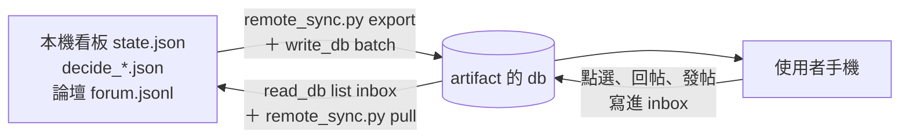

<!-- 手機遠端看板（claude.ai artifact）怎麼推快照、怎麼把使用者的回答與回帖拉回本機。 -->
# 手機遠端看板

使用者出門只能用手機時看的界面：https://claude.ai/artifact/8F7Snk7hXkavpFuCjfTboE （只有使用者本人能開）。頁面原始檔是同層 `remote.html`，三個分頁：進度、待你裁、論壇。



**本機是唯一的源頭，artifact 只是界面。** artifact 頁連不到本機（CSP 擋所有對外連線，localhost 也擋），兩邊只靠 artifact 的 db 中轉；能讀寫那個 db 的只有帶 Artifact 工具的 Claude（頂層或 forum 線隊長），codex 與腳本都碰不到。

## 推（本機 → 手機）

```sh
python3 wf/tools/progress_board/remote_sync.py export <暫存資料夾>
```

印出 `writes_file`；把裡面每一組（最多 50 筆）原樣當 `Artifact write_db` 的 `db_op: batch`、`writes` 送出，`url` 用上面那個。什麼時候推：使用者說要看、各線有新 ask／代定／帖子、或拉回之後（讓已處理的回答從頁上消失）。

<details><summary>推了什麼</summary>

| db 文件 | 內容 |
|---|---|
| `snap/board` | 各線一句話現況（看板 `state.json`）、近 36 小時的代定、卡住、匯總 `summary/latest.md` 全文與一句話總覽 |
| `snap/asks` | 看板上還沒答的 ask，加上所有 `decide_*.json` 裡 `answer_state` 為空／`missing`／`pending` 的題（id 寫成 `decide:<batch>:<題號>`） |
| `snap/forum` | 帖子列表（沒有內文），加上 `synced_inbox`：已拉回本機的 inbox 文件 id，頁面據此不再顯示「等頂層拉回」 |
| `posts/<id>` | 每帖全文與回帖；軟刪的帖子在 db 直接刪掉 |

</details>

## 拉（手機 → 本機）

使用者在對話裡說「我在手機看板答了／回了」時，頂層做兩步：

1. `Artifact read_db`：`url` 同上、`db_op: list`、`collection: inbox`、`out_dir: <暫存資料夾>`（檔案會落在 `<暫存資料夾>/inbox/*.json`）。
2. `python3 wf/tools/progress_board/remote_sync.py pull <暫存資料夾>`（先加 `--dry-run` 看一眼也行）。

然後再推一次。

<details><summary>拉回寫到哪</summary>

- 看板 ask 的回答 → 追加到 `~/Desktop/aos-進度/data/answers.jsonl`（跟看板網頁送出的一樣格式，多一個 `via: artifact`；`progress_answers.sh` 照常讀得到）。
- decide-page 的題 → 每批寫一個回覆行檔 `<暫存資料夾>/decide_<batch>.txt`（decide-page 回覆格式），腳本印出接著要跑的 `decide_page.py parse … ` 指令，確認後 `apply`、`land`，照 [decide-page](../../../workflows/decide-page.md) 流程落回各線。
- 回帖、發帖 → 追加到論壇 `~/Desktop/aos-進度/data/forum/forum.jsonl`，作者 `user`。
- 處理過的 inbox 文件 id 記在 `~/Desktop/aos-進度/data/remote_seen.json`，重拉不會重複寫；inbox 文件本身留在 db 不刪（使用者的原始紀錄）。

</details>

<details><summary>db 規則</summary>

整個 db 只有 owner（使用者本人）能寫、誰能開頁誰能讀；Claude 的 `write_db` 也是以使用者身分寫。頁面只寫 `inbox` 集合（`kind` 為 `answer`／`reply`／`post`，加 `target`、`choice`、`comment`、`body`、`title`、`ts`），其餘集合只讀。

</details>
