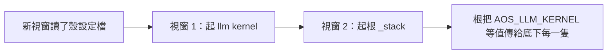
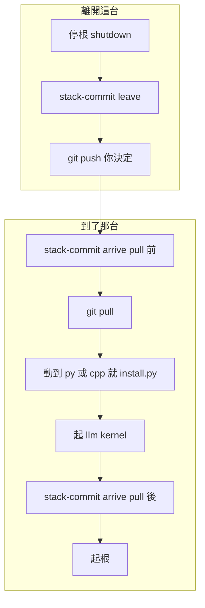

換機說明書：每台要有什麼、`.zshrc`／`.bashrc` 怎麼寫、怎麼起 llm kernel 與 `_stack` 的根、換台時離站與到站的完整順序、常見錯誤怎麼看怎麼救。給使用者看，也給 agent 照做。

# 03 換機

← [回入口](../dev-env.md)｜上一份：[02-模型端點](02-模型端點.md)｜根定義：[wf/tree](../../tree/README.md)｜換機工具：`wf/tools/stack-commit`（用法在 `wf/tools/stack_commit.py` 檔頭）｜規劃：[02-規劃 線 9](../../../proto8/thinking/2026-11/22/工作區與stack-1122/02-規劃.md#線-9換機說明書)

## 先講結論

- **aos 的樹現在住在 repo 裡的 `~/repo/aos/_stack`**（stack＝daemon 存狀態的資料夾，像一本帳），跟著 git 在兩台之間搬。同一時間只有一台在跑。
- **llm kernel 每台自己跑一台，不跟著搬**（llm kernel＝替 agent 排隊問模型的那台 daemon）。預設定義 `~/aos-home/llm`、stack `~/aos-home/.llm-stack`。
- **殼設定檔只要寫一段**：設 `AOS_HOME`、source `env.sh`，**之後**再 export `AOS_DAEMON`、`AOS_LLM_KERNEL`；整段包在「不在 agent 的殼裡」的判斷裡。範例在下面，照抄就好。
- **每次起樹**：先起 llm kernel，再起根，各佔一個 tmux 視窗。
- **換台**：離開＝停根 → `stack-commit leave` → push。到了＝`stack-commit arrive` → `git pull` → 需要就 `install.py` → 起 llm kernel → 再跑一次 `arrive` → 起根。
- 前提：線 3（三個絕對路徑的修正）已經 commit、兩台都跑過 `install.py`。沒裝的話，換台後 eca-aos 會忘掉它的三個 subagent。

## 每台要有的三樣

| 什麼 | 放哪 | 跟著 `_stack` 走嗎 |
|---|---|---|
| repo | `~/repo/aos`，`AOS_HOME`＝它的 `proto8` | 走（git） |
| 這台的 llm kernel | 定義 `~/aos-home/llm`，stack `~/aos-home/.llm-stack` | 不走：端點寫的是這台的 `localhost` 服務 |
| 權限站（選用） | repo 外，例如 `~/.aos/perm/` | 不走；家機現在沒有，先不設 |

- **用量與預算不跟著換台**：llm kernel 的帳本留在各台自己的 stack 裡，換台後從那台的帳接著記。使用者 11-22：「額度就是使用者自己心裏有數就好，等以後規模大了才需要另外設計」。
- **兩台的端點名字要一樣**（例如 `sol`、`fake`），網址可以不同。agent-fsm 記的是名字，換到沒有這個名字的那台會停在 `EndpointUnknown`。
- 公司那台的 llm kernel 放哪還沒定（規劃題 4）。下面一律寫預設 `~/aos-home/llm`；那台放別處的話，只改範例裡 `AOS_LLM_KERNEL` 那行和起 llm kernel 那行的兩個路徑。
- 第一次在某台建 llm kernel：從家機那份或 `proto8/templates/kernel/llm-kernel` 抄，用 `rsync -a --exclude='*.bak-*' 來源/ ~/aos-home/llm/`（家機那夾有三份 `.bak-*` 舊設定，`cp -r` 會一起抄過去）。抄完照那台的服務改 `kernel.json` 的網址，名字不改。

## 殼設定檔怎麼寫

家機用 zsh（`~/.zshrc`），公司 WSL 用 bash（`~/.bashrc`），**兩邊寫法一樣**，貼同一段：

```sh
# aos: skip inside an agent's shell (it carries AOS_STACK; the daemon gives it its own values)
if [[ -z $AOS_STACK ]]; then
  export AOS_HOME="$HOME/repo/aos/proto8"
  source "$AOS_HOME/env.sh"        # clears every AOS_* but AOS_HOME: the exports below must come after it
  export AOS_DAEMON="$HOME/repo/aos/_stack"
  export AOS_LLM_KERNEL="$HOME/aos-home/.llm-stack"
  # export AOS_KERNEL="$HOME/.aos/perm/stack/requests"   # only while a permission station is really running
fi
```

三個要點，各一句：

1. **export 一定寫在 `source env.sh` 後面。** `env.sh` 會把 `AOS_HOME` 以外的 `AOS_*` 全部清掉（這是為了不讓 agent 的值漏到人的視窗），寫在前面就白寫了。
2. **整段包在 `[[ -z $AOS_STACK ]]` 裡面。** agent 的殼（例如 Claude Code 的 Bash 工具）也會讀你的殼設定檔；它帶著 `AOS_STACK`，判斷不成立就跳過。寫在外面的話，暫存樹裡的 agent 會被改成指向真的 `_stack`，等於去踩正在跑的樹。
3. **`AOS_KERNEL` 平常不要打開。** 打開了卻沒有權限站在跑，底下每一隻收信、寄信、設計時器都會在 3 秒後失敗（`KernelFailed`）。

放哪一行：

- 家機：把 `~/.zshrc` 裡原本那行 `[[ -z $AOS_STACK ]] && export AOS_HOME=… && … source ~/aos-home/env.sh` 整行換成上面這段（舊的 `~/aos-home/env.sh` 搬家後就不在了）。
- 公司 WSL：Ubuntu 的 `~/.bashrc` 開頭有一段「不是互動殼就 `return`」，把這段放在那段之後，放檔尾最省事。原本 source 舊樹 `env.sh` 的那一行要拿掉，或移到這段前面；留在這段後面的話，它會再清一次，把 `AOS_DAEMON`、`AOS_LLM_KERNEL` 清掉。
- 改完開一個**新的**終端機視窗才生效（已經開著的視窗可以 `source ~/.zshrc`／`source ~/.bashrc`）。VS Code 的終端機分頁一樣要開新的；VS Code 本身與它的擴充套件拿到的是 VS Code 啟動那一刻的環境，要重開 VS Code 視窗才換新值。
- 改了 `AOS_LLM_KERNEL`、開關權限站之後，**要停根再從新視窗起根**，agent 才拿到新值（agent 的值是起根那一刻那個殼給的）。

<details><summary>不 source <code>env.sh</code> 的寫法（export 順序就沒差）</summary>

`env.sh` 做的事只有：查 `AOS_HOME` 對不對、清 `AOS_*`、把 `$AOS_HOME/bin`（和有的話 `$AOS_HOME/frontend/bin`）放進 `PATH` 最前面。不想要它清，就自己放 `PATH`，跟 `proto8/cpp/aos-daemon/examples/root/` 的 systemd、s6 範例一樣：

```sh
if [[ -z $AOS_STACK ]]; then
  export AOS_HOME="$HOME/repo/aos/proto8"
  export PATH="$AOS_HOME/bin:$PATH"
  [[ -d $AOS_HOME/frontend/bin ]] && export PATH="$AOS_HOME/frontend/bin:$PATH"
  export AOS_DAEMON="$HOME/repo/aos/_stack"
  export AOS_LLM_KERNEL="$HOME/aos-home/.llm-stack"
fi
```

代價：少了 `env.sh` 的兩道保護——`AOS_HOME` 指錯時它會講、`aos-exec` 還沒裝時它會提醒 `install.py`。`env.sh` 也會拿掉 `CLAUDECODE` 這類 Claude Code 的變數，這種寫法不拿。

</details>

<details><summary>選用：把起樹的兩行包成殼函式</summary>

放在同一段 `if` 裡面，之後在任何視窗打 `aos-llm-up`、`aos-root-up` 就好。名字自己取，別跟 `aos-llm` 這類現有指令撞名。

```sh
  aos-llm-up()  { env -u AOS_DAEMON -u AOS_KERNEL -u AOS_STACK -u AOS_CLOCK aos-exec --stack "$HOME/aos-home/.llm-stack" "$HOME/aos-home/llm"; }
  aos-root-up() { (cd "$HOME/repo/aos" && env -u AOS_DAEMON -u AOS_STACK -u AOS_CLOCK aos-exec --stack _stack wf/tree/root); }
```

</details>

## 起樹：先 llm kernel，再根

兩個都在前台跑，各開一個 tmux 視窗（VS Code 的終端機分頁也行，但關掉 VS Code 它們就跟著停；tmux 不會）。



**視窗 1，llm kernel：**

```sh
env -u AOS_DAEMON -u AOS_KERNEL -u AOS_STACK -u AOS_CLOCK aos-exec --stack ~/aos-home/.llm-stack ~/aos-home/llm
```

- 拿掉 `AOS_DAEMON`：不然它會把 `_stack` 記成自己的上一層。拿掉 `AOS_KERNEL`：不然它每次問模型的工作會繞去權限站、再被送到 `_stack` 的表上跑。
- **一定帶 `--stack ~/aos-home/.llm-stack`。** 不帶的話 stack 會落在 `~/aos-home/.stack`，跟 `AOS_LLM_KERNEL` 對不上，agent 的信寄到沒人收的地方，只會一直等。
- **要叫真模型，`LITELLM_KEY` 在這個視窗 export**，根那邊不用。好處是金鑰不會傳到每一隻 agent 身上。
- **同一份 `~/aos-home/llm` 同時只起一台。** 兩台會各自以為 LM Studio 那一格是自己的，同時往裡送。
- 第一次起時 `~/aos-home/.llm-stack` 會自己建。停它：`aos-daemon-ctl -d ~/aos-home/.llm-stack shutdown`。換台時它不用停。

**視窗 2，根：**

```sh
cd ~/repo/aos && env -u AOS_DAEMON -u AOS_STACK -u AOS_CLOCK aos-exec --stack _stack wf/tree/root
```

- 這行**故意留著** `AOS_LLM_KERNEL`、`AOS_KERNEL`，讓根傳給底下每一隻；`AOS_HOME` 也要在。
- 表上只有 `_clock`（時鐘）、`_sweeper`（清道夫）兩列，agent 掛上去之後才會多。
- 停它：`aos-daemon-ctl -d ~/repo/aos/_stack shutdown`（殼裡有 `AOS_DAEMON` 時可以省掉 `-d`）。

## 換台



**離開這台：**

1. 讓 agent 手上的事收尾、該交件的交件。**還沒交件的檔不會跟著換台**；任何 `temp/` 裡的東西本來就不跟著走。停根會打斷正在答的那一輪，那封信不會重答。
2. 停根：`aos-daemon-ctl -d ~/repo/aos/_stack shutdown`。llm kernel 不用停。
3. `~/repo/aos/wf/tools/stack-commit leave`。它會：
   - 確認沒有 daemon 握著 `_stack`，有就拒絕；
   - `_stack` 以外有沒交件的檔就列出來、拒絕（`DirtyOutside`）。確定不帶走就加 `--leave-dirty`；
   - llm kernel 那邊還有 `_stack` 寄的、沒回的信就拒絕（`LlmLetters`）。讓 llm kernel 開著答完再跑一次；不等就加 `--ignore-llm`，但之後到的回信會讓這台的 `_stack` 又變髒；
   - 只挑該帶走的檔，掃一遍金鑰樣式，命中就停（`SecretFound`，只印檔名與行號）。看過確定沒事的檔用 `--secret-ok 檔` 放行；
   - 交一個 commit，不 push。想先看會交什麼就加 `--dry-run`。
4. `git push`：**要不要推由你決定**。推上去的內容有 agent 的對話紀錄與信，推了就收不回來。
5. `leave` 完不是馬上換台、想在這台接著用，可以再起根（llm kernel 一直開著）。但那之後要換台，就得重做一次停根、`leave`、push。另一台只能在這之後 pull。

**到了那台：**

1. 開一個新視窗（殼設定檔要先照上面改好）。
2. `~/repo/aos/wf/tools/stack-commit arrive`（**pull 之前**）。這台離開後又跑過，它會停下來列出差異（`StackDirty`），讓你決定留哪一邊。它不替你選。必須在 pull 前跑，因為 `git pull` 會默默蓋掉 `_stack` 裡同名的被忽略檔。
3. `git -C ~/repo/aos pull`。只用普通的 pull，**不加 `--rebase`、`--autostash`**。
4. 動到 `proto8/py`、`proto8/cpp` 就 `python3 ~/repo/aos/proto8/install.py`（第 6 步的 `arrive` 也會提醒）。不裝的話，會用舊程式讀新程式寫的 stack。
5. 起 llm kernel（上一節視窗 1）。這台的已經在跑就跳過。
6. `~/repo/aos/wf/tools/stack-commit arrive`（**pull 之後**）。它清掉這台上次留下的執行期檔（鎖、冷卻時間、端點快取…），查殼裡的 `AOS_HOME`、`AOS_DAEMON`、`AOS_LLM_KERNEL`（ping 得到嗎）、`AOS_KERNEL`，最後印出起根那一行。查出來的問題只印、不停，自己看一眼。
7. 起根（上一節視窗 2）。

只是想看看現在的狀態：`stack-commit status`。它只看不改，會列出「只在這台、還沒交」的 `_stack` 檔。

**`_stack` 進過 git 之後，這個 repo 裡別跑這幾個**：`git stash`、`git reset --hard`、`git checkout -- .`、`git clean -fdx`、`git pull --autostash`、`git pull --rebase`。前四個會把正在跑的樹倒回上次換機 commit 的樣子，或刪掉還沒 commit 的部分。`git clean -fdx` 會刪光還沒 commit 過的 `_stack`。rebase 那類則是一遇到髒的追蹤檔就拒絕。`git status` 永遠是髒的，這是正常的；commit 只交自己改的檔。

## 核對

```sh
echo "$AOS_HOME | $AOS_DAEMON | $AOS_LLM_KERNEL | $AOS_KERNEL"
aos-daemon-ctl -d ~/aos-home/.llm-stack ping     # llm kernel: "replied in N ms"
aos-daemon-ctl ping                              # the root of _stack (from AOS_DAEMON)
aos-daemon-ctl ls                                # every row running; REASON tells why one is not
```

- 第一行：前三個有值，`AOS_KERNEL` 沒開權限站就是空的。
- 問 agent 一句：`aos-agent -t <名> ask '…'`。eca-aos 的 subagent：在它的對話裡用 `subagent ls`，要看到三隻都在。
- 到站那台第一次開畫面（`aos-agent open`）時，畫面用的是開畫面那個殼的值，因為記值的 `claude/env.json` 不進 git。所以那台的殼也要照上面設好。

## 常見錯誤怎麼看、怎麼救

| 看到什麼 | 多半是 | 怎麼救 |
|---|---|---|
| `echo $AOS_DAEMON` 是空的 | export 寫在 `source env.sh` 前面被清掉；或公司那台舊的 source 那行在這段後面又清了一次 | 照範例調順序，開新視窗 |
| `command not found: aos-exec` | `env.sh` 沒 source 到：舊那行還指著已搬走的 `~/aos-home/env.sh`；或 `install.py` 還沒跑 | 換成範例那段；`python3 ~/repo/aos/proto8/install.py` |
| agent-fsm 表上變 `stopped`，原因只寫 `RunFailed … not restarting again` | 起根的殼沒 export `AOS_LLM_KERNEL`。代號 `LlmKernelMissing` 只在那隻的 `_stack/procs/<名>/stderr.txt`；`aos-agent ask` 會說「它睡著了」，容易看錯 | 補 export、停根、從新視窗起根，再 `aos-agent -d ~/repo/aos/_stack ctl start <名>`。它不會自己醒；醒了之後，排隊的問題照樣會答 |
| agent-fsm 一直在等、不回 | llm kernel 沒開（機器重開、視窗關了）；或起它時忘了 `--stack`，信寄到沒人收的 `.llm-stack` | `aos-daemon-ctl -d ~/aos-home/.llm-stack ping`；不通就照上面起；多出來的 `~/aos-home/.stack` 那台先 `shutdown` |
| agent-fsm 停在 `EndpointUnknown` | 這台 llm kernel 的端點名字跟另一台不一樣 | 在這台的 `kernel.json` 補同名端點（網址照這台），`start` 那隻 |
| 每一隻收信寄信都 `KernelFailed` | 殼裡打開了 `AOS_KERNEL`，權限站卻沒在跑 | 註解掉那行，停根、從新視窗起根；或把站起來 |
| 改了 export，agent 拿到的還是舊值 | 只開了新視窗或重開畫面，根沒重起 | 停根，從新視窗起根 |
| 暫存樹裡的 agent 下的指令打到真的 `_stack` | export 寫在 `[[ -z $AOS_STACK ]]` 外面 | 移進判斷裡 |
| 起 llm kernel 時直接打 `aos-exec …`，沒用 `env -u …` 那行 | 它把 `_stack` 記成自己的上一層；殼裡有 `AOS_KERNEL` 的話，問模型的工作還會繞去權限站，再被送到 `_stack` 的表上跑 | `aos-daemon-ctl -d ~/aos-home/.llm-stack shutdown`，照上面那行重起 |
| `arrive` 說 `StackDirty` | 這台離開後又起過根，或上次沒做 `leave` | 決定留哪一邊：留這台就在這台 `leave`，再處理另一台；留 HEAD 就把那些檔手動放回或移走 |
| `git pull` 整個被拒、說 `_stack` 的檔會被蓋掉 | 兩台都跑過（同一份 `_stack` 兩邊都改了） | 先別硬蓋；`stack-commit status` 看差什麼，決定留哪一邊 |
| `leave` 說 `DirtyOutside` | `_stack` 以外有沒交件的檔 | 先交件；確定不帶走就加 `--leave-dirty` |
| `leave` 說 `LlmLetters` | llm kernel 還有 `_stack` 寄的信沒回 | llm kernel 開著等它答完再跑；不等加 `--ignore-llm` |
| `leave` 說 `SecretFound` | 會帶走的檔裡有像金鑰的字 | 打開那幾行看；真的是金鑰就別交，處理掉再跑；沒事就 `--secret-ok 檔` |
| 換台後 eca-aos 忘了它的 subagent | 線 3 還沒裝到這台 | 這台 `install.py`，再照搬家步驟重掛 |
| `~/aos-home` 多出一個 `start-api/` | 照 `install.py` 最後印的下一步、或起手範本的說明抄進來 | 這台的 `~/aos-home` 只裝 llm kernel；起手範本抄到別處 |

## 選用：權限站

家機現在沒有，這段等要開時再看。

- 放 repo 外，例如 `~/.aos/perm/`。抄 `proto8/templates/kernel/daemon-kernel/`，當成一台獨立的 daemon 起。
- `kernel.json` 一定要寫 `next`（＝`~/repo/aos/_stack/procs_requests`，`_stack` 根的收件夾）與 `count_daemon`（＝`~/repo/aos/_stack`）。不寫的話，它會把放行的請求轉給它自己那台，agent 就被起在權限站那邊，數量上限也數錯表。
- 範本 `allowed` 名單裡的是測試用的名字，照實改。
- 站起來之後，才打開殼設定檔裡那行 `AOS_KERNEL=<它的 stack>/requests`，然後停根、從新視窗起根。

## 這台的 `~/aos-home` 是什麼

只裝這台的 llm kernel（`llm/` 定義、`.llm-stack/` 它的 stack），**不是 aos 的樹**，不要在那裡起根或放別的東西。家機舊的那棵樹搬家後在 `~/aos-home.old-1122/`，只是退路，不在那裡起東西（它的相對路徑已經指不到 `llm/` 了）；要退回舊樹就照 [規劃線 6 的退路](../../../proto8/thinking/2026-11/22/工作區與stack-1122/02-規劃.md#線-6家機搬家使用者在場) 整批搬回去。公司那台的 `~/aos-home` 是使用者說「別管」的舊樹，那台的 llm kernel 放哪見上面「每台要有的三樣」。

## 出處

- 使用者 11-22：「1.這塊就是精心設計.zshrc,.bashrc的事情，linux使用者都會的，只要說明書寫好。2.這個沒差，額度就是使用者自己心裏有數就好，等以後規模大了才需要另外設計」；決定與調查見 [01-決定與調查](../../../proto8/thinking/2026-11/22/工作區與stack-1122/01-決定與調查.md)。
- `env.sh` 清 `AOS_*`：`proto8/env.sh`；`.env` 不蓋殼裡已有的值：`proto8/cpp/aos-exec/src/env/dotenv.cpp`；llm kernel 照 `AOS_KERNEL` 送工作：`proto8/knowledge/aos/cli/parts/llm_kernel.md`；權限站的 `next`、`count_daemon`：`proto8/knowledge/aos/kernel.md`、`proto8/templates/kernel/README.md`。
- 邊緣狀況的編號與原因：[02-規劃「邊緣狀況」](../../../proto8/thinking/2026-11/22/工作區與stack-1122/02-規劃.md#邊緣狀況規劃員挖到輸入檔沒寫的)（16、18～25、34～39 寫進了上面的表）。
