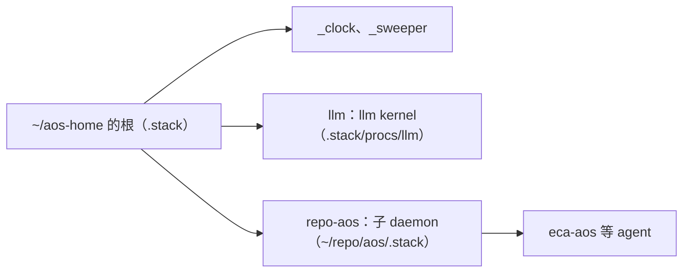

每台設定說明書：每台要有什麼、`.zshrc`／`.bashrc` 怎麼寫、怎麼起樹（`~/aos-home` 的根，底下掛 llm kernel 與 repo 那棵）、家機怎麼改成同一套、從舊名 `_stack` 改過來、核對、常見錯誤怎麼看怎麼救。給使用者看，也給 agent 照做。

# 03 每台怎麼設、怎麼起樹

← [回入口](../dev-env.md)｜上一份：[02-模型端點](02-模型端點.md)｜根定義：[wf/tree](../../tree/README.md)｜規劃（11-22，換機那部分 11-23 起不用）：[02-規劃](../../../proto8/thinking/2026-11/22/工作區與stack-1122/02-規劃.md)

## 先講結論

- **每台一棵樹，根在 `~/aos-home`**（根定義 `~/aos-home/root/`，stack `~/aos-home/.stack`；stack＝daemon 存狀態的資料夾，像一本帳）。它的表上有兩列：
  - `llm`：這台的 llm kernel（替 agent 排隊問模型的那台 daemon）。定義 `~/aos-home/llm`，stack `~/aos-home/.stack/procs/llm`，所以 **`AOS_LLM_KERNEL=~/aos-home/.stack/procs/llm`**。
  - `repo-aos`：repo 那棵樹，是一台**子 daemon**。定義 `~/repo/aos/wf/tree/root`（git 追蹤、兩台共用、沒改），stack 照舊是 `~/repo/aos/.stack`（eca-aos 等 agent 都在它的表上）。這一列自己帶環境值 `AOS_LLM_KERNEL`，公司那台另帶 `CLAUDE_CONFIG_DIR="$HOME/.claude-alt"`。
  - `~/aos-home` 的根與 llm kernel 用普通設定檔（不帶 `CLAUDE_CONFIG_DIR`）。
  - 使用者 11-23：「應該說，我預期會有兩棵樹，一棵是這台的，在~/aos-home，底下掛著llm kernel。另一棵是repo aos的，啟動的時候會是CLAUDE_CONFIG_DIR=alt AOS_LLM_KERNEL=...」，稍後又說：「家機那塊確實也要變成~/aos-home一套，底下是llm_kernel，不過repo aos這個樹會變成~/aos-home底下的一個proc。這台WSL也可以這樣嗎？」——可以，公司那台 11-23 照這樣建好、試起過（線 two-trees-1123）。
- **起樹只要一行**：起 `~/aos-home` 的根，llm kernel 與 repo 那棵跟著起；停也只要一行。
- **`~/repo/aos/.stack` 被 git 忽略、每台各有各的、不跟著 git 搬**。兩台可以同時各跑各的樹，互不相干。
  - 使用者 11-23：「Hmmm，我要把_stack改為.stack，因為我發現，把stack一起隨機器搬遷，不是一個好主意。這塊之後我會細說。」「就是說，直接變成.stack，然後把它git ignore，就這樣。換機那一套就不用了。」
  - 跟著 git 走的只有 repo 裡的檔：根定義 `wf/tree/root`、各 agent 的私有地盤 `wf/ws/…`、文件與程式。agent 的對話、信箱、狀態留在那台。`~/aos-home` 整夾不在 git 裡。
- **殼設定檔只要寫一段**：設 `AOS_HOME`、source `env.sh`，**之後**再 export `AOS_DAEMON`（＝`~/repo/aos/.stack`，人平常下指令的對象是 repo 那棵）、`AOS_LLM_KERNEL`；整段包在「不在 agent 的殼裡」的判斷裡。範例在下面，照抄就好。
- **家機還是舊樣子**（11-23）：llm kernel 自己一台（`~/aos-home/.llm-stack`）、repo 那棵另外起。方向已定要改成同一套，步驟在下面「家機照做」。

## 每台要有的三樣

| 什麼 | 放哪 |
|---|---|
| repo | `~/repo/aos`，`AOS_HOME`＝它的 `proto8`；repo 那棵的 stack 是裡面的 `.stack`（被 git 忽略） |
| `~/aos-home` | `root/`（根定義，抄自 `proto8/templates/start-api/root`＝範本 `daemon-root` 加一行 `AOS_LLM_KERNEL=${AOS_STACK}/procs/llm`）、`llm/`（llm kernel 定義，端點寫的是這台的 `localhost` 服務）、`.stack/`（根的 stack，起了才有） |
| 權限站（選用） | repo 外，例如 `~/.aos/perm/`；兩台現在都沒有，先不設 |

- **用量與預算各台各記**：llm kernel 的帳本在 `~/aos-home/.stack/procs/llm/`。使用者 11-22：「額度就是使用者自己心裏有數就好，等以後規模大了才需要另外設計」。
- **定義跟著 git 走、llm kernel 不走**：`wf/` 裡的定義寫了某個端點名字（例如 `sol`、`fake`），這台的 llm kernel 就要有同名的端點（網址照這台），不然 agent-fsm 會停在 `EndpointUnknown`。
- **公司那台用另一個 Claude 帳號（`~/.claude-alt`）**：寫在 `repo-aos` 那一列的環境值裡（掛的時候 `--envs CLAUDE_CONFIG_DIR=…`），子 daemon 會傳給底下每一隻。`~/aos-home` 的根與 llm kernel 沒有它。開畫面用的是開畫面那個殼的值，所以開畫面那一行也要帶：`CLAUDE_CONFIG_DIR="$HOME/.claude-alt" aos-agent -t eca-aos open`；不帶會用主帳號，而且原本那段對話會斷。範本 `eca-claude-alt`（定義自己帶帳號；說明 [eca-claude-alt](../../../proto8/templates/eca-claude-alt/README.md)）留著可選，不是預設。出處：使用者 11-23 先說「後續掛agent都用那個」，稍後改說「啊不，其實還是用環境變數起活樹，會更靈活。」以後者為準。**不要把 `CLAUDE_CONFIG_DIR` 寫進殼設定檔**（會連主帳號的日常使用一起換掉）。
- 第一次在某台建 llm kernel：從另一台那份或 `proto8/templates/kernel/llm-kernel` 抄，用 `rsync -a --exclude='*.bak-*' 來源/ ~/aos-home/llm/`（家機那夾有三份 `.bak-*` 舊設定，`cp -r` 會一起抄過去）。抄完照那台的服務改 `kernel.json` 的網址，名字不改。公司那台的 `llm/` 是 11-23 從範本抄的，多一包端點 `sol-high`。

## 殼設定檔怎麼寫

兩台都用 zsh（`~/.zshrc`）。公司那台的 `~/.bashrc` 也放同一段（在 zsh 裡套 bash 跑東西時用得到）。**寫法一樣**，貼同一段：

```sh
# aos: skip inside an agent's shell (it carries AOS_STACK; the daemon gives it its own values)
if [[ -z $AOS_STACK ]]; then
  export AOS_HOME="$HOME/repo/aos/proto8"
  source "$AOS_HOME/env.sh"        # clears every AOS_* but AOS_HOME: the exports below must come after it
  export AOS_DAEMON="$HOME/repo/aos/.stack"
  export AOS_LLM_KERNEL="$HOME/aos-home/.stack/procs/llm"   # llm kernel = row "llm" under the ~/aos-home root (11-23)
  # export AOS_KERNEL="$HOME/.aos/perm/stack/requests"   # only while a permission station is really running
fi
```

三個要點，各一句：

1. **export 一定寫在 `source env.sh` 後面。** `env.sh` 會把 `AOS_HOME` 以外的 `AOS_*` 全部清掉（這是為了不讓 agent 的值漏到人的視窗），寫在前面就白寫了。
2. **整段包在 `[[ -z $AOS_STACK ]]` 裡面。** agent 的殼（例如 Claude Code 的 Bash 工具）也會讀你的殼設定檔；它帶著 `AOS_STACK`，判斷不成立就跳過。寫在外面的話，暫存樹裡的 agent 會被改成指向真的 `.stack`，等於去踩正在跑的樹。
3. **`AOS_KERNEL` 平常不要打開。** 打開了卻沒有權限站在跑，底下每一隻收信、寄信、設計時器都會在 3 秒後失敗（`KernelFailed`）。

放哪一行：

- 放檔尾最省事。原本 source 舊樹 `env.sh` 的那一行（例如 `~/aos-home/env.sh`）要拿掉，或移到這段前面；留在這段後面的話，它會再清一次，把 `AOS_DAEMON`、`AOS_LLM_KERNEL` 清掉。
- `~/.bashrc`：Ubuntu 的開頭有一段「不是互動殼就 `return`」，這段要放在那段之後。
- 改完開一個**新的**終端機視窗才生效（已經開著的視窗可以 `source ~/.zshrc`）。VS Code 的終端機分頁一樣要開新的；VS Code 本身與它的擴充套件拿到的是 VS Code 啟動那一刻的環境，要重開 VS Code 視窗才換新值。
- 殼裡的 `AOS_LLM_KERNEL` 現在只給人自己下的指令用（例如 `aos-llm ask`）。樹裡的 agent 拿到的值不看殼：`~/aos-home` 的根從 `root/.env` 拿，repo 那棵從 `repo-aos` 那一列的環境值拿。

<details><summary>不 source <code>env.sh</code> 的寫法（export 順序就沒差）</summary>

`env.sh` 做的事只有：查 `AOS_HOME` 對不對、清 `AOS_*`、把 `$AOS_HOME/bin`（和有的話 `$AOS_HOME/frontend/bin`）放進 `PATH` 最前面。不想要它清，就自己放 `PATH`，跟 `proto8/cpp/aos-daemon/examples/root/` 的 systemd、s6 範例一樣：

```sh
if [[ -z $AOS_STACK ]]; then
  export AOS_HOME="$HOME/repo/aos/proto8"
  export PATH="$AOS_HOME/bin:$PATH"
  [[ -d $AOS_HOME/frontend/bin ]] && export PATH="$AOS_HOME/frontend/bin:$PATH"
  export AOS_DAEMON="$HOME/repo/aos/.stack"
  export AOS_LLM_KERNEL="$HOME/aos-home/.stack/procs/llm"
fi
```

代價：少了 `env.sh` 的兩道保護——`AOS_HOME` 指錯時它會講、`aos-exec` 還沒裝時它會提醒 `install.py`。`env.sh` 也會拿掉 `CLAUDECODE` 這類 Claude Code 的變數，這種寫法不拿。

</details>

<details><summary>選用：把起樹那一行包成殼函式</summary>

放在同一段 `if` 裡面，之後在任何視窗打 `aos-up` 就好。名字自己取，別跟現有指令撞名。

```sh
  aos-up() { (cd "$HOME/aos-home" && env -u AOS_DAEMON -u AOS_STACK -u AOS_CLOCK -u AOS_KERNEL -u AOS_LLM_KERNEL aos-exec --stack .stack root); }
```

</details>

## 起樹、停樹

在前台跑，開一個 tmux 視窗（VS Code 的終端機分頁也行，但關掉 VS Code 它就跟著停；tmux 不會）。



**起（每次）：**

```sh
cd ~/aos-home && env -u AOS_DAEMON -u AOS_STACK -u AOS_CLOCK -u AOS_KERNEL -u AOS_LLM_KERNEL aos-exec --stack .stack root
```

- 拿掉 `AOS_DAEMON`：殼裡那個值指 repo 那棵，留著的話根會以為自己是那台的下屬。拿掉 `AOS_KERNEL`：不然 llm kernel 問模型的工作會繞去權限站。拿掉 `AOS_LLM_KERNEL`：讓 `root/.env` 那行 `${AOS_STACK}/procs/llm` 生效（殼裡的值會蓋過 `.env`）。
- 睡下的 `llm`、`repo-aos` 會自己醒，`repo-aos` 醒了之後它表上的 eca-aos 等也跟著醒。
- **要叫真模型、需要金鑰（例如 `LITELLM_KEY`）的話，在這個視窗 export 再起**。代價：金鑰會傳到底下每一列，包括 repo 那棵的 agent（以前 llm kernel 自己一台時只在它的視窗）。

**停（一行全停）：**

```sh
aos-daemon-ctl -d ~/aos-home/.stack shutdown
pgrep -af aos-daemon        # 沒有輸出＝全停了
```

- **只停 repo 那棵**：`aos-daemon-ctl -d ~/aos-home/.stack stop repo-aos`，再起：`… start repo-aos`。**不要**用 `aos-daemon-ctl -d ~/repo/aos/.stack shutdown`（或殼裡有 `AOS_DAEMON` 時的 `aos-daemon-ctl shutdown`）：那一列是 `--auto-restart`，上面的根會馬上把它再起來（11-23 暫存樹實跑過，工具自己也會印一行 warning 提醒）。
- **開 eca-aos 的畫面**（公司那台）：`CLAUDE_CONFIG_DIR="$HOME/.claude-alt" aos-agent -t eca-aos open`。家機不帶 `CLAUDE_CONFIG_DIR`。

**第一次（每台只做一次）：把兩列掛上去。** 先照上面起根，另開一個視窗：

```sh
cd ~/aos-home && aos-daemon-ctl -d .stack add --auto-restart llm
aos-agent -d ~/aos-home/.stack ctl add --auto-restart -n repo-aos -w "$HOME/repo/aos" -s "$HOME/repo/aos/.stack" \
  --envs CLAUDE_CONFIG_DIR="$HOME/.claude-alt" --envs AOS_LLM_KERNEL="$HOME/aos-home/.stack/procs/llm" "$HOME/repo/aos/wf/tree/root"
```

- 家機那一行拿掉 `--envs CLAUDE_CONFIG_DIR=…`。
- `-s "$HOME/repo/aos/.stack"`＝沿用 repo 那棵現有的 stack，表上原本的 agent 都在；不帶 `-s` 會在 `~/aos-home/.stack/procs/repo-aos/` 開一份空的。
- 之前若在別的殼單獨起著 repo 那棵，先停它（`aos-daemon-ctl -d ~/repo/aos/.stack shutdown`），不然子 daemon 起不來（`DaemonExists`）。
- 這兩個環境值記在那一列（明文，存在 `~/aos-home/.stack/procs/repo-aos/exec.json`；不要放金鑰）。要改：`aos-agent -d ~/aos-home/.stack ctl rm repo-aos`（不刪 stack），再照上面 `add` 一次。

## 家機照做（從舊樣子改成同一套，做一次）

家機 11-23 的樣子：llm kernel 自己一台（定義 `~/aos-home/llm`、stack `~/aos-home/.llm-stack`），repo 那棵（`~/repo/aos/.stack`，eca-aos 與三個 subagent）另外起。

```sh
aos-daemon-ctl -d ~/repo/aos/.stack shutdown; aos-daemon-ctl -d ~/aos-home/.llm-stack shutdown
pgrep -af aos-daemon                                         # 沒有輸出才往下
ls ~/aos-home/root 2>/dev/null && echo "root/ 已經有了，先看是什麼"   # 應該不存在
cp -r ~/repo/aos/proto8/templates/start-api/root ~/aos-home/root
cp -p ~/.zshrc ~/.zshrc.bak-1123c
sed -i 's|aos-home/.llm-stack|aos-home/.stack/procs/llm|' ~/.zshrc   # AOS_LLM_KERNEL 改新路徑；diff ~/.zshrc.bak-1123c ~/.zshrc 看只改了那一行
```

然後開新視窗，照上一節「起」那一行起根，再照「第一次」掛兩列（`repo-aos` 那行拿掉 `CLAUDE_CONFIG_DIR`）。

- 舊的 `~/aos-home/.llm-stack/` 不再用（帳本從零記），確認新的能動之後可以刪。
- 三個 subagent 在 repo 那棵的表上，跟著 `repo-aos` 一起起，不用重掛。
- 家機要真模型的金鑰，現在在起 `~/aos-home` 根的那個視窗 export（見上面「起」的代價）。
- 家機改好後，repo 裡兩處還寫著家機舊的 llm kernel 位置，跟著改成 `aos-home/.stack/procs/llm`：`wf/workflows/dispatch/kits/gather/.env`（`${HOME}/aos-home/.llm-stack`）與 `kits/site.json` 的 `llm_kernel`。11-23 沒改，因為家機那時還是舊樣子。

## 從舊名 `_stack` 改過來（11-23 之前起過樹的那台，做一次）

表上記的是相對 stack 的路徑（`procs/<名>`、工作區 `..`），資料夾改名不用重掛 agent。

1. 停根：`aos-daemon-ctl -d ~/repo/aos/_stack shutdown`，用 `pgrep -af aos-daemon` 確認根和它底下的 agent 都收了。
2. 改名：`mv ~/repo/aos/_stack ~/repo/aos/.stack`（是改名，不是刪）。
3. `~/.zshrc`（有的話連 `~/.bashrc`）裡的 `AOS_DAEMON` 改成 `$HOME/repo/aos/.stack`。前端的 `~/.config/systemd/user/aos-frontend.service` 若寫著 `_stack` 也要改（範本 `proto8/frontend/systemd/aos-frontend.service` 已改），再 `systemctl --user daemon-reload` 並重起它。
4. 接著照上面「家機照做」改成 `~/aos-home` 一套。
5. 照下一節核對。agent 自己存的 `hookeds/*/event.json`、`claude/env.json` 裡還寫著舊路徑沒關係，下一次跑或起來就換成新的。

## 核對

```sh
echo "$AOS_HOME | $AOS_DAEMON | $AOS_LLM_KERNEL | $AOS_KERNEL"
aos-daemon-ctl -d ~/aos-home/.stack ls           # _clock, _sweeper, llm, repo-aos: all running
aos-daemon-ctl ls                                # repo tree (from AOS_DAEMON): _clock, _sweeper, eca-aos…; last line "supervisor …/aos-home/.stack/: running"
echo '{"endpoint":"fake","request":{"messages":[{"role":"user","content":"hi"}]}}' | aos-llm ask   # llm kernel: FAKE ANSWER to: hi
git -C ~/repo/aos status --short                 # .stack never shows up here
```

- 第一行：前三個有值，`AOS_LLM_KERNEL` 是 `…/aos-home/.stack/procs/llm`，`AOS_KERNEL` 沒開權限站就是空的。
- 問 agent 一句：`aos-agent -t <名> ask '…'`。eca-aos 的 subagent：在它的對話裡用 `subagent ls`。
- 看某一隻拿到的值（只看這兩個，不要印整份環境）：`tr '\0' '\n' < /proc/<pid>/environ | grep -E '^(CLAUDE_CONFIG_DIR|AOS_LLM_KERNEL)='`，pid 在 `ls` 的第三欄。公司那台 11-23 量到：eca-aos 與 repo 那台子 daemon 是 `CLAUDE_CONFIG_DIR=…/.claude-alt`、`AOS_LLM_KERNEL=…/aos-home/.stack/procs/llm`；`~/aos-home` 的根與 llm kernel 沒有 `CLAUDE_CONFIG_DIR`。
- 殼裡沒有 `AOS_DAEMON` 時，`aos-daemon-ctl`、`aos-mailbox`、清道夫會找呼叫當下 cwd 的 `./.stack`：站在 `~/repo/aos` 不帶 `-d` 下指令＝打到 repo 那棵；站在 `~/aos-home`＝打到上面的根。

## 常見錯誤怎麼看、怎麼救

| 看到什麼 | 多半是 | 怎麼救 |
|---|---|---|
| `echo $AOS_DAEMON` 是空的 | export 寫在 `source env.sh` 前面被清掉；或舊的 source 那行在這段後面又清了一次 | 照範例調順序，開新視窗 |
| `command not found: aos-exec` | `env.sh` 沒 source 到：舊那行還指著已搬走的 `~/aos-home/env.sh`；或 `install.py` 還沒跑 | 換成範例那段；`python3 ~/repo/aos/proto8/install.py` |
| 起根時 `DaemonExists` | 同一個 stack 已有一台在跑（例如之前照舊習慣單獨起了 repo 那棵） | `pgrep -af aos-daemon` 看是哪台；單獨起的那台 `aos-daemon-ctl -d ~/repo/aos/.stack shutdown`，再起 `~/aos-home` 的根 |
| `aos-daemon-ctl ls` 最後一行寫 `root daemon (no supervisor)` | repo 那棵被人照舊指令單獨起了，沒掛在 `~/aos-home` 底下（公司那台這樣起的話沒帶 alt 帳號） | 停它，起 `~/aos-home` 的根 |
| `aos-daemon-ctl shutdown` 停了 repo 那棵，它馬上又起來 | 它是 `~/aos-home` 根上 `--auto-restart` 的一列 | `aos-daemon-ctl -d ~/aos-home/.stack stop repo-aos`；或整棵 `aos-daemon-ctl -d ~/aos-home/.stack shutdown` |
| 起根後 `~/aos-home` 的表上只有 `_clock`、`_sweeper` | 這台還沒掛兩列（新的 `.stack`） | 照「第一次」那兩行 |
| agent-fsm 表上變 `stopped`，原因只寫 `RunFailed … not restarting again` | 牠沒拿到 `AOS_LLM_KERNEL`。代號 `LlmKernelMissing` 只在那隻的 `.stack/procs/<名>/stderr.txt`；`aos-agent ask` 會說「它睡著了」，容易看錯 | 看 `repo-aos` 那一列有沒有帶 `--envs AOS_LLM_KERNEL=…`（沒有就 rm 再 add），再 `aos-agent -d ~/repo/aos/.stack ctl start <名>`。它不會自己醒；醒了之後，排隊的問題照樣會答 |
| agent-fsm 一直在等、不回 | `llm` 那一列沒在跑；或 `AOS_LLM_KERNEL` 指到舊的 `~/aos-home/.llm-stack`（沒人收） | `aos-daemon-ctl -d ~/aos-home/.stack ls` 看 `llm`；看那隻拿到的值（見「核對」） |
| agent-fsm 停在 `EndpointUnknown` | 定義寫的端點名字，這台的 llm kernel 沒有 | 在這台的 `kernel.json` 補同名端點（網址照這台），`start` 那隻 |
| 每一隻收信寄信都 `KernelFailed` | 殼裡打開了 `AOS_KERNEL`，權限站卻沒在跑，起根時又沒拿掉 | 註解掉那行，照「起」那一行（有 `-u AOS_KERNEL`）重起；或把站起來 |
| 開了 eca-aos 的畫面，用的卻是主帳號 | 開畫面那一行沒帶 `CLAUDE_CONFIG_DIR` | 關掉畫面，用 `CLAUDE_CONFIG_DIR="$HOME/.claude-alt" aos-agent -t eca-aos open` 重開 |
| 暫存樹裡的 agent 下的指令打到真的 `.stack` | export 寫在 `[[ -z $AOS_STACK ]]` 外面；或清掉 `AOS_*` 之後站在 `~/repo/aos` 不帶 `-d` 下指令（會找 `./.stack`） | 移進判斷裡；暫存樹的指令一律帶 `-d <暫存樹的 stack>`，或先 cd 到暫存夾 |
| `.stack` 整個不見了 | 有人在 repo 裡跑了 `git clean -fdx`（被忽略的檔也刪） | 收不回來；這個 repo 裡別跑 `git clean -fdx` |
| `~/aos-home` 多出一個 `start-api/` | 照 `install.py` 最後印的下一步、或起手範本的說明抄進來 | `~/aos-home` 只放 `root/`、`llm/`、`.stack/`；起手範本抄到別處 |

## 選用：權限站

兩台現在都沒有，這段等要開時再看。

- 放 repo 外，例如 `~/.aos/perm/`。抄 `proto8/templates/kernel/daemon-kernel/`，當成一台獨立的 daemon 起。
- `kernel.json` 一定要寫 `next`（＝`~/repo/aos/.stack/procs_requests`，repo 那棵的收件夾）與 `count_daemon`（＝`~/repo/aos/.stack`）。不寫的話，它會把放行的請求轉給它自己那台，agent 就被起在權限站那邊，數量上限也數錯表。
- 範本 `allowed` 名單裡的是測試用的名字，照實改。
- 站起來之後，把 `AOS_KERNEL=<它的 stack>/requests` 加進 `repo-aos` 那一列的環境值（`ctl rm repo-aos`，再 `add` 時多一個 `--envs AOS_KERNEL=…`）。殼設定檔裡那行打開也沒用：起根那一行會拿掉它（llm kernel 不該經站）。

## 這台的 `~/aos-home` 是什麼

**這台那棵樹的根**：`root/`（根定義）、`llm/`（llm kernel 定義）、`.stack/`（根的 stack；llm kernel 的在 `.stack/procs/llm/`）。repo 那棵掛在它底下，但 stack 留在 `~/repo/aos/.stack`。不要在 `~/aos-home` 放別的東西。

- **公司那台（11-23 起）**：就是這個樣子。另有一夾 `~/aos-home/.llm-stack/`：11-23 早上 llm kernel 自己一台時的 stack，只用 fake 問過一句，已不用，可以刪。
- **家機**：11-23 還是 llm kernel 自己一台（`~/aos-home/.llm-stack`），照上面「家機照做」改。家機舊的那棵樹 11-22 搬家後在 `~/aos-home.old-1122/`，只是退路，不在那裡起東西。

## 出處

- 使用者 11-23：「應該說，我預期會有兩棵樹，一棵是這台的，在~/aos-home，底下掛著llm kernel。另一棵是repo aos的，啟動的時候會是CLAUDE_CONFIG_DIR=alt AOS_LLM_KERNEL=...」「家機那塊確實也要變成~/aos-home一套，底下是llm_kernel，不過repo aos這個樹會變成~/aos-home底下的一個proc。這台WSL也可以這樣嗎？」；也說過「這台的llm kernel放~/aos-home/llm」「喔不過~/aos-home的這個root daemon仍然是用普通設定檔」。公司那台 11-23 照這樣建、先在暫存樹試通（子 daemon 沿用既有 stack、`--envs` 傳到孫輩、上層停起帶著子層、只停子層會被 auto-restart 再起）再動真的（線 two-trees-1123）。
- 使用者 11-23：「Hmmm，我要把_stack改為.stack，因為我發現，把stack一起隨機器搬遷，不是一個好主意。這塊之後我會細說。」「就是說，直接變成.stack，然後把它git ignore，就這樣。換機那一套就不用了。」（線 dot-stack-1123；11-22 的換台步驟與換機工具 `wf/tools/stack-commit` 從這天起退場，舊版本文見 git 歷史。）
- 使用者 11-22：「1.這塊就是精心設計.zshrc,.bashrc的事情，linux使用者都會的，只要說明書寫好。2.這個沒差，額度就是使用者自己心裏有數就好，等以後規模大了才需要另外設計」；決定與調查見 [01-決定與調查](../../../proto8/thinking/2026-11/22/工作區與stack-1122/01-決定與調查.md)。
- 範本：根＋掛在根上的 llm kernel 是 [start-api](../../../proto8/templates/start-api/README.md) 的擺法；`ctl add --envs`、`-s`：`aos-agent ctl add --help`。`env.sh` 清 `AOS_*`：`proto8/env.sh`；`.env` 不蓋殼裡已有的值：`proto8/cpp/aos-exec/src/env/dotenv.cpp`；llm kernel 照 `AOS_KERNEL` 送工作：`proto8/knowledge/aos/cli/parts/llm_kernel.md`；權限站的 `next`、`count_daemon`：`proto8/knowledge/aos/kernel.md`、`proto8/templates/kernel/README.md`；沒設 `AOS_DAEMON` 找 `./.stack`：`proto8/py/aos/daemon_ctl/table.py`。
- 邊緣狀況的編號與原因：[02-規劃「邊緣狀況」](../../../proto8/thinking/2026-11/22/工作區與stack-1122/02-規劃.md#邊緣狀況規劃員挖到輸入檔沒寫的)。
